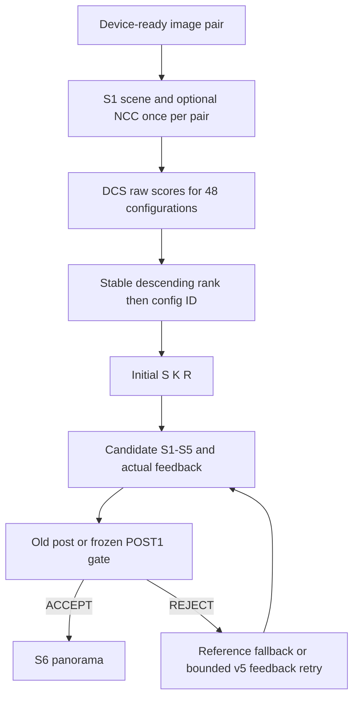

# DCS-R1: implementation và kiểm chứng

Đế giao triển khai ngày 07/11 (Thứ 7), năm 2026, trong Phase 3; deadline phase 07/11 (Thứ 7). Đây là policy nghiên cứu riêng, default v4/v5 không đổi. Spec đầu vào: `controller-direct-config-selection-agent-spec.md`.

## Khảo sát trước khi sửa

Source có v4 pooled, v5 selector/gate/retry native và các workflow A–E/W1–W5. Local chỉ tìm được full P0 ZIP; chưa có ZIP A–E/v5 mới để xác thực các số W5 được trích trong spec. Run all tìm chúng trên Drive. Thiếu frozen v5 thì không thay bằng một model khác rồi gọi là baseline v5 gốc.

Audit ZIP thật xác nhận 200 pair, 195 Reference-valid, 48 cấu hình, 115.200 warmup/repeat rows; ABI pre 39, post 77. Có một query chỉ Reference PASS. Manifest kernel/evaluator hiện tại tương thích nguồn calibration. Mười repeat dùng cùng H/status/seed; không có bằng chứng PASS stability qua nhiều seed. Nhãn dùng median timing, không lấy mẫu nhanh nhất. UNKNOWN Reference nằm trong ledger riêng.

## Luồng thực thi

`src/controller/dcs.hpp` tính raw tree margin hoặc linear score. `select_direct` trả đủ scores/ranks, initial index và reason. `Controller::begin_pair` ở policy DCS bỏ cả pre QoR và latency inference/scoring. Post-gate vẫn bắt buộc; rank score không có semantics probability/confidence. Invalid DCS model/schema/catalog/features/output dẫn tới Reference. Lỗi CUDA/readiness vẫn tuân thủ contract, không che bằng kết quả giả.

Schema `controller-policy-dcs-r1` giữ layout gate/cost/retry v5 và thêm `dcs`. Loader kiểm 48 config IDs, descriptors S/K/R, uniqueness, tree ABI và feature availability. Hash model/schema/catalog lưu trong policy/receipts và file checksums được xác thực trong workflow; loader C++ không phải bộ xác thực chữ ký mật mã. Inference C++ không gọi Python hoặc XGBoost runtime.

F0 dùng đúng 33 PRE0 slots. F1 bổ sung 6 NCC. F2 bổ sung 9 tương tác có cùng công thức Python/C++. Có controls bỏ texture hoặc gradient. Matching/geometry/photometric/spatial không nằm trong initial input; continuation offline dùng feature của một source attempt cố định đã quan sát, cùng pre/config của target chưa chạy. Missing source/spatial báo coverage/NOT_IDENTIFIABLE. Optional F3 pre-S4 probe chưa implement.

## Method và đánh giá

- M0: BASE_PREQLAT archived OOF, BASE_GLOBAL train-only, rank:ndcg, rank:pairwise, direct48 và pairwise ridge. NDCG grade FAIL=0, PASS=1..4; pairwise precedence PASS cao hơn FAIL, PASS nhanh hơn có label cao hơn. Ridge học utility differences trong từng query. Direct48 giữ đủ 48 class kể cả class vắng trong fold.
- Outer 5 folds theo image component; inner 2 folds chọn family/depth/rounds/regularization. Search hẹp `(1,32,40)`, `(2,64,20)`, `(3,96,40)`. Có thêm matched-capacity controls để phân biệt objective với tuning. Không chọn family bằng outer metrics. F0 cố định trước feature ablation; feature family/hp khóa trong outer training pool. Final deployment choice là CV lại trên development, không dùng 50 evaluation.
- BASE_V5_RECONSTRUCTED refit PRE0/POST1/reject/cost models trong từng outer training pool. Nó dùng training-only stage priors, không phải exact frozen v5 cũ. Native V5_COMBINED dùng nguyên weights từ ZIP v5 và được đo lại cùng source.
- PERFECT_SELECTOR_ORACLE và PERFECT_POST_OFFLINE_ONLY chỉ là counterfactual. FAIL giữ trong mẫu số: penalized latency = Tselected + Tref nếu FAIL; regret trừ Toracle. PASS-only ratio xuất riêng. Oracle gap closed và CI bootstrap theo component, có thể âm.
- Learning curve giữ F0, capacity định trước depth 2/64 (test fixture có protocol nhỏ), 3 family, 40/80/120/156 groups tùy kích thước outer pool, 3 sampling seeds. Cùng outer evaluation; requested size được cap trong từng training pool, actual groups/pairs được ghi riêng để không đổi mẫu số evaluation ở điểm cuối. Average seed trong pair trước bootstrap, không coi seed/repeat là sample mới. Không dùng feature/hyperparameter chọn trên pool lớn hơn để đánh giá pool nhỏ.
- Gate replay tách OLD_POST archived OOF, POST1 refit nested và perfect post. Chosen cheap PASS bị Gate reject được báo là bottleneck của Gate; thiếu post không gán kết quả PASS. R-only giữ nguyên toàn S5 trong cost scenario, đổi K giữ S1, đổi S recompute; timing replay không phải E2E đo thật.

Feature set tốt nhất theo decision CV được đem benchmark, chưa được promote bằng CV. Atlas/correlation/permutation chỉ phục vụ giải thích. Giữ feature để phát hành còn cần measured overhead/E2E và đánh giá độc lập; NCC không mặc định có lợi. STAGED dùng retry native v5 và model feedback được refit theo đúng frozen POST1, không đưa continuation information ceiling vào production.

## Kiểm chứng và giới hạn

Unit fixtures ghi TEST_FIXTURE/TEST_ONLY; CUDA không chạy local. Tests kiểm label/group/tie/Reference-only, export XGBoost raw margin, native rank toàn 48, unavailable/schema mismatch fallback, CPU workflow, Parquet, Gate, learning curve, notebook auth/kernel, ZIP và checkpoint tampering. Python/C++ parity đòi `atol=rtol=5e-5` và đúng cả thứ tự 48 candidates. Baseline QoR/Reference tests giữ nguyên.

T4 Run all phải build Release sm_75, CTest và parity trước benchmark. Cùng source, 2 warmup/10 repeat, seed 20261101, balanced batches. Chưa có fresh blind cohort: DEVELOPMENT_ONLY / NOT_QUALIFIED; không tuyên bố generalization hoặc đổi default. Chưa chạy GPU ở local và không dùng MCP Colab.

Module map: `tools/controller/dcs/` gồm protocol/features/labels/models, cv/metrics, analysis/learning/gates, artifacts/native/runner, plots/report. Native ở `src/controller/dcs.hpp`, lifecycle `controller.*`, loader/trace/harness; tests `test_dcs*`, `dcs_probe.cpp`; notebook và runbook được tách riêng.

Nguồn thuật toán: [XGBoost Learning to Rank](https://xgboost.readthedocs.io/en/stable/tutorials/learning_to_rank.html), truy cập 07/11 (Thứ 7), dùng query-group/graded objectives và raw scores. Văn bản được rà theo [Signs of AI writing](https://en.wikipedia.org/wiki/Wikipedia:Signs_of_AI_writing), truy cập cùng ngày.

## Danh sách file tạo/sửa

| File | Thay đổi |
|---|---|
| [docs/controller-direct-selection-implementation.md](../docs/controller-direct-selection-implementation.md) | Tạo |
| [docs/controller-direct-selection-runbook.md](../docs/controller-direct-selection-runbook.md) | Tạo |
| [docs/decisions/p3-controller-direct-selection.md](../docs/decisions/p3-controller-direct-selection.md) | Tạo |
| [harness/attempt_trace.hpp](../harness/attempt_trace.hpp) | Sửa |
| [harness/controller_policy.hpp](../harness/controller_policy.hpp) | Sửa |
| [harness/pipeline_runner.cu](../harness/pipeline_runner.cu) | Sửa |
| [notebooks/controller_direct_config_selection_t4.ipynb](../notebooks/controller_direct_config_selection_t4.ipynb) | Tạo |
| [src/controller/CMakeLists.txt](../src/controller/CMakeLists.txt) | Sửa |
| [src/controller/controller.cpp](../src/controller/controller.cpp) | Sửa |
| [src/controller/controller.hpp](../src/controller/controller.hpp) | Sửa |
| [src/controller/dcs.hpp](../src/controller/dcs.hpp) | Tạo |
| [src/controller/policy.cpp](../src/controller/policy.cpp) | Sửa |
| [src/controller/policy.hpp](../src/controller/policy.hpp) | Sửa |
| [tests/CMakeLists.txt](../tests/CMakeLists.txt) | Sửa |
| [tests/controller/dcs_probe.cpp](../tests/controller/dcs_probe.cpp) | Tạo |
| [tests/controller/test_dcs.cpp](../tests/controller/test_dcs.cpp) | Tạo |
| [tests/python/test_dcs.py](../tests/python/test_dcs.py) | Tạo |
| [tests/python/test_dcs_notebook.py](../tests/python/test_dcs_notebook.py) | Tạo |
| [tools/controller/dcs/__init__.py](../tools/controller/dcs/__init__.py) | Tạo |
| [tools/controller/dcs/analysis.py](../tools/controller/dcs/analysis.py) | Tạo |
| [tools/controller/dcs/artifacts.py](../tools/controller/dcs/artifacts.py) | Tạo |
| [tools/controller/dcs/cv.py](../tools/controller/dcs/cv.py) | Tạo |
| [tools/controller/dcs/features.py](../tools/controller/dcs/features.py) | Tạo |
| [tools/controller/dcs/gates.py](../tools/controller/dcs/gates.py) | Tạo |
| [tools/controller/dcs/labels.py](../tools/controller/dcs/labels.py) | Tạo |
| [tools/controller/dcs/learning.py](../tools/controller/dcs/learning.py) | Tạo |
| [tools/controller/dcs/metrics.py](../tools/controller/dcs/metrics.py) | Tạo |
| [tools/controller/dcs/models.py](../tools/controller/dcs/models.py) | Tạo |
| [tools/controller/dcs/native.py](../tools/controller/dcs/native.py) | Tạo |
| [tools/controller/dcs/plots.py](../tools/controller/dcs/plots.py) | Tạo |
| [tools/controller/dcs/protocol.py](../tools/controller/dcs/protocol.py) | Tạo |
| [tools/controller/dcs/report.py](../tools/controller/dcs/report.py) | Tạo |
| [tools/controller/dcs/requirements.txt](../tools/controller/dcs/requirements.txt) | Tạo |
| [tools/controller/dcs/runner.py](../tools/controller/dcs/runner.py) | Tạo |
| [tools/controller/v5/benchmark.py](../tools/controller/v5/benchmark.py) | Sửa |
| [tools/controller/v5/runner.py](../tools/controller/v5/runner.py) | Sửa |
