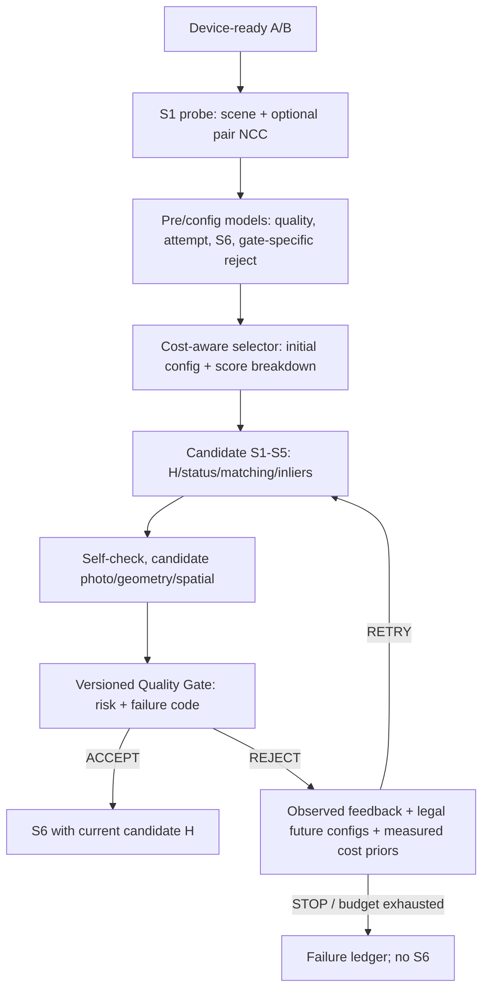

# Implementation Controller v5

Ngày ghi nhận: 07/11 (Thứ 7), năm 2026. Đế phụ trách, thuộc Phase 3 với deadline chung 07/11 (Thứ 7). Đây là implementation nghiên cứu và workflow kiểm chứng; chưa có số đo T4 chứng minh v5 đạt speedup/QoR.

## Trạng thái sau khi triển khai

| Thành phần | Implementation thực tế | Kiểm chứng local | Đo T4 |
|---|---|---|---|
| Cost-aware selector | `src/controller/v5.cpp`, schema `controller-policy-v5`, JSON loader và Controller lifecycle | C++ cost/lifecycle, Python/C++ model và selector parity trên fixture | Chờ notebook |
| Quality Gate | Binary controls và bốn failure heads; model phân tách SSIM/PSNR/coverage/joint violation | Grouped fit, calibration partitions, export và scalar inference | Chờ notebook |
| Spatial features | Shared CPU/CUDA definition, 16 feature; shader chạy trên A/B/H candidate | Identity, no overlap, singular H, pitch guard và host syntax | CUDA parity test trong CTest |
| Feedback retry | Bounded rerank, tăng R cùng S/K, đổi K, đổi S, direct Reference và STOP | Host lifecycle nhiều attempt, guard và reuse contract cũ | S5 continuation/harness integration cần T4 |
| Harness/baselines | Native v4 cùng weights, fixed Reference, 5 biến thể v5; trace/profile và canonical QoR | Host CTest, parser và CPU workflow | 7 biến thể cùng source/cohort |

Ban đầu repo chỉ có v4 pooled và diagnostics A–E. Hai phần này không được tính là implementation v5. Các source S1–S6 và default policy được giữ nguyên; manifest `kernel-compatibility.json` kiểm 41 file kernel/feature/evaluator với calibration source trước khi dùng dữ liệu cũ. Chỉ thêm nhánh v5 tùy chọn cùng việc thu feature/telemetry trong harness. Không có Python/XGBoost runtime trong C++ inference.

## Input → output



Pre ABI có 39 slot: photo v4 dùng 33, PRE1 bổ sung 6 pair-NCC đã có implementation trước candidate attempt. Post ABI v5 có 93 slot: layout all v4 77 slot cộng 16 spatial slot. Tên, availability và group indices xuất trong `feature-schemas.json`; column maps được lưu trong từng model checkpoint. Không đưa match/inlier/H vào pre. Reference H, SSIM/PSNR relative và QoR labels chỉ ở tooling offline.

Spatial dùng 16 tile centers, mỗi patch 7×7; patch không đủ quan sát giữ denominator riêng. Có SSIM quantiles/worst/mean/std, MAE q90, valid fraction và quadrant coverage; projection group có Jacobian determinant min/max/spread và invalid projection fraction (gồm orientation đảo). Residual spatial statistics từ inliers vẫn thuộc matching/geometry hiện có. POST3_PHOTO/POST3_GEOMETRY/POST3 tách feature columns và CUDA group flags; CPU collector dùng cùng công thức C++ từ H đã lưu, không chạy lại RANSAC để tạo feature spatial. CUDA test đối chiếu cùng A/B/H với CPU, gồm dịch ảnh và no-overlap.

## Score, gate và retry

`P(reject)` được train bằng pre/config với target là REJECT của đúng gate version và self-check đã freeze, có hash đi kèm. Target này khác QoR FAIL và không bằng `1-p_pre`. Model mới dùng grouped booster-fit và probability-calibration disjoint. Feedback model có 45 slot: 39 pre/config target và 6 tín hiệu của attempt vừa quan sát, không dùng H/feature của target chưa chạy.

```text
score = common_probe_and_selector
      + predicted_initial_attempt_S1_S5
      + gate_features_and_inference
      + (1-p_reject) * predicted_candidate_S6
      + p_reject * (incremental_fallback_attempt + predicted_reference_S6)
```

Reference-start bỏ gate nhưng trả common overhead. Initial attempt target dùng fixed E2E trừ S6 như proxy, loại S1 khi candidate cùng scale với probe đã cache. Proxy có host overhead và sai số; không được gọi là thời gian attempt đo trực tiếp. S6 regression chỉ fit những lần có S6 thực sự chạy. Matrix fallback không có S6, nên S6 chỉ được cộng ở nhánh tương ứng. Retry ranking không cộng lại common probe đã trả trước đó.

Incremental matrix được shrink từ profile T4 theo transition; không nội suy S5 tuyến tính theo R. Mỗi entry đều có trạng thái estimated từ telemetry, support và prior, không giả rằng đã đo đủ 48×48 transition. Unsupported class không nhận discount tùy tiện. Gate features có profile theo mask/group; inference có CPU microprofile trên cùng host Colab. Sau profile GPU, PRE0/PRE1 được đối chiếu thêm bằng development OOF replay có measured probe/gate overhead; đây vẫn là replay estimate. Model/cost/threshold được khóa trước W5 evaluation, giữ nguyên khi resume.

POST4 học ba violation heads và joint-failure head. Risk dùng `max(joint, min(1, p_ssim+p_psnr+p_cov))`, không giả independence. Union bound trên các xác suất ước lượng không phải chứng nhận calibration hay quality. Binary controls chỉ có joint risk; component telemetry không được diễn giải như head đã huấn luyện. Gate trả ACCEPT chỉ khi status/H/self-check/payload hợp lệ và risk dưới threshold. Reference vẫn có thể fail; không chuyển Reference failure thành PASS.

Sau REJECT, planner chỉ xét các vị trí sau trong catalogue, dùng feedback thật để rerank. R-only phải tăng R và đủ match; đổi K chạy lại S2–S5, đổi S chạy lại S1–S5. Execution errors kết thúc theo contract, không retry mọi lỗi. Harness cũ giữ generation/seed/workspace/stream identity và S5 continuation. Tối đa 4 attempt; slot cuối ưu tiên Reference, nếu không còn transition hợp lệ thì STOP. S6 chỉ chạy khi Controller ACCEPT, geometry/render failure sau đó vẫn được ghi nhận.

## Workstreams và giới hạn

- W1 dùng archived nested-CV models: các fold có depth/rounds riêng (3/64, 2/128, 3/64, 2/64, 2/128). Chúng khác final P0 2/64; provenance giữ nguyên, controls cùng OOF predictions. W2–W4 khóa capacity 2/64 và không gán archived variable-capacity OOF là cùng model. W1 bổ sung perfect pre+post và joint perfect latency, cùng các controls; chỉ là OFFLINE_ORACLE/ESTIMATED_REPLAY.
- W2 chạy PRE0/PRE1 cùng folds/capacity, có fixed-config K500 AUC/AP, ECE/Brier, top-k/cheap-PASS và weighted regret. PRE2 correspondence probe tùy chọn chưa implement và được ghi NOT_IMPLEMENTED.
- W3 chạy POST0–POST4 cùng hai spatial group controls. Chọn feature/gate trên grouped development. Threshold không được chọn bằng 50 evaluation đã xem.
- W4 chạy nested component learning curve, 3 sampling seeds, cùng outer evaluation. Gate/feature selection lặp lại bên trong training pool; reuse model A–E chỉ khi input hash, fit/cal/eval IDs và capacity trùng. Không có expansion manifest độc lập đã duyệt thì NO_NEW_TRAINING_DATA, không tự sinh thêm sample.
- W5 build/test/parity rồi đo native REF/V4/SEL/GATE/COST+GATE/STAGED/V5_COMBINED. Combined hiện bằng STAGED và được đo như identity control. CSV phân biệt model estimates với GPU measurements.

Hiện chỉ xác nhận calibration và 50 pair evaluation cũ, chưa chứng nhận fresh holdout. Notebook vẫn đo development ablation nhưng tổng hợp PARTIAL / NOT_QUALIFIED, giữ default. Tất cả số đo mới, CUDA parity và full learning curve cần Đế Run all trên Colab rồi gửi ZIP; agent không điều khiển Colab.

Hướng dẫn: [runbook](controller-v5-runbook.md). Protocol/budget: [experiment matrix](controller-v5-experiment-matrix.md). Contract reuse: [Controller contract](stages/controller-contract.md).

## Danh sách file bàn giao

| Thay đổi | File | Vai trò |
|---|---|---|
| Tạo | [docs/controller-v5-experiment-matrix.md](../docs/controller-v5-experiment-matrix.md) | Tài liệu implementation, protocol, quyết định và hướng dẫn. |
| Tạo | [docs/controller-v5-implementation.md](../docs/controller-v5-implementation.md) | Tài liệu implementation, protocol, quyết định và hướng dẫn. |
| Tạo | [docs/controller-v5-runbook.md](../docs/controller-v5-runbook.md) | Tài liệu implementation, protocol, quyết định và hướng dẫn. |
| Tạo | [docs/decisions/p3-controller-v5-unified.md](../docs/decisions/p3-controller-v5-unified.md) | Tài liệu implementation, protocol, quyết định và hướng dẫn. |
| Sửa | [harness/CMakeLists.txt](../harness/CMakeLists.txt) | Tích hợp policy, feature flags, retry và telemetry native. |
| Sửa | [harness/attempt_trace.hpp](../harness/attempt_trace.hpp) | Tích hợp policy, feature flags, retry và telemetry native. |
| Sửa | [harness/controller_policy.hpp](../harness/controller_policy.hpp) | Tích hợp policy, feature flags, retry và telemetry native. |
| Sửa | [harness/harness_types.hpp](../harness/harness_types.hpp) | Tích hợp policy, feature flags, retry và telemetry native. |
| Sửa | [harness/main.cpp](../harness/main.cpp) | Tích hợp policy, feature flags, retry và telemetry native. |
| Sửa | [harness/pipeline_runner.cu](../harness/pipeline_runner.cu) | Tích hợp policy, feature flags, retry và telemetry native. |
| Sửa | [harness/pipeline_runner.hpp](../harness/pipeline_runner.hpp) | Tích hợp policy, feature flags, retry và telemetry native. |
| Tạo | [notebooks/controller_v5_unified_t4.ipynb](../notebooks/controller_v5_unified_t4.ipynb) | Notebook duy nhất điều phối Colab Run all. |
| Sửa | [src/controller/CMakeLists.txt](../src/controller/CMakeLists.txt) | Core v5, validation và CPU/CUDA features; giữ nhánh default. |
| Sửa | [src/controller/controller.cpp](../src/controller/controller.cpp) | Core v5, validation và CPU/CUDA features; giữ nhánh default. |
| Sửa | [src/controller/controller.hpp](../src/controller/controller.hpp) | Core v5, validation và CPU/CUDA features; giữ nhánh default. |
| Sửa | [src/controller/policy.cpp](../src/controller/policy.cpp) | Core v5, validation và CPU/CUDA features; giữ nhánh default. |
| Sửa | [src/controller/policy.hpp](../src/controller/policy.hpp) | Core v5, validation và CPU/CUDA features; giữ nhánh default. |
| Tạo | [src/controller/spatial.cu](../src/controller/spatial.cu) | Core v5, validation và CPU/CUDA features; giữ nhánh default. |
| Tạo | [src/controller/spatial.hpp](../src/controller/spatial.hpp) | Core v5, validation và CPU/CUDA features; giữ nhánh default. |
| Tạo | [src/controller/v5.cpp](../src/controller/v5.cpp) | Core v5, validation và CPU/CUDA features; giữ nhánh default. |
| Tạo | [src/controller/v5.hpp](../src/controller/v5.hpp) | Core v5, validation và CPU/CUDA features; giữ nhánh default. |
| Sửa | [tests/CMakeLists.txt](../tests/CMakeLists.txt) | Kiểm contract, parity, leakage, resume, notebook hoặc CUDA. |
| Tạo | [tests/controller/spatial_probe.cpp](../tests/controller/spatial_probe.cpp) | Kiểm contract, parity, leakage, resume, notebook hoặc CUDA. |
| Tạo | [tests/controller/test_spatial.cu](../tests/controller/test_spatial.cu) | Kiểm contract, parity, leakage, resume, notebook hoặc CUDA. |
| Tạo | [tests/controller/test_v5.cpp](../tests/controller/test_v5.cpp) | Kiểm contract, parity, leakage, resume, notebook hoặc CUDA. |
| Tạo | [tests/controller/v5_probe.cpp](../tests/controller/v5_probe.cpp) | Kiểm contract, parity, leakage, resume, notebook hoặc CUDA. |
| Tạo | [tests/python/test_controller_v5.py](../tests/python/test_controller_v5.py) | Kiểm contract, parity, leakage, resume, notebook hoặc CUDA. |
| Sửa | [tests/python/test_score_ablation.py](../tests/python/test_score_ablation.py) | Kiểm contract, parity, leakage, resume, notebook hoặc CUDA. |
| Tạo | [tests/python/test_v5_notebook.py](../tests/python/test_v5_notebook.py) | Kiểm contract, parity, leakage, resume, notebook hoặc CUDA. |
| Sửa | [tools/controller/score_campaign.py](../tools/controller/score_campaign.py) | Cho validator nhận split calibration mà giữ default validation. |
| Tạo | [tools/controller/v5/__init__.py](../tools/controller/v5/__init__.py) | Tooling W1–W5, training/audit/report/checkpoint. |
| Tạo | [tools/controller/v5/benchmark.py](../tools/controller/v5/benchmark.py) | Tooling W1–W5, training/audit/report/checkpoint. |
| Tạo | [tools/controller/v5/build.py](../tools/controller/v5/build.py) | Tooling W1–W5, training/audit/report/checkpoint. |
| Tạo | [tools/controller/v5/costs.py](../tools/controller/v5/costs.py) | Tooling W1–W5, training/audit/report/checkpoint. |
| Tạo | [tools/controller/v5/data.py](../tools/controller/v5/data.py) | Tooling W1–W5, training/audit/report/checkpoint. |
| Tạo | [tools/controller/v5/export.py](../tools/controller/v5/export.py) | Tooling W1–W5, training/audit/report/checkpoint. |
| Tạo | [tools/controller/v5/gates.py](../tools/controller/v5/gates.py) | Tooling W1–W5, training/audit/report/checkpoint. |
| Tạo | [tools/controller/v5/kernel-compatibility.json](../tools/controller/v5/kernel-compatibility.json) | Tooling W1–W5, training/audit/report/checkpoint. |
| Tạo | [tools/controller/v5/learning.py](../tools/controller/v5/learning.py) | Tooling W1–W5, training/audit/report/checkpoint. |
| Tạo | [tools/controller/v5/offline.py](../tools/controller/v5/offline.py) | Tooling W1–W5, training/audit/report/checkpoint. |
| Tạo | [tools/controller/v5/plots.py](../tools/controller/v5/plots.py) | Tooling W1–W5, training/audit/report/checkpoint. |
| Tạo | [tools/controller/v5/protocol.py](../tools/controller/v5/protocol.py) | Tooling W1–W5, training/audit/report/checkpoint. |
| Tạo | [tools/controller/v5/requirements.txt](../tools/controller/v5/requirements.txt) | Tooling W1–W5, training/audit/report/checkpoint. |
| Tạo | [tools/controller/v5/reuse.py](../tools/controller/v5/reuse.py) | Tooling W1–W5, training/audit/report/checkpoint. |
| Tạo | [tools/controller/v5/runner.py](../tools/controller/v5/runner.py) | Tooling W1–W5, training/audit/report/checkpoint. |
| Tạo | [tools/controller/v5/schema.py](../tools/controller/v5/schema.py) | Tooling W1–W5, training/audit/report/checkpoint. |
| Tạo | [tools/controller/v5/training.py](../tools/controller/v5/training.py) | Tooling W1–W5, training/audit/report/checkpoint. |
