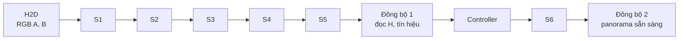

# Quy ước chung

- **Người quyết định:** Tuấn.
- **Ngày ghi nhận:** 18/10 (Chủ nhật), năm 2026.
- **Phase:** Phase 0.
- **Trạng thái:** Interface dùng chung bị khóa sau 19/10 (Thứ 2); chỉ Tuấn sửa. Các điểm còn chờ xác nhận nằm ở mục 11. Phần CUDA chưa được kiểm chứng trên Colab T4.

Quy ước này chỉ gồm những gì mọi thành viên cùng dùng. Phương pháp bên trong mỗi stage do người phụ trách quyết định (xem [kế hoạch](plan.md), mục 4). Mẫu ghi quyết định kỹ thuật: [decisions/TEMPLATE.md](decisions/TEMPLATE.md). Quyết định S1: [stages/s1-preprocessing.md](stages/s1-preprocessing.md).

## 1. Cấu trúc repo

| Đường dẫn | Nội dung | Người phụ trách |
|---|---|---|
| `src/common/` | Header interface dùng chung (struct, mã lỗi, helper hình học) | Tuấn |
| `src/s1/` | S1 Preprocessing | Tuấn |
| `src/s2_s3/` | S2 Keypoint detection, S3 Description | Thành |
| `src/s4/` | S4 Matching | Đế |
| `src/s5/` | S5 Homography | Đế |
| `src/s6/` | S6 Warping and blending | Chương |
| `src/controller/` | Controller | Đế |
| `harness/` | Chương trình chạy S1–S6, đo thời gian, ghi CSV | Tuấn |
| `tools/` | Script Python: mock data (`tools/mock/`), evaluator, phân tích | Theo task |
| `tests/` | Test (CTest cho C++/CUDA, pytest cho Python trong `tests/python/`) | Mọi người, theo stage của mình |
| `docs/` | Tài liệu dự án (mục lục tại `docs/README.md`): `decisions/`, `stages/`, `reports/`, `research/` | Tuấn điều phối, mọi người |
| `paper/` | Bản LaTeX của paper | Chương dựng khung |
| `data/`, `results/`, `build/` | Dữ liệu, kết quả, build. Không commit; chia sẻ qua Google Drive | |

Mỗi người chỉ sửa code trong thư mục của mình. Sửa `src/common/` phải qua Tuấn.

## 2. Môi trường

| Hạng mục | Quy ước |
|---|---|
| Nền tảng chính thức | Google Colab, GPU Tesla T4 (`sm_75`) |
| Ngôn ngữ | C++17, CUDA 17 |
| Build | CMake (xem mục 3). Lệnh: `cmake -S . -B build && cmake --build build -j`. Thiếu `cmake` thì `pip install cmake` |
| Test | `ctest --test-dir build --output-on-failure`; Python: `python -m pytest tests/python` |
| OpenCV C++ | Chỉ harness và bản giả link OpenCV (`find_package(OpenCV)`); library của stage không phụ thuộc OpenCV |
| Python | `pip install -r tools/requirements.txt` (pin `opencv-python==5.0.0.93`, khớp bản có sẵn trên Colab ngày 18/10 (Chủ nhật)) |

## 3. CMake

- `project(... LANGUAGES CXX)`; CUDA được bật khi `check_language(CUDA)` tìm thấy toolkit (luôn đúng trên Colab T4), với `CMAKE_CUDA_ARCHITECTURES 75`. Không có CUDA thì chỉ build các target chạy trên host, để kiểm tra header ở máy không có GPU.
- `src/common/` là `INTERFACE` library `stitch_common`; mỗi stage là một library riêng, test và harness link vào.
- Include header theo dạng `#include "common/types.hpp"`.

## 4. Interface giữa các stage

Header: [src/common/](../src/common/). Mỗi struct là POD, namespace `stitch`.

| Struct | Nội dung | Vị trí |
|---|---|---|
| `ImageView` | `data`, `width`, `height`, `pitch_bytes`, `format` (`RGB8`, `GRAY8`) | Device |
| `ScaleInfo` | Output S1 của một ảnh: kích thước gốc và sau thu nhỏ, `sx`, `sy`, `D[9]` | Host |
| `Keypoints` | SoA `x`, `y`, `response`, `capacity`, `d_count`; tọa độ theo hệ ảnh S1 | Device |
| `Descriptors` | `type` (`BINARY_U8`, `FLOAT32`), `dim`, `row_stride_bytes`, `data` | Device |
| `Matches` | SoA `idx_a`, `idx_b` (`int32`), `distance` (`float`), `capacity`, `d_count` | Device |
| `HomographyResult` | `H`, `H_s`, `num_matches`, `num_inliers`, `inlier_ratio`, `inlier_coverage`, `reproj_residual`, `status` | Host |
| Inlier mask | `uint8_t` cho mỗi match | Device |
| `StageTimings` | Thời gian từng stage (ms) | Host |

Quy tắc chung:

- Ảnh vào pipeline là RGB interleaved `uint8`. Harness đổi BGR sang RGB một lần khi nạp ảnh, ngoài vùng đo thời gian.
- Số phần tử biến thiên (keypoint, match) nằm trên device. Stage sau launch grid theo `capacity`; thread có chỉ số vượt `*d_count` thoát sớm. Không đồng bộ giữa S1 và S5.
- Caller cấp phát mọi output. Workspace tạm theo kiểu CUB: mỗi stage có hàm `size_t sX_workspace_bytes(...)`, caller cấp phát và truyền con trỏ vào. Stage không tự cấp phát.
- Mọi stage nhận `cudaStream_t` và chạy bất đồng bộ. Bản 1 dùng một stream cho cả pipeline.
- Stage trả `Status` sau khi kiểm tra `cudaGetLastError()` (lỗi launch). Lỗi lúc kernel chạy được bắt tại các điểm đồng bộ. Stage nào cần đồng bộ bên trong phải ghi rõ trong header.
- `Status`: `OK`, `INVALID_ARGUMENT`, `INSUFFICIENT_WORKSPACE`, `CUDA_ERROR`, `NOT_ENOUGH_POINTS`, `DEGENERATE`. Thêm mã mới phải qua Tuấn.
- Cùng input, cấu hình và seed thì phải cho cùng H và cùng tín hiệu tự kiểm tra. Mọi yếu tố ngẫu nhiên dùng seed cố định.
- Descriptor: interface tổng quát theo tag kiểu; S4 chọn metric theo tag (Hamming cho `BINARY_U8`, L2 cho `FLOAT32`).

Điểm đồng bộ:

## 5. Quy ước hình học

- Tâm pixel ở tọa độ nguyên.
- H là 3×3, row-major, `double`, vector cột, chiều B → A, trong hệ RGB gốc. Interface không bắt buộc `h33 = 1`; hàm so sánh H trong test tự chuẩn hóa (`homography_max_diff`).
- S1 xuất `D` cho từng ảnh: `x_s = s_x (x + 0.5) − 0.5`, `D = [[s_x, 0, 0.5(s_x − 1)], [0, s_y, 0.5(s_y − 1)], [0, 0, 1]]`.
- S5 tìm `H_s` trong hệ S1, đổi về hệ gốc bằng `to_original(H_s, D_A, D_B)` (`H = D_A⁻¹ · H_s · D_B`, helper trong [src/common/geometry.hpp](../src/common/geometry.hpp)) và trả cả hai ma trận. S6 chỉ dùng `H`.
- Homography đúng của HPatches `H_1_i` biến ảnh 1 sang ảnh `i`, nên theo quy ước của Nhóm là `H_BA = inv(H_1_i)` với A là ảnh 1.

## 6. File kết quả

Hai file CSV nối với nhau bằng (`pair_id`, `config_id`), cộng `meta.json` cho mỗi lượt chạy.

`runs.csv` do harness ghi:

| Nhóm cột | Cột |
|---|---|
| Định danh | `run_id`, `git_rev`, `dataset`, `split`, `pair_id`, `config_id`, `repeat_idx`, `is_warmup`, `seed` |
| Cấu hình | `S`, `K`, `R`, `blend_mode` |
| Thời gian (ms) | `t_h2d`, `t_s1`, `t_s2`, `t_s3`, `t_s4`, `t_s5`, `t_s6`, `t_controller`, `t_d2h`, `t_e2e` |
| Tín hiệu S2–S5 | `num_kp_a`, `num_kp_b`, `num_matches`, `num_inliers`, `inlier_ratio`, `inlier_coverage`, `reproj_residual` |
| Homography | `h0` … `h8` (H trong hệ gốc, row-major) |
| Telemetry S6 | `canvas_pixels`, `overlap_pixels`, `blend_mode_effective`, `num_levels`, `peak_workspace_bytes`, `cache_hit` |
| Trạng thái | `status`, `fail_stage` |

`qor.csv` do evaluator offline ghi: `pair_id`, `config_id`, `ref_config_id`, `valid_stitch`, `ssim_overlap`, `psnr_overlap`, `overlap_coverage`, `reference_status`. Mỗi (`pair_id`, `config_id`) một dòng nhờ tính tất định. `Pass_i(c)` tính trong script phân tích, không lưu.

`meta.json`: tên GPU, xung nhịp từ `nvidia-smi`, version driver, CUDA, OpenCV, `git_rev`, cờ build, ngày giờ, danh sách cấu hình, số lần warm-up và lặp.

Quy ước:

- `config_id` là chuỗi đọc được, ví dụ `S0.50_K1000_R256_Bfeather`.
- `t_s1`, `t_s2`, `t_s3` tính chung cho hai ảnh: CUDA event ghi trước khi stage chạy cho ảnh A và sau khi chạy xong ảnh B. Không tách theo ảnh vì khi batch hai ảnh trong một kernel hoặc chạy song song thì không tách được.
- `h0` … `h8` ghi ở mọi lần lặp và phải giống nhau giữa các lần lặp (kiểm tra tính tất định).

## 7. Đo thời gian

- Thời gian từng stage đo bằng CUDA event trên stream của pipeline.
- `t_e2e` đo bằng `std::chrono::steady_clock` trên host: bắt đầu khi RGB A và B đã nằm trên device, kết thúc sau `cudaStreamSynchronize` khi panorama đã sẵn sàng trên device. Gồm controller, các lần đồng bộ và overhead host. Không gồm decode ảnh, `t_h2d`, `t_d2h`. Fixed, Oracle và Adaptive dùng cùng ranh giới này.
- 2 lần warm-up (ghi vào CSV với `is_warmup = 1`), 10 lần đo. Với mỗi (`pair_id`, `config_id`) lấy median của 10 lần đo. Median và p95 báo cáo trên phân phối theo các cặp ảnh, không tính trên 10 lần lặp.
- Khi B cố định, QoR chỉ phụ thuộc H: evaluator tự warp lại từ `h0` … `h8` bằng `cv2.warpPerspective` (bilinear), không dùng output của S6.

## 8. Overlap mask và coverage (đề xuất, chờ Đế và Chương)

Tính trong hệ tọa độ của ảnh A, nên không phụ thuộc canvas của cấu hình:

- Miền đánh giá cố định của cặp `i`: `Ω_i = { p trong A : H_ref⁻¹ · p hợp lệ và nằm trong B }`, `H_ref` lấy từ cấu hình Fixed-High.
- Với cấu hình `c`: `valid_c = { p trong A : H_c⁻¹ · p hợp lệ và nằm trong B }`.
- SSIM và PSNR tính giữa A và B đã warp bằng `H_c`, trên `Ω_i ∩ valid_c`.
- `overlap_coverage = |Ω_i ∩ valid_c| / |Ω_i|`; `CoverageOK` khi `overlap_coverage ≥ 0.95` (giá trị để pilot).
- Fixed-High không tạo được H hợp lệ: `reference_status = reference_failure`, báo cáo riêng theo [quyết định của Đế](decisions/benchmark-qor-s4-s5.md).
- `QualityPolicy` (`ΔSSIM_max`, `ΔPSNR_max`, ngưỡng coverage) không thuộc header của pipeline GPU vì chỉ evaluator offline dùng. Lưu dạng JSON có version, đọc bằng Python.

Cách này chỉ đúng khi B cố định trong thí nghiệm S, K, R chính.

## 9. Chia development và final

| Tập | Nội dung |
|---|---|
| Final | Toàn bộ 1.106 cặp tập test UDIS-D; không dùng để chọn tham số |
| Development | 200–300 cặp lấy ngẫu nhiên từ tập train UDIS-D với seed cố định; danh sách `pair_id` được commit |
| Go/No-Go | 20–30 cặp là tập con của development |

Fallback nếu tập train quá nặng để tải: lấy development từ tập test theo hash, cặp có `sha256(pair_id) mod 5 = 0` vào development, phần còn lại là final.

## 10. Git

- Tên nhánh `<ten>/p<phase>-<chu-de>`, ví dụ `tuan/p0-conventions`.
- Commit message tiếng Anh theo Conventional Commits.
- Pull request vào `main`; Tuấn review và merge. Pull request của một stage chỉ được merge khi output khớp bản giả OpenCV trên mock data, trong sai số do người phụ trách stage ghi rõ trong pull request.
- Không commit dataset, output, file build, file hướng dẫn agent cá nhân.

## 11. Quy ước làm việc với AI agent

1. **Bắt buộc đọc và sao chép template trước khi cho agent làm việc:**
   - Trước khi để AI agent (Cursor, Claude Code, Antigravity, Copilot...) đọc codebase, lên kế hoạch hoặc thực thi bất kỳ task nào, thành viên **bắt buộc phải sao chép** [AGENTS_TEMPLATE.md](../AGENTS_TEMPLATE.md) thành file cấu hình tương ứng ở thư mục gốc repo:
     - `AGENTS.md` (cho Antigravity, Codex, và các agent đọc `AGENTS.md`);
     - `CLAUDE.md` (cho Claude Code);
     - `.cursorrules` hoặc file tương đương tùy công cụ.
   - Tuyệt đối không để agent đọc codebase, lên kế hoạch hay thực thi khi chưa nạp bộ quy tắc tối thiểu từ template này.
2. **Đồng bộ khi kéo code mới (`git pull`):**
   - Mỗi lần kéo code mới về từ nhánh `main`, thành viên phải kiểm tra xem [AGENTS_TEMPLATE.md](../AGENTS_TEMPLATE.md) có thay đổi không (ví dụ bằng lệnh `git log -p -1 -- AGENTS_TEMPLATE.md`). Nếu có, phải cập nhật file agent cá nhân tương ứng trước khi giao việc tiếp.
3. **Tuyệt đối không commit file cấu hình agent cá nhân:**
   - Các file `AGENTS.md`, `CLAUDE.md`, `.cursorrules` đã nằm trong `.gitignore` để tránh xung đột môi trường cá nhân và không làm bẩn repo chung.

## 12. Điểm còn mở

| Điểm | Người xác nhận |
|---|---|
| Kiểu descriptor, số byte hoặc số chiều; kiểu ảnh S2 cần từ S1; `σ` của blur | Thành (Đã chốt: `BINARY_U8` 32 byte, `GRAY8`, `σ = 0` tại S1 vì S3 tự blur $7\times 7, \sigma = 2$) |
| S5 gọi `to_original` và trả cả `H_s` lẫn H | Đế |
| Định nghĩa `Ω_i`, coverage, ngưỡng 0.95; development lấy từ tập train UDIS-D | Đế, Chương |
| Workspace query; S6 chỉ nhận H trong hệ gốc | Chương |
| Giữ B cố định trong thí nghiệm S, K, R chính | Chương và cả Nhóm |
| Ngưỡng chính thức cho hai điều kiện Go/No-Go | Cả Nhóm |
| Build CUDA và `test_common_cuda` trên Colab T4 | Chưa chạy; cần runtime GPU |
