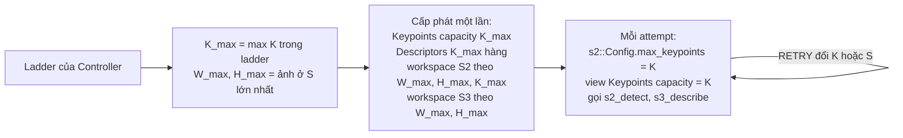

# Quyết định: S2 và S3 nhận K động trên bộ nhớ cấp phát một lần

- **Task:** Phase 2, task 1 của Thành trong [kế hoạch](../plan.md), mục 8: S2 và S3 nhận tham số K động từ Controller mà không giảm hiệu năng hoặc rò rỉ bộ nhớ.
- **Người quyết định:** Thành.
- **Ngày ghi nhận:** 28/10 (Thứ 4), năm 2026.
- **Phase:** Phase 2.
- **Trạng thái:** Đã chọn ngày 28/10 (Thứ 4), sau khi kiểm chứng trên Colab T4. Fallback ở mục 4 là bắt buộc: khi cấp theo K_max, harness phải truyền view `capacity = K`. Bằng chứng ở mục 5 và trong [bằng chứng T4](../s2-s3-t4-validation.md), mục 6.

## 1. Bối cảnh

Theo [contract Controller](../controller-contract.md), mỗi pair có thể chạy nhiều attempt. Mỗi attempt mang một bộ S/K/R do Controller chọn từ ladder. Harness chuyển K vào `s2::Config::max_keypoints` và sở hữu mọi buffer, workspace (contract, mục 2). Khi K đổi, harness chạy lại S2 tới S5 và không được coi output của K mới là prefix của output cũ (contract, mục 6.3).

Tiêu chí nghiệm thu trong kế hoạch:

- đổi K qua nhiều lần chạy không làm crash kernel và không cấp phát lại bộ nhớ khi không cần;
- độ chính xác bằng Phase 1.

Ràng buộc có sẵn từ Phase 1 ([decision ORB](s2-s3-orb.md), [quy ước chung](../conventions.md)):

- stage không cấp phát và không đồng bộ;
- kích thước workspace tính được trên host bằng `s2_workspace_bytes(W, H, config)` và `s3_workspace_bytes(W, H)`;
- số keypoint thật nằm trên device (`d_count`), host không đọc giữa các stage.

Hiện trạng code, đọc ngày 28/10 (Thứ 4):

- `s2_detect` chỉ kiểm tra `output.capacity >= K` và `workspace_bytes >= layout.total` của lần gọi đó ([s2.cu](../../src/s2_s3/s2.cu)). Workspace lớn hơn mức cần được chấp nhận.
- Mỗi lần gọi `s2_detect` đặt lại histogram và ghi lại toàn bộ score map, maxima, tham số chọn, bộ đếm theo block. Slot key nằm ngoài số điểm đã chọn được gán 0. Không có dữ liệu nào từ lần gọi trước được đọc lại.
- Các kernel theo keypoint của S2 (Harris, rank) sinh grid theo `2K` của lần gọi đó.
- `s3_describe` sinh grid theo `keypoints.capacity` và mỗi warp thoát sớm khi chỉ số vượt `*d_count` ([s3.cu](../../src/s2_s3/s3.cu)). Nếu `capacity = K_max` mà K nhỏ, sẽ có thêm block chỉ đọc `d_count` rồi thoát.
- S2 và S3 không gọi `cudaMalloc` hay `cudaFree`.
- Harness hiện cấp phát keypoint, descriptor và workspace một lần theo `max_k` ([pipeline_runner.cu](../../harness/pipeline_runner.cu)).

## 2. Phương án chọn

Caller cấp phát một lần trước run theo kích thước lớn nhất có thể gặp, rồi truyền K của từng attempt qua `Config`. S2 và S3 giữ nguyên API.

Cách dùng:

- `K_max` là K lớn nhất trong ladder. `W_max`, `H_max` là kích thước ảnh S1 ở S lớn nhất trong ladder.
- Workspace S2 lấy từ `s2_workspace_bytes(W_max, H_max, {.., K_max, ..})`, workspace S3 lấy từ `s3_workspace_bytes(W_max, H_max)`.
- Mỗi attempt chỉ đổi `max_keypoints`, kích thước ảnh và trường `capacity` của view `Keypoints` (đặt bằng K, xem mục 4). Buffer, workspace và stream giữ nguyên.
- K lớn hơn `capacity` trả `INVALID_ARGUMENT`. Ảnh lớn hơn kích thước đã dùng để tính workspace trả `INSUFFICIENT_WORKSPACE`. Cả hai đều là lỗi cấu hình của caller, không phải tín hiệu chất lượng.

Phương án này đúng khi số byte workspace không giảm theo K và theo kích thước ảnh. Trong `make_s2_layout`, các vùng score, maxima, bộ đếm block tăng theo số pixel, vùng key tăng theo `2K` và nằm cuối layout. Vì vậy số byte cần cho mọi (S, K) trong ladder không vượt số byte của (W_max, H_max, K_max). Test host ở mục 5 kiểm tra tính chất này.

Hệ quả cần biết: S2 chọn trước 2K điểm theo FAST score rồi mới chọn K điểm theo Harris. Tập 2K đổi theo K, nên K điểm của lần chạy K nhỏ không nhất thiết là K điểm đầu của lần chạy K lớn. Điều này khớp với contract mục 6.3: đổi K thì chạy lại S2 tới S5.

## 3. Trade-off và phương án phụ

| Phương án | Ưu điểm | Nhược điểm | Vì sao không chọn |
|---|---|---|---|
| Cấp phát một lần theo K_max, truyền view `capacity = K` (chọn) | Không cấp phát trong vùng đo; không đổi API; code S2/S3 đã hỗ trợ | Bộ nhớ giữ theo K_max cả khi K nhỏ; harness phải nhớ đặt `capacity = K`, nếu quên thì S3 launch thêm block thừa | |
| Cấp phát lại khi K đổi | Bộ nhớ vừa đúng K | `cudaMalloc`, `cudaFree` nằm giữa các attempt, gây đồng bộ ngầm và cộng latency vào vùng đo; trái quy ước stage không cấp phát | Làm hỏng chính tiêu chí nghiệm thu |
| Một bộ workspace riêng cho mỗi K trong ladder | Không cần tính kích thước lớn nhất | Tổng bộ nhớ bằng tổng các bộ, trong khi mỗi lúc chỉ dùng một bộ | Tốn bộ nhớ mà không nhanh hơn |
| `cudaMallocAsync` với memory pool | Bộ nhớ theo đúng K | Vẫn có chi phí cấp phát trên stream; đưa cấp phát vào trong stage | Trái quy ước, khó đo |
| CUDA Graph riêng cho mỗi K | Giảm chi phí launch | Phải dựng và giữ graph cho từng K và từng kích thước ảnh; S2 chỉ có 8 kernel và 1 memset | Phức tạp hơn lợi ích; chưa có số đo cho thấy launch là nút thắt |

## 4. Fallback, nay là bắt buộc

Fallback này được chuẩn bị cho trường hợp S3 chậm hơn ngưỡng ở mục 5 khi `capacity = K_max`. Số đo trên T4 cho thấy đúng trường hợp đó xảy ra ở K = 1000, nên Thành chốt dùng fallback ngày 28/10 (Thứ 4).

Harness truyền cho S2 và S3 một view `Keypoints` có `capacity = K` của attempt đó. View này trỏ vào cùng buffer đã cấp theo K_max, chỉ đổi trường `capacity`. Cách này:

- không cấp phát thêm, không đổi code hay API của S2/S3;
- vẫn đúng contract của S2 (`capacity >= K`);
- làm grid của S3 co theo K;
- cần Tuấn sửa chỗ tạo `Keypoints` trong harness. S4 khi đó cũng nhận `capacity = K`.

Phương án phụ thêm tham số K vào `s3_describe` đã được cân nhắc nhưng không chọn: nó đổi interface S3 và buộc sửa mọi call site, trong khi view `capacity = K` đạt cùng kết quả.

## 5. Kiểm chứng

Ngưỡng hiệu năng do Thành chốt ngày 28/10 (Thứ 4): với từng ô S×K, median `t_s2` và `t_s3` khi cấp theo K_max được chậm hơn khi cấp vừa đúng K tối đa max(5%, 0.005 ms).

Kết quả chạy ngày 28/10 (Thứ 4), code ở commit `16fbfe7`. Chi tiết, lệnh và bảng số nằm trong [bằng chứng T4](../s2-s3-t4-validation.md), mục 6.

| Kiểm tra | Nơi chạy | Điều kiện đạt | Kết quả |
|---|---|---|---|
| Số byte workspace S2 không giảm theo K, W, H; workspace S3 không giảm theo W, H; mọi (S, K) của dải thử không vượt (W_max, H_max, K_max) | Host, `tests/test_s2_s3_config.cpp` | Pass | Pass |
| Chuỗi 9 attempt đổi cả K và kích thước ảnh trên một bộ buffer cấp theo K_max, với cả `capacity = K_max` và `capacity = K`, so với lần chạy cấp vừa đúng | T4, `tests/test_s2_s3_cuda.cu` | Count, keypoint, response, descriptor, ảnh blur giống từng bit | Pass |
| `cudaMemGetInfo` trước và sau 1000 lần gọi S2 và S3 với K luân phiên | T4 | Bộ nhớ free bằng nhau | Pass |
| compute-sanitizer memcheck (có leak check), racecheck, initcheck, synccheck | T4 | 0 lỗi | 0 lỗi, 0 hazard, leak 0 byte |
| Thời gian S2 khi cấp theo K_max, S ∈ {1, 0.75, 0.5, 0.25}, K ∈ {500, 1000, 2000, 4000}, ảnh `graf` và `wall` | T4 | Đạt ngưỡng trên | Đạt ở cả 32 ô, cả hai lượt đo |
| Thời gian S3 khi cấp theo K_max, `capacity = K_max` | T4 | Đạt ngưỡng trên | **Không đạt** ở 6 ô (lượt 1) và 7 ô (lượt 2), đều ở K = 1000, chậm thêm 0.0060–0.0093 ms |
| Thời gian S3 khi cấp theo K_max, view `capacity = K` | T4 | Đạt ngưỡng trên | Đạt ở cả 32 ô, cả hai lượt đo |
| 41 golden case và 16 cặp Oxford của Phase 1 | T4 | Kết quả giống [bằng chứng Phase 1](../s2-s3-t4-validation.md) | 41/41 khớp từng bit; 16 cặp cho cùng số liệu, 13/16 PASS |

Nguyên nhân chỉ K = 1000 vượt ngưỡng mà K = 500 thì không chưa được giải thích. Với `capacity = K_max`, S3 launch `K_max / 4` block bất kể K, nên block thừa là nguyên nhân hợp lý nhất. Nhưng chưa có profile để xác nhận, và giả thuyết này không giải thích được vì sao K = 500 (nhiều block thừa hơn) vẫn đạt. Fallback loại bỏ block thừa và đạt ở mọi ô, nên việc profile không chặn quyết định.

## 6. Nguồn

Không dùng nguồn ngoài.
