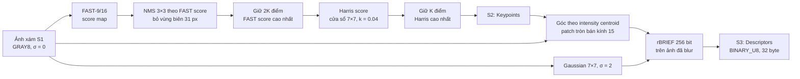

# Quyết định: S2 và S3 dùng ORB một level

- **Task:** Phase 1, task 1–3 của Thành trong [kế hoạch](../plan.md), mục 8: kernel CUDA cho S2 có núm K, kernel CUDA cho S3, test so với OpenCV.
- **Người quyết định:** Thành.
- **Ngày ghi nhận:** 25/10 (Chủ nhật), năm 2026.
- **Phase:** Phase 1.
- **Trạng thái:** Đã chọn phương pháp. Bản tham chiếu NumPy đã được so với `cv2.ORB` của `opencv-python` 5.0.0.93 trên ảnh tổng hợp (mục 5). Kernel CUDA khớp bản tham chiếu từng bit trên Colab T4 ngày 25/10 (Chủ nhật). Trên 16 cặp Oxford, 13 cặp đạt và 3 cặp có thay đổi scale lớn không đạt; xem [bằng chứng T4](../s2-s3-t4-validation.md). Chưa chạy trên UDIS-D.

## 1. Bối cảnh

S2 nhận ảnh xám từ S1 và giữ tối đa K keypoint. S3 tính descriptor cho các keypoint đó. Interface đã khóa trong [quy ước chung](../conventions.md): `Keypoints` là SoA trên device, gồm `x`, `y`, `response` và `d_count`. `Descriptors` có tag `BINARY_U8` hoặc `FLOAT32`, S4 chọn Hamming hoặc L2 theo tag. Struct chung không có trường góc, scale hay octave.

Ràng buộc từ phía Nhóm:

- K là núm điều khiển. Chi phí của S2, S3 và S4 phải giảm khi K giảm.
- Kết quả phải tất định: cùng input và cấu hình thì cho cùng keypoint và descriptor.
- Stage không cấp phát và không đồng bộ. Số keypoint nằm trên device.
- Pull request chỉ được merge khi output khớp bản giả OpenCV trong sai số do người phụ trách ghi rõ.
- Mốc nộp bài là 13/11 (Thứ 6), nên kernel phải viết và kiểm chứng xong trong vài ngày.

Quyết định này trả lời các điểm đang chờ Thành ở [quy ước chung, mục 11](../conventions.md) và [S1, mục 6](../s1-preprocessing.md).

## 2. Phương án chọn

ORB một level, bám thuật toán của `cv::ORB` (OpenCV 5.0.0) với `nlevels=1`, `scoreType=HARRIS_SCORE`, `patchSize=31`, `edgeThreshold=31`, `WTA_K=2`.

| Nội dung | Quyết định |
|---|---|
| Ảnh vào S2 | `GRAY8` từ S1, **σ = 0** (S1 không blur). FAST và Harris chạy trên ảnh chưa blur, giống OpenCV ORB |
| Detector | FAST-9 trên vòng 16 điểm, ngưỡng `fast_threshold`. Score bằng `cornerScore<16>` của OpenCV. NMS chỉ giữ cực đại nghiêm ngặt trong lân cận 3×3 |
| Vùng biên | Chỉ giữ keypoint có `31 ≤ x < W − 31` và `31 ≤ y < H − 31`, như `runByImageBorder`. Nhờ vậy S3 luôn đủ patch, và hàng `i` của descriptor ứng đúng với keypoint `i` |
| Chọn K (núm K) | Giữ 2K điểm có FAST score cao nhất, tính Harris cho các điểm này, rồi giữ K điểm có Harris cao nhất. Hai lần chọn này giống ORB của OpenCV |
| Thứ tự và tie-break | Điểm bằng score thì ưu tiên chỉ số pixel `y·W + x` nhỏ hơn. Output sắp theo Harris giảm dần |
| `response` | Harris score dạng float32, cùng công thức và thứ tự phép tính với `HarrisResponses` của OpenCV |
| Orientation | Moment `m01`, `m10` trên patch tròn bán kính 15 của ảnh chưa blur. Góc tính bằng `fastAtan2` của OpenCV. Góc chỉ dùng bên trong S3, không đưa ra interface |
| Blur cho S3 | Gaussian 7×7, σ = 2, `BORDER_REFLECT_101`, lọc tách hai pass bằng float32 (mục 3) |
| Descriptor | rBRIEF 256 bit, `WTA_K=2`, pattern `bit_pattern_31_` lấy nguyên từ OpenCV. Kiểu `BINARY_U8`, `dim = 32`. S4 dùng Hamming |
| Config | `fast_threshold` (1–254), `max_keypoints` = K, `harris_k`. Không có giá trị mặc định ngầm. Giá trị dùng khi pilot: `fast_threshold = 20` và `harris_k = 0.04` như OpenCV, K ∈ {500, 1000, 2000, 4000} |
| Kích thước ảnh | Ảnh có cạnh ≤ 62 px thì trả 0 keypoint. Đây là kết quả hợp lệ, không phải lỗi |
| Thư viện | Không dùng CUB hay Thrust. Scan, compact và chọn top-K tự viết theo cách S4 đã làm, nên kích thước workspace tính được trên host |

Lý do chọn:

- ORB nhẹ và song song hóa tốt. FAST và NMS chạy theo pixel, Harris và descriptor chạy theo keypoint. Chi phí của Harris, S3 và S4 tỉ lệ trực tiếp với K, nên K là núm có tác động thật.
- Descriptor nhị phân 32 byte giúp S4 so bằng Hamming với `popc`, rẻ hơn L2 trên 128 float của SIFT.
- Bám đúng OpenCV ở cấu hình một level giúp kiểm chứng: so từng keypoint và từng bit descriptor với `cv2.ORB`, không chỉ so ở mức H cuối.
- σ = 0 ở S1: OpenCV ORB tìm keypoint trên ảnh chưa blur và chỉ blur trước bước BRIEF. Nếu S1 blur σ = 1 như giá trị tạm thời thì FAST mất bớt góc và lệch khỏi OpenCV.

## 3. Hai chi tiết số học cần lưu ý

**Blur trong ORB không dùng nhánh bit-exact.** `cv2.GaussianBlur` gọi riêng trên ảnh `uint8` dùng nhánh fixed-point 8 bit, với các hệ số [18, 34, 48, 56, 48, 34, 18]/256. Bên trong `cv::ORB`, ảnh là ma trận con của pyramid có viền, nên `GaussianBlur` bỏ qua nhánh này (điều kiện `!_src.isSubmatrix()` trong `smooth.dispatch.cpp`) và chạy bộ lọc tách float32 với hệ số của `getGaussianKernel(7, 2, CV_32F)`. Kiểm tra thực tế cho thấy:

- dùng nhánh fixed-point thì 198 trên 128.000 bit descriptor lệch so với `cv2.ORB` (500 keypoint, góc 0);
- dùng bộ lọc float32 thì 0 bit lệch.

S3 vì thế dùng float32. Thứ tự cộng được cố định: pass ngang trước, pass dọc sau, cộng hệ số 0 đến 6 từ trái sang phải, không dùng fused multiply-add. Thứ tự SIMD của OpenCV có thể khác, nên vài pixel hiếm có thể lệch 1 mức xám so với `cv2.sepFilter2D`: 0 hoặc 1 pixel trên mỗi ảnh 640×480 trong bốn ảnh thử.

**Phép tính float trên GPU.** Để CUDA khớp từng bit với bản tham chiếu:

- Harris, `fastAtan2`, phép xoay pattern và blur dùng `__fmul_rn` và `__fadd_rn`, để nvcc không gộp thành FMA;
- `cos` và `sin` của góc tính bằng double rồi đổi về float;
- làm tròn tọa độ mẫu theo kiểu round-half-even, như `cvRound`.

## 4. Trade-off và phương án phụ

| Phương án | Ưu điểm | Nhược điểm | Vì sao không chọn |
|---|---|---|---|
| ORB nhiều level (8 level, scale 1.2 như mặc định OpenCV) | Chịu được chênh lệch scale giữa hai ảnh | Thêm pyramid và chia K theo level; S1 đã có núm S điều khiển độ phân giải | Cặp ảnh ghép panorama thường có scale gần nhau. Để làm ablation nếu dữ liệu development cho thấy cần |
| SIFT (DoG + 128 float) | Descriptor ổn định hơn với scale, độ sáng | Kernel phức tạp hơn nhiều; S4 phải tính L2 trên 128 chiều; khó kịp lịch | Chi phí cài đặt và latency cao |
| Chọn K trực tiếp theo Harris, không qua bước 2K theo FAST | Ít bước hơn | Phải tính Harris cho mọi điểm sau NMS; lệch khỏi OpenCV | Mất khả năng so trực tiếp với `cv2.ORB` |
| Chia lưới để keypoint phân bố đều | H ổn định hơn khi keypoint dồn một góc | Thêm tham số; lệch khỏi OpenCV | Để làm ablation ở Phase 2 nếu thấy inlier coverage thấp |
| Dùng CUB cho sort và scan | Ít code tự viết | CUB cần số phần tử trên host, trong khi số keypoint nằm trên device; workspace chỉ tính được khi có CUDA | Không hợp với quy ước workspace và test host |

Khác biệt có chủ ý so với OpenCV: `KeyPointsFilter::retainBest` giữ một tập con không xác định tại score biên, và có thể giữ nhiều hơn K điểm. S2 giữ đúng K điểm và chọn theo chỉ số pixel khi bằng score. Vì vậy tập keypoint chỉ trùng phần lớn với OpenCV, không trùng hoàn toàn.

## 5. Kiểm chứng

Đã chạy ngày 25/10 (Chủ nhật) trên máy Windows của Thành: Python 3.11, `opencv-python` 5.0.0.93, NumPy 2.4. Ảnh thử là ảnh 640×480 tổng hợp (noise, hình tròn và chữ, tạo tương tự fixture trong [bằng chứng S4/S5](../s4-s5-t4-validation.md)), `fast_threshold = 20`.

| Kiểm tra | Kết quả |
|---|---|
| FAST score và NMS so với `cv2.FastFeatureDetector(20, true)` | 18.322/18.322 keypoint khớp vị trí và score |
| Harris `response` so với `cv2.ORB` trên keypoint chung | Khớp tuyệt đối |
| Tập keypoint so với `cv2.ORB(nlevels=1)`, K = 500 / 1000 / 2000 | Trùng 498 / 997 / 1974 điểm |
| Descriptor trên keypoint chung | Khớp bit 100% ở cả ba K |
| Blur float32 so với `cv2.sepFilter2D` | 0 pixel lệch trên ảnh noise 97×131 |

Test tự động của bản tham chiếu nằm trong `tests/python/test_s2_s3_reference.py`.

Kernel CUDA, sanitizer, thời gian chạy trên T4 và lần nối đầu tiên với S4/S5 trên 16 cặp Oxford được ghi trong [bằng chứng T4](../s2-s3-t4-validation.md). Phần chưa kiểm chứng gồm:

- chất lượng H trên UDIS-D và tập development;
- thời gian theo ranh giới đo chung của harness.

## 6. Fallback

- CUDA lệch bản tham chiếu do phép tính float: bỏ yêu cầu khớp bit, chuyển sang ngưỡng ≥99% descriptor khớp bit và phần còn lại lệch ≤2 bit. Không nới ngưỡng keypoint, vì FAST và Harris là phép tính nguyên.
- Bước chọn top-K là nút thắt trên T4: thay phép chọn theo rank bằng radix select. Chỉ làm khi đã có số đo profiling.
- Keypoint dồn một vùng làm S5 thiếu inlier coverage trên development data: thêm chia lưới hoặc ORB nhiều level như ablation, báo Nhóm trước khi đổi mặc định.

## 7. Nguồn

- E. Rublee, V. Rabaud, K. Konolige, G. Bradski, "ORB: An efficient alternative to SIFT or SURF", ICCV 2011, [DOI 10.1109/ICCV.2011.6126544](https://doi.org/10.1109/ICCV.2011.6126544).
- E. Rosten, T. Drummond, "Machine learning for high-speed corner detection", ECCV 2006, [DOI 10.1007/11744023_34](https://doi.org/10.1007/11744023_34).
- OpenCV 5.0.0, mã nguồn được đọc để bám thuật toán và lấy pattern, truy cập 25/10 (Chủ nhật), năm 2026:
  - [modules/features/src/orb.cpp](https://github.com/opencv/opencv/blob/5.0.0/modules/features/src/orb.cpp): Harris, ICAngles, rBRIEF, `bit_pattern_31_` (giấy phép BSD của Willow Garage, giữ nguyên trong [orb_pattern.hpp](../../src/s2_s3/orb_pattern.hpp));
  - [modules/features/src/fast.cpp](https://github.com/opencv/opencv/blob/5.0.0/modules/features/src/fast.cpp) và [fast_score.cpp](https://github.com/opencv/opencv/blob/5.0.0/modules/features/src/fast_score.cpp): FAST-9 và NMS;
  - [modules/imgproc/src/smooth.dispatch.cpp](https://github.com/opencv/opencv/blob/5.0.0/modules/imgproc/src/smooth.dispatch.cpp): kernel Gaussian và điều kiện chọn nhánh blur;
  - [modules/core/src/mathfuncs_core.simd.hpp](https://github.com/opencv/opencv/blob/5.0.0/modules/core/src/mathfuncs_core.simd.hpp): `fastAtan2`.
