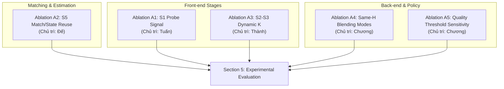

# Đặc tả 5 bài thí nghiệm bóc tách (Ablation Studies) — Phase 3

- **Tài liệu tham chiếu:** [Kế hoạch tổng thể (docs/plan.md)](../plan.md), [Báo cáo nghiệm thu Phase 2](../reports/phase-2-review-report.md)
- **Mục tiêu:** Định lượng độc lập đóng góp của từng thành phần kiến trúc và thuật toán trong pipeline thích nghi (Adaptive Runtime Pipeline), cung cấp bằng chứng thực nghiệm vững chắc cho Section 5 của bài báo tại workshop PARMA-DITAM 2027.
- **Nguyên tắc phân công:** Mỗi bài thí nghiệm bóc tách có **đúng 1 người chủ trì duy nhất (Single Owner)** chịu trách nhiệm thực thi, lấy số liệu và viết phân tích.

**Thiết kế chốt ngày 02/11 (Thứ 2):** A4 giữ alignment metrics làm invariant và seam crops định tính; A5 dùng lưới 5×4 với controller riêng theo policy được hiệu chỉnh trên development. A1/A2/A3 và quantum vẫn giữ owner hiện tại.

---

## 1. Bảng tổng hợp 5 bài thí nghiệm bóc tách

| Mã | Tên bài Ablation | Mục tiêu khoa học | Biến thể đối đầu (Variants) | Chỉ số đo lường chính | Người chủ trì duy nhất |
|---|---|---|---|---|---|
| **A1** | **Hiệu quả của Probe Signal (S1 Gradient)** | Đo lường xem chi phí probe (~0.07 ms) có thực sự giúp giảm số lần retry và tiết kiệm latency tổng thể hay không | 1. **Adaptive with Probe** (đề xuất) 2. **Blind Escalation** (luôn bắt đầu từ nấc 1 nhẹ nhất, thiếu inliers thì leo thang) 3. **Conservative High** (luôn chạy nấc tối đa) | - $t_{\text{probe}}$, $t_{\text{controller}}$, $t_{\text{e2e}}$ - Số attempt trung bình/pair - Tỉ lệ retry (%) | **Tuấn** |
| **A2** | **Đóng góp của State/Match Reuse trong S5** | Định lượng thời gian tiết kiệm được khi tăng $R$ nhờ việc tái sử dụng match S4 và inliers S5 cũ | 1. **With Reuse** (đề xuất: giữ nguyên match S4, chỉ mở rộng RANSAC evaluation từ $R_{\text{old}}$ đến $R_{\text{new}}$) 2. **No Reuse** (chạy lại toàn bộ S4 matching và S5 RANSAC từ đầu) | - Thời gian chạy lại $t_{\text{retry}}$ - Delta latency tiết kiệm được (ms) - Tốc độ cải thiện của attempt 2/3 | **Đế** |
| **A3** | **Tác động của Ngân sách $K$ động trong S2–S3** | Đo đạc độ co giãn thời gian của FAST/ORB theo núm vặn $K$ và kiểm chứng tính ổn định bộ nhớ (zero-allocation với view `capacity = K`) | 1. **Fixed pre-allocated buffer** (đề xuất: cấp phát một lần theo $K_{\max}=4000$, truyền view `capacity = K` động theo từng attempt) 2. **Dynamic re-allocation / Unbounded capacity** (cấp phát lại theo từng $K$ hoặc giữ `capacity = K_max` cố định) 3. Quét $K \in \{500, 1000, 2000, 4000\}$ | - Kernel time $t_{s2}$, $t_{s3}$ - Memory allocation / idle-block overhead - Số lượng keypoints hợp lệ | **Thành** |
| **A4** | **Same-Homography Blending Trade-off (S6)** | Định lượng chi phí render/workspace; quan sát định tính seam/ghosting | Cố định RGB, H gốc B→A, canvas và origin: 1. **Feather** 2. **Multiband 3 REDUCE** 3. **Multiband 5 REDUCE** | - GPU render interval và host invocation tách rõ - Workspace bytes theo API; không gọi là peak VRAM - Alignment SSIM/PSNR bất biến theo H - Crop seam cùng vị trí, định tính | **Chương** |
| **A5** | **Độ nhạy của Ngưỡng Chất lượng ($\delta_S, \delta_P$)** | Đo Controller theo từng policy, Oracle và QoR khi đổi dung sai | Lưới **5×4**: - $\delta_S \in \{0.01,0.02,0.03,0.04,0.05\}$ - $\delta_P \in \{0.2,0.5,0.8,1.0\}$ dB Controller được hiệu chỉnh trên development/validation và khóa trước test | - QoR/feasible rate và failures - Ladder/retry distribution - Median/p95 latency và speedup dưới cùng policy | **Chương** |

---

## 2. Chi tiết đặc tả từng bài thí nghiệm

### 2.1. Ablation A1: Hiệu quả của Probe Signal (S1 Gradient)

- **Người chủ trì duy nhất:** Tuấn

- **Bối cảnh:** Controller đề xuất sử dụng kernel S1 trích xuất độ biến thiên gradient trung bình trên ảnh probe thu nhỏ (scale 0.25, chi phí $<0.1\text{ ms}$) để chọn mức cấu hình ban đầu (initial configuration).
- **Câu hỏi khoa học:** Chi phí probe $t_{\text{probe}} \approx 0.07\text{ ms}$ có thực sự giúp giảm số vòng lặp retry và tiết kiệm latency tổng hay không so với việc luôn khởi đầu mù (blind) từ nấc nhẹ nhất?
- **Phương pháp thực hiện:**
  - Chạy `stitch_harness` trên toàn bộ tập test UDIS-D ở 3 chế độ:
    1. *Adaptive with Probe:* Sử dụng gradient probe để phân loại cảnh (dễ $\to$ Level 1, thường $\to$ Level 2, phức tạp $\to$ Level 3).
    2. *Blind Escalation:* Bỏ qua probe, 100% các cặp ảnh đều bắt đầu từ Level 1 ($S=0.5, K=1000, R=128$); nếu S5 không đủ inliers thì leo thang tuần tự lên Level 2, 3, 4.
    3. *Conservative High:* Luôn chạy ở cấu hình an toàn cao nhất ($S=1.0, K=2000, R=1024$).
- **Đầu ra bàn giao:**
  - Bảng so sánh 3 chế độ: Mean/Median $t_{\text{e2e}}$, tỉ lệ retry (%), và số attempt trung bình/pair.
  - Đoạn phân tích kỹ thuật cho Section 5.2 minh chứng giá trị của Scene-Awareness.

---

### 2.2. Ablation A2: Đóng góp của State/Match Reuse trong S5

- **Người chủ trì duy nhất:** Đế

- **Bối cảnh:** Khi Controller phát hiện S5 thiếu inliers nhưng cấu hình hiện tại chỉ cần tăng số vòng lặp RANSAC $R$ (ví dụ từ $R=256$ lên $512$ hoặc $1024$), danh sách match của S4 hoàn toàn không đổi.
- **Câu hỏi khoa học:** Cơ chế tái sử dụng match của S4 và mở rộng đánh giá giả thuyết trên GPU tiết kiệm được bao nhiêu ms so với việc chạy lại từ đầu?
- **Phương pháp thực hiện:**
  - Lọc ra các cặp ảnh kích hoạt escalation trong tập UDIS-D test set.
  - So sánh thời gian thực thi của attempt leo thang ở 2 trường hợp:
    1. *With Reuse:* Giữ nguyên buffer descriptor match trong VRAM, kernel S5 chỉ sinh thêm $R_{\text{new}} - R_{\text{old}}$ giả thuyết và cập nhật best consensus model.
    2. *No Reuse:* Giải phóng buffer, chạy lại toàn bộ kernel S4 Hamming matching và S5 RANSAC từ vòng 0 đến $R_{\text{new}}$.
- **Đầu ra bàn giao:**
  - Bảng đối sánh độ trễ $t_{\text{s4}} + t_{\text{s5}}$ giữa 2 trường hợp.
  - Biểu đồ minh họa phần trăm thời gian tiết kiệm được ở các nấc retry.

---

### 2.3. Ablation A3: Tác động của Ngân sách K động trong S2-S3

- **Người chủ trì duy nhất:** Thành

- **Bối cảnh:** Khác với các pipeline truyền thống phải cấp phát lại buffer GPU mỗi khi thay đổi số lượng keypoints $K$, kiến trúc S2–S3 của nhóm cấp phát một bộ buffer/workspace cố định một lần theo $K_{\max}=4000$ và kích thước ảnh lớn nhất ngay từ đầu (pre-allocated), sau đó truyền tham số $K$ động kèm view `Keypoints` có `capacity = K` vào từng attempt (xem [quyết định K động](../decisions/s2-s3-dynamic-k.md)).
- **Câu hỏi khoa học:** Thời gian thực thi của S2 (FAST + Harris) và S3 (ORB) đánh đổi (trade-off) và co giãn như thế nào khi vặn núm $K \in \{500, 1000, 2000, 4000\}$? Cơ chế zero-allocation kết hợp view `capacity = K` giúp triệt tiêu hiện tượng jitter cấp phát và tránh phóng thừa block ở S3/S4 ra sao?
- **Phương pháp thực hiện:**
  - Quét qua các giá trị $K \in \{500, 1000, 2000, 4000\}$ trên lưới tỉ lệ $S \in \{0.25, 0.5, 0.75, 1.0\}$ (hoặc cố định $S=0.5$ cho đường cong chi tiết từng kernel).
  - Đo đạc thời gian $t_{s2}$, $t_{s3}$ (và chi tiết các bước FAST, Harris rank $O(K^2)$, rBRIEF).
  - Đối sánh giữa 3 chế độ: (1) cấp phát một lần theo $K_{\max}=4000$ kèm view `capacity = K`, (2) cấp phát một lần nhưng giữ `capacity = K_max` (gây thừa block ở S3 khi $K$ nhỏ), và (3) cấp phát vừa đúng theo từng $K$ (`cudaMalloc`/`cudaFree`).
- **Đầu ra bàn giao:**
  - Bảng phân bổ thời gian chi tiết của S2 và S3 cùng footprint bộ nhớ theo từng nấc $K \in \{500, 1000, 2000, 4000\}$.
  - Đồ thị đường cong thể hiện sự đánh đổi (trade-off) giữa ngân sách $K$ và thời gian trích xuất đặc trưng.

---

### 2.4. Ablation A4: Same-Homography Blending Trade-off trong S6

- **Người chủ trì duy nhất:** Chương

- **Bối cảnh:** Stage 6 hỗ trợ 3 chế độ blending: Feather (nhẹ), Multiband 3 mức, và Multiband 5 mức.
- **Câu hỏi khoa học:** Chi phí tính toán và workspace của multiband khác feather bao nhiêu? Các crop đã chọn theo protocol cho thấy khác biệt seam/ghosting nào, với giới hạn của đánh giá định tính?
- **Phương pháp thực hiện:**
  - Sử dụng công cụ `tools/bench/same_h.py` trên các cặp ảnh UDIS-D có độ phức tạp thị giác cao (độ tương phản sáng tối mạnh, parallax nhẹ).
  - Đóng băng RGB, chín hệ số H gốc B→A, canvas/origin và masks; chỉ đổi B. 3/5 là số lần REDUCE, tương ứng tối đa 4/6 mức lưu trữ.
  - Đo GPU render interval bằng events và host invocation riêng; setup/geometry/upload không trộn vào steady-state. Workspace lấy từ API query; chỉ báo peak VRAM nếu có phép đo riêng và scope rõ.
  - Alignment SSIM/PSNR từ ảnh gốc/H không đánh giá composition và phải bất biến giữa B. Không dùng chúng để xếp hạng seam quality hoặc bảo đảm multiband tốt hơn.
  - Xuất hai bộ crop đường nối cùng tọa độ/zoom cho cả ba mode; caption ghi observation định tính, không retouch hoặc sửa H cho riêng mode.
- **Đầu ra bàn giao:**
  - Bảng ba chế độ: GPU/host latency, workspace bytes, canvas/mask và sai số correctness; alignment metrics ghi rõ invariant.
  - Ảnh/crop, hashes, mode order/seeds và raw timings; không có claim composition định lượng mới.

---

### 2.5. Ablation A5: Độ nhạy của Ngưỡng Chất lượng Overlap

- **Người chủ trì duy nhất:** Chương

- **Bối cảnh:** Chính sách QoR xác định một cấu hình $c$ là hợp lệ nếu $\mathrm{SSIM}(c) \ge \mathrm{SSIM}_{\mathrm{ref}} - \delta_S$ và $\mathrm{PSNR}(c) \ge \mathrm{PSNR}_{\mathrm{ref}} - \delta_P$.
- **Câu hỏi khoa học:** Với controller được hiệu chỉnh và khóa theo từng quality policy, QoR, latency, retry và khoảng cách tới Oracle thay đổi thế nào khi dung sai thay đổi?
- **Phương pháp thực hiện:**
  - Chốt lưới 20 policy; chấm dev sweep bằng `tools/qor/evaluate.py`/predicate chuẩn:
    - $\delta_S \in \{0.01, 0.02, 0.03, 0.04, 0.05\}$
    - $\delta_P \in \{0.2, 0.5, 0.8, 1.0\text{ dB}\}$
  - Chương tự triển khai config loading và calibration của cùng controller family trên development-fit/validation, giữ cùng reference và budget tìm kiếm giữa policy; khóa variants, Fixed-Best và fallback trước test. Không tune theo test hoặc gán dung sai offline trực tiếp thành ngưỡng inlier/residual chưa kiểm chứng.
  - Chạy controller thật theo từng variant trên 1.105 cặp test, cùng timing/seed/repeats; Oracle chọn từ audited grid theo policy. Grid/metric không phụ thuộc dung sai được tái dùng để tránh chạy CUDA dư thừa.
  - Chỉ thay predicate offline trên output cũ thì output/latency controller không thay đổi; phép relabel đó phải được ghi là offline-only, không thay thí nghiệm controller theo policy.
  - Báo feasible rate, QoR, reference failures/missing, ladder/retry, median/p95 pair latency và conditional/all-cohort comparison có denominator.
- **Đầu ra bàn giao:**
  - Heatmap 5×4 và các đường sensitivity theo từng $\delta_P$: QoR/feasible rate, latency và retry của Controller/Oracle/baseline tương ứng.
  - Báo cáo calibration/protocol lock, controller/quality-policy hashes, data ledger và nhận xét dựa trên kết quả. Operating point 0.02/0.5 không được mặc định là tối ưu trước thí nghiệm.
