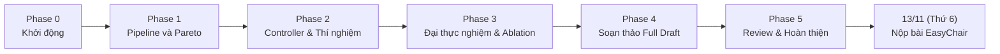

# Kế hoạch thực hiện workshop paper PARMA-DITAM 2027

Tài liệu đi kèm: [Các stage của pipeline](stages.md), gồm mục tiêu, đầu vào, đầu ra và người phụ trách từng stage.

Quy ước ngày: mọi mốc ghi theo dạng `dd/mm (Thứ n)` của năm 2026.

## 1. Mục tiêu

Nhóm viết và nộp một full paper cho workshop [PARMA-DITAM 2027](https://parma-ditam-workshop.github.io/). **Mốc nộp bài của Nhóm là 13/11 (Thứ 6).**

Thông tin workshop, để tham khảo:

| Mục | Nội dung |
|---|---|
| Hạn nộp chính thức của workshop | 16/11/2026, 23:59 UTC |
| Nơi nộp | [EasyChair](https://easychair.org/conferences/?conf=parmaditam2027), nộp file PDF |
| Định dạng | Template OASIcs, tối đa 10 trang single-column, không tính trang tiêu đề và tài liệu tham khảo; chỉ nhận full paper |
| Hình thức review | Double-blind |
| Các mốc sau khi nộp | Thông báo kết quả 14/12/2026, camera-ready 07/01/2027, workshop 18/01/2027 tại Glasgow |

## 2. Câu hỏi nghiên cứu và hướng tiếp cận

**Research question:** *Can a scene-aware cross-stage runtime reduce GPU panorama-stitching latency by dynamically allocating computational budgets while maintaining a predefined Quality-of-Result constraint?*

Hướng tiếp cận ở mức ý chính:

- Pipeline ghép hai ảnh theo hướng feature-based gồm 6 stage, chạy trên GPU (xem [stages.md](stages.md)).
- Một số stage có núm chỉnh lượng tính toán: S (tỉ lệ thu nhỏ ảnh), K (số keypoint), R (số vòng RANSAC), B (kiểu blend).
- Một runtime (controller) chọn mức tính toán cho từng cặp ảnh dựa trên độ khó của cảnh và các tín hiệu chất lượng trung gian, sao cho latency thấp nhất mà chất lượng vẫn đạt ngưỡng `Qmin`.
- Kết quả được so với các cấu hình cố định và với Oracle (biết trước cấu hình rẻ nhất đạt `Qmin` cho từng cặp ảnh).

Chi tiết thiết kế do người phụ trách từng phần quyết định trong quá trình làm (mục 4).

## 3. Phân vai

| Thành viên | Stage phụ trách | Vai trò chung |
|---|---|---|
| Tuấn | S1 Preprocessing | Điều phối; review pull request theo task/stage và merge |
| Thành | S2 Keypoint detection, S3 Description | Chủ trì quantum catalogue optimization offline, bổ sung ngày 02/11 (Thứ 2) |
| Đế | S4 Matching, S5 Homography | Controller; ghép code và chạy end-to-end để tìm module lỗi, điểm nghẽn |
| Chương | S6 Warping and blending | |

Cách chia stage giữ giống đồ án môn học để mỗi người làm tiếp stage mình đã quen. Lý do chi tiết nằm ở [stages.md](stages.md).

Quyết định bổ sung ngày 02/11 (Thứ 2): **Thành chủ trì workstream quantum offline để chọn catalogue cấu hình**, gồm adapter dữ liệu, native cover/QUBO, classical baselines, QAOA simulator và báo cáo đối chứng. Đây là trách nhiệm nghiên cứu bổ sung, không chuyển ownership S1/S4/S5/S6 hoặc controller cho Thành. Tuấn cung cấp sweep/measurement; Đế review policy và quản lý consumer catalogue trong controller; Chương review QoR/B và tổng hợp paper. Chi tiết ở [kế hoạch quantum](research/quantum-integration-tasks.md) và [quyết định kỹ thuật](decisions/p3-offline-quantum-catalogue.md).

## 4. Nguyên tắc làm việc

1. **Lập kế hoạch cuốn chiếu theo phase.** Mỗi phase tối đa 7 ngày: 6 ngày làm và 1 ngày review kết quả, lập kế hoạch chi tiết cho phase sau. Chỉ phase hiện tại có task chi tiết.
2. **Một deadline chung cho mọi task trong phase**, không có deadline riêng cho từng task.
3. **Làm song song, không chờ nhau.** Trong một phase, các task không phụ thuộc lẫn nhau. Ai cần đầu vào chưa có thì dùng mock data và bản giả (cài bằng OpenCV) của stage tương ứng.
4. **Quy ước chung** chỉ đặt cho những gì mọi thành viên cùng dùng, và do một người quyết định (Tuấn).
5. **Quyết định kỹ thuật** của từng stage, module hay task do người phụ trách tự quyết định. Mọi quyết định hay phương án kỹ thuật đều phải cân nhắc các phương án tương tự, phân tích kỹ trade-off và nhận định rõ lựa chọn có thực sự phù hợp, đảm bảo tính đúng đắn, chính xác trong ngữ cảnh hiện tại hay không. Phương án chọn phải tối ưu trong điều kiện của phần mình phụ trách, hoặc có fallback nếu không tối ưu hay không khả thi. Phase 0 chỉ chốt các quyết định chủ chốt; các quyết định khác làm tới đâu quyết định tới đó và được ghi lại trong `docs/` gồm: bối cảnh, phương án chọn, trade-off hoặc phương án phụ, fallback, người quyết định, ngày.
6. **Ghép code chỉ khi các module liên quan đã xong:** dự kiến cuối Phase 1 (lần đầu đủ 6 stage) và cuối Phase 2 (đưa controller vào pipeline). Đế phụ trách. Trước đó mỗi người tự chạy toàn pipeline bằng các bản giả để phát hiện lỗi sớm.
7. **Review:** Tuấn review pull request của từng task/stage và merge. Ở Phase 3, cả Nhóm cùng review toàn bộ paper.
8. **Viết paper:** ai cài đặt phần nào thì viết phần đó, nhưng viết ở phase sau phase cài đặt, khi cách cài đặt đã được kiểm chứng.
9. **Quy tắc AI agent:** Thành viên dùng AI agent phải tuân thủ [AGENTS_TEMPLATE.md](../AGENTS_TEMPLATE.md). Trước khi để agent đọc codebase repo, lên kế hoạch hay thực thi bất cứ điều gì, bắt buộc phải sao chép template thành file cấu hình cá nhân (`AGENTS.md`, `CLAUDE.md`...) và cập nhật lại mỗi khi `git pull`.

## 5. Lịch các phase

| Phase | Tên | Deadline | Trạng thái |
|---|---|---|---|
| 0 | Khởi động | 19/10 (Thứ 2) | ĐÃ XONG |
| 1 | Pipeline và Pareto (Go/No-Go) | 25/10 (Chủ nhật) | ĐÃ XONG (GO) |
| 2 | Controller, thí nghiệm, viết phương pháp | 31/10 (Thứ 7) | ĐÃ XONG (PASS) |
| 3 | Đại thực nghiệm, Ablation và Phân tích độc lập | 05/11 (Thứ 5) | Đang thực hiện |
| 4 | Soạn thảo toàn diện bản thảo (Full Draft) | 09/11 (Thứ 2) | Dự kiến |
| 5 | Rà soát chéo, Chuẩn hóa OASIcs và Nộp bài EasyChair | 13/11 (Thứ 6) | Dự kiến (dự phòng 3 ngày trước hạn 16/11) |

Để tránh dồn việc vào sát hạn chót và tăng cường làm việc song song, lộ trình từ 02/11 đến 13/11 được tổ chức thành các sprint ngắn (3–4 ngày). Kế hoạch tuân thủ nguyên tắc cuốn chiếu: Phase 3 có bảng task chi tiết; Phase 4 và 5 chỉ ghi ý chính định hướng và sẽ lập chi tiết khi hoàn tất Phase 3. Các thành viên được phép làm gối đầu sớm các task viết bài và rà soát của Phase 4–5 ngay trong Phase 3.

## 6. Phase 0: Khởi động

Deadline chung: 19/10 (Thứ 2).

| Thành viên | Task |
|---|---|
| Tuấn | 1. Chốt quy ước chung, chỉ gồm những gì mọi người cùng dùng: cấu trúc repo, môi trường build và thư viện dùng chung trên Colab T4, định dạng dữ liệu truyền giữa các stage, các cột của file kết quả CSV (thời gian và chất lượng), quy tắc Git, mẫu ghi quyết định kỹ thuật 2. Tạo mock data: một phần nhỏ HPatches kèm output tham chiếu của từng stage sinh bằng OpenCV, và bản giả bằng OpenCV cho từng stage 3. Khảo sát và chốt phương pháp chủ chốt cho S1 |
| Thành | Khảo sát và chốt phương pháp chủ chốt cho S2, S3 |
| Đế | 1. Khảo sát và chốt benchmark (mục 9); định nghĩa QoR và `Qmin` 2. Khảo sát và chốt phương pháp chủ chốt cho S4, S5 |
| Chương | 1. Dựng khung LaTeX theo template OASIcs trong `paper/` 2. Khảo sát và chốt phương pháp chủ chốt cho S6 |
| Cả Nhóm | Đọc kế hoạch và gửi feedback; thống nhất ngưỡng cho hai điều kiện Go/No-Go (mục 7) |

Định hướng đã thống nhất cho quy ước chung: tự viết kernel CUDA cho pipeline; OpenCV chỉ dùng làm baseline và bản giả. Lý do: các núm chỉnh, việc tái sử dụng kết quả khi leo thang và CUDA stream cần kiểm soát được code; bản `opencv-python` cài bằng pip trên Colab không có module CUDA.

## 7. Go/No-Go

Go/No-Go là điểm quyết định "đi tiếp hay đổi hướng", làm trong ngày review của Phase 1. Mục đích là kiểm tra bằng số liệu thật xem ý tưởng chính có đứng vững không, trước khi cả Nhóm đầu tư vào runtime.

| # | Điều kiện | Ý nghĩa | Ngưỡng gợi ý |
|---|---|---|---|
| 1 | Các stage chịu tác động của núm S, K, R chiếm phần đáng kể trong tổng thời gian end-to-end | Nếu phần này quá nhỏ thì chỉnh núm cũng không giảm được bao nhiêu latency | khoảng 30% |
| 2 | Oracle nhanh hơn rõ rệt so với cấu hình cố định tốt nhất (Fixed-Best) ở cùng `Qmin` | Đây là mức lợi tối đa runtime có thể đạt; nếu Oracle còn không nhanh hơn bao nhiêu thì runtime không có giá trị | khoảng 20-25% |

Ngưỡng chính thức do cả Nhóm thống nhất trong Phase 0.

Cách làm: không có task prototype riêng. Đây là một buổi phân tích khoảng nửa ngày, dùng dữ liệu Nhóm đằng nào cũng tạo ra:

- điều kiện 1 lấy từ thời gian từng stage sau lần ghép code cuối Phase 1;
- điều kiện 2 lấy từ một lượt chạy nhanh vài tổ hợp S, K, R trên 20-30 cặp ảnh bằng chính pipeline GPU của Nhóm. Script này cũng dùng để dựng Pareto.

Nếu ghép code bị trễ, quyết định được dời sang 1-2 ngày đầu Phase 2.

| Kết quả | Khi nào | Hướng đi |
|---|---|---|
| Go | Đạt cả hai điều kiện | Giữ nguyên hướng runtime |
| Go có điều chỉnh | Đạt điều kiện 2, không đạt điều kiện 1 | Báo cáo riêng latency của phần tính toán, hoặc đưa núm B lên làm núm chính |
| No-Go | Không đạt điều kiện 2 | Chuyển paper thành khảo sát Pareto giữa chất lượng và latency của pipeline ghép ảnh trên GPU (vẫn hợp topic case studies của workshop); giữ nguyên lịch |

Kể cả khi No-Go, pipeline GPU, benchmark, script đo QoR và harness vẫn dùng được; chỉ phần controller bị bỏ.

## 8. Phase 1 và các phase sau

Task chi tiết của mỗi phase được lập trong ngày review của phase trước.

### Phase 1: Pipeline và Pareto

Deadline chung cho các task: 25/10 (Chủ nhật).

Điều kiện bắt đầu: các task của Phase 0 (mục 6) xong trước tối 19/10 (Thứ 2).

| Thành viên | Task |
|---|---|
| Tuấn | 1. Kernel CUDA cho S1, có núm S 2. Harness: chạy S1-S6, mỗi stage chọn được bản GPU hoặc bản giả; đo thời gian từng stage bằng CUDA event; ghi kết quả ra CSV 3. Script quét lưới S×K×R và script phân tích: Pareto front, Fixed-Best, Oracle, số liệu cho hai điều kiện Go/No-Go |
| Thành | 1. Kernel CUDA cho S2 (có núm K) và S3 2. Test so với OpenCV 3. Tối ưu chỗ nghẽn trong S2-S3 |
| Đế | 1. Kernel CUDA cho S4 2. Kernel CUDA cho S5, có núm R; xuất các tín hiệu tự kiểm tra; tái sử dụng kết quả khi chỉ tăng R |
| Chương | 1. Kernel CUDA cho S6: warp, feather, multiband 3 và 5 mức (núm B) 2. Script đo QoR theo định nghĩa của Đế: PSNR/SSIM vùng chồng lấn, độ phủ; Đế review |

Quy định riêng của Phase 1:

- Mỗi người chạy toàn pipeline với bản giả của các stage còn lại, không chờ nhau.
- Mỗi người chỉ sửa code trong thư mục mình phụ trách. Interface dùng chung chỉ Tuấn sửa và được khóa sau 19/10.
- Pull request của một stage chỉ được merge khi output khớp với bản giả OpenCV trên mock data, trong sai số cho phép do người phụ trách stage ghi rõ trong pull request.

Ngày review: Đế ghép 6 stage GPU và chạy script quét trên 20-30 cặp ảnh của tập development; cả Nhóm phân tích Go/No-Go (mục 7); lập task Phase 2.

### Phase 2: Controller, thí nghiệm và viết phương pháp

Deadline chung cho các task: 31/10 (Thứ 7).

Điều kiện bắt đầu: Phase 1 kết luận GO (đã nghiệm thu vào 26/10 (Thứ 2), xem [Báo cáo Go/No-Go](reports/phase-1-gonogo-report.md)).

| Thành viên | Task | Tiêu chí nghiệm thu |
|---|---|---|
| Đế | 1. Chốt contract giao diện Controller (struct tín hiệu đầu vào từ S1, S5 và struct núm điều khiển S, K, R, B) cho cả Nhóm; thiết kế và cài đặt module Controller cùng cơ chế escalation khi ghép ảnh khó 2. Xuất đầy đủ tín hiệu tự kiểm tra từ S5 và đảm bảo tái sử dụng match khi chỉ tăng R 3. Chủ trì soạn thảo Section 4 (Adaptive Runtime Controller) cho paper; ghi quyết định kỹ thuật vào `docs/decisions/` | - Contract giao diện Controller được chốt sớm (27/10) để các stage triển khai độc lập - Controller chọn được cấu hình ban đầu và kích hoạt escalation khi S5 thiếu inliers - Overhead của Controller đủ nhỏ để duy trì lợi thế speedup so với Fixed-Best - Chạy thử nghiệm được trên tập dữ liệu pilot |
| Thành | 1. Đảm bảo S2 và S3 nhận tham số K động từ Controller mà không bị giảm hiệu năng hoặc rò rỉ bộ nhớ 2. Viết draft phần S2 và S3 trong Section 3 cho paper | - Thay đổi K qua các lần chạy không làm crash kernel và không gây overhead cấp phát lại bộ nhớ không cần thiết - Đạt độ chính xác tương đương Phase 1 |
| Chương | 1. Dựng khung LaTeX template OASIcs trong `paper/`, kiểm tra compile PDF ở chế độ ẩn danh (double-blind) 2. Rà soát núm B của S6 phục vụ thí nghiệm đo QoR 3. Chủ trì khung Section 1 (Introduction) và Section 2 (Related Work) cho paper; viết phần S6 trong Section 3 | - Khung LaTeX compile ra PDF chuẩn không lỗi trên môi trường chung - Đo được PSNR/SSIM ổn định cho các cấu hình thí nghiệm |
| Tuấn | 1. Tích hợp trích xuất đặc trưng ảnh thô từ S1 (texture/gradient) theo đúng contract của Đế đưa ra, overhead dưới 0.1 ms 2. Nâng cấp Harness để kết nối Controller vào luồng chạy thích nghi (hỗ trợ đo cả 3 chế độ: Fixed-Best, Oracle, Controller) 3. Viết draft phần S1 trong Section 3; review các PR và điều phối chạy benchmark trên Colab T4 | - Tín hiệu S1 sinh ra đồng thời với tiền xử lý ảnh, overhead không đáng kể - Harness chạy tự động được cả 3 chế độ đo lường |

Quy định riêng của Phase 2:

- **Tôn trọng quyền tự quyết kỹ thuật và phân tích trade-off:** Mỗi thành viên toàn quyền quyết định phương pháp kỹ thuật, thuật toán và cách cài đặt bên trong module của mình (theo mục 4, điều 5), miễn sao đáp ứng tiêu chí nghiệm thu và đúng contract dữ liệu. Mọi quyết định kỹ thuật đều phải cân nhắc các phương án tương tự, phân tích kỹ trade-off và nhận định rõ lựa chọn có thực sự phù hợp, đảm bảo tính đúng đắn, chính xác trong ngữ cảnh hiện tại hay không; ghi lại quyết định vào `docs/decisions/` theo mẫu của Nhóm.
- **Đế chốt contract giao diện sớm:** Vì Đế phụ trách Controller, Đế chủ trì quyết định và chốt contract giao diện (struct tín hiệu đầu vào từ S1, S5 và struct núm điều khiển) ngay đầu phase (27/10) để Tuấn, Thành, Chương bám theo triển khai độc lập, không phải chờ nhau.
- **Viết paper song song:** Tận dụng Phase 2 để viết ngay các mục đã kiểm chứng (Introduction, Related Work, và toàn bộ phần phương pháp của 6 stage S1–S6 cùng Controller trong Section 3 và Section 4) để giảm áp lực cho Phase 3.

Ngày review: 01/11 (Chủ nhật). Ghép Controller vào harness, chạy thử nghiệm pilot trên Colab T4, đánh giá speedup thực tế so với Fixed-Best và Oracle; lập task chi tiết cho Phase 3.

### Phase 3: Đại thực nghiệm, Ablation và Phân tích độc lập

Deadline chung cho các task: 05/11 (Thứ 5).

Tài liệu đi kèm: [Đặc tả 5 bài thí nghiệm bóc tách (Ablation Studies)](experiments/ablation-studies.md), [phương pháp quantum offline](research/quantum-integration-proposal.md) và [task quantum của Thành](research/quantum-integration-tasks.md).

Thiết kế A4/A5 được chốt ngày 02/11 (Thứ 2): A4 dùng alignment invariant và seam crops định tính; A5 dùng lưới 5×4, controller hiệu chỉnh trên development theo policy và khóa trước test. A1/A2/A3 và quantum giữ phân công hiện tại.

Điều kiện bắt đầu: Phase 2 đã nghiệm thu ĐẠT vào 01/11 (Chủ nhật), xem [Báo cáo nghiệm thu Phase 2](reports/phase-2-review-report.md).

| Thành viên | Task | Tiêu chí nghiệm thu |
|---|---|---|
| **Tuấn** | 1. Cung cấp batch script tự động (`tools/colab_runner.py` / `stitch_harness`) chạy UDIS-D test set (1.106 cặp) trên Colab Tesla T4, trích xuất dữ liệu đo lường thô `telemetry_results.csv` cho 3 chế độ (`Fixed-Best`, `Oracle`, `Adaptive`) 2. Chủ trì duy nhất (Single Owner) theo [Đặc tả Ablation Studies](experiments/ablation-studies.md): [**Ablation A1**](experiments/ablation-studies.md#21-ablation-a1-hiệu-quả-của-probe-signal-s1-gradient) (Đo lường hiệu quả và overhead của Probe Signal S1 Gradient so với Blind Escalation) 3. Soạn thảo Section 5.1 (Experimental Protocol & Hardware Setup) ghi nhận chi tiết hệ thống đo lường, phần cứng, flags, seeds | - File raw CSV đo đạc trên T4 hoàn chỉnh, không có dữ liệu lỗi/thiếu trường - Bài Ablation A1 có số liệu đối sánh định lượng rõ ràng về overhead probe và số lần retry - Section 5.1 súc tích, minh bạch, đúng chuẩn học thuật |
| **Đế** | 1. Phân tích telemetry của Controller trên UDIS-D test set: phân bố các nấc thang (ladder distribution), tỉ lệ retry, số inliers phục hồi, và mổ xẻ các ca corner case (thất bại do `BUDGET_EXHAUSTED` hoặc parallax mạnh) 2. Chủ trì duy nhất (Single Owner) theo [Đặc tả Ablation Studies](experiments/ablation-studies.md): [**Ablation A2**](experiments/ablation-studies.md#22-ablation-a2-đóng-góp-của-statematch-reuse-trong-s5) (Lợi ích tiết kiệm thời gian của cơ chế tái sử dụng match trong S5 khi tăng $R$) 3. Chạy kiểm chứng hình học độc lập trên HPatches (59 chuỗi biến đổi góc nhìn có ground-truth homography), tính Mean Corner Error (MCE) chứng minh tính chính xác hình học 4. Soạn thảo draft phân tích Controller cho Section 5.2 và Section 6 (Discussion & Limitations) | - Báo cáo số liệu phân tích Controller rõ ràng, logic, không thiên vị - Bài Ablation A2 có số liệu định lượng cụ thể chứng minh giá trị của cơ chế tái sử dụng match - Bảng kết quả sai số hình học MCE trên HPatches |
| **Chương** | 1. Chạy công cụ QoR (SSIM, PSNR vùng chồng lấn) trên toàn bộ kết quả UDIS-D test set của 3 chế độ 2. Chủ trì duy nhất (Single Owner) 2 bài thí nghiệm bóc tách theo [Đặc tả Ablation Studies](experiments/ablation-studies.md): [**Ablation A4**](experiments/ablation-studies.md#24-ablation-a4-same-homography-blending-trade-off-trong-s6) (Same-Homography Blending: đối sánh chi phí và chất lượng giữa Feather, Multiband 3 và Multiband 5) và [**Ablation A5**](experiments/ablation-studies.md#25-ablation-a5-độ-nhạy-của-ngưỡng-chất-lượng-overlap) (Độ nhạy của ngưỡng chất lượng $\delta_S, \delta_P$) 3. Chạy stress-test độ phân giải (Synthetic 720p, 1080p, 4K) và chạy đo latency mở rộng trên L4 / A100 qua tài khoản Colab Pro (Cross-Architecture Study) 4. Xuất các biểu đồ vector (Pareto curve, Latency CDF, Bar charts), bảng số liệu LaTeX và chọn 2–3 ảnh so sánh trực quan (visual panorama) | - Báo cáo QoR hoàn tất, trích xuất được bảng latency breakdown và Pareto data - 2 bài Ablation A4 và A5 có số liệu và biểu đồ đối sánh rõ ràng - Dữ liệu so sánh độ trễ vi kiến trúc (T4 vs L4 vs A100) sẵn sàng đưa vào paper - Các biểu đồ vector chuẩn xuất bản, sắc nét |
| **Thành** | 1. Chủ trì duy nhất (Single Owner) theo [Đặc tả Ablation Studies](experiments/ablation-studies.md): [**Ablation A3**](experiments/ablation-studies.md#23-ablation-a3-tác-động-của-ngân-sách-k-động-trong-s2-s3) (Phân tích chi tiết hành vi của S2 FAST và S3 ORB khi nhận ngân sách $K$ động, đo độ co giãn latency và kiểm chứng zero-allocation) 2. Soạn thảo draft tiểu mục Feature Budget Allocation trong Section 5 3. Khởi động rà soát sớm văn phong học thuật (loại bỏ triệt để các dấu hiệu AI writing) cho các phần Section 1, 2, 3, 4 đã hoàn thành 4. Chủ trì [Q00–Q13 quantum offline](research/quantum-integration-tasks.md): adapter, native cover/QUBO, classical controls, QAOA simulator p=1,2, validator và báo cáo; chạy song song nhánh không quantum | - Bài Ablation A3 có bảng đối sánh định lượng thời gian và footprint bộ nhớ theo $K$ - Soạn thảo hoàn chỉnh nội dung S2–S3 cho Section 5 - Rà soát xong văn phong các section cũ, câu từ súc tích, mạch lạc - Quantum có instance từ sweep, tests, circuit/counts/logs và bảng controls theo gates; zero-feasible được báo negative, thiếu dữ liệu/môi trường thì ghi chưa hoàn thành; không tự kết luận speedup hệ thống |

#### Workstream quantum offline chạy song song

**Chủ trì duy nhất: Thành.** Phạm vi được chốt ngày 02/11 (Thứ 2): chọn catalogue cấu hình `(S,K,R,B_fixed)` bằng QUBO/QAOA offline; không thay kernel, estimator hoặc ABI S1–S6, không gọi quantum backend khi xử lý từng cặp ảnh. QPU không bắt buộc; simulator phải được ghi đúng nhãn. A3 và các task A1–A5 vẫn giữ owner hiện tại.

| Nhánh | Task và owner | Tiêu chí nghiệm thu Phase 3 |
|---|---|---|
| **Không quantum** | Tuấn/Đế tiếp tục runtime gốc, Fixed-Best, Oracle và Adaptive; từng owner thực hiện A1–A5. Thành triển khai classical catalogue controls trong tooling offline riêng | Benchmark chính chạy được khi không cài quantum SDK; giữ artifact baseline độc lập, không đợi QAOA hoặc catalogue loader mới |
| **Quantum offline** | Thành chủ trì Q00–Q13: tiếp nhận sweep development, kiểm dữ liệu, native cover, exact/greedy/CP-SAT/SA/random, QUBO/Ising/reduction, resource admission, QAOA `p=1,2`, validator/repair và báo cáo | Có code/tests, môi trường riêng và tối thiểu một instance từ sweep CUDA còn biến sau reduction, circuit/counts/logs thật, đối chứng cổ điển và phân tích feasibility/cardinality/regret/solver time; raw và repaired tách riêng. Chưa có dữ liệu hoặc môi trường thì ghi BLOCKED/chưa hoàn thành; toy hoặc công thức đơn thuần không đóng task |
| **Consumer catalogue cổ điển** | Thành bàn giao catalogue có hash/schema; Đế giữ quyền sửa controller, Tuấn giữ harness; Chương review QoR | Nếu kịp có consumer đã kiểm thử, so `W0` runtime gốc, `W1` classical catalogue và `W2` QAOA catalogue bằng cùng consumer/selector family/budget, self-check/reuse/fallback giữa W1/W2. Chưa có consumer thì chỉ nghiệm thu kết quả solver offline, chưa kết luận speedup hệ thống |

Thứ tự của Thành: Q01/Q02/Q10 và tiny tests có thể làm ngay; Q00/Q03 cần raw sweep; Q04–Q12 hoàn thiện theo dependency; Q13 chỉ chạy ứng dụng khi dữ liệu/encoding/resource gates đạt. Không tái triển khai stage CUDA, không đưa Qiskit/Aer/OR-Tools vào requirements hoặc build của pipeline. Handoff chi tiết, artifact và acceptance ở [quantum-integration-tasks.md](research/quantum-integration-tasks.md).

Catalogue được fit từ development; validation chọn tham số, sau đó khóa trước test. Không dùng 1.106 cặp test UDIS-D để chọn catalogue, seed hoặc quantum hyperparameters. Nhánh đầu dùng một quality policy và B cố định được Đế/Chương xác nhận; không nhân toàn bộ campaign quantum theo lưới A5. Catalogue cổ điển cũng là nhánh không quantum và phải tiếp tục được khi QAOA fail.

Quantum phải có thí nghiệm thật hoặc báo trạng thái chưa hoàn thành. QAOA không tìm được nghiệm raw feasible vẫn là negative result hợp lệ nếu circuit/samples/budget và controls đầy đủ; không tự xuất catalogue cổ điển mang nhãn quantum. Không yêu cầu QAOA phải thắng và không viết sẵn claim quantum advantage. Thiếu dữ liệu/tài nguyên hoặc scope quá lớn được báo trong review 05/11 (Thứ 5), không dời lịch các nhánh khác và không đánh quantum hoàn tất bằng kết quả baseline.

Quy định riêng của Phase 3:

- **Phân vai cân bằng kỹ thuật:** Mỗi thành viên chủ trì đúng bài thí nghiệm bóc tách cốt lõi gắn liền với stage của mình: A1 (Tuấn), A2 (Đế), A3 (Thành), A4 & A5 (Chương).
- **Nguyên tắc trách nhiệm duy nhất (Single Owner):** Mỗi bài thí nghiệm bóc tách (A1–A5) do đúng một thành viên phụ trách toàn bộ từ chạy thử, lấy số liệu đến viết phân tích theo [Đặc tả 5 bài thí nghiệm bóc tách](experiments/ablation-studies.md); không giao chung để tránh đùn đẩy trách nhiệm.
- **Tôn trọng quyền tự quyết phân tích:** Mỗi thành viên tự đào sâu dữ liệu, rút ra insights và nhận xét kỹ thuật khách quan cho phần mình phụ trách; không để AI hoặc một cá nhân áp đặt góc nhìn chủ quan (bias) lên bài báo.
- **Làm việc gối đầu:** Khuyến khích các thành viên làm trước các khung bảng biểu, draft mục thảo luận và rà soát của Phase 4–5 ngay trong Phase 3 để đẩy nhanh tiến độ.

Ngày review Phase 3: 05/11 (Thứ 5). Nghiệm thu toàn bộ số liệu đo đạc (freeze data), các bảng biểu/đồ thị và các draft phân tích độc lập; kích hoạt Phase 4.

### Phase 4: Soạn thảo toàn diện bản thảo (Full Draft) (ý chính)

Deadline dự kiến: 09/11 (Thứ 2).

Mục tiêu chính: Tích hợp toàn bộ số liệu, bảng biểu, đồ thị từ Phase 3 vào `paper/`; viết hoàn chỉnh Section 5 (Experimental Evaluation), Section 6 (Discussion & Limitations), Section 7 (Conclusion); chốt các con số định lượng trong Abstract và hoàn thiện Introduction.

Với quantum, Thành bàn giao phân tích solver có bằng chứng để Chương tổng hợp; chỉ viết kết quả offline nếu chưa có catalogue consumer/e2e. Việc mở rộng consumer và thí nghiệm hệ thống được lập chi tiết sau review Phase 3; không gắn lợi ích catalogue cổ điển thành lợi ích quantum.

### Phase 5: Rà soát chéo, Chuẩn hóa OASIcs và Nộp bài (ý chính)

Deadline chung: **13/11 (Thứ 6)** (nộp bài EasyChair, giữ 3 ngày đệm an toàn trước hạn chót 16/11 của ban tổ chức).

Mục tiêu chính: Cả Nhóm đọc chéo (peer-review) toàn bộ 10 trang bài báo; rà soát văn phong chống AI writing; kiểm tra audit ẩn danh kép (double-blind); căn chỉnh layout không tràn 10 trang OASIcs; nộp file PDF chính thức lên EasyChair.

## 9. Dataset và benchmark

Để đảm bảo tính khách quan toàn diện và chiều sâu học thuật, bài báo áp dụng chiến lược dữ liệu 3 trục độc lập:

| Trục dữ liệu | Bộ dữ liệu | Mục đích và Vai trò trong Paper | Người phụ trách |
|---|---|---|---|
| **1. Ảnh thực tế đa dạng cảnh** | **UDIS-D Test Set** (1.106 cặp ảnh) | Benchmark chính end-to-end: đo latency thực tế, tỉ lệ thành công, Overlap SSIM/PSNR; phân nhóm theo 4 loại cảnh (Normal, Low-texture, Night, Large parallax) để chứng minh tính Scene-Aware | Tuấn chạy batch, Đế & Chương phân tích |
| **2. Đối chứng hình học chuẩn xác** | **HPatches** (59 chuỗi biến đổi góc nhìn) | Có homography đúng ($H_{\text{gt}}$ 100%): đo sai số hình học tuyệt đối (Mean Corner Error - MCE), chứng minh Controller không làm suy giảm độ chính xác hình học | Đế |
| **3. Thử tải độ phân giải** | **Synthetic Scaling** (720p, 1080p, 4K) | Đo đạc sự co giãn tài nguyên và điểm nghẽn GPU ở độ phân giải lớn, làm nổi bật giá trị của núm $S$ và núm $B$ | Chương |

Tập 25 cặp ảnh development đã dùng ở Phase 2 được giữ nguyên vai trò kiểm tra tính năng và khóa policy; tuyệt đối không dùng tập test để tune tham số nhằm giữ vững tính trung thực học thuật.

## 10. Môi trường chạy

- **Baseline chính (Primary):** Google Colab GPU Tesla T4 (kiến trúc Turing, `sm_75`, CUDA 13.0, Compute Capability 7.5). Toàn bộ bài đo chuẩn mực và bảng số liệu chính của bài báo chạy trên môi trường này.
- **Nghiên cứu mở rộng xuyên kiến trúc (Cross-Architecture Study):** Tận dụng tài khoản Colab Pro để chạy mở rộng trên **L4 GPU (Ada Lovelace, `sm_89`)** và **A100 GPU (Ampere, `sm_80`)**. Thí nghiệm này đánh giá tính tổng quát hóa của Controller khi chuyển dịch giữa các thế hệ vi kiến trúc GPU khác nhau.
- `nvidia-smi` ghi nhận xung nhịp, công suất (năng lượng) và thông tin phần cứng cụ thể trong từng phiên chạy; kết quả đo lường ghi nhận rõ môi trường thực thi.

## 11. Paper

- Viết bằng LaTeX, tiếng Anh, trong thư mục `paper/` của repo; không dùng Overleaf.
- Template OASIcs lấy từ Dagstuhl theo hướng dẫn trên trang workshop; phiên bản template hiện hành cần kiểm tra khi dựng khung. Bản dùng để nộp phải bật chế độ ẩn danh cho double-blind.
- Không đưa tên thành viên, tên trường, link GitHub cá nhân hay thông tin nhận diện Nhóm vào paper và metadata của PDF.
- Pipeline được trình bày là pipeline feature-based kinh điển (Brown & Lowe, IJCV 2007; Szeliski, *Computer Vision: Algorithms and Applications*), không trích dẫn đề đồ án môn học.

## 12. Rủi ro

| Rủi ro | Cách xử lý |
|---|---|
| Hạn giữa kỳ đồ án môn học 23/10 (Thứ 6) trùng Phase 1, trong khi Phase 1 gánh khối lượng của hai phase cũ | Ai bị kẹt việc báo ngay cho cả Nhóm để điều chỉnh task trong phase, không đợi tới ngày review |
| Ghép code cuối Phase 1 bị trễ | Dời Go/No-Go sang 1-2 ngày đầu Phase 2 |
| No-Go | Chuyển sang paper khảo sát Pareto, giữ nguyên lịch (mục 7) |
| Colab hết hạn mức GPU hoặc đổi GPU | Thành viên khác chạy hộ; chỉ dùng kết quả trên T4, thí nghiệm cuối chạy trong một phiên |
