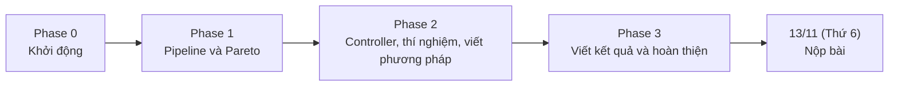

# Kế hoạch thực hiện workshop paper PARMA-DITAM 2027

Tài liệu đi kèm: [Các stage của pipeline](stages.md), gồm mục tiêu, đầu vào, đầu ra và người phụ trách từng stage.

Quy ước ngày: mọi mốc ghi theo dạng `dd/mm (Thứ n)` của năm 2026.

## 1. Mục tiêu

Nhóm viết và nộp một full paper cho workshop [PARMA-DITAM 2027](https://parma-ditam-workshop.github.io/). **Mốc nộp bài của Nhóm là 13/11 (Thứ 6).**

Thông tin workshop, để tham khảo:

| Mục | Nội dung |
|---|---|
| Hạn nộp chính thức của workshop | 16/11/2026, 23:59 UTC |
| Nơi nộp | [EasyChair](https://easychair.org/conferences/?conf=parmaditam2027), nộp file PDF |
| Định dạng | Template OASIcs, tối đa 10 trang single-column, không tính trang tiêu đề và tài liệu tham khảo; chỉ nhận full paper |
| Hình thức review | Double-blind |
| Các mốc sau khi nộp | Thông báo kết quả 14/12/2026, camera-ready 07/01/2027, workshop 18/01/2027 tại Glasgow |

## 2. Câu hỏi nghiên cứu và hướng tiếp cận

**Research question:** *Can a scene-aware cross-stage runtime reduce GPU panorama-stitching latency by dynamically allocating computational budgets while maintaining a predefined Quality-of-Result constraint?*

Hướng tiếp cận ở mức ý chính:

- Pipeline ghép hai ảnh theo hướng feature-based gồm 6 stage, chạy trên GPU (xem [stages.md](stages.md)).
- Một số stage có núm chỉnh lượng tính toán: S (tỉ lệ thu nhỏ ảnh), K (số keypoint), R (số vòng RANSAC), B (kiểu blend).
- Một runtime (controller) chọn mức tính toán cho từng cặp ảnh dựa trên độ khó của cảnh và các tín hiệu chất lượng trung gian, sao cho latency thấp nhất mà chất lượng vẫn đạt ngưỡng `Qmin`.
- Kết quả được so với các cấu hình cố định và với Oracle (biết trước cấu hình rẻ nhất đạt `Qmin` cho từng cặp ảnh).

Chi tiết thiết kế do người phụ trách từng phần quyết định trong quá trình làm (mục 4).

## 3. Phân vai

| Thành viên | Stage phụ trách | Vai trò chung |
|---|---|---|
| Tuấn | S1 Preprocessing | Điều phối; review pull request theo task/stage và merge |
| Thành | S2 Keypoint detection, S3 Description | |
| Đế | S4 Matching, S5 Homography | Controller; ghép code và chạy end-to-end để tìm module lỗi, điểm nghẽn |
| Chương | S6 Warping and blending | |

Cách chia stage giữ giống đồ án môn học để mỗi người làm tiếp stage mình đã quen. Lý do chi tiết nằm ở [stages.md](stages.md).

## 4. Nguyên tắc làm việc

1. **Lập kế hoạch cuốn chiếu theo phase.** Mỗi phase tối đa 7 ngày: 6 ngày làm và 1 ngày review kết quả, lập kế hoạch chi tiết cho phase sau. Chỉ phase hiện tại có task chi tiết.
2. **Một deadline chung cho mọi task trong phase**, không có deadline riêng cho từng task.
3. **Làm song song, không chờ nhau.** Trong một phase, các task không phụ thuộc lẫn nhau. Ai cần đầu vào chưa có thì dùng mock data và bản giả (cài bằng OpenCV) của stage tương ứng.
4. **Quy ước chung** chỉ đặt cho những gì mọi thành viên cùng dùng, và do một người quyết định (Tuấn).
5. **Quyết định kỹ thuật** của từng stage, module hay task do người phụ trách tự quyết định. Phương án chọn phải tối ưu trong điều kiện của phần mình phụ trách, hoặc có fallback nếu không tối ưu hay không khả thi. Phase 0 chỉ chốt các quyết định chủ chốt; các quyết định khác làm tới đâu quyết định tới đó và được ghi lại trong `docs/` gồm: bối cảnh, phương án chọn, trade-off hoặc phương án phụ, fallback, người quyết định, ngày.
6. **Ghép code chỉ khi các module liên quan đã xong:** dự kiến cuối Phase 1 (lần đầu đủ 6 stage) và cuối Phase 2 (đưa controller vào pipeline). Đế phụ trách. Trước đó mỗi người tự chạy toàn pipeline bằng các bản giả để phát hiện lỗi sớm.
7. **Review:** Tuấn review pull request của từng task/stage và merge. Ở Phase 3, cả Nhóm cùng review toàn bộ paper.
8. **Viết paper:** ai cài đặt phần nào thì viết phần đó, nhưng viết ở phase sau phase cài đặt, khi cách cài đặt đã được kiểm chứng.

## 5. Lịch các phase

| Phase | Tên | Deadline |
|---|---|---|
| 0 | Khởi động | 19/10 (Thứ 2) |
| 1 | Pipeline và Pareto (Go/No-Go) | 25/10 (Chủ nhật) |
| 2 | Controller, thí nghiệm, viết phương pháp | |
| 3 | Viết kết quả và hoàn thiện | |
| | **Nộp bài** | **13/11 (Thứ 6)** |

Ngày 18/10, các phase còn lại được gộp từ 4 xuống 3 để kịp mốc nộp; mỗi phase vẫn tối đa 7 ngày (mục 4). Deadline và task của Phase 2, Phase 3 sẽ được giao khi phase trước hoàn tất.

## 6. Phase 0: Khởi động

Deadline chung: 19/10 (Thứ 2).

| Thành viên | Task |
|---|---|
| Tuấn | 1. Chốt quy ước chung, chỉ gồm những gì mọi người cùng dùng: cấu trúc repo, môi trường build và thư viện dùng chung trên Colab T4, định dạng dữ liệu truyền giữa các stage, các cột của file kết quả CSV (thời gian và chất lượng), quy tắc Git, mẫu ghi quyết định kỹ thuật 2. Tạo mock data: một phần nhỏ HPatches kèm output tham chiếu của từng stage sinh bằng OpenCV, và bản giả bằng OpenCV cho từng stage 3. Khảo sát và chốt phương pháp chủ chốt cho S1 |
| Thành | Khảo sát và chốt phương pháp chủ chốt cho S2, S3 |
| Đế | 1. Khảo sát và chốt benchmark (mục 9); định nghĩa QoR và `Qmin` 2. Khảo sát và chốt phương pháp chủ chốt cho S4, S5 |
| Chương | 1. Dựng khung LaTeX theo template OASIcs trong `paper/` 2. Khảo sát và chốt phương pháp chủ chốt cho S6 |
| Cả Nhóm | Đọc kế hoạch và gửi feedback; thống nhất ngưỡng cho hai điều kiện Go/No-Go (mục 7) |

Định hướng đã thống nhất cho quy ước chung: tự viết kernel CUDA cho pipeline; OpenCV chỉ dùng làm baseline và bản giả. Lý do: các núm chỉnh, việc tái sử dụng kết quả khi leo thang và CUDA stream cần kiểm soát được code; bản `opencv-python` cài bằng pip trên Colab không có module CUDA.

## 7. Go/No-Go

Go/No-Go là điểm quyết định "đi tiếp hay đổi hướng", làm trong ngày review của Phase 1. Mục đích là kiểm tra bằng số liệu thật xem ý tưởng chính có đứng vững không, trước khi cả Nhóm đầu tư vào runtime.

| # | Điều kiện | Ý nghĩa | Ngưỡng gợi ý |
|---|---|---|---|
| 1 | Các stage chịu tác động của núm S, K, R chiếm phần đáng kể trong tổng thời gian end-to-end | Nếu phần này quá nhỏ thì chỉnh núm cũng không giảm được bao nhiêu latency | khoảng 30% |
| 2 | Oracle nhanh hơn rõ rệt so với cấu hình cố định tốt nhất (Fixed-Best) ở cùng `Qmin` | Đây là mức lợi tối đa runtime có thể đạt; nếu Oracle còn không nhanh hơn bao nhiêu thì runtime không có giá trị | khoảng 20-25% |

Ngưỡng chính thức do cả Nhóm thống nhất trong Phase 0.

Cách làm: không có task prototype riêng. Đây là một buổi phân tích khoảng nửa ngày, dùng dữ liệu Nhóm đằng nào cũng tạo ra:

- điều kiện 1 lấy từ thời gian từng stage sau lần ghép code cuối Phase 1;
- điều kiện 2 lấy từ một lượt chạy nhanh vài tổ hợp S, K, R trên 20-30 cặp ảnh bằng chính pipeline GPU của Nhóm. Script này cũng dùng để dựng Pareto.

Nếu ghép code bị trễ, quyết định được dời sang 1-2 ngày đầu Phase 2.

| Kết quả | Khi nào | Hướng đi |
|---|---|---|
| Go | Đạt cả hai điều kiện | Giữ nguyên hướng runtime |
| Go có điều chỉnh | Đạt điều kiện 2, không đạt điều kiện 1 | Báo cáo riêng latency của phần tính toán, hoặc đưa núm B lên làm núm chính |
| No-Go | Không đạt điều kiện 2 | Chuyển paper thành khảo sát Pareto giữa chất lượng và latency của pipeline ghép ảnh trên GPU (vẫn hợp topic case studies của workshop); giữ nguyên lịch |

Kể cả khi No-Go, pipeline GPU, benchmark, script đo QoR và harness vẫn dùng được; chỉ phần controller bị bỏ.

## 8. Phase 1 và các phase sau

Task chi tiết của mỗi phase được lập trong ngày review của phase trước.

### Phase 1: Pipeline và Pareto

Deadline chung cho các task: 25/10 (Chủ nhật).

Điều kiện bắt đầu: các task của Phase 0 (mục 6) xong trước tối 19/10 (Thứ 2).

| Thành viên | Task |
|---|---|
| Tuấn | 1. Kernel CUDA cho S1, có núm S 2. Harness: chạy S1-S6, mỗi stage chọn được bản GPU hoặc bản giả; đo thời gian từng stage bằng CUDA event; ghi kết quả ra CSV 3. Script quét lưới S×K×R và script phân tích: Pareto front, Fixed-Best, Oracle, số liệu cho hai điều kiện Go/No-Go |
| Thành | 1. Kernel CUDA cho S2 (có núm K) và S3 2. Test so với OpenCV 3. Tối ưu chỗ nghẽn trong S2-S3 |
| Đế | 1. Kernel CUDA cho S4 2. Kernel CUDA cho S5, có núm R; xuất các tín hiệu tự kiểm tra; tái sử dụng kết quả khi chỉ tăng R |
| Chương | 1. Kernel CUDA cho S6: warp, feather, multiband 3 và 5 mức (núm B) 2. Script đo QoR theo định nghĩa của Đế: PSNR/SSIM vùng chồng lấn, độ phủ; Đế review |

Quy định riêng của Phase 1:

- Mỗi người chạy toàn pipeline với bản giả của các stage còn lại, không chờ nhau.
- Mỗi người chỉ sửa code trong thư mục mình phụ trách. Interface dùng chung chỉ Tuấn sửa và được khóa sau 19/10.
- Pull request của một stage chỉ được merge khi output khớp với bản giả OpenCV trên mock data, trong sai số cho phép do người phụ trách stage ghi rõ trong pull request.

Ngày review: Đế ghép 6 stage GPU và chạy script quét trên 20-30 cặp ảnh của tập development; cả Nhóm phân tích Go/No-Go (mục 7); lập task Phase 2.

### Các phase sau (ý chính)

- **Phase 2, controller, thí nghiệm và viết phương pháp:** làm controller và ghép vào pipeline; chạy thí nghiệm với các baseline, Oracle, ablation; đo overhead của controller và năng lượng nếu kịp. Viết Introduction, Related Work và các mục về phương pháp, hệ thống đã cài đặt ở Phase 1.
- **Phase 3, viết kết quả và hoàn thiện:** viết Results, Abstract, Conclusion; cả Nhóm review toàn bộ paper và sửa; kiểm tra ẩn danh, định dạng OASIcs và số trang trước khi nộp. Thời gian còn lại tới 13/11 dùng làm dự phòng.

## 9. Dataset và benchmark

Paper dùng dataset công khai để người khác tái lập được kết quả; không bắt buộc ảnh tự chụp. Chưa có benchmark dành riêng cho bài toán ghép ảnh trên GPU thích nghi theo ràng buộc chất lượng, nên Nhóm kết hợp các bộ phổ biến. Các ứng viên để Đế khảo sát và chốt ở Phase 0:

| Dataset | Nội dung | Phù hợp ở điểm nào |
|---|---|---|
| [CA-UDHN](https://github.com/JirongZhang/DeepHomography) (ECCV 2020) | Khoảng 80k cặp chia 5 loại cảnh: thường, ít texture, thiếu sáng, tiền cảnh nhỏ, tiền cảnh lớn. Tập test khoảng 4.2k cặp có 6-8 điểm tương ứng gán nhãn tay | Mỗi loại cảnh ứng với một mức độ khó, khớp với ý tưởng scene-aware |
| [HPatches](https://arxiv.org/abs/1704.05939) | 116 chuỗi ảnh (59 chuỗi đổi góc nhìn), có homography đúng | Tính sai số hình học chính xác |
| UDIS-D | 10.440 cặp train và 1.106 cặp test ảnh thật, có parallax, cảnh đêm, tối, tuyết; không có homography đúng | Kiểm tra trên ảnh thật, đo chất lượng vùng chồng lấn |

Lưu ý: các bộ trên có độ phân giải thấp so với 1080p/4K. Để đo latency trên GPU ở độ phân giải cao, cần bổ sung cặp ảnh tổng hợp từ ảnh độ phân giải cao, biến đổi bằng homography đã biết. Ảnh tự chụp chỉ là tùy chọn bổ sung.

## 10. Môi trường chạy

- Mọi build, test và đo đạc chạy trên Google Colab với GPU Tesla T4; build CUDA bằng `-arch=sm_75`.
- `nvidia-smi` trên Colab đọc được công suất, nên có thể đo năng lượng.
- Thí nghiệm cuối chạy trong cùng một phiên Colab; ghi tên GPU và xung nhịp cùng kết quả.

## 11. Paper

- Viết bằng LaTeX, tiếng Anh, trong thư mục `paper/` của repo; không dùng Overleaf.
- Template OASIcs lấy từ Dagstuhl theo hướng dẫn trên trang workshop; phiên bản template hiện hành cần kiểm tra khi dựng khung. Bản dùng để nộp phải bật chế độ ẩn danh cho double-blind.
- Không đưa tên thành viên, tên trường, link GitHub cá nhân hay thông tin nhận diện Nhóm vào paper và metadata của PDF.
- Pipeline được trình bày là pipeline feature-based kinh điển (Brown & Lowe, IJCV 2007; Szeliski, *Computer Vision: Algorithms and Applications*), không trích dẫn đề đồ án môn học.

## 12. Rủi ro

| Rủi ro | Cách xử lý |
|---|---|
| Hạn giữa kỳ đồ án môn học 23/10 (Thứ 6) trùng Phase 1, trong khi Phase 1 gánh khối lượng của hai phase cũ | Ai bị kẹt việc báo ngay cho cả Nhóm để điều chỉnh task trong phase, không đợi tới ngày review |
| Ghép code cuối Phase 1 bị trễ | Dời Go/No-Go sang 1-2 ngày đầu Phase 2 |
| No-Go | Chuyển sang paper khảo sát Pareto, giữ nguyên lịch (mục 7) |
| Colab hết hạn mức GPU hoặc đổi GPU | Thành viên khác chạy hộ; chỉ dùng kết quả trên T4, thí nghiệm cuối chạy trong một phiên |
