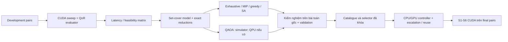

# Đề xuất tích hợp quantum cho workshop PARMA-DITAM 2027

Ngày khảo sát: **21/10 (Thứ 4), năm 2026**. Trạng thái: **đề xuất nghiên cứu để thảo luận**, chưa thay đổi phương pháp, interface hoặc phân công của Nhóm. Chưa triển khai solver, chưa chạy QPU và chưa có kết quả quantum trên pipeline của Nhóm.

## 1. Khuyến nghị và phạm vi

**Ưu tiên một thí nghiệm chọn catalogue cấu hình offline bằng QUBO/QAOA; giữ controller online và S1–S6 chạy cổ điển trên CPU/GPU.** Catalogue là tập nhỏ các cấu hình `(S, K, R, B)` dùng chung cho nhiều cảnh. Chỉ xem xét đưa thí nghiệm vào paper sau khi có bảng latency/QoR thực và vượt các điều kiện ở mục 8.

Lý do chọn hướng này là khả năng dùng lại dữ liệu characterization/Pareto, kiểm chứng nghiệm bằng code cổ điển và tách chi phí quantum khỏi đường chạy từng cặp ảnh. Đây là đánh giá khả thi về kiến trúc; chưa có bằng chứng catalogue do quantum tìm được tốt hơn catalogue do solver cổ điển tìm được.

Nếu ưu tiên đóng góp quantum trực tiếp vào computer vision cho nghiên cứu dài hơn, **S5 robust fitting** có nền tảng liên quan rõ hơn qua CVPR 2022 và ECCV 2024 [R1, R2]. Thay S5 ở thời điểm hiện tại sẽ làm thay đổi estimator, núm R, trạng thái reuse và cách đo overhead; chưa khuyến nghị cho bản workshop đang triển khai.

Tài liệu phân biệt ba loại kết luận:

- **Bằng chứng bên ngoài:** paper đã công bố, phương pháp, backend và giới hạn đọc được từ nguồn gốc.
- **Suy luận cho dự án:** mức phù hợp với contract và research question hiện tại.
- **Thiết kế đề xuất:** mô hình toán, protocol và điều kiện dừng do tài liệu này đề nghị; cần Nhóm xét duyệt trước triển khai.

Mục tiêu là xây một đề xuất có thể bị kiểm chứng và bác bỏ. Việc dùng nguồn từ CVPR, ECCV, AAAI hoặc Nature Computational Science không bảo đảm novelty hay khả năng được chấp nhận ở các venue đó.

## 2. Bối cảnh repo và câu hỏi nghiên cứu

Nguồn nội bộ: [kế hoạch](plan.md), [pipeline](stages.md), [quy ước](conventions.md), [benchmark/QoR/S4–S5](benchmark-qor-s4-s5-decisions.md), [S6](s6-warp-blend.md) và [khung paper](../PARMA-DITAM_2027_Workshop/README.md). Checkout khảo sát dựa trên `e2c00e8`; đã có header chung, CMake, tests host/CUDA và mock OpenCV. Chưa thấy kernel S1–S6, harness, controller hoặc bảng benchmark trong checkout này. Việc thiếu artifact tại đây không chứng minh các thành viên chưa có code trên nhánh khác hoặc kết quả ngoài repo.

Theo lịch Nhóm, Phase 1 có mốc **25/10 (Chủ nhật)**; mốc nộp của Nhóm là **13/11 (Thứ 6)**. Đây là ràng buộc tiến độ từ kế hoạch, không phải xác nhận các điều kiện bắt đầu phase đã hoàn thành.

Research question hiện tại là giảm GPU stitching latency bằng phân bổ budget theo cảnh dưới quality policy cố định. Câu hỏi mở rộng đề xuất:

**RQ-Q:** Với cùng dữ liệu development và ràng buộc QoR, một solver QAOA có tạo được catalogue ít cấu hình, giữ được độ phủ và latency gần Oracle, với chi phí tìm kiếm cạnh tranh với các solver cổ điển hay không?

Ba câu hỏi phụ cần trả lời riêng:

1. Catalogue nhỏ có thực sự giúp controller giảm overhead hoặc cải thiện generalization so với dùng toàn bộ lưới cấu hình?
2. QUBO có biểu diễn đúng bài toán catalogue, sau khi tính đủ slack variables và tiền xử lý?
3. Quantum solver đóng góp gì ngoài việc thực hiện lại một phép tối ưu mà greedy hoặc exact solver đã giải nhanh?

**Giới hạn quan trọng:** nếu đã biết latency và tính khả thi của mọi cấu hình cho một cặp ảnh, chọn cấu hình nhanh nhất chỉ cần quét `|C|` phần tử. Phần tổ hợp ở đề xuất nằm trong việc nhiều cảnh cùng chia sẻ một catalogue nhỏ. Chưa coi bài toán chọn cấu hình online của repo là NP-hard.

Workshop có các topic về accelerators, heterogeneous computing, runtime management và performance case studies [W1]. Một nghiên cứu phân chia offline/online và đo trade-off có thể phù hợp các topic đó; đây là diễn giải của dự án. Quantum không phải yêu cầu của workshop.

## 3. Cách khảo sát và giới hạn bằng chứng

Khảo sát định hướng, cập nhật đến ngày ghi đầu tài liệu; ưu tiên công trình được xuất bản tại CVPR/ECCV, AAAI và các tạp chí quantum/ML có nguồn gốc truy cập được. Bổ sung Q-SE vì sát bài toán configuration selection, cùng nguồn nền tảng về set cover và graph cuts. Không dùng impact factor, citation count hoặc xếp hạng venue thay cho kiểm tra phương pháp.

Các nhóm truy vấn được dùng:

- `quantum robust fitting homography`, `robust fitting gate quantum computer`;
- `quantum multi-model fitting`, `QuCOOP`, `HQC-NBV`;
- `quantum configuration selection QAOA`, `algorithm portfolio selection`;
- `quantum multi-objective optimization`, `quantum optimization benchmarking`;
- `quantum machine learning classical baselines`, `shadow models`.

Nguồn tìm và đối chiếu gồm CVF/ECVA, AAAI, trang publisher, kho của tác giả/cơ quan và arXiv. Loại khỏi căn cứ kết luận các bản tin marketing, diễn giải thứ cấp và paper không liên quan đến một điểm tích hợp cụ thể. Bản arXiv và bản hội nghị của cùng công trình được tính là một nguồn. Không thống kê PRISMA hoặc tổng số hits vì công cụ tìm kiếm này không tạo một corpus đầy đủ, ổn định.

Phạm vi đọc ghi ở bảng dưới là các phần thực sự được kiểm tra, không có nghĩa đã đọc toàn bộ mọi phụ lục. Khi dùng preprint để đọc phương pháp nhưng metadata của venue để xác minh xuất bản, ghi riêng hai nguồn. Khảo sát không phải kiểm toán retraction đầy đủ và không xác nhận novelty toàn lĩnh vực.

ARS được dùng để tổ chức tìm kiếm, kiểm chứng và phản biện. Có một lượt khảo sát nguồn được giao riêng; phần tổng hợp, lập mô hình và tự phản biện được thực hiện trong ngữ cảnh chung. Đây không phải một hội đồng review độc lập hoặc cross-model review. Không gửi manuscript riêng tư sang API nghiên cứu bên ngoài.

### 3.1. Bằng chứng liên quan trực tiếp

| Nguồn và nơi công bố | Phạm vi đọc/kiểm tra | Bằng chứng dùng được và ranh giới |
|---|---|---|
| **[R1] HQC robust fitting — CVPR 2022** | Introduction, §§4.2–4.3, 6.2, 7; metadata CVF | Chuỗi QUBO cho robust fitting; QPU trên synthetic nhỏ, dữ liệu thực ở §6.2 dùng SA trên CPU. Không chứng minh tăng tốc GPU stitching |
| **[R2] Robust fitting on a gate quantum computer — ECCV 2024** | §§1.3–1.4, 4.2, 5–7; metadata ECVA | IonQ Aria cho minh họa nhỏ; benchmark fundamental matrix dùng thuật toán influence cổ điển. Không coi khả thi circuit là khả thi thay S5 đầy đủ |
| **[R3] QuMF/DeQuMF — CVPR 2023** | §§3, 5–6 và implementation chính thức | Chọn nhiều mô hình qua annealing, có decomposition. Decomposition không bảo đảm global optimum; phạm vi khác một global H của repo |
| **[R4] R-QuMF — CVPR Workshops 2025, Image Matching Workshop** | §§4.4, 5.1 và phụ lục timing | Xử lý outlier trong multi-model QUBO, có SA/Gurobi/D-Wave. Anneal duration riêng lẻ không đại diện tổng latency; đây là CVPRW, không phải CVPR main |
| **[R5] QuCOOP — CVPR 2025** | §§4, 7.4, 8, Appendix G và trang tác giả | QUBO cục bộ cho registration/correspondence, có D-Wave thật. So sánh nhanh hơn Q-Match QA là quantum-vs-quantum, không phải vượt BF matching GPU |
| **[R6] HQC-NBV — CVPR 2026** | Metadata CVF; §§4–6 của preprint v1 | Quyết định nhỏ kết hợp kiểm tra/fallback cổ điển. §6 dùng Qiskit Aer simulator cho toàn bộ thí nghiệm; exploration efficiency khác computational latency |
| **[R7] Quantum approximate multi-objective optimization — Nature Computational Science 2025** | Results, phần QAOA/parameter transfer và runtime | QAOA cho MO-MAXCUT, có IBM hardware. Parameter training offline được tách khỏi runtime mỗi instance; kết quả không chuyển trực tiếp sang stitching |
| **[R8] QOBLIB — Nature Computational Science 2026** | Metadata; formulation, metrics, resources và quantum runtime | Căn cứ thiết kế benchmark theo bài toán gốc, có native MIP và QUBO. Cần công khai conversion overhead, feasibility và tài nguyên |
| **[R9] Quantum configuration selection — Q-SE 2024** | Formulation, evaluation và discussion | QAOA cho attributed feature models; dùng ideal simulator. Là tiền lệ sát chủ đề, chưa phải bằng chứng advantage cho catalogue của repo |

### 3.2. Nguồn dùng để phản biện thiết kế

- **Algorithm portfolios đã có lịch sử nghiên cứu:** Hydra kết hợp configuration và portfolio selection từ AAAI 2010 [R10]. Vì vậy, xây catalogue rồi học selector tự nó chưa đủ làm novelty.
- **Dữ liệu có thể làm baseline cổ điển mạnh hơn dự đoán:** Huang et al. phân tích vấn đề này và yêu cầu so với cả classical approximations của mô hình quantum [R11]. Không suy ra quantum classifier sẽ tốt hơn trên vài tín hiệu S4/S5.
- **Offline quantum/online classical có tiền lệ:** shadow models nghiên cứu cách dùng quantum resources ở training và deployment cổ điển [R12]. Catalogue QAOA ở đây chỉ tương đồng ở cách tách offline/online; chưa phải shadow model theo định nghĩa của paper.
- **Set cover → Ising/QUBO là kỹ thuật đã biết** [R13]. Công thức ở mục 5 là cách cụ thể hóa cho bảng stitching của Nhóm, không tuyên bố phát minh phép biến đổi.
- **Seam nhị phân submodular có exact classical baseline:** graph cuts áp dụng được cho lớp năng lượng phù hợp [R14]. Khả năng viết seam thành QUBO chưa đủ chứng minh quantum có lợi.
- **QML phải có ablation phù hợp:** khảo sát thực nghiệm của Bowles et al. cho thấy baseline cổ điển và mô hình bỏ entanglement có thể cạnh tranh trên các tác vụ đã xét [R15]. Nguồn này được dùng dưới trạng thái preprint, không gán venue chưa xác minh.

Các nguồn trên nghiêng về optimization và geometric vision vì sát pipeline. Chúng không đại diện toàn bộ quantum image processing hay toàn bộ nghiên cứu quantum hiện hành.

## 4. Đối chiếu các vị trí tích hợp

| Vị trí | Cách tích hợp có thể nghiên cứu | Chi phí/rủi ro đối với repo | Khuyến nghị |
|---|---|---|---|
| **Catalogue offline** | Set cover theo QoR và latency regret; so QAOA với solver cổ điển | Cần bảng đo, encoding và validation; không thay stage ABI | **Ứng viên chính có điều kiện** |
| **S5** | Outlier/inlier selection, robust fitting quantum-classical | Thay estimator, budget R và reuse; mapping homography cần làm riêng | Hướng tiếp theo nếu muốn đóng góp quantum trực tiếp |
| **S6 seam** | Nhãn chọn nguồn ảnh trên pixel/superpixel | Cần thêm seam solver, metric sau blend; graph-cut baseline mạnh | Chưa ưu tiên trong workshop |
| **S4 matching** | QAP/correspondence kiểu QuCOOP | Bài toán khác exact top-2 nearest neighbors; dữ liệu và embedding tăng | Chưa thay BF matcher |
| **Controller QML** | Quantum kernel/VQC trên feature vector nhỏ | Chưa có dữ liệu chứng minh lợi ích; thêm training/inference overhead | Chỉ xét sau baseline cổ điển đủ mạnh |
| **Warp, resize, pyramid** | Quantum image representation/processing | Phải giải quyết nạp dữ liệu và xuất panorama cổ điển; đổi kiến trúc lớn | Không đưa vào phạm vi đề xuất |

Riêng S6, đề xuất hiện tại là inverse warp và feather/multi-band. Quantum seam sẽ bổ sung một phương pháp mới, trong khi QoR chính đang đánh giá H với B cố định. Muốn nghiên cứu seam phải bổ sung đánh giá composition trước. Không dùng SSIM/PSNR alignment hiện tại để kết luận quantum blender tốt hơn.

## 5. Phương pháp đề xuất: catalogue gần Oracle dưới ràng buộc QoR

### 5.1. Dữ liệu và mục tiêu

Giữ **B cố định** trong thí nghiệm đầu, theo đề xuất phối hợp trong tài liệu benchmark; giá trị cụ thể vẫn do Chương và Nhóm chốt. Khi đó `c = (S, K, R, B_fixed)`. Không tự thêm B vào tối ưu khi chưa có quality policy sau blend.

Với cặp development `i` và cấu hình `c`, dùng:

- `t_ic > 0`: median latency theo protocol của Nhóm;
- `a_ic ∈ {0,1}`: đạt quality policy, gồm validity, coverage và các tolerance;
- `C`: lưới cấu hình hữu hạn đã đo;
- `I_f`: các cặp có reference hợp lệ và có ít nhất một cấu hình đạt policy.

Reference failure và cặp không có cấu hình đạt policy được báo cáo riêng trên toàn tập; không biến chúng thành dữ liệu biến mất khỏi denominator của kết quả hệ thống.

Oracle trên lưới và tập cấu hình chấp nhận được:

$$
t_i^* = \min_{c\in C:\,a_{ic}=1} t_{ic},\qquad
U_i(\rho)=\{c\in C:a_{ic}=1,\ t_{ic}\le(1+\rho)t_i^*\}.
$$

`ρ ≥ 0` là latency regret tolerance trên development. Ví dụ grid `0, 0.05, 0.10, 0.20` chỉ là thiết kế pilot; chọn bằng validation, công bố sensitivity và khóa trước final test. Đây không phải nới quality policy: mọi cấu hình trong `U_i` vẫn phải đạt QoR.

Chọn biến `y_c = 1` nếu cấu hình thuộc catalogue `P`. Bài toán cơ sở:

$$
\min_{y\in\{0,1\}^{|C|}} \sum_c y_c
\quad\text{s.t.}\quad
\sum_{c\in U_i(\rho)}y_c\ge1\quad\forall i\in I_f.
$$

Đây là minimum set cover trên bảng thực nghiệm. Mục tiêu trực tiếp là giảm số cấu hình dưới coverage/regret constraint; chưa trực tiếp tối ưu mean latency, thứ tự escalation hoặc reuse cost. Khi nhiều catalogue cùng kích thước, dùng quy tắc tie-break cố định trên development và công bố nó. Nếu cần mục tiêu runtime phức tạp hơn, phải thay mô hình một cách minh bạch và so lại baseline.

**Giới hạn bảo đảm:** coverage và regret ở trên chỉ đúng cho restricted Oracle trên dữ liệu đã dùng xây mô hình. Controller online có thể chọn sai và chịu overhead/retry; không được chuyển bảo đảm này thành QoR hoặc latency guarantee trên ảnh mới.

### 5.2. QUBO và điều kiện tương đương

Đặt `A_ic = 1[c ∈ U_i]`, `d_i = |U_i| ≥ 1`. Viết bất đẳng thức thành đẳng thức bằng slack không âm:

$$
\sum_c A_{ic}y_c-1-s_i=0,\qquad
s_i=\sum_{k=0}^{b_i-1}2^kz_{ik},\quad b_i=\lceil\log_2 d_i\rceil.
$$

Khi `d_i=1`, `b_i=0`, `s_i=0`. Khi coverage thỏa, slack cần thiết nằm trong `0,…,d_i−1`, luôn biểu diễn được. Binary encoding có thể biểu diễn thêm vài giá trị lớn hơn; chúng không thể làm residual bằng 0 với một assignment `y` nằm ngoài miền coverage.

Hàm năng lượng đề xuất:

$$
E(y,z)=\lambda\sum_c y_c+
\alpha\sum_i\left(\sum_c A_{ic}y_c-1-\sum_k2^kz_{ik}\right)^2,
\qquad \lambda>0.
$$

Sau khai triển và dùng `x²=x` cho biến nhị phân, đây là QUBO. Điều kiện đủ trong số học chính xác là **`α > λ|C|`**: có nghiệm cover bằng toàn bộ C với cost không quá `λ|C|`; mọi nghiệm vi phạm có ít nhất một residual nguyên khác 0 và energy ít nhất `α`. Vì vậy ground state phải feasible và tối thiểu hóa kích thước catalogue. Điều này không bảo đảm QAOA tìm được ground state.

Penalty lớn tạo hệ số có dynamic range cao; khi scale hệ số, noise hoặc độ chính xác hữu hạn có thể làm solver khó hơn. Pilot phải kiểm tra nghiệm trong **bài toán gốc** và sensitivity của penalty, thay vì chỉ báo energy đẹp. Cách tiếp cận này theo tinh thần benchmark ứng dụng của [R8]; lập luận tương đương cụ thể ở đây là suy dẫn của đề xuất.

### 5.3. Tiền xử lý và ngân sách qubit

Trước khi tạo QUBO, có thể áp dụng các reduction bảo toàn feasibility và optimum cardinality:

1. Gộp các hàng có cùng `U_i`.
2. Nếu `U_i ⊆ U_j`, bỏ constraint `j`, vì cover `i` đã cover `j`.
3. Constraint một phần tử buộc cấu hình đó được chọn; loại tiếp các hàng đã được nó cover.
4. Bỏ cột không cover hàng nào. Với cột trùng nhau, dùng quy tắc đại diện đã khóa và lưu mapping phục hồi.

Các reduction chỉ bảo toàn bài toán cover tại `ρ` đang xét. Chúng không bảo toàn mọi latency statistic hoặc một mục tiêu escalation khác. Không loại cấu hình chỉ vì dominated trên mean latency: cấu hình đó có thể quan trọng cho một nhóm cảnh.

Số logical bits của encoding trước reduction, với các hàng có `d_i ≥ 1`:

$$
q_{\mathrm{before}}=|C|+\sum_{i\in I_f}\lceil\log_2 d_i\rceil.
$$

Sau khi thế biến cố định và reduction, tính lại `q_after = |C_remaining| + Σ_i ceil(log2 d_i_remaining)` trên các hàng còn lại. Nếu một hàng còn lại có `d_i_remaining=0`, bài toán đã infeasible và phải dừng trước khi tạo QUBO. Lưu cả kích thước trước/sau, mapping và offset của objective; không báo số cấu hình như số qubit thực dùng.

Ví dụ tự tính **trước reduction**: 6 cấu hình và 4 constraint, mỗi constraint có 6 lựa chọn, cần 18 bits; 8 cấu hình và 8 constraint, mỗi constraint có 8 lựa chọn, cần 32 bits. Các hàng trong hai ví dụ này trùng nhau nên reduction sẽ giảm mạnh kích thước; chúng chỉ minh họa chi phí encoding thô, không phải instance khó hoặc số đo dataset. Statevector complex128 cần ít nhất `16·2^q` bytes: lần lượt 4 MiB và 64 GiB chỉ cho vector trạng thái, chưa tính buffers.

**Ngưỡng pilot đề xuất là `q ≤ 20` cho mô phỏng statevector**, có kiểm tra RAM và backend trước chạy. Đây là giới hạn tài nguyên do dự án chọn, không phải giới hạn vật lý của quantum computing. Không giả định 200–300 cặp development sẽ tự giảm đủ nhỏ. Nếu reduction vẫn lớn, chỉ dùng một cohort development nhỏ được chọn trước để kiểm tra encoding/solver, rồi đánh giá catalogue trên toàn validation. Cohort đó không thay thế thực nghiệm full development và không chứng minh scalability.

Nếu instance nhỏ đủ mô phỏng nhưng exhaustive search trên các biến catalogue cũng giải rất nhanh, phải báo kết quả đó. Không tăng kích thước nhân tạo hoặc bỏ exact baseline để tạo lợi thế quantum.

### 5.4. Solver và đường triển khai

Pilot dùng **QAOA depth nhỏ `p=1,2`**, X mixer và phép đổi `x=(1−Z)/2` sang Ising. Đây là cấu hình khởi đầu để đo, không phải lựa chọn tối ưu đã được chứng minh. Khóa ngân sách evaluations/shots, seed, số restarts và tiêu chí lấy nghiệm trước lượt so sánh cuối. Khởi tạo từ heuristic/parameter transfer chỉ là ablation sau khi có baseline chuẩn.

Ngoài `q` và `p`, ghi số quadratic couplings khác zero, gate count/depth sau transpilation, đặc biệt two-qubit gates, số parameter evaluations và tổng shots. Vừa RAM để mô phỏng chưa chứng minh circuit có độ sâu hoặc ngân sách chạy phù hợp.

Không gộp quantum annealing, simulated annealing và gate-based QAOA dưới cùng một nhãn kết quả. Nếu thử D-Wave về sau, phải báo logical/physical qubits, minor embedding, chain breaks, precision, số reads và toàn bộ overhead tương ứng. Không mặc định có tài khoản, quota hoặc ngân sách QPU.

Controller chỉ đọc feature sẵn có tại thời điểm quyết định. Không dùng `a_ic`, `t_i*`, output Oracle hoặc feature S5 để đưa ra quyết định trước S5 khi chưa chạy stage đó. Chi phí tạo feature, chạy probe và escalation phải tính vào end-to-end latency. Catalogue không thay thế dependency graph và luật cache/reuse của Nhóm.

Giữ fallback cổ điển do controller quy định. Nếu fallback nằm ngoài catalogue thì báo cả `|P|` và số cấu hình triển khai thực tế, cùng fallback rate; không ghi rằng hệ thống chỉ cần `|P|` cấu hình. Fixed-High cũng có thể fail, nên fallback không phải bảo đảm thành công.

## 6. Protocol thực nghiệm và tiêu chí phản bác

### 6.1. Tách dữ liệu và khóa quyết định

- Dùng development từ train UDIS-D theo [conventions.md](conventions.md#9-chia-development-và-final); tách fit/validation trong development để chọn `ρ`, controller và ngân sách solver. Không dùng final để chọn catalogue hoặc feature.
- Lưu `pair_id`, seed, manifest, code revision, config grid, policy version và cách xử lý reference failure. Nếu dùng fallback split từ test theo quy ước, phần đã dùng development phải bị loại khỏi final.
- Fit mọi solver trên cùng bảng và cùng split. Tránh leakage giữa các cặp từ cùng cảnh/sequence khi có metadata; nếu không kiểm soát được thì công bố giới hạn.
- Quality thresholds hiện là pilot và phải được Đế/Chương chốt. Không thay chúng giữa các solver hoặc nới theo kết quả quantum.
- Chọn controller bằng development; final chỉ đánh giá một protocol đã khóa. Nếu chạy lại final sau thay đổi, báo đó là exploratory và cần tập đánh giá độc lập cho kết luận xác nhận.

### 6.2. Ba lớp đánh giá riêng

| Lớp | Baselines bắt buộc | Chỉ số và cách đọc |
|---|---|---|
| **Encoding/solver** | Exhaustive trên `y` cho instance nhỏ; exact MIP/CP-SAT cho instance lớn; greedy cover; SA trên cùng QUBO; random có cùng budget | Feasibility trên ma trận gốc, catalogue size, gap tới optimum/bound, success probability, wall time, tài nguyên. Tách raw samples và nghiệm sau repair |
| **Catalogue** | Full grid, Fixed-Best, catalogue greedy/exact/SA/QAOA ở cùng `ρ` | Validation coverage, regret của restricted Oracle, catalogue size, fallback nhu cầu. Restricted Oracle là mốc chọn cấu hình lý tưởng trong catalogue, chưa gồm controller/retry overhead |
| **Hệ thống** | Fixed-Low/High/Best; Adaptive full-grid; Adaptive với catalogue của từng solver; Oracle offline | Median/p95 latency theo pair, QoR violation, coverage, failure, overhead, retry/fallback, reuse. Cùng CUDA pipeline, evaluator và timing boundary |

Không so catalogue quantum có selector được tuning kỹ với catalogue cổ điển dùng selector yếu. Dùng cùng selector family và tuning budget; khi thay catalogue làm đổi labels/classes, huấn luyện lại bằng cùng protocol. Exact optimum của catalogue size không đồng nghĩa optimum runtime sau selector.

Đo trên Colab T4 theo quy ước: 2 warm-up, 10 lần đo cho mỗi pair/config, median theo pair/config rồi thống kê trên các pair. Báo paired differences và confidence intervals bằng resampling theo pair hoặc scene khi xác định được nhóm. Repeats trên cùng một pair không được tính thành các ảnh độc lập. Các thử nghiệm solver ngẫu nhiên cần nhiều seed đã khóa; không chỉ chọn best seed.

### 6.3. Tính đủ chi phí quantum và offline

Tách ít nhất các khoản:

`T_characterization`, `T_encoding`, `T_reduction`, `T_parameter_search`, `T_compile_or_embed`, `T_sampling`, `T_decode_validate`, `T_repair`, cùng backend/resource metadata. Chi phí characterization được chia sẻ khi cùng dùng một bảng, nhưng vẫn công bố vì đây là điều kiện để tái lập.

`T_online` giữ đúng ranh giới của Nhóm: RGB đã ở GPU đến panorama sẵn sàng ở GPU, gồm controller/synchronization/retry. Quantum chạy offline không được cộng vào mỗi ảnh; đồng thời phải báo `T_offline` và chi phí phân bổ `T_offline/N` cho một số kịch bản số ảnh sử dụng thực tế. Không tuyên bố giảm tổng thời gian chỉ từ việc dời tính toán ra ngoài vùng đo.

Nếu về sau có QPU online, báo cả queue-inclusive user latency và execution/service components; dữ liệu truyền hoặc đồng bộ phát sinh trong đường xử lý phải được tính. Năng lượng toàn hệ thống chỉ được kết luận khi đo được phạm vi tài nguyên liên quan.

Với xác suất thành công độc lập `p_s`, có thể ước lượng số runs để đạt xác suất mục tiêu 0,99 bằng `ceil(log(0.01)/log(1−p_s))`, cho `0<p_s<1`. Xử lý riêng `p_s=0,1` và nêu giả định độc lập; thời gian setup chia sẻ không được nhân lặp một cách máy móc. Đây là chỉ số bổ sung, không thay thế wall-time budget thực.

### 6.4. Ablation cần thiết

1. **Giá trị của catalogue:** full grid so với catalogue cổ điển tốt nhất, trước khi xét quantum.
2. **Giá trị của solver:** cùng mô hình, cùng preprocessing, QAOA so với exact/greedy/SA/random.
3. **Giá trị của reduction:** kích thước và thời gian trước/sau; xác nhận mapping phục hồi.
4. **Noise và penalty:** ideal sampling, finite-shot và noise model công bố rõ; không gọi noise simulation là hardware measurement.
5. **Controller và reuse:** bật/tắt catalogue, escalation và reuse từng yếu tố để tránh gán speedup CUDA cho quantum.
6. **Generalization:** fit cohort nhỏ so với full development, kiểm trên toàn validation; sensitivity theo `ρ` và quality policy đã định trước.

## 7. Novelty dự kiến, phản biện và hướng tới venue mạnh

**Claim có thể kiểm chứng:** một cách xây catalogue theo latency regret và QoR cho adaptive GPU stitching; một benchmark có native cover model, QUBO và nhiều solver; phân tích xem compression, selector hay solver tạo ra lợi ích.

**Chưa có căn cứ để claim:** phương pháp đầu tiên kết hợp quantum với stitching; quantum advantage; exponential speedup; SOTA panorama quality; bảo đảm QoR cho ảnh chưa thấy; hoặc kết quả từ simulator đại diện tốc độ QPU.

| Phản biện có thể gặp | Cách thiết kế nghiên cứu để trả lời |
|---|---|
| “Đây chỉ là set cover đã biết” | Thừa nhận phép biến đổi; chỉ giữ đóng góp nếu có vấn đề runtime thực, cấu trúc workload và evidence mới. Nếu chỉ có mapping, chưa đủ đóng góp mạnh |
| “Exact/greedy đã giải tức thì” | Công bố thời gian đó; dùng kết quả làm No-Go cho claim tăng tốc quantum. Không bỏ baseline |
| “Catalogue nhỏ đâu cần QPU” | Đo chất lượng/tài nguyên ở nhiều kích thước thật. Phân biệt technical feasibility với usefulness |
| “Speedup do CUDA/reuse, không do quantum” | So với catalogue cổ điển có cùng selector và reuse; báo chi phí offline và online riêng |
| “QoR chỉ là alignment proxy” | Giữ phạm vi claim phù hợp; nếu nghiên cứu blend phải có composition evaluation được xác nhận |
| “Subset nhỏ được chọn để quantum thắng” | Khóa cohort/seed trước, công bố mọi instance và thất bại; kiểm lại toàn validation |
| “S5 đã có quantum papers” | Trích đúng các tiền lệ và phân biệt estimator/mô hình/backend; cần ablation homography riêng nếu chuyển hướng |

Đối với **workshop hiện tại**, đóng góp hợp lý nhất là một case study có giới hạn rõ, nếu có kết quả thực. Với **CVPR/ECCV**, cần một đóng góp geometric vision hoặc robust estimation có ý nghĩa và thực nghiệm mạnh hơn việc gắn solver vào catalogue. Với **nghiên cứu systems/quantum optimization ở quy mô lớn hơn**, cần nhiều workload/instance, classical baselines hiện hành, scaling, chi phí chuyển đổi và kết quả tái lập. Đây là đánh giá của đề xuất, không phải tiêu chuẩn chính thức hay dự báo acceptance.

Nếu tiếp tục S5 cho nghiên cứu sau, câu hỏi nên xoay quanh trade-off robustness–latency của quantum-assisted outlier selection dưới cùng dữ liệu/mô hình H. Bắt đầu bằng correspondence nhỏ, so với GPU RANSAC/MSAC cùng seed/policy, rồi đo toàn bộ CPU/GPU/QPU bridge. Không giả định thuật toán fundamental matrix trong [R2] áp dụng nguyên trạng cho homography.

## 8. Điều kiện triển khai, dừng và đưa vào paper

| Gate | Điều kiện xem xét đi tiếp | Nếu không đạt |
|---|---|---|
| **G0 — nền workshop** | Pipeline GPU, evaluator và bảng đo có thể tái lập; Go/No-Go của Nhóm có dữ liệu thật | Giữ quantum ở mức đề xuất; ưu tiên Phase 1 |
| **G1 — catalogue hữu ích** | Catalogue cổ điển giảm không gian quyết định và có trade-off thực trên validation, dưới QoR đã khóa | Không cần triển khai QAOA chỉ để thêm quantum |
| **G2 — encoding đúng và vừa tài nguyên** | Kiểm tra exhaustive đúng; đếm đủ bits/coefficients; pilot phù hợp ngân sách | Dùng solver cổ điển; cohort nhỏ chỉ làm minh họa có gắn nhãn |
| **G3 — solver có giá trị nghiên cứu** | So sánh đủ exact/greedy/SA/random, có budget và raw failures, kết luận từ ứng dụng gốc | Báo feasibility/negative result; không claim advantage |
| **G4 — paper đủ bằng chứng** | Controller thật, final split và chi phí đầy đủ; kết quả quantum bổ sung cho RQ chính | Chỉ ghi Future Work; không đổi title/abstract để quảng bá quantum |

Không đặt một ngưỡng speedup mới tùy ý thay cho Go/No-Go của Nhóm. Các ngưỡng liên quan hệ thống phải được chốt trước kết quả final. Một negative result vẫn có thể hữu ích cho hiểu biết nội bộ, nhưng không mặc nhiên đủ thành contribution của full paper.

Trong bản workshop tối đa 10 trang nội dung [W1], chỉ cân nhắc một subsection và bảng/plot gọn nếu vượt G4. Nếu mới có simulator nhỏ, mô tả đúng mức proof of concept hoặc Future Work; không tách thành một câu chuyện quantum lớn làm loãng RQ chính.

### 8.1. Phối hợp đề xuất, chưa phải giao task

- **Tuấn:** xác nhận harness/CSV, tính tái lập và thời gian offline/online.
- **Đế:** xác nhận quality policy, development/final, controller và baseline S5.
- **Chương:** giữ ranh giới S6/B, tích hợp mô tả và thảo luận vào paper khi có bằng chứng.
- **Thành:** xác nhận feature/descriptor và feature availability nếu controller sử dụng tín hiệu S2/S3.

Việc đọc, viết và commit tài liệu này đã được người dùng yêu cầu; không đồng nghĩa Nhóm đã chọn phương pháp quantum. Chưa thêm dependency, tạo tài khoản QPU, chạy dịch vụ trả phí, sửa common headers hoặc đổi stage của thành viên khác.

## 9. Kiểm chứng tài liệu và phần còn thiếu

- Metadata và claim quan trọng đã đối chiếu với nguồn gốc; phạm vi đọc và phân biệt simulator/hardware ghi ở mục 3.
- Đã chạy kiểm tra exhaustive bằng Python cho **441 ma trận coverage**: mọi ma trận có 1–3 cột và 1–3 hàng, mỗi hàng khác zero, gồm cả hàng lặp. Với `λ=1`, `α=|C|+1`, duyệt toàn bộ assignments `y,z`: mọi ground state đều feasible và có cardinality bằng optimum của bài toán cover gốc. Đồng thời kiểm tra mọi assignment `y` giữ nguyên feasibility sau gộp hàng trùng/bỏ constraint superset. Tất cả trường hợp pass. Kiểm tra này chạy local, chỉ xác minh encoding nhỏ; chưa kiểm tra triển khai QAOA, noise, mọi reduction hoặc performance T4/QPU.
- Đã kiểm tra UTF-8, reference IDs, liên kết file nội bộ, code/math fences và whitespace. Không dùng kết quả kiểm tra cấu trúc tài liệu để suy ra kết quả nghiên cứu.
- Chưa có bảng latency/QoR của Nhóm, catalogue thật, kết quả QAOA, Colab T4 hoặc QPU cho đề xuất này. Không có số thực nghiệm tổng hợp để suy ra improvement.
- Novelty còn cần đối chiếu sâu với algorithm configuration/selection và các nghiên cứu cover-based portfolio design. QAOA feasibility không đủ để giải quyết khoảng trống này.
- Tài liệu S6 đang có snapshot cũ về cấu trúc repo; cần cập nhật bằng task riêng. Đề xuất này không tự sửa quyết định S6 hoặc conventions.

## 10. Tài liệu tham khảo và nguồn truy cập

Tất cả URL dưới đây được truy cập trong ngày khảo sát ghi đầu tài liệu. Các bản arXiv dùng đọc nội dung được chỉ rõ; trạng thái venue dựa trên trang xuất bản hoặc trang tác giả chính thức. Không trích các chỉ số cải thiện của paper ngoài thành số liệu dự án.

**[R1]** Doan, A.-D., Sasdelli, M., Suter, D., & Chin, T.-J. (2022). *A hybrid quantum-classical algorithm for robust fitting*. CVPR, 417–427. [Metadata CVF](https://openaccess.thecvf.com/content/CVPR2022/html/Doan_A_Hybrid_Quantum-Classical_Algorithm_for_Robust_Fitting_CVPR_2022_paper.html); [full text arXiv v4](https://arxiv.org/html/2201.10110v4).

**[R2]** Yang, F. F., Sasdelli, M., & Chin, T.-J. (2024). *Robust fitting on a gate quantum computer*. ECCV, 120–138. [ECVA](https://www.ecva.net/papers/eccv_2024/papers_ECCV/html/37_ECCV_2024_paper.php); [DOI](https://doi.org/10.1007/978-3-031-73232-4_7); [full text arXiv v1](https://arxiv.org/html/2409.02006v1).

**[R3]** Farina, M., Magri, L., Menapace, W., Ricci, E., Golyanik, V., & Arrigoni, F. (2023). *Quantum multi-model fitting*. CVPR. [CVF paper](https://openaccess.thecvf.com/content/CVPR2023/papers/Farina_Quantum_Multi-Model_Fitting_CVPR_2023_paper.pdf); [full text arXiv v1](https://arxiv.org/html/2303.15444v1); [implementation](https://github.com/FarinaMatteo/qmmf).

**[R4]** Pandey, S., Magri, L., Arrigoni, F., & Golyanik, V. (2025). *Outlier-robust multi-model fitting on quantum annealers*. CVPR Workshops, Image Matching Workshop. [Trang tác giả](https://4dqv.mpi-inf.mpg.de/RQMMF/); [full text arXiv v1](https://arxiv.org/html/2504.13836v1).

**[R5]** Kuete Meli, N., Golyanik, V., Seelbach Benkner, M., & Moeller, M. (2025). *QuCOOP: A versatile framework for solving composite and binary-parametrised problems on quantum annealers*. CVPR. [Trang tác giả](https://4dqv.mpi-inf.mpg.de/QuCOOP/); [full text arXiv v1](https://arxiv.org/html/2503.19718v1).

**[R6]** Yu, X., & Chen, C. W. (2026). *HQC-NBV: A hybrid quantum-classical view planning approach*. CVPR, 35091–35100. [Metadata CVF](https://openaccess.thecvf.com/content/CVPR2026/html/Yu_HQC-NBV_A_Hybrid_Quantum-Classical_View_Planning_Approach_CVPR_2026_paper.html); [preprint v1 đọc phương pháp](https://arxiv.org/html/2505.05212v1).

**[R7]** Kotil, A., Pelofske, E., Riedmüller, S., Egger, D. J., Eidenbenz, S., Koch, T., & Woerner, S. (2025). *Quantum approximate multi-objective optimization*. Nature Computational Science, 5, 1168–1177. [Bài xuất bản và DOI](https://www.nature.com/articles/s43588-025-00873-y).

**[R8]** Koch, T., et al. (2026). *The Quantum Optimization Benchmarking Library*. Nature Computational Science, 6, 653–671. [Bài xuất bản, danh sách tác giả đầy đủ và DOI](https://www.nature.com/articles/s43588-026-00991-1); [QOBLIB](https://github.com/ZIB-AOPT/QOBLIB).

**[R9]** Ammermann, J., Brenneisen, F. J., Bittner, T., & Schaefer, I. (2024). *Quantum solution for configuration selection and prioritization*. Q-SE, 8 pages. [DOI](https://doi.org/10.1145/3643667.3648221); [author full text tại KIT](https://publikationen.bibliothek.kit.edu/1000173454/154123677).

**[R10]** Xu, L., Hoos, H. H., & Leyton-Brown, K. (2010). *Hydra: Automatically configuring algorithms for portfolio-based selection*. AAAI, 24(1), 210–216. [Proceedings và DOI](https://ojs.aaai.org/index.php/AAAI/article/view/7565).

**[R11]** Huang, H.-Y., Broughton, M., Mohseni, M., Babbush, R., Boixo, S., Neven, H., & McClean, J. R. (2021). *Power of data in quantum machine learning*. Nature Communications, 12, 2631. [DOI](https://doi.org/10.1038/s41467-021-22539-9); [full text arXiv v2](https://arxiv.org/html/2011.01938v2).

**[R12]** Jerbi, S., Gyurik, C., Marshall, S. C., Molteni, R., & Dunjko, V. (2024). *Shadows of quantum machine learning*. Nature Communications, 15, 5676. [Bài xuất bản và DOI](https://www.nature.com/articles/s41467-024-49877-8).

**[R13]** Lucas, A. (2014). *Ising formulations of many NP problems*. Frontiers in Physics, 2, Article 5, §5.1 Set cover. [Full text và DOI](https://www.frontiersin.org/journals/physics/articles/10.3389/fphy.2014.00005/full).

**[R14]** Kolmogorov, V., & Zabih, R. (2004). *What energy functions can be minimized via graph cuts?* IEEE TPAMI, 26(2), 147–159. [Trang tác giả](https://pub.ista.ac.at/~vnk/papers/WHAT_ENERGIES.html); [full text](https://pub.ista.ac.at/~vnk/papers/KZ-PAMI-graph_cuts.pdf).

**[R15]** Bowles, J., Ahmed, S., & Schuld, M. (2024). *Better than classical? The subtle art of benchmarking quantum machine learning models*. Preprint, arXiv:2403.07059v2. [Metadata](https://arxiv.org/abs/2403.07059); [full text v2](https://arxiv.org/html/2403.07059v2).

**[W1]** PARMA-DITAM 2027. *Call for papers; information for authors*. [CfP chính thức](https://parma-ditam-workshop.github.io/parma_ditam_2027_CfP.pdf); [website](https://parma-ditam-workshop.github.io/). Phạm vi workshop và giới hạn review được đối chiếu với kế hoạch Nhóm; camera-ready là giai đoạn riêng.
