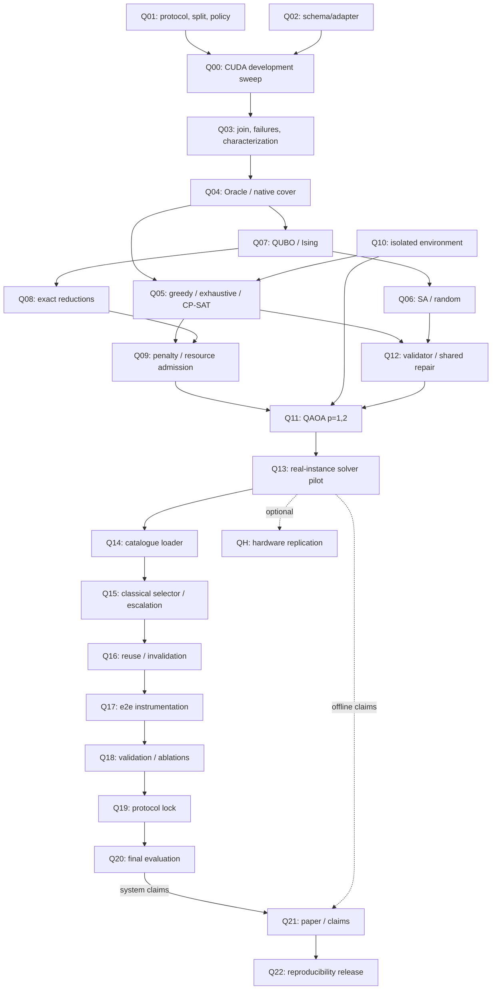

# Kế hoạch triển khai quantum catalogue selection

## Material Passport

- Origin Skill: academic-research-suite / deep-research.
- Origin Mode: backlog triển khai từ nghiên cứu có RQ xác định.
- Origin Date: 2026-10-24; cập nhật 24/10 (Thứ 7), năm 2026.
- Verification Status: PLANNED — chưa coi task dưới đây là đã triển khai hoặc được owner nhận.
- Version Label: quantum_catalogue_tasks_v1.
- Tài liệu phương pháp: [quantum-integration-proposal.md](quantum-integration-proposal.md).

## 1. Phạm vi, owner và Definition of Done

Primary path đã chọn: **A — offline QUBO/QAOA catalogue selection**, B_fixed. Tạo bảng đo CUDA trước, xây native cover/QUBO, chạy QAOA simulator p=1,2 có raw samples, rồi so với classical baselines và tích hợp catalogue vào controller cổ điển. Không chuyển sang S5 estimator, S6 seam hoặc quantum classifier để thay thế phần còn thiếu.

Owner dưới đây là đề xuất: Tuấn giữ S1/harness/common/merge; Thành giữ S2–S3; Đế giữ S4–S5/controller và duyệt QoR; Chương giữ S6, đề xuất nhận quantum tooling và tổng hợp. Mỗi owner stage chịu trách nhiệm code của mình; Tuấn review interface/CSV chung. Không giao thêm trách nhiệm cho Thành ngoài review keypoint/descriptor và feature availability khi cần.

Effort là ước lượng **person-day làm việc tập trung**, một ngày khoảng 6 giờ, chưa được đo và không phải deadline. Task harness/CUDA/controller một phần trùng task đã có trong plan; không cộng đôi thành effort quantum. Không có deadline riêng từng task; Nhóm xếp backlog này vào phase hiện tại hoặc phase sau sau khi review, giữ mốc chung trong plan. P0 là bắt buộc cho thí nghiệm quantum offline; P1 cho kết luận runtime/paper; P2 là hardware/extension tùy chọn.

Definition of Done cho tích hợp quantum ứng dụng: Q00–Q13 có artifact kiểm tra được, QAOA thực sự chạy trên ít nhất một instance từ CUDA sweep còn q_after>0 sau reduction, native/classical baselines đủ, raw và repaired outputs tách biệt. Optimum=1 hoặc classical giải nhanh không miễn prototype khi q_after>0 và đủ tài nguyên. Kết quả QAOA không có feasible raw sample vẫn là negative experiment nếu circuit/counts/logs hợp lệ; không được xuất catalogue thành công giả. Khi đó muốn hoàn tất tích hợp vào controller phải có catalogue hybrid hợp lệ, truy vết nguồn và repair, hoặc ghi rõ phần tích hợp chưa hoàn thành. Claim hệ thống còn cần Q14–Q20; Q21–Q22 để bàn giao paper/tái lập. QPU không bắt buộc.

Mọi CLI và file code `tools/quantum/*` dưới đây là **dự kiến chưa tồn tại**, trừ tooling QoR/S6 dẫn chiếu sẵn. Artifacts data/results/build không commit theo conventions; lưu manifest/hash và vị trí chia sẻ. Small test fixtures có thể commit trong tests theo quy ước Nhóm; không commit dataset hoặc raw benchmark outputs.

## 2. Dependency graph và critical path

Q00 được đặt đầu vì chưa có CUDA characterization hợp lệ. Q01/Q02 là prerequisite chuẩn bị của Q00, có thể làm trước khi đủ kernel. Q04–Q12 có thể phát triển bằng toy fixtures khi chờ, nhưng không đóng task nghiệm thu dữ liệu thật bằng toy. Graph có cả chuỗi tooling song song và đường dữ liệu chính.

Critical path: CUDA đủ stage/harness → Q00 → Q03 → Q04 → encoding/admission → Q11/Q13 → controller replay → final. Q10, tiny-instance tests và validator có thể làm song song. Nếu critical path bị chặn, báo missing artifact; không thay bằng timing S6-only hay mock CPU.

## 3. Nhóm dữ liệu characterization

### Q00 — Complete the development CUDA sweep

- **Owner đề xuất:** Tuấn (harness/sweep), Đế (ghép S1–S6), từng owner sửa stage của mình; **Priority:** P0.
- **Dependencies:** Q01, Q02; stage GPU và T4/harness đủ điều kiện theo plan. **Estimated effort:** 1–2 ngày chạy/kiểm tra sau tích hợp; không bao gồm viết stage còn thiếu.
- **Deliverable:** sweep CUDA cho các development-fit/validation pairs được phép, C=(S,K,R,B_fixed), Fixed-High và baseline cần thiết; có 2 warmup + 10 đo/pair/config.
- **Acceptance criteria:** cùng timing boundary t_e2e của conventions; algorithm seed cố định, H tất định; đủ stage thực chạy GPU; H trong hệ RGB gốc B→A; lưu mọi launch/runtime failure; config/repeats coverage được kiểm bằng manifest. Không thay measurements thiếu bằng CPU/mock hoặc latency S6-only.
- **Go/No-Go:** G0; thiếu stage/harness/T4 thì BLOCKED ứng dụng, không đánh sweep complete. Toy test của tooling vẫn có thể chạy độc lập.
- **Artifacts:** `runs.csv`, `meta.json`, config-grid/split manifests, logs, GPU/driver/CUDA/clock/git/source hashes; vị trí dự kiến `results/quantum-characterization/<run_id>/`.

### Q01 — Freeze the pilot protocol and scene-grouped splits

- **Owner đề xuất:** Đế (policy/reference/split), Tuấn (CSV/measurement), Chương (B); **Priority:** P0.
- **Dependencies:** quyết định hiện có trong docs; không phụ thuộc Q00. **Estimated effort:** 0,5 ngày review, chưa tính chuẩn bị dataset lớn.
- **Deliverable:** protocol pilot có C, B_fixed, Fixed-High, candidate/fallback spaces, split/grouping, seeds và policy version/hash.
- **Acceptance criteria:** validation tách từ development được phép; final không đổi; scene/sequence/ảnh dùng chung không leakage khi metadata cho phép. Policy pilot 0.95/0.02/0.5 được ghi là đề xuất cho tới Đế duyệt. Khóa quantile method và failure/repeat handling. Sensitivity grids/rho/budget có người duyệt, không tự thay Go/No-Go runtime.
- **Go/No-Go:** chưa có owner decision thì chỉ cho synthetic tooling/pilot có nhãn, chưa chạy final hoặc claim QoR chính thức.
- **Artifacts:** `protocol-pilot.json`, `splits.json`, `config-grid.json`, `policy.json`, decision record; metadata thiếu scene được ghi rõ.

### Q02 — Implement the characterization schema and adapters

- **Owner đề xuất:** Chương (adapter riêng), Tuấn review schema/common boundary; **Priority:** P0.
- **Dependencies:** đọc conventions và evaluator hiện có; test schema không cần sweep. **Estimated effort:** 0,5–1 ngày.
- **Deliverable:** `tools/quantum/characterize.py`, schema bảng dẫn xuất và tiny CSV fixtures/tests.
- **Acceptance criteria:** join đúng pair_id/config_id/run_id/split, gọi evaluator/report để tính pass; không sửa runs.csv/qor.csv chung. Kiểm tra duplicate/missing rows, config mismatch, warmup, đủ 10 repeats, status/hashes. `latency_p95_repeat_ms` chỉ diagnostic; p95 main trên pair medians. Không drop silent failures.
- **Go/No-Go:** input chưa đầy đủ phải error/ledger, không tự tạo latency hoặc labels.
- **Artifacts:** schema version, tests cho malformed/missing/policy mismatch, `characterization.csv` dự kiến; implementation không có quantum dependency.

### Q03 — Validate failures and publish characterization

- **Owner đề xuất:** Chương; Đế review reference status/QoR, Tuấn review timing; **Priority:** P0.
- **Dependencies:** Q00, Q02. **Estimated effort:** 0,5 ngày.
- **Deliverable:** bảng pair/config median latency, diagnostic repeat p95, QoR pass, coverage, status và completeness report.
- **Acceptance criteria:** reference_failure/reference_unreliable, unachievable_in_C và incomplete phân loại riêng; giữ denominator toàn split. QoR pass tái tạo từ evaluator, không nhập tay. Fixed-High hợp lệ tự pass nếu nằm trong C; explicit candidate exclusion được ghi. Mỗi dòng truy về run/meta/policy hashes.
- **Go/No-Go:** G0 chỉ qua khi đủ bảng và provenance; incomplete chặn instance chính, không coi là no-pass. S6/Oxford smoke hiện có không đủ đóng task.
- **Artifacts:** `characterization.csv`, `failure-ledger.csv`, `completeness.json`, input manifest/hash và review record.

## 4. Nhóm native cover và classical baselines

### Q04 — Build the Oracle and original cover instances

- **Owner đề xuất:** Chương; Tuấn review Oracle consistency; **Priority:** P0.
- **Dependencies:** Q03 cho dữ liệu thật; phát triển trước bằng toy. **Estimated effort:** 0,5–1 ngày.
- **Deliverable:** `tools/quantum/build_instance.py`, C/I_f/t_i*/U_i(rho), original incidence matrix và original-problem validator API.
- **Acceptance criteria:** Oracle từ median t_e2e và pass trong C, không từ S6 latency; rho/epsilon comparison versioned; no-pass/empty I_f là status rõ. Fixture giải tích xác nhận U_i, full-grid coverage và infinity regret. Có hashes/scope full hoặc restricted.
- **Go/No-Go:** thiếu measurements hoặc I_f rỗng thì không xuất instance hợp lệ giả.
- **Artifacts:** `instance.json`, `incidence.npz`, `oracle.csv`, tests và configuration mapping.

### Q05 — Implement greedy, exhaustive and native CP-SAT

- **Owner đề xuất:** Chương; Tuấn review exact/bound reporting; **Priority:** P0.
- **Dependencies:** Q04; CP-SAT execution cần Q10, pure-Python tests làm trước. **Estimated effort:** 1 ngày.
- **Deliverable:** `tools/quantum/solve_classical.py` với maximum-gain greedy/reverse-delete, exhaustive-small và native integer CP-SAT.
- **Acceptance criteria:** cùng original instance/reduction và tie-break; greedy/exact feasibility được kiểm gốc; known-optimum tests. Native enumeration admission theo n_y=|C_remaining|, không theo số hàng. CP-SAT OPTIMAL/FEASIBLE/UNKNOWN và incumbent/bound tách rõ; exhaustive timeout chưa là certificate. Ghi actual wall time kể cả khi exact chạy gần như tức thì.
- **Go/No-Go:** optimum/bound sai hoặc thiếu certificate thì chặn objective-gap claims; classical mạnh không phải lý do bỏ baseline hoặc bỏ prototype quantum.
- **Artifacts:** native model export, solver logs, known-optimum fixtures, per-instance catalogue/coverage/regret report.

### Q06 — Implement QUBO SA and matched random controls

- **Owner đề xuất:** Chương; **Priority:** P0.
- **Dependencies:** Q07; phát triển trên tiny QUBO trước. **Estimated effort:** 0,5–1 ngày.
- **Deliverable:** seeded Metropolis SA, uniform-QUBO random và random-y distribution có khai báo; same-time/matched-sample runs.
- **Acceptance criteria:** tính delta energy khớp full energy; schedule/proposals/restarts, draws/evaluations và threads lưu vào log. Cùng QUBO với QAOA, không coi shot bằng SA move. Ghi raw sample/energy/status; raw feasibility không thay bằng repaired feasibility.
- **Go/No-Go:** không tái lập seed hoặc không có comparable budgets thì chưa nghiệm thu solver comparison.
- **Artifacts:** solver configs/logs, raw sample files, tests, anytime traces.

## 5. Nhóm encoding và tài nguyên

### Q07 — Implement slack QUBO, Ising conversion and decode

- **Owner đề xuất:** Chương; Tuấn review logic/formulation; **Priority:** P0.
- **Dependencies:** Q04. **Estimated effort:** 1 ngày.
- **Deliverable:** slack binary b_i=ceil(log2 d_i), upper-triangular QUBO, Ising h/J/offset, bit mapping/decode.
- **Acceptance criteria:** enumerate tiny (y,z), so residual/QUBO/Ising energies; cover-feasible y có ít nhất một zero-penalty slack, equality-feasible sample luôn cover gốc. Với alpha>lambda|C|, ground state cardinality bằng exact cover; test singleton, duplicate, non-power-of-two degree, empty/invalid row, endian/factor-2. QUBO-feasible phải định nghĩa là residual zero, không là mọi bitstring.
- **Go/No-Go:** bất kỳ mismatch nào chặn QAOA; không sửa tolerance/penalty để che lỗi conversion.
- **Artifacts:** `qubo.json`, `ising.json`, `variables.json`, proof note trong proposal và `test_quantum_encoding.py`.

### Q08 — Implement optimum-preserving reductions

- **Owner đề xuất:** Chương; **Priority:** P0.
- **Dependencies:** Q07, Q04. **Estimated effort:** 0,5–1 ngày.
- **Deliverable:** duplicate/superset rows, forced singletons, zero columns, duplicate columns và full reconstruction ledger.
- **Acceptance criteria:** exhaustive nhỏ xác nhận optimum cardinality trước/sau và feasibility sau restore trên original matrix; fixed-point và idempotence tests. Giữ forced cost/representatives/hashes. Duplicate columns chỉ giữ cardinality optimum, không hứa validation-equivalence; có on/off ablation. Không sparsify mất constraints rồi nhận exact reduction.
- **Go/No-Go:** mismatch thì tắt reduction đó và sửa; q=0 xuất solved_by_reduction, không gọi quantum solution.
- **Artifacts:** `reduction.json`, before/after matrices, reconstruction tests và optimum certificates nhỏ.

### Q09 — Audit penalties, couplings and simulator admission

- **Owner đề xuất:** Chương; **Priority:** P0.
- **Dependencies:** Q05, Q07, Q08. **Estimated effort:** 0,5 ngày.
- **Deliverable:** bound alpha>lambda k_ub từ feasible cover, sensitivity grid, q_before/q_after/couplings/dynamic-range/RAM report.
- **Acceptance criteria:** default alpha=k_ub+1 khi lambda=1; below-bound tests được nhãn stress-only. Đếm q_after theo row degrees đã cập nhật sau reduction. Positive global scaling giữ mapping/offset, không clip. q<=20 là proposed admission, đo thêm actual memory. Full instance quá lớn chỉ cho restricted cohort manifest khóa trước; đánh giá full-data coverage sau đó, không claim full optimum.
- **Go/No-Go:** G1; sai bound/precision hoặc vượt RAM/time thì reject run với status rõ. Mọi instance trivial/quá lớn phải báo feasibility limitation, không lựa dataset sau khi xem quantum score.
- **Artifacts:** `resource-audit.json`, penalty-sensitivity config, cohort selection manifest và admission logs.

## 6. Nhóm QAOA prototype bắt buộc

### Q10 — Pin and verify an isolated simulator environment

- **Owner đề xuất:** Chương; Tuấn review dependency boundary; **Priority:** P0.
- **Dependencies:** không cần sweep; package/install plan trong proposal. **Estimated effort:** 0,5 ngày.
- **Deliverable:** Python 3.12 environment riêng, pinned/hashes Qiskit/Aer/OR-Tools, license inventory và install/run instructions.
- **Acceptance criteria:** compatibility import + tiny circuit smoke, CPU/RAM/threads/OS/version receipt, direct/transitive licenses/NOTICE. Không đổi pipeline requirements hoặc root build, không cần cloud credentials. Pin versions sau kiểm tra thực, không sao chép version chưa chạy.
- **Go/No-Go:** thiếu compatible environment thì chặn QAOA execution; dependency failure không được ghi thành quantum negative result về thuật toán.
- **Artifacts:** `tools/quantum/requirements-lock.txt`, environment receipt và license inventory; venv/build không commit.

### Q11 — Implement and run QAOA p=1,2 on a simulator

- **Owner đề xuất:** Chương; **Priority:** P0.
- **Dependencies:** Q07, Q09, Q10, Q12. **Estimated effort:** 1–2 ngày prototype; pilot budget giới hạn theo config.
- **Deliverable:** `tools/quantum/solve_qaoa.py`, uniform initial state, X mixer, cost Hamiltonian, finite-shot expectation/SPSA và p=1,2.
- **Acceptance criteria:** circuit phase/basis test khớp Ising oracle; raw counts tổng đúng executed shots. Lưu angles, optimizer/sampler/transpiler seeds, requested/executed calls/shots, restarts/timeouts, backend/version/circuit depth/two-qubit gates. Pilot đề xuất 10 seeds, 4 starts, 100 calls/start, 1024 shots/call + 4096 confirmation; 60 s cap gồm mọi bước solver/repair, dừng sớm ghi rõ. Raw probabilities chính từ confirmation circuit cố định; samples gộp optimizer chỉ là adaptive mixture/best-found. Exact-expectation diagnostic tách khỏi finite shots.
- **Go/No-Go:** G2 cần ít nhất một nontrivial real-sweep instance, có counts ở cả p. Feasibility=0 vẫn giữ thí nghiệm; no circuit/crash không hoàn thành task. Không nhãn simulator là hardware.
- **Artifacts:** circuits QPY/QASM phù hợp version, raw counts, angles/traces, `solver_runs.jsonl`, simulator memory/time logs.

### Q12 — Implement shared validation, repair and catalogue provenance

- **Owner đề xuất:** Chương; Đế review consumption contract; **Priority:** P0.
- **Dependencies:** Q05, Q06, Q07; có thể test không cần QAOA. **Estimated effort:** 0,5–1 ngày.
- **Deliverable:** shared original-matrix validator, canonical slack decode, deterministic add/reverse-delete repair và catalogue schema.
- **Acceptance criteria:** raw equality/cover feasibility tách; repaired y luôn được kiểm lại gốc. Cùng repair cho quantum/SA/random và empty-start control; đếm bit flips/added/deleted/time/rate. Không dùng validation/final labels. No-feasible trả status thật; catalogue success truy về sample/forced/repair, không mặc định greedy rồi gắn nhãn quantum.
- **Go/No-Go:** provenance đứt hoặc repair chiếm kết quả mà không báo thì fail nghiệm thu; hybrid repaired catalogue cần nhãn riêng.
- **Artifacts:** `catalogue.schema.json`, `catalogue.json`, raw/repaired audit, repair-only tests và logs.

### Q13 — Run the real-instance solver pilot and evaluate Go/No-Go

- **Owner đề xuất:** Chương; Tuấn/Đế review kết luận; **Priority:** P0.
- **Dependencies:** Q03–Q12 có artifact áp dụng, CP-SAT environment sẵn. **Estimated effort:** 0,5–1 ngày, không gồm sweep.
- **Deliverable:** comparison exhaustive/CP-SAT/greedy/SA/random/QAOA trên cùng instance; raw/post-repair và resource/time breakdown.
- **Acceptance criteria:** cardinality/feasibility/success/optimality gap hoặc bounds, raw feasibility probability, validation coverage/regret, repair rate và actual time đủ. CP-SAT native được phép mạnh hơn QUBO baseline. Cùng wall cap và separate resource audit; seeds/restarts retained, không chọn best seed rồi bỏ failures. Catalogue lớn/nhỏ đều giữ, thêm matched-size nếu có.
- **Go/No-Go:** G3; nếu exact/greedy thắng hoặc repair-only tương đương, chốt feasibility/negative result và dừng mở rộng. Quantum execution evidence vẫn bắt buộc; chưa có real instance thì ghi chưa hoàn tất.
- **Artifacts:** `solver-comparison.csv`, pilot report, logs/hashes, catalogue-size/regret và solver-time/instance-size plots; không vẽ scaling claim từ một instance.

## 7. Nhóm tích hợp controller cổ điển

### Q14 — Load versioned catalogues without changing stage ABI

- **Owner đề xuất:** Đế (controller); Chương xuất catalogue; Tuấn review integration; **Priority:** P1.
- **Dependencies:** Q13, Q12. **Estimated effort:** 0,5 ngày khi controller nền đã có.
- **Deliverable:** loader cho catalogue classical và QAOA/hybrid có provenance; config validation/fallback.
- **Acceptance criteria:** reject unknown config/mismatched B/policy/hash/schema, empty/invalid catalogue có error rõ; không đổi S1–S6/common. Nếu thêm fallback ngoài P, báo cả |P| và |P union fallback|. Catalogue solver-failed không được consume như success.
- **Go/No-Go:** chỉ nhận catalogue validated; không sửa source của owner khác để vượt gate.
- **Artifacts:** loader tests, schema compatibility receipt, catalogue IDs trong run metadata.

### Q15 — Implement matched classical selection and escalation

- **Owner đề xuất:** Đế; Thành review feature availability khi dùng S2/S3; **Priority:** P1.
- **Dependencies:** Q14, Q01. **Estimated effort:** 1 ngày incremental khi controller nền sẵn.
- **Deliverable:** same-family initial selector, self-check, classical escalation order/retry cap/fallback cho mọi catalogue.
- **Acceptance criteria:** features có trước quyết định và cost extraction được đo; không đọc pair_id lookup, H_ref/Oracle/Pass labels online, hoặc tín hiệu future stage. P không tự thành ladder monotonic; order khóa trên development, selector fit development và tuning validation. Same training/tuning budget giữa solver catalogues.
- **Go/No-Go:** phát hiện leakage hoặc termination không rõ thì dừng system comparison.
- **Artifacts:** feature-availability table, selector config/model hashes, transition traces và forbidden-feature tests.

### Q16 — Validate reuse and invalidation dependencies

- **Owner đề xuất:** Đế (controller/S5), từng owner stage review; **Priority:** P1.
- **Dependencies:** Q15, S5 incremental-R contract. **Estimated effort:** 0,5–1 ngày incremental.
- **Deliverable:** dependency/reuse tests cho tăng R, đổi K/S, thay H và render S6.
- **Acceptance criteria:** chỉ tăng R giữ đúng matches/hypothesis sequence nếu S5 hỗ trợ; đổi S/K invalidate phần bị ảnh hưởng, H mới chạy lại S6. Caller-owned buffers/stream sống đủ; reuse on/off cùng output/failure theo tolerance stage. Cache bookkeeping không bị loại khỏi timing.
- **Go/No-Go:** cache sai thì tắt reuse cho mọi baseline tương ứng và ghi limitation; không giữ speedup từ stale output.
- **Artifacts:** invalidation matrix, cache/retry traces, regression tests và reviewer records theo stage.

### Q17 — Measure real end-to-end controller cost

- **Owner đề xuất:** Tuấn (harness), Đế (controller telemetry); **Priority:** P1.
- **Dependencies:** Q16, Q14. **Estimated effort:** 0,5–1 ngày incremental.
- **Deliverable:** replay/benchmark fixed, full-grid và catalogue variants với e2e/controller/sync/retry/cache costs.
- **Acceptance criteria:** t_e2e cùng conventions; includes controller/retries/fallback; S6-only hoặc sum stage times không thay host e2e. Ghi failure latency, false acceptance/rejection counts/denominators, retry/fallback/coverage. Không cộng quantum offline vào mỗi ảnh; offline total/amortization vẫn có bảng riêng.
- **Go/No-Go:** thiếu online timing thì chỉ cho offline catalogue claim, chưa kết luận runtime speedup.
- **Artifacts:** `runs.csv`, traces, overhead breakdown, `qor.csv` và system metrics theo catalogue_id.

## 8. Nhóm validation, final và paper

### Q18 — Complete validation and ablations

- **Owner đề xuất:** Chương (solver/analysis), Đế (controller/QoR), Tuấn (harness); **Priority:** P1.
- **Dependencies:** Q13, Q17. **Estimated effort:** 1–2 ngày, tùy data/compute.
- **Deliverable:** development/validation report và ablations trong proposal §7.2.
- **Acceptance criteria:** full-grid vs classical/quantum; native exact/greedy/SA/random controls; reduction on/off/duplicate-columns, penalty/rho/policy sensitivity, raw/repair-only, reuse/escalation on/off. N/A quantum selector có lý do vì F ngoài primary. Oracle-C/Oracle-P/adaptive-P tách. Scene-cluster paired CI, failure denominator đủ; no tune final.
- **Go/No-Go:** nếu catalogue không hữu ích hoặc quantum không thắng, ghi negative result và giới hạn claim; không tìm cohort sau kết quả để cứu quantum.
- **Artifacts:** validation tables/plots, bootstrap seeds/config, sensitivity reports và decision record.

### Q19 — Lock the final protocol

- **Owner đề xuất:** Đế và Tuấn; cả Nhóm duyệt system thresholds; **Priority:** P1.
- **Dependencies:** Q18, Q01. **Estimated effort:** 0,25–0,5 ngày review.
- **Deliverable:** protocol-lock manifest: code, splits, policies, catalogue IDs, solver/controller parameters và planned analysis.
- **Acceptance criteria:** owner decisions rõ; final chưa được dùng tune; ngưỡng Go/No-Go runtime trong plan không bị thay ngầm. Định nghĩa campaign/resume và failure handling; mọi config/budget/CI/figure scripts có hash. Không chọn final seed hoặc catalogue theo final result.
- **Go/No-Go:** chưa lock thì không mở final; phát hiện contamination cần disclosure/holdout mới được Nhóm duyệt.
- **Artifacts:** `protocol-lock.json`, owner review/decision record, analysis manifest.

### Q20 — Run the final evaluation campaign once

- **Owner đề xuất:** Tuấn (chạy benchmark), Đế (pipeline/QoR), Chương (analysis); **Priority:** P1.
- **Dependencies:** Q19. **Estimated effort:** 1 ngày chạy/kiểm tra, phụ thuộc quota T4.
- **Deliverable:** final outputs cho Fixed-High, Fixed-Best, Oracle-C/Oracle-P và adaptive variants đã khóa.
- **Acceptance criteria:** same session/GPU/config boundary theo plan; 2 warmup + 10 measured/config, paired analysis trên pair medians. Không tune bằng final; crash resume giữ manifest và record, không thay protocol. Offline quantum costs/raw failures cùng package; simulator/hardware tách.
- **Go/No-Go:** thiếu benchmark/runtime gate thì ghi incomplete; không điền số ước lượng như đo thật.
- **Artifacts:** raw CSV/meta/logs, frozen final tables/plots, failure ledger và campaign completion receipt.

### Q21 — Write the quantum subsection and limitations

- **Owner đề xuất:** Chương; Đế review QoR/controller, Tuấn review systems/merge; **Priority:** P1.
- **Dependencies:** Q20 cho system claims; Q13 đủ cho bản subsection offline có giới hạn. **Estimated effort:** 0,5–1 ngày.
- **Deliverable:** subsection 1–1,5 trang tối đa gồm table/plot, limitations/threats, source citations và claim-evidence mapping.
- **Acceptance criteria:** mọi số sinh từ artifacts; nêu simulator/raw/repair/cost; không advantage/exponential speedup/SOTA/QoR guarantee. Quantum có thực nghiệm cụ thể kể cả negative, không chỉ Future Work. Default giữ title/RQ; abstract chỉ nhắc nếu có bằng chứng đáng kể, quyết định có record. Tôn trọng double-blind và budget OASIcs.
- **Go/No-Go:** G4; thiếu QAOA evidence không nhận quantum integration done. Không coi negative result tự động đủ contribution full paper.
- **Artifacts:** LaTeX diff khi task writing được giao, citations, result-generation manifest và reviewer disposition.

### Q22 — Package reproducibility and hand off

- **Owner đề xuất:** Chương (tooling/docs), Tuấn review release/merge; **Priority:** P1.
- **Dependencies:** Q21, các experiments được report. **Estimated effort:** 0,5 ngày.
- **Deliverable:** README reproduction, exact environment/commands, schema/version/hashes và artifact index.
- **Acceptance criteria:** replay instance→solver→decode→catalogue→tables trên một tiny fixture và real instance được phép chia sẻ; raw samples không mất. Code/docs/config/tests commit riêng hợp lý; data/build/results không commit. Instance từ dataset có license/provenance; optional QPU tokens không trong source. Working tree changes người dùng có sẵn không stage.
- **Go/No-Go:** artifact không truy vết được thì đánh incomplete, không xuất certificate tái lập giả.
- **Artifacts:** code/config/test commits, release artifact index, reproduction receipt và issue checklist.

### QH — Optional QPU or annealer replication

- **Owner đề xuất:** Chương; Tuấn duyệt resource/access; **Priority:** P2.
- **Dependencies:** Q13, quyền truy cập/chi phí được xác nhận, license/API plan riêng. **Estimated effort:** chưa ước lượng khi chưa biết backend/quota.
- **Deliverable:** cùng instances trên hardware thật nếu có tài nguyên, tuyệt đối không cần để hoàn thành simulator MVP.
- **Acceptance criteria:** gate-QPU báo device/calibration/transpile seed/depth/two-qubit gates/shots/job IDs; annealer báo logical/physical bits, embedding/chain strength/breaks/reads/postprocessing. Queue/network/compile/programming/sampling/readout/repair và wall time tách; so simulator/classical cùng original problem. Hybrid vendor solver phải khai rõ phần opaque/classical.
- **Go/No-Go:** access/cost/noise không phù hợp thì skip có lý do, không đổi primary hoặc ngoại suy simulator thành hardware.
- **Artifacts:** provider receipts/job logs, backend metadata, raw samples, embedding hoặc compiled circuits và hardware-vs-simulator report.

## 9. Gate và quyết định dừng

| Gate | Tickets / điều kiện | Nếu không đạt |
|---|---|---|
| G0 | Q00–Q03: CUDA characterization đầy đủ, policy/split có owner/hash | Chặn real-instance work; không giả dữ liệu; tooling test tiếp được |
| G1 | Q04–Q10/Q12: native/QUBO/Ising/reduction đúng, RAM/qubit phù hợp | Sửa lỗi; trivial/resource limitation báo rõ, không tạo circuit giả |
| G2 | Q11/Q13: p=1,2 real-instance circuit/counts và classical controls | Zero-feasible là negative experiment; crash/no circuit là chưa hoàn thành |
| G3 | Q13/Q18: trade-off theo criteria Nhóm khóa trước | Dừng mở rộng QPU/depth/B–F; giữ feasibility/negative report |
| G4 | Q17–Q22: controller thật cho system claims, final locked và reproducible | Giới hạn claim offline, hoặc ghi task chưa hoàn thành nếu thiếu minimum evidence |

**Go cho simulator MVP A; No-Go cho mở rộng khi không có giá trị.** Exact/greedy thắng không làm biến mất yêu cầu quantum: vẫn bàn giao circuit/logs, bảng đối chứng và negative/feasibility result. Nếu mọi real instance sau exact reduction là trivial hoặc vượt tài nguyên thì báo chưa thể hoàn thành real-application prototype trong budget, không claim toy thay ứng dụng. Không nới QoR/split/Go–No-Go sau xem kết quả. Quantum là mandatory experiment của backlog này; thắng classical là giả thuyết có thể bị bác bỏ.

## 10. Các commit dự kiến theo deliverable

| Nhóm commit tiếng Anh | Tickets liên quan |
|---|---|
| `feat(quantum): add characterization and native cover instances` | Q02–Q04 |
| `feat(quantum): add classical catalogue baselines` | Q05–Q06 |
| `feat(quantum): encode and validate catalogue QUBOs` | Q07–Q09/Q12 |
| `feat(quantum): add reproducible QAOA simulator experiments` | Q10–Q13 |
| `feat(controller): consume versioned configuration catalogues` | Q14–Q17, do Đế/Tuấn phụ trách |
| `docs(quantum): report catalogue experiments and limitations` | Q18–Q22 |

Danh sách này là cách tách commit đề xuất, chưa tạo commit hoặc giao task ngoài phạm vi nghiên cứu. Nguồn học thuật, license và giới hạn đọc nằm tại proposal §12; không sao chép citation metadata chưa kiểm chứng vào paper.
