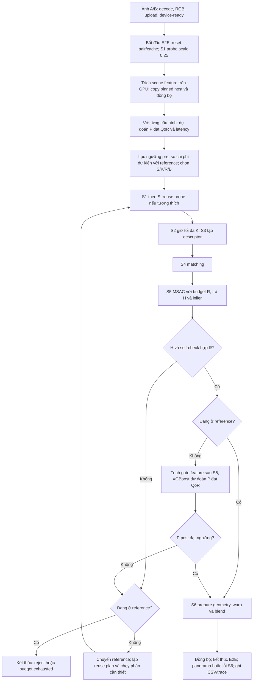
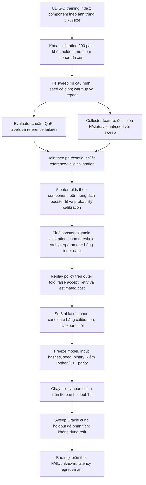

# Hồ sơ nghiên cứu Controller: workflow, thực nghiệm và các vấn đề còn mở

Ngày tổng hợp: 05/11 (Thứ 5), năm 2026. Người phụ trách: Đế. Nhánh khảo sát: `de/p3-controller-evaluation`. Tài liệu phục vụ phân tích và thiết kế thí nghiệm tiếp theo trong workshop paper; thuộc phần cải tiến bổ sung của Phase 3, deadline chung 05/11 (Thứ 5).

Tài liệu mô tả code tới `fd74277`, nhưng số đo XGBoost cuối cùng thuộc binary `a4bf474`. Các bảng số liệu được trích bằng Python từ JSON/CSV đã lưu tại máy khi lập báo cáo. Không chạy lại benchmark, train lại model, đổi gate hoặc cập nhật mặc định khi viết tài liệu này.

## 1. Trạng thái và cách đọc

Mục tiêu nghiên cứu là giảm latency xử lý một cặp ảnh bằng cách chọn lượng tính toán phù hợp, đồng thời giữ QoR tương đối với một cấu hình reference. Hiện đã có các cấu hình chạy nhanh và đạt QoR, nhưng Controller chưa chọn và chấp nhận chúng đủ tốt để đạt lợi ích toàn hệ thống.

Ba điều đã kiểm chứng cần giữ riêng:

- Oracle offline nhanh hơn reference đáng kể trên các cặp có reference hợp lệ.
- Reuse giảm chi phí của một số transition retry, đặc biệt khi chỉ tăng R.
- Controller online mới nhất chưa nhanh hơn reference dưới cùng yêu cầu QoR. Biến thể XGBoost được chọn trước holdout còn chấp nhận nhầm một cặp FAIL.

Tài liệu phân biệt **đã đo**, **suy luận từ code/kết quả**, và **đề xuất chưa thử**. Không dùng kết quả của cohort này thay kết quả cohort khác. Các policy `v1`, `v2`, `v3`, `v4` bên dưới là các thế hệ Controller trong repo, không phải các version của đồ án môn học.

Các phần chính:

1. Thuật ngữ, QoR và workflow online: mục 2–5.
2. Feature, huấn luyện và protocol đo: mục 6–8.
3. Lịch sử cải tiến và kết quả: mục 9–12.
4. Phân tích nguyên nhân, issue ledger và hướng nghiên cứu: mục 13–15.
5. Code, artifact, kiểm chứng và cách tái lập: mục 16–18.

Các kết quả trong `results/` là artifact cục bộ, không được commit. Người chỉ clone repo sẽ cần nhận thêm checkpoint để mở các liên kết raw và ảnh.

## 2. Thuật ngữ và các đại lượng dễ nhầm

| Khái niệm | Nghĩa trong báo cáo này |
|---|---|
| Pair | Một cặp ảnh A/B có vùng chồng lấn; đơn vị tổng hợp thống kê chính |
| Configuration | Bộ núm `(S, K, R, B)` cho một lần xử lý |
| S | Scale ảnh dùng để tìm homography; ảnh RGB gốc vẫn được giữ để render |
| K | Giới hạn keypoint trên mỗi ảnh; số keypoint thực tế có thể thấp hơn K |
| R | Tổng budget hypothesis của S5, không phải số vòng cộng thêm ở mỗi retry |
| B | Chế độ blend; các campaign cải tiến này giữ `feather` |
| Attempt | Một lần tìm/kiểm H theo một cấu hình; attempt sau có thể reuse một phần stage |
| Retry | Có attempt tiếp theo trong cùng adaptive run; Fixed luôn có một attempt |
| Ladder | Tập cấu hình Controller được phép sử dụng và quy tắc chuyển giữa chúng |
| Reference | Cấu hình làm chuẩn cho QoR tương đối; trong các campaign mới là S1/K2000/R1024/feather |
| Fixed-Best | Một cấu hình cố định được chọn bằng development. Trong các campaign mới trùng reference; ở pilot lịch sử không trùng |
| Oracle | Sau khi sweep và biết QoR, chọn cấu hình nhanh nhất đạt predicate cho từng pair; không tính chi phí tìm đáp án online |
| Gate | Quyết định chấp nhận kết quả sau S5 từ tín hiệu đang có; chỉ là predictor của QoR |
| False accept | Gate chấp nhận candidate nhưng evaluator chuẩn xác định QoR FAIL |
| False reject | Gate loại candidate dù cấu hình đó thực sự đạt QoR; cần mẫu số và tập đối chiếu cụ thể |
| Fallback | Thử lại bằng reference khi candidate không được chấp nhận; reference vẫn có thể lỗi pipeline |
| Buffer/workspace | Vùng nhớ đã cấp phát; giữ buffer khác với giữ kết quả tính toán để reuse |
| Regret cấu hình | Latency fixed của cấu hình đã chọn trừ latency Oracle trên cùng pair đạt QoR |

Trong v1–v3, ladder gắn với đường escalation tiến về sau. Trong v4, tên trường JSON vẫn là `ladder`, nhưng vai trò chính là **catalogue 48 ứng viên**: chọn một candidate bất kỳ, sau đó chấp nhận hoặc chuyển thẳng reference. V4 không chạy tuần tự cả 48 cấu hình.

### 2.1. QoR đang đánh giá điều gì?

QoR là Quality of Result. Trong các phép đo development này, evaluator đánh giá **alignment giữa hai ảnh**, bằng ảnh A và ảnh B được warp theo H vào khung A. Nó chưa phải điểm thẩm mỹ của panorama đã blend ở S6, cũng chưa phải sai số so với homography ground truth.

Với reference hợp lệ, predicate pilot yêu cầu đồng thời:

```text
execution_status == OK và candidate có metric hợp lệ
coverage(candidate) >= 0.95
SSIM(candidate) >= SSIM(reference) - 0.02
PSNR(candidate) >= PSNR(reference) - 0.5 dB
```

Nguồn: [quality policy pilot](../../tools/qor/policy-pilot.json), [evaluator](../../tools/qor/evaluate.py), [quyết định PASS/FAIL](../../tools/qor/decision.py). Policy có trạng thái `pilot-not-team-approved`; tài liệu không nâng nó thành quyết định nghiệm thu QoR chính thức của cả Nhóm.

Gọi `omega` là valid overlap của reference trong khung A. Candidate được chấm trên giao của `omega` với valid mask của candidate; coverage bằng diện tích giao này chia diện tích `omega`. Reference metrics dùng miền reference. SSIM dùng cửa sổ 11 × 11, Gaussian sigma 1,5 trên RGB; PSNR dùng data range 255.

Hệ quả:

- PASS có thể xuất hiện ở ảnh có SSIM tuyệt đối thấp, nếu không giảm quá mức cho phép so với reference.
- Reference không phải ground truth; reference cũng có thể sai alignment hoặc thất bại.
- `REFERENCE_FAILED`/unknown không được đổi thành PASS và không được lặng lẽ thay bằng pair khác.
- Mean SSIM/PSNR gần reference không chứng minh mọi pair giữ QoR.
- Inlier bbox coverage, tỷ lệ patch hợp lệ và coverage QoR có các mẫu số khác nhau; không dùng thay nhau.

### 2.2. Vì sao gate không tính thẳng QoR chuẩn?

Gate nằm sau S5, trước S6. Nó biết A/B, H candidate và matching/inlier đã tính; không có H reference cho pair đang chạy. Muốn chấm predicate tương đối chính xác phải chạy reference hoặc có một chuẩn tương đương. Làm vậy thường tiêu mất phần latency đang muốn tiết kiệm.

Do đó gate dùng tín hiệu nội tại và metric ảnh lấy mẫu để **dự đoán** candidate có đạt QoR hay không. Gate ACCEPT không đồng nghĩa evaluator PASS. Gate ACCEPT cũng chưa đảm bảo S6 tạo được panorama: canvas hoặc workspace S6 vẫn có thể không hợp lệ.

## 3. Pipeline và các núm tính toán

| Bước | Công việc | Đầu ra liên quan Controller | Núm |
|---|---|---|---|
| Nạp ảnh | Decode, chuyển RGB8, upload và bảo đảm ảnh device-ready | A/B RGB gốc | Ngoài vùng E2E được báo |
| Probe S1 | Tiền xử lý A/B ở scale cố định 0,25 | Ảnh xám nhỏ, thống kê scene | `probe_scale`, độc lập S của candidate |
| Chọn cấu hình | Rule/cây/ensemble tùy policy | S/K/R/B đầu tiên | Trong E2E adaptive |
| S1 candidate | Grayscale, tiền xử lý và resize theo S | Gray A/B, ScaleInfo | S |
| S2 | FAST, Harris ranking, giữ tối đa K điểm | Keypoint và count mỗi ảnh | K |
| S3 | Descriptor nhị phân rBRIEF | Descriptor tại các keypoint | Gián tiếp theo K/S |
| S4 | Hamming matching và ratio test | Match, distance, top2 workspace | Gián tiếp theo K/S |
| S5 | MSAC/RANSAC tìm H và refine | H, match/inlier, coverage, residual | R |
| Gate | Kiểm điều kiện hợp lệ và dự đoán QoR | ACCEPT, RETRY hoặc REJECT | Policy/gate threshold |
| S6 | Chuẩn bị canvas, warp và feather blend | Panorama hoặc lỗi render | B cố định trong campaign |
| Ghi kết quả | CSV run, attempt trace, status và timing | Artifact kiểm chứng | Không thay quyết định online |

Grid v4 có S ∈ {0,25; 0,50; 0,75; 1,00}, K ∈ {500; 1000; 2000}, R ∈ {128; 256; 512; 1024}, B = feather: tổng 48 cấu hình. Scale cao không bắt buộc K/R cao.

H trả theo chiều B → A, trong tọa độ RGB gốc. S5 tìm `H_s` trong hệ ảnh resize rồi đổi về `H = inverse(D_A) * H_s * D_B`, với quy ước tâm pixel của [geometry contract](../conventions.md). Feature sau warp và evaluator phải cùng quy ước; không đơn giản nhân tọa độ với `1/S` rồi bỏ offset tâm pixel.

S/K/R thay đổi workload khác nhau. Giảm K có thể giảm descriptor và matching, đồng thời đổi tập match mà S5 chấm. Giảm R giảm budget tìm H. Cùng R vẫn có chi phí S5 khác nhau khi số match khác nhau. Tăng R không tạo thêm correspondence vì S4 đã cố định.

Budget cao không bảo đảm mọi metric ảnh tăng đơn điệu: thay K/S có thể đổi correspondence, còn thêm hypothesis có thể chọn một H khác. Reference là điểm đối chứng được khóa, không phải cấu hình có chất lượng tuyệt đối tốt nhất cho từng pair. Trong policy cũ, cấu hình cao nhất vẫn có thể bị self-check ngưỡng từ chối; v4 chủ động bỏ learned gate tại reference nhưng vẫn xử lý H/pipeline failure.

## 4. Workflow online hiện tại: v4 pooled XGBoost

Sơ đồ mô tả đường policy v4 đã tích hợp, được chạy khi truyền file `controller-policy-v4` tường minh. Wrapper campaign cũ vẫn dùng `legacy-v1` nếu không nhận policy mới; chưa thay mặc định sang XGBoost. Đây là mô hình đã train offline, không tự học online sau mỗi pair.



Đường lỗi API, CUDA hoặc execution không hợp lệ có thể kết thúc run ngay; không phải mọi lỗi đều được coi là tín hiệu chất lượng để retry. Khi fallback đổi K hoặc S, các stage tương ứng được chạy lại theo reuse plan; mũi tên trở về S1 trong sơ đồ chỉ vị trí điều phối, không bắt buộc chạy lại mọi stage.

### 4.1. Chọn cấu hình trước khi chạy

Ba ensemble dùng chung dữ liệu các cấu hình:

```text
p_pre(x, c)  = dự đoán khả năng đạt QoR từ scene và cấu hình c
L_hat(x, c)  = dự đoán latency fixed của cấu hình c, đơn vị ms
p_post(x,c,z)= dự đoán khả năng đạt QoR sau khi có matching/alignment z
```

Controller trước hết dự đoán latency reference. Với mỗi candidate khác reference, score hiện tại là:

```text
score(c) = L_hat(x,c) + (1 - p_pre(x,c)) * L_hat(x,reference) + extra_ms
```

Chỉ xét candidate có `p_pre >= pre_threshold`; chọn score thấp nhất nếu thấp hơn latency reference dự đoán. Nếu không có candidate thỏa, chạy reference ngay. Trong policy `v4_photo`, ngưỡng pre là 0,85; ngưỡng post là 0,65; `extra_ms` là 0,429087 ms. Chi phí probe được tính trong replay và E2E; phần probe chung không cộng lại cho riêng từng ứng viên khi so score.

Score này là xấp xỉ, chưa phải expected E2E được học đầy đủ. Nó dùng xác suất **QoR FAIL** để phạt fallback, trong khi retry thực tế xảy ra khi **gate từ chối** hoặc H không hợp lệ. Gate có thể từ chối một candidate thật sự PASS và có thể chấp nhận một candidate FAIL. Chi phí fallback cũng phụ thuộc transition và reuse. Đây là điểm cần kiểm chứng thêm, không phải sai số đã được định lượng riêng trong lần đo này.

### 4.2. Sau S5 và fallback

V4 giữ self-check hợp lệ tối thiểu: ít nhất bốn inlier, H/status hợp lệ; các ngưỡng ratio/coverage/residual cũ được đặt rộng để predictor hậu kiểm quyết định QoR cho candidate. Sau đó:

- Candidate khác reference: cần feature hợp lệ và `p_post >= gate_threshold` để ACCEPT.
- Candidate bị loại: chuyển thẳng reference; không rerank các candidate còn lại bằng tín hiệu vừa quan sát.
- Reference: bỏ qua learned gate và việc trích gate feature, nhưng vẫn cần H/self-check hợp lệ; S6 vẫn có thể lỗi.
- Tối đa hai attempt. Không có chuỗi thử toàn catalogue và không cập nhật trọng số model từ pair vừa chạy.

Model JSON được nạp trước run; C++ suy luận bằng mảng cây, không gọi Python/XGBoost trong vòng xử lý pair. State machine là `Idle → AwaitingFeedback → Finished`, với RETRY giữ trạng thái chờ feedback cho attempt tiếp theo. Mỗi pair mới reset state/cache; không chuyển H hoặc scene của pair trước sang pair sau.

Ở policy photo, vòng chọn ban đầu đánh giá một latency reference và hai ensemble cho mỗi trong 47 candidate, tức tối đa 95 lượt ensemble, mỗi lượt 128 cây. Đây là số lượt suy luận từ code, không phải số attempt GPU. Chưa có phép đo cô lập để gán toàn bộ host overhead cho các lượt cây này.

### 4.3. Timing thực tế

E2E bắt đầu sau khi ảnh RGB sẵn sàng trên device, gồm probe, trích feature, copy/đồng bộ nội bộ, suy luận, các attempt/retry và S6 đến khi hoàn tất hoặc run thất bại. Decode, H2D chuẩn bị đầu vào và cấp phát workspace ở ngoài vùng đo.

Harness adaptive hiện có các điểm đồng bộ sau những stage để thu timing và feedback. Vì vậy đây là latency của implementation tích hợp hiện tại; không nên xem mọi stage event là chi phí kernel thuần hoặc xem luồng hiện tại đã tối ưu đồng bộ tối đa.

`t_controller` chứa thời gian host của probe/decision/observe, có phần chồng lấp với S1 probe và gate feature. `t_features` của từng attempt nằm trong trace; không cộng mọi cột vào nhau để suy E2E. Median gate trên toàn cohort có thể bằng 0 vì nhiều pair chạy thẳng reference và bỏ trích gate; điều đó không có nghĩa kernel gate miễn phí.

## 5. Retry và reuse: phạm vi đã chứng minh

| Transition | Kết quả còn dùng được | Phần cần chạy lại |
|---|---|---|
| Cùng S/K, tăng R | S1–S4 và raw search state S5 nếu identity/cache hợp lệ | Phần hypothesis S5 bổ sung, sau đó kiểm/refine kết quả |
| Cùng S, đổi K | Ảnh S1 | S2, S3, S4 và search S5 mới |
| Đổi S | RGB gốc, workspace đã cấp | S1–S5 theo scale mới |
| Chỉ đổi B | Không thuộc retry trong các policy này | B giữ cố định trong một run |

Cache cần cùng input/generation, seed, scale, matches và solver settings. Không reuse search state chỉ vì cùng con trỏ buffer. Khi tăng R từ 128 lên 1024, R mới là tổng budget, không chạy thêm 1024 hypothesis ngoài 128 đã có.

A2 đã chọn giữ workspace ở cả With Reuse và No Reuse. No Reuse tính lại S4 và reset search S5; With Reuse giữ match và nối tiếp search. Thí nghiệm đo lợi ích tránh tính lại, không đo lợi ích tránh `cudaMalloc/cudaFree`. Nếu chọn đúng cấu hình ở attempt đầu, reuse chưa đem lại khoản tiết kiệm retry; không suy ra giải phóng buffer sẽ nhanh hơn.

Một quy tắc đã sửa: nếu chỉ đổi R mà số match hiện có nhỏ hơn `min_inliers` của mức kế tiếp, bỏ qua mức đó. Không thể tìm 25 inlier từ 23 match bằng cách tăng R. Quy tắc không chứng minh rằng mọi retry còn lại có lợi, chỉ loại retry chắc chắn không đạt điều kiện đếm.

Trong v4_photo, fallback phổ biến giữ S/K và tăng R, nên reuse phù hợp. Một candidate K1000 fallback K2000 phải tính lại S2–S5; chi phí hai loại transition không giống nhau.

## 6. Feature đã triển khai và thời điểm được phép dùng

Nguồn layout: [feature_schema.py](../../tools/controller/feature_schema.py), [feature kernel cơ sở](../../src/controller/features.cu), [feature quan hệ](../../src/controller/relational_features.cu).

| Nhóm | Thành phần | Có trước chọn cấu hình? | Hạn chế |
|---|---|---|---|
| Scene cơ sở, 26 giá trị | Gradient A/B riêng; mỗi ảnh chia 2 × 2 vùng, mỗi vùng có mean, contrast và gradient | Có, sau probe | Texture riêng từng ảnh chưa mô tả đủ overlap/correspondence |
| Chênh lệch vùng, 4 giá trị | Chênh mean tuyệt đối A/B tại bốn vùng | Có | So vùng cùng vị trí, chưa căn chỉnh |
| Config, 3 giá trị | S, K/2000, R/1024 | Có | Cho phép chia sẻ dữ liệu giữa các cấu hình |
| Pair relation, 6 giá trị | NCC peak, peak gap, dx/dy, NCC không dịch, overlap tại peak | Có nếu bật nhóm pair/all | Chỉ tìm chuyển dịch thô trên ảnh nhỏ, chưa xử lý đầy đủ perspective/parallax |
| Gate cơ sở, 24 giá trị | Match/inlier; residual; hình học H; photometric lấy mẫu; phân bố inlier | Sau S5 | Là tín hiệu gần đúng, không phải predicate QoR |
| Geometry bổ sung, 4 giá trị | Residual p50/p90, max và độ phân tán residual trung bình theo vùng | Sau S5 | Consensus vẫn có thể khớp tốt một vùng nhỏ |
| Matching bổ sung, 4 giá trị | Mean/p90 distance, mean top2 ratio, tỷ lệ match mơ hồ | Sau S4; implementation thu cùng gate sau S5 | Chưa có reverse matching riêng để đo mutual fraction |
| Photo bổ sung, 6 giá trị | Mean/min patch SSIM, edge MAE/cosine, valid patch fraction, p90 normalized MAE | Sau S5 | Lấy mẫu ít; không có reference nên chưa biết mức giảm QoR tương đối |

Gate cơ sở gồm các tên sau, để tiện đối chiếu mô hình và tìm feature thay thế:

```text
matches_fraction, inliers_fraction, inlier_ratio, inlier_bbox_coverage,
residual_s1, residual_original,
projected_area_ratio, projected_width_ratio, projected_height_ratio,
projective_denominator_ratio, sampled_overlap,
warp_mae, warp_rmse, warp_correlation, exposure_difference,
overlap_contrast_a, overlap_contrast_b, normalized_warp_mae,
occupied_cells_a, occupied_cells_b, largest_cell_a, largest_cell_b,
spatial_entropy_a, spatial_entropy_b
```

Gate cơ sở dùng lưới photometric 64 × 64 và phân bố inlier trên lưới 4 × 4 ở mỗi ảnh. NCC thử 49 độ dịch trên 32 × 32 mẫu, dx/dy chuẩn hóa từ −0,375 tới 0,375. Photo bổ sung dùng 16 patch, mỗi patch 7 × 7; đây không phải SSIM chuẩn trên toàn overlap với cửa sổ 11 × 11.

Interface pooled chứa 39 giá trị pre và 77 giá trị post. Mỗi ablation chỉ đưa các cột được chọn vào cây rồi export về layout chung. **Policy được chọn `photo` dùng 33 cột pre và 63 cột post**: scene/config, gate cơ sở và sáu photo bổ sung. Nó không bật NCC pair, bốn matching bổ sung hoặc bốn geometry bổ sung. Nhóm `all` có đo riêng, không được chọn lại vì kết quả holdout.

Không đưa feature sau S4/S5 vào mô hình chọn ban đầu khi train. Nếu muốn dùng matching để chọn cấu hình, phải thay workflow thành nhiều bước và tính chi phí probe matching vào E2E.

## 7. Workflow offline: dữ liệu, huấn luyện và khóa mô hình



### 7.1. Dữ liệu và chia tập

Calibration có 200 pair UDIS-D training; 191 pair có reference hợp lệ và được dùng để học. Chín reference failure vẫn có trong ledger. 191 × 48 = 9.168 dòng pair/config có nhãn trong thiết kế học; đây chỉ đại diện cho 191 pair độc lập theo cách chọn component, không phải 9.168 cảnh độc lập.

Sweep calibration có 96.000 measurement và 19.200 warmup. Collector có 9.600 quan sát pair/config, bao gồm các trường hợp không có feature gate vì S5 không thành công. Post model chỉ fit các quan sát có gate feature hợp lệ; pre model vẫn nhận nhãn FAIL của các cấu hình không đạt.

Các cohort validation v2, v3, v4 mỗi cohort có 50 pair; mỗi lần khóa cohort mới ngoài calibration và các cohort đã xem. CRC/size tạo component để tránh trùng ảnh giữa các phần; chưa có annotation bảo đảm mọi scene/ngữ cảnh chụp độc lập. Không dùng UDIS-D test hoặc HPatches để tune các policy bổ sung.

Các tập 50 pair đã xem kết quả hiện là dữ liệu phân tích. Chúng không còn là holdout chưa biết cho vòng tối ưu tiếp theo.

### 7.2. Cách học XGBoost

Một model dùng chung cho mọi cấu hình, thay vì model gate tách riêng mỗi cấu hình. Ba mục tiêu học là binary QoR trước chạy, log latency fixed, và binary QoR sau S5. Không học một nhãn duy nhất là ID cấu hình Oracle thắng.

Thử `(depth, rounds)` là `(2,64)`, `(3,64)`, `(2,128)`. Các tham số cố định: learning rate 0,06; `min_child_weight=12`; L2 = 20; L1 = 0,5; gamma = 0,05; histogram `max_bin=64`; subsample và colsample đều 1; hai CPU thread; seed 20261101. XGBoost version đo là 3.2.0, chỉ dùng offline. Model cuối photo có ba ensemble, mỗi ensemble 128 cây depth tối đa 2.

Mỗi outer fold giữ riêng các component đánh giá. Trong phần train của outer fold, hash chia nhóm thành phần fit booster và phần calibration xác suất/chọn ngưỡng. Sigmoid calibration fit bằng margin trên phần không dùng fit booster. Hyperparameter và ngưỡng được chọn bằng replay trên phần inner calibration này, không đọc outer fold.

Fit cuối của photo dùng 127 pair fit booster và 64 pair calibration/chọn ngưỡng. Zero false accept trên 64 pair chọn ngưỡng chưa chứng minh zero lỗi trên ảnh mới. Việc dùng cùng phần inner data để calibration xác suất, chọn ngưỡng và chọn hyperparameter cũng giới hạn độ tin cậy của kết quả inner; outer folds và holdout dùng để kiểm tiếp.

Ngưỡng pre thử {0; 0,5; 0,7; 0,85; 0,95; 1}; ngưỡng post thử {0,5; 0,65; 0,75; 0,85; 0,9; 0,95; 0,98; 0,995; 1}. Tune ưu tiên các policy không có false accept quan sát được trên inner calibration, sau đó giảm mean replay. Chọn ablation bằng outer kết quả: ít false accept trước, rồi chi phí. Cả sáu ablation đều còn lỗi ngoài fold; photo chỉ là candidate nghiên cứu có ít lỗi nhất, chưa phải policy đủ điều kiện triển khai.

### 7.3. Replay và inference

Replay dùng latency của grid, chi phí gate đo bằng microbenchmark và probe/decision dự toán. Có thêm 0,25 ms reserve cho inference đầy đủ. Với retry, replay tính fallback đầy đủ một cách bảo thủ; chưa trừ chính xác phần reuse của từng transition. Vì vậy replay cost không thay số đo E2E thật.

Export giữ float32 threshold/leaf và thứ tự cộng cây, nhánh `<` của XGBoost; mô hình cây v3 cũ dùng `<=`, không dùng lẫn. C++ loader kiểm schema, feature index, finite, cây kết thúc, giới hạn kích thước và reference cuối. Model views phải trỏ vào storage còn sống. Các kiểm này xử lý lỗi triển khai inference; chúng không bảo đảm model học đúng QoR.

## 8. Protocol đo và cách so sánh

Campaign v4 chính thức: Google Colab Tesla T4, 15.360 MiB, driver 580.82.07, CUDA/nvcc 13.0/13.0.88, Release `sm_75`, source `a4bf474`, seed RANSAC 20261101, hai warmup và mười repeat đo. Ảnh development trong các campaign này là 512 × 512. Chạy GPU tuần tự, đảo thứ tự mode theo batch và khóa hash binary/model/input trước đo.

Mỗi pair lấy median của mười repeat. Sau đó mean/median/std/p95 trong bảng được tính trên phân phối các pair-median, trừ khi ghi rõ raw repeat. Repeat không phải mẫu độc lập khi bootstrap; CI dùng resample theo pair, 10.000 lần, seed 20261101.

Luôn báo hai lớp kết quả:

1. PASS/FAIL/reference unknown trên toàn cohort, kể cả pipeline failure.
2. Latency và speedup trên cùng các pair đủ điều kiện so sánh; ghi rõ mẫu số.

Speedup reference/controller lớn hơn 1 mới là nhanh hơn reference. `ratio_of_means`, `ratio_of_medians`, median tỷ số paired và geometric mean paired là các thống kê khác nhau. Lọc chỉ các cặp cùng PASS phục vụ so sánh latency có điều kiện, không xóa việc một mode đã làm mất PASS trên toàn cohort.

Sweep Oracle bổ sung là lượt đo riêng. Khi so Controller với Oracle, dùng thời gian Controller chạy lại trong lượt bổ sung, không ghép latency Oracle mới với latency campaign gốc rồi gọi là paired measurement. So sánh các thế hệ phải chạy chúng trên cùng cohort/binary; mốc khoảng 7,5 ms, 8,5 ms hoặc 13,5 ms thuộc các nhóm khác nhau không tự chứng minh regression.

## 9. Các hướng đã áp dụng trước XGBoost

### 9.1. Policy ban đầu: gradient và năm nấc

Ladder legacy: S0.25/K500/R128; S0.5/K1000/R128; S0.5/K1000/R256; S0.75/K2000/R512; S1/K2000/R1024. Probe dùng minimum gradient A/B với ba khoảng: ≥ 0,08 bắt đầu nấc đầu, ≥ 0,04 bắt đầu nấc thứ hai, còn lại nấc thứ ba. Không bắt đầu trực tiếp ở hai nấc scale cao.

Self-check dùng bốn ngưỡng: số inlier, inlier ratio, inlier bbox coverage và residual. Số inlier tối thiểu tăng từ 15 tới 35. Thiết kế gắn scale cao với K/R cao nên bỏ mất nhiều cấu hình scale cao nhưng K/R thấp mà Oracle chọn.

Pilot 25 pair có 23 reference hợp lệ. Bảng dưới tính lại từ canonical audit trên cùng tập 23 pair; Fixed-Best lịch sử là **S1/K2000/R512**, khác reference của các campaign mới.

| Đối chiếu lịch sử | N | Median (ms) |
| --- | --- | --- |
| Fixed-Best S1/K2000/R512 | 23 | 7,8645 |
| Oracle toàn grid | 23 | 3,8410 |
| Fixed-Best/Oracle | 23 | 2,0475× |

Hai reference failure giữ riêng. `gate-summary.json` còn có median Fixed-Best 7,4410 ms trên toàn bộ 25 pair, gồm cả pair không đủ điều kiện chấm QoR; không dùng thay median có điều kiện ở bảng trên. Oracle khoảng 2× là quan sát trên tập con có thể chấm QoR, chưa chứng minh speedup toàn cohort hay speedup online.

### 9.2. Telemetry toàn test, A2 và HPatches của v1

Đây là campaign Phase 3 gốc, source `c58d754`; Fixed trong campaign này là **S0.5/K1000/R256**, không phải Fixed-Best chọn lại trên development. Toàn bộ cohort có 1.106 pair UDIS-D test, hai warmup và mười repeat.

| Mode | Input | Panorama hoàn tất | Mean (ms) | Median (ms) | p95 (ms) |
| --- | --- | --- | --- | --- | --- |
| Fixed S0.5/K1000/R256 | 1106 | 1038 | 4,2909 | 4,0732 | 8,0746 |
| Adaptive v1 | 1106 | 945 | 4,9825 | 4,7557 | 8,5886 |

Adaptive có 204 pair retry, 18,44%, trung bình 1,374 attempt/pair; 161 pair `BUDGET_EXHAUSTED`. Panorama hoàn tất chưa tương đương QoR PASS. Latency toàn cohort có cả run kết thúc sớm nên bảng này không chứng minh chất lượng tương đương.

A2 chỉ có 35 pair R-only retry. Median host retry With Reuse 0,5547 ms và No Reuse 1,3006 ms; CUDA S4+S5 tương ứng 0,5457 và 1,2812 ms. Median mức tiết kiệm paired 0,8015 ms, tương đương 58,21%. Path/H/status/count đã đối chiếu; không ngoại suy mức tiết kiệm này thành speedup trên 1.106 pair.

HPatches gồm 295 pair từ 59 viewpoint sequence, dùng ground-truth B → A để tính MCE. Fixed giữ H ở 278 pair, adaptive ở 193; panorama hoàn tất lần lượt 231 và 185. Median MCE trên mỗi tập giữ riêng là 18,533 và 7,334 px. Trên 193 pair chung, mean MCE là 68,224 và 38,547 px; median delta bằng 0, p95 delta 3,537 px. Chưa có noninferiority margin chốt trước, nên không kết luận Controller giữ nguyên độ chính xác trên toàn cohort.

Nguồn và giới hạn đầy đủ: [báo cáo Phase 3](p3-de-evaluation.md), [quyết định A2](../decisions/p3-de-a2-reuse.md). Các phép đo test/HPatches này không phải nghiệm thu cho v4.

### 9.3. V2: mở ladder, fit gate ngưỡng và rule gradient

Đã cho phép scale cao/K thấp/R thấp, fit bốn ngưỡng self-check theo QoR và chọn tối đa 12 candidate cộng reference. Gate cần ít nhất bốn positive và không có false accept đã biết trên calibration. Rule ban đầu học tối đa bốn khoảng gradient, cho phép bắt đầu mọi nấc; bổ sung skip R-only retry bất khả thi.

Kết quả calibration 191 pair hợp lệ: median reference 8,2390 ms; Oracle toàn grid 3,6380; Oracle giới hạn ladder cũ 5,2805; ladder mới 3,9020. Số đáp án Oracle có trong ladder tăng từ 23 lên 86/191. Nhưng S0.75/K500/R128 có 85 positive mà gate chỉ nhận chín; S1/K500/R128 có 92 positive mà gate chỉ nhận ba, không đủ support nên bị loại khỏi ladder.

Rule cuối chọn reference cho mọi pair. Trên validation v2: adaptive 49 PASS, một reference failure, không retry; legacy 13 PASS, 36 FAIL, một unknown. Cùng 49 pair PASS, median Fixed-Best 7,6260 ms và v2 7,6670 ms. Không phải code bỏ retry: policy bắt đầu tại nấc cuối nên không có retry để thực hiện.

Nguồn: [báo cáo calibration](controller-policy-calibration.md). Bài học là thêm candidate vào catalogue chưa đủ nếu gate chỉ nhận một phần nhỏ các positive và rollout đánh giá thử rẻ là quá tốn.

### 9.4. V3: feature nhiều chiều, cây nhỏ và cost transition

Đã thêm scene 30 chiều, gate 24 chiều có geometry/photometric/inlier distribution; học cây nhỏ theo nhãn QoR/latency và export C++; đo các chuỗi retry thực để học chi phí/target tiến về sau. Gate depth 2–3, tối thiểu tám mẫu ở lá; selector depth tối đa ba, tối thiểu 20 pair ở lá. Fit chỉ ACCEPT lá thuần positive không đảm bảo precision trên ảnh mới.

Đã thử strict, p90, p80. Tên p90/p80 mô tả yêu cầu precision khi chọn gate ngoài fold, không phải ngưỡng SSIM/PSNR và không phải cam kết trên holdout. Strict/p90 vẫn chọn reference; p80 bắt đầu rẻ 22/50 pair, có 12 retry và một false accept. Selector cuối chỉ dùng `b_tile2_gradient`, dù được cung cấp 30 đầu vào.

| Mode | PASS | FAIL | Unknown | N latency | Mean ms | Median ms | Std ms | p95 ms | Min–max ms |
| --- | --- | --- | --- | --- | --- | --- | --- | --- | --- |
| reference | 49 | 0 | 1 | 49 | 9,4779 | 8,5710 | 4,3042 | 16,8103 | 3,3185–18,7910 |
| fixed_original | 25 | 24 | 1 | 49 | 4,2638 | 3,7300 | 1,8839 | 7,3882 | 1,6300–8,2290 |
| legacy | 25 | 24 | 1 | 49 | 4,6553 | 4,6615 | 1,7600 | 7,6418 | 2,1595–8,7430 |
| v2 | 49 | 0 | 1 | 49 | 9,4801 | 8,7415 | 4,1265 | 15,7153 | 3,4185–17,6820 |
| v3_strict | 49 | 0 | 1 | 49 | 10,0914 | 9,2600 | 4,1329 | 16,3203 | 4,0190–18,2655 |
| v3_p90 | 49 | 0 | 1 | 49 | 10,0814 | 9,3400 | 4,1337 | 16,3273 | 4,0380–18,3075 |
| v3_p80 | 48 | 1 | 1 | 49 | 9,6396 | 8,4750 | 4,2041 | 17,1050 | 3,9940–19,4705 |

P80: chín pair dừng rẻ và PASS, một pair dừng rẻ nhưng FAIL, 12 pair retry rồi PASS, 27 reference-start PASS và một reference unknown. Trên chín pair dừng rẻ và PASS, median reference 13,4955 ms và p80 7,5650 ms. Mốc **13,496 ms là reference trên riêng nhóm chín pair**, không phải reference toàn cohort và không phải Fixed có retry. Nhóm này có nhiều match hơn trung bình nên S5 reference đắt hơn.

Trên 48 pair cùng PASS, speedup theo tỷ số mean của p80 là 0,9700×, CI 95% [0,8688; 1,0936]. Lợi ích nhóm dừng rẻ bị chi phí thử sai, fallback và overhead trên pair chọn reference lấn át. False accept `udis_train_003317` trượt SSIM dù PSNR tốt hơn reference.

Oracle bổ sung cùng cohort v3 có mean 3,7379 ms và median 3,7460 ms. Chỉ 4/49 đáp án Oracle có trong ladder p80; cấu hình cuối trùng 2/49, chỉ 4/48 cấu hình đạt QoR nằm trong 10% latency Oracle. Đây là lý do chuyển sang pooled model và giữ toàn bộ 48 cấu hình.

Cost transition v3 học từ 3.140 attempt trên 32 pair calibration chọn bằng hash; kiểm trên tám pair giữ riêng cho MAE 0,30865 ms, p95 absolute error 0,80666 ms, sau đó fit cuối trên 32 pair. Mô hình xấp xỉ này đã có, nhưng v4 score/replay hiện chưa dùng đầy đủ mô hình transition đó.

Nguồn: [báo cáo feature/gate](controller-learned-features.md), [báo cáo thống kê và Oracle v3](controller-detailed-statistics.md).

## 10. V4: pooled XGBoost và ablation feature

### 10.1. Những thay đổi thực sự đã làm

- Học ba ensemble dùng chung theo scene/config, có sigmoid calibration tách khỏi booster fit.
- Giữ toàn bộ 48 cấu hình, gồm mọi K500, không cần mỗi cấu hình có gate riêng mới được tham gia.
- Bổ sung NCC pair, matching ambiguity, residual theo vùng và patch/edge feature; đo sáu ablation.
- Tính feature/inference/retry trong E2E và bỏ trích learned gate khi chạy reference.
- Export inference C++ có parity; kiểm fixed cùng cấu hình có H/status/count/seed khớp policy.
- Merge bản sửa per-attempt `capacity=K` từ main trước phép đo mới, rồi thu lại grid calibration theo source đã tích hợp.

Không có thay đổi nới predicate QoR để tạo speedup. Các policy cũ được chạy lại làm baseline trên cùng binary/cohort v4; không coi latency v3 ở cohort cũ là baseline paired của v4.

### 10.2. Chi phí feature: prototype và bản song song hóa

Đây là microbenchmark trên calibration với route/model diagnostic nhỏ để tách chi phí, không phải policy đã đạt QoR. Mỗi nhóm có 729 first-attempt observation hợp lệ. Không dùng các cột này thay inference/E2E của model thật.

| Nhóm | Gate cũ ms | Gate mới ms | Probe/decision cũ ms | Probe/decision mới ms | N hợp lệ |
| --- | --- | --- | --- | --- | --- |
| existing | 0,3909 | 0,3907 | 0,2615 | 0,2599 | 729 |
| pair | 0,3937 | 0,3901 | 4,7320 | 0,3618 | 729 |
| matching | 0,9393 | 0,4098 | 0,2587 | 0,2594 | 729 |
| geometry | 0,7208 | 0,4482 | 0,2580 | 0,2599 | 729 |
| photo | 1,1942 | 0,4291 | 0,2579 | 0,2597 | 729 |
| all | 2,0371 | 0,4744 | 4,7274 | 0,3620 | 729 |

Prototype NCC bị thực hiện quá tuần tự; đã chuyển sang 49 block × 128 thread cho các độ dịch và bước finish. Patch feature dùng 16 block × 64 thread; residual/distance dùng histogram và reduction có thứ tự cố định. Không dùng floating atomic tùy thứ tự để tạo kết quả khó tái lập. Workspace cấp trước vùng đo.

Chi phí trích feature đã giảm rõ, nhưng không làm Controller chọn được cấu hình rẻ hơn. Tối ưu kernel feature và tối ưu quyết định policy là hai việc cần kiểm riêng.

### 10.3. Kết quả ngoài fold trên calibration

Mỗi hàng là 191 pair outer evaluation, replay chứ chưa phải GPU E2E policy trên holdout.

| Nhóm | N | False accept | Dừng rẻ | Retry | Mean replay ms | Reference ms |
| --- | --- | --- | --- | --- | --- | --- |
| existing | 191 | 7 | 26 | 19 | 8,9544 | 8,8432 |
| pair | 191 | 5 | 18 | 3 | 8,9506 | 8,8432 |
| matching | 191 | 4 | 18 | 17 | 9,0840 | 8,8432 |
| geometry | 191 | 6 | 22 | 21 | 9,1125 | 8,8432 |
| photo | 191 | 3 | 20 | 23 | 9,2144 | 8,8432 |
| all | 191 | 4 | 17 | 6 | 9,0093 | 8,8432 |

Không nhóm nào có zero false accept ngoài fold. Photo được chọn trước holdout vì ít lỗi nhất, không phải vì đã đạt ràng buộc giữ QoR hoặc có replay nhanh hơn reference. Nhóm `all` không tự tốt hơn nhóm nhỏ hơn. Chọn ablation bằng cùng outer kết quả có selection bias; holdout mới được dùng để kiểm candidate đã chọn.

## 11. V4: kết quả đo trên tập 50 pair mới

### 11.1. Latency, failure và các baseline

PASS/FAIL/unknown giữ toàn cohort 50 pair. Latency tính trên 49 pair reference hợp lệ, gồm cả candidate FAIL; chưa chứng nhận giữ QoR. `baseline_v2` và `baseline_v3` là policy cũ chạy trên cùng cohort/binary mới; `baseline_v3` là p80.

| Mode | PASS | FAIL | Unknown | N latency | Mean ms | Median ms | Std ms | p95 ms | Min–max ms |
| --- | --- | --- | --- | --- | --- | --- | --- | --- | --- |
| reference | 49 | 0 | 1 | 49 | 8,5870 | 7,9215 | 4,3567 | 16,5950 | 3,1505–19,1435 |
| fixed_original | 19 | 30 | 1 | 49 | 3,7101 | 3,4230 | 1,9197 | 7,3008 | 0,3240–9,4405 |
| legacy | 16 | 33 | 1 | 49 | 4,4490 | 4,2560 | 1,6549 | 7,4374 | 2,2605–9,2750 |
| baseline_v2 | 49 | 0 | 1 | 49 | 8,5657 | 7,7445 | 4,2692 | 16,7017 | 3,2555–19,2400 |
| baseline_v3 | 49 | 0 | 1 | 49 | 9,1060 | 8,4335 | 4,3770 | 16,9765 | 3,8355–22,7090 |
| v4_existing | 49 | 0 | 1 | 49 | 8,7773 | 7,9260 | 4,2805 | 16,9659 | 3,4735–19,4320 |
| v4_pair | 49 | 0 | 1 | 49 | 8,7417 | 8,1765 | 3,9129 | 16,3642 | 3,7470–18,1255 |
| v4_matching | 49 | 0 | 1 | 49 | 8,7869 | 8,0115 | 4,2673 | 16,9315 | 3,4845–19,4545 |
| v4_geometry | 49 | 0 | 1 | 49 | 8,7841 | 8,0045 | 4,2659 | 16,9209 | 3,4880–19,4515 |
| v4_photo | 48 | 1 | 1 | 49 | 8,8261 | 7,9950 | 4,2119 | 16,5090 | 2,7575–19,5750 |
| v4_all | 49 | 0 | 1 | 49 | 8,7401 | 8,3040 | 3,8887 | 16,2747 | 3,6930–18,0180 |

Không biến thể XGBoost nào chứng minh lợi thế toàn policy dưới cùng yêu cầu QoR trong phép đo này. Photo mất một PASS; các biến thể giữ đủ PASS có point estimate mean cao hơn reference. Không dùng chênh lệch nhỏ để khẳng định regression có ý nghĩa thống kê khi CI chưa hỗ trợ.

### 11.2. Speedup trên cùng pair QoR PASS

| Mode | N chung PASS | Tỷ số mean | Tỷ số median | Median paired | Geometric paired | CI 95% tỷ số mean | Nhanh/chậm pair | Mất PASS |
| --- | --- | --- | --- | --- | --- | --- | --- | --- |
| reference | 49 | 1,0000× | 1,0000× | 1,0000× | 1,0000× | [1,0000; 1,0000] | 0/0 | 0 |
| fixed_original | 19 | 2,3088× | 2,2855× | 2,2014× | 2,2811× | [2,0973; 2,6037] | 19/0 | 30 |
| legacy | 16 | 2,2221× | 2,3111× | 2,1988× | 2,1806× | [2,0757; 2,3870] | 16/0 | 33 |
| baseline_v2 | 49 | 1,0025× | 1,0229× | 0,9863× | 0,9961× | [0,9861; 1,0282] | 2/47 | 0 |
| baseline_v3 | 49 | 0,9430× | 0,9393× | 0,9006× | 0,9205× | [0,8471; 1,0571] | 6/43 | 0 |
| v4_existing | 49 | 0,9783× | 0,9994× | 0,9610× | 0,9663× | [0,9609; 1,0036] | 2/47 | 0 |
| v4_pair | 49 | 0,9823× | 0,9688× | 0,9390× | 0,9512× | [0,9354; 1,0430] | 5/44 | 0 |
| v4_matching | 49 | 0,9772× | 0,9888× | 0,9607× | 0,9641× | [0,9599; 1,0020] | 2/47 | 0 |
| v4_geometry | 49 | 0,9776× | 0,9896× | 0,9604× | 0,9646× | [0,9600; 1,0026] | 2/47 | 0 |
| v4_photo | 48 | 0,9704× | 0,9421× | 0,9459× | 0,9567× | [0,9336; 1,0058] | 12/36 | 1 |
| v4_all | 49 | 0,9825× | 0,9539× | 0,9346× | 0,9508× | [0,9360; 1,0429] | 5/44 | 0 |

Tỷ số mean photo nhỏ hơn 1; CI chứa 1. Mặt khác photo làm mất một PASS trên toàn cohort, nên dù một thống kê có cải thiện cũng chưa đủ gọi là giữ chất lượng. Những mode Fixed cũ/legacy chạy nhanh trên tập con nhưng mất nhiều PASS; không phải phương án thay thế tương đương QoR.

### 11.3. QoR distributions

Các mean/median/min lấy trên candidate có metric hợp lệ, gồm cả PASS và FAIL. Số mẫu là số pair, không nhân lên theo repeat.

| Mode | N SSIM/PSNR/cov | Mean SSIM | Median SSIM | Min SSIM | Mean PSNR dB | Median PSNR dB | Mean coverage | Min coverage |
| --- | --- | --- | --- | --- | --- | --- | --- | --- |
| reference | 49/49/49 | 0,7056 | 0,7443 | 0,3981 | 21,5921 | 20,7552 | 1,000000 | 1,000000 |
| fixed_original | 47/47/47 | 0,6712 | 0,6570 | 0,3178 | 20,9905 | 20,7976 | 0,957750 | 0,711733 |
| legacy | 39/39/39 | 0,6628 | 0,6349 | 0,2822 | 21,3269 | 20,7976 | 0,963599 | 0,677078 |
| baseline_v2 | 49/49/49 | 0,7056 | 0,7443 | 0,3981 | 21,5921 | 20,7552 | 1,000000 | 1,000000 |
| baseline_v3 | 49/49/49 | 0,7055 | 0,7443 | 0,3981 | 21,5862 | 20,7552 | 0,999973 | 0,999003 |
| v4_existing | 49/49/49 | 0,7056 | 0,7443 | 0,3981 | 21,5921 | 20,7552 | 1,000000 | 1,000000 |
| v4_pair | 49/49/49 | 0,7055 | 0,7443 | 0,3981 | 21,5909 | 20,7552 | 0,999979 | 0,999141 |
| v4_matching | 49/49/49 | 0,7056 | 0,7443 | 0,3981 | 21,5921 | 20,7552 | 1,000000 | 1,000000 |
| v4_geometry | 49/49/49 | 0,7056 | 0,7443 | 0,3981 | 21,5921 | 20,7552 | 1,000000 | 1,000000 |
| v4_photo | 49/49/49 | 0,7039 | 0,7443 | 0,3981 | 21,5664 | 20,7552 | 0,998332 | 0,943009 |
| v4_all | 49/49/49 | 0,7055 | 0,7443 | 0,3981 | 21,5909 | 20,7552 | 0,999979 | 0,999141 |

Các metric trung bình gần nhau che được một lỗi lớn ở pair riêng. Vì vậy phải giữ bảng FAIL và ảnh cùng phân phối, không chỉ mean SSIM/PSNR.

### 11.4. Timing từng stage trong campaign chính

Các số sau là mean stage của các raw repeat trên 49 pair reference-valid, gồm candidate FAIL; không phải median stage hay mean chỉ trên tập cùng PASS. S1 adaptive gồm probe và S1 của attempt khi cần. `t_controller` chồng lấp với một phần probe/feature, `t_s6` fixed có thể bao gồm khoảng chờ host sau S5; không cộng ngang bảng để suy E2E hoặc gọi tất cả là kernel time.

| Mode | S1 ms | S2 ms | S3 ms | S4 ms | S5 ms | S6 raw ms | Controller host ms |
| --- | --- | --- | --- | --- | --- | --- | --- |
| reference | 0,3718 | 0,1688 | 0,2028 | 1,4236 | 5,1725 | 1,2617 | 0,0000 |
| baseline_v3 | 0,6172 | 0,1980 | 0,2213 | 1,3497 | 4,9421 | 1,2073 | 0,7276 |
| v4_photo | 0,6176 | 0,1691 | 0,2017 | 1,4093 | 4,8500 | 1,2084 | 0,5363 |
| v4_all | 0,7198 | 0,1689 | 0,1981 | 1,3496 | 4,8316 | 1,2092 | 0,5338 |

Reference dành phần lớn thời gian stage được ghi cho S5. Photo giảm một phần chi phí S5, nhưng vẫn giữ K2000 ở gần hết pair và phát sinh probe/decision/fallback. Chênh từng cột chưa phải phân rã nhân quả vì đường xử lý và thứ tự lượt đo cũng khác nhau.

### 11.5. Cấu hình và chi phí theo nhánh của photo

| Cấu hình ban đầu photo | Pair |
| --- | --- |
| S1.00_K2000_R1024 | 35 |
| S1.00_K2000_R128 | 14 |
| S1.00_K1000_R128 | 1 |

Trong 50 pair: 35 bắt đầu reference; 15 thử rẻ; bốn retry; 11 dừng rẻ, gồm mười PASS và một FAIL. Reference-start gồm một reference unknown. Sau fallback, trên 49 pair có thể chấm, cấu hình cuối là 38 reference, mười S1/K2000/R128 và một S1/K1000/R128; không có K500.

| Nhánh photo | Tổng pair | N cùng PASS | Reference mean ms | Controller mean ms | Speedup mean |
| --- | --- | --- | --- | --- | --- |
| reference_start | 35 | 34 | 7,9905 | 8,2592 | 0,9675× |
| cheap_stop | 11 | 10 | 10,2088 | 9,5105 | 1,0734× |
| cheap_retry | 4 | 4 | 9,6085 | 12,2152 | 0,7866× |

Trong nhóm dừng rẻ và PASS, tiết kiệm trung bình chỉ khoảng 0,70 ms/pair vì phần lớn vẫn giữ S1/K2000 và chỉ giảm R. Bốn lần thử sai tốn thêm khoảng 2,61 ms/pair so với reference trên cùng nhóm. Các pair bắt đầu reference vẫn trả chi phí probe/decision. Đây là cơ chế lợi ích cục bộ không chuyển thành speedup toàn policy.

## 12. V4: đối chiếu Oracle và ảnh

### 12.1. Lượt đo Oracle bổ sung

Đây là lượt đo riêng, dùng cùng source/policy/seed. Oracle bỏ chi phí sweep/tìm đáp án online. Thời gian reference/photo ở bảng này khác campaign chính vì được đo lại.

| Mode | N reference-valid | Mean ms | Median ms | p95 ms |
| --- | --- | --- | --- | --- |
| reference | 49 | 8,4557 | 7,6775 | 16,6045 |
| v4_photo | 49 | 8,9158 | 8,0650 | 16,6221 |
| Oracle | 49 | 3,3861 | 3,0990 | 6,2540 |

| Đối chiếu | Kết quả |
| --- | --- |
| Oracle có đáp án | 49/50 pair |
| Đáp án Oracle có trong catalogue | 49/49 |
| Cấu hình ban đầu/cuối trùng Oracle | 0/49 và 0/49 |
| Cấu hình cuối trong 10% latency Oracle, chỉ pair đạt QoR | 2/48 |
| Oracle chọn K500 | 35/49 |
| Controller chọn K500 | 0/49 |
| Reference/Oracle, tỷ số mean trên 49 pair | 2,4972× |
| Controller/Oracle, tỷ số mean trên 48 cùng PASS | 2,6464× |
| S/K/R cuối trùng Oracle | 22 / 7 / 9 trong 49 pair |
| Mean độ lệch tuyệt đối S/K/R | 0,2449 / 1193,8776 / 666,1224 |
| Median độ lệch tuyệt đối S/K/R | 0,2500 / 1500,0000 / 896,0000 |

| Cấu hình Oracle | Pair |
| --- | --- |
| S1.00_K500_R128_Bfeather | 10 |
| S0.50_K500_R128_Bfeather | 8 |
| S0.75_K500_R128_Bfeather | 6 |
| S0.25_K500_R128_Bfeather | 3 |
| S0.50_K2000_R128_Bfeather | 3 |
| S1.00_K1000_R128_Bfeather | 3 |
| S1.00_K500_R256_Bfeather | 3 |
| S0.50_K1000_R128_Bfeather | 2 |
| S0.75_K2000_R128_Bfeather | 2 |
| S1.00_K1000_R512_Bfeather | 2 |
| S0.50_K500_R1024_Bfeather | 1 |
| S0.50_K500_R256_Bfeather | 1 |
| S0.75_K500_R256_Bfeather | 1 |
| S1.00_K2000_R128_Bfeather | 1 |
| S1.00_K2000_R256_Bfeather | 1 |
| S1.00_K500_R1024_Bfeather | 1 |
| S1.00_K500_R512_Bfeather | 1 |

Mọi đáp án Oracle của 49 pair đều nằm trong catalogue v4. Vì vậy mở thêm cấu hình chưa phải cách xử lý trực tiếp cho khoảng cách hiện tại. Trùng chính xác ID có thể nhạy với timing gần hòa; chỉ số regret và số pair trong 10% Oracle được báo kèm để tránh đánh giá chỉ bằng nhãn thắng.

| Phân rã trên cùng 48 pair PASS | Mean ms |
| --- | --- |
| Oracle | 3,3774 |
| Fixed đúng cấu hình Controller đã chọn | 8,1156 |
| Controller E2E | 8,9378 |
| Chênh do cấu hình | 4,7382 |
| E2E trừ fixed cùng cấu hình | 0,8222 |

Khoảng 85% chênh mean Controller–Oracle trong phân rã này đến từ cấu hình đã chọn đắt, khoảng 15% là phần E2E còn lại. Phần còn lại gồm probe, feature, suy luận, retry, host và khác biệt timing giữa các đường đo; chưa đo riêng được từng nguyên nhân. Không gọi toàn bộ 0,8222 ms là chi phí XGBoost.

### 12.2. Mẫu false accept và ảnh kiểm tra

`udis_train_009552` chạy S1/K2000/R128 và được gate ACCEPT. Trace có 436 match, 247 inlier, inlier ratio khoảng 0,5665, inlier bbox coverage khoảng 0,3226 và residual S1 khoảng 1,2971. Những tín hiệu này chưa đảm bảo QoR.

| Metric | Reference | Controller | Điều kiện PASS |
| --- | --- | --- | --- |
| SSIM | 0,690846 | 0,605733 | ≥ 0,670846 |
| PSNR dB | 18,495283 | 17,238101 | ≥ 17,995283 |
| Coverage | 1,000000 | 0,943009 | ≥ 0,95 |

Pair này trượt cả SSIM drop, PSNR drop và coverage. Patch SSIM trung bình khoảng 0,7360 và valid patch fraction bằng 1 vẫn không bảo đảm SSIM/coverage chuẩn. Gate đang nhìn các patch có thể lấy mẫu được, không đo đầy đủ miền overlap tương đối với reference.

Oracle của pair này là S0.75/K500/R128, có SSIM khoảng 0,6887, PSNR 18,4142 dB và coverage 0,9972. Có cấu hình nhanh đạt QoR ngay trong catalogue; controller đã chọn cấu hình đắt hơn mà vẫn nhận sai chất lượng.

Ảnh bên dưới là alignment preview trong khung A, **không phải panorama S6**. Ô đen là ngoài miền warp B; error map là sai khác photometric, không phải SSIM map. Metric preview đã đối chiếu CSV trong 1e-12; WebP lossless và PNG khôi phục đã kiểm pixels.


Hai mẫu khác để so hành vi:

- [Dừng rẻ và PASS: udis_train_006395](../../results/controller-v4-t4-20261104/final-checkpoint/v4-images/cheap-pass-udis_train_006395.png): Controller S1/K2000/R128, Oracle S0.75/K500/R128. PASS tương đối chưa đồng nghĩa ảnh tuyệt đối tốt.
- [Retry: udis_train_005090](../../results/controller-v4-t4-20261104/final-checkpoint/v4-images/retry-udis_train_005090.png): Controller kết thúc reference, Oracle S0.25/K500/R128.

Không gán nhãn parallax, vật thể động hoặc nguyên nhân vật lý cho từng mẫu nếu chưa có annotation/kiểm tra độc lập.

## 13. Vì sao đổi sang XGBoost vẫn chưa tốt?

### 13.1. Catalogue đã đủ, bộ chọn vẫn lọc mất cấu hình tốt

Replay model cuối trên calibration cho kết quả dưới đây. Nó gồm cả dữ liệu fit/calibration của model cuối, **không phải độ chính xác ngoài fold** và không được dùng để báo generalization. Mục đích là xem cơ chế lọc đang làm gì; không refit hoặc đổi ngưỡng từ bảng này.

| Cấu hình | N | QoR PASS thật | Vượt pre | PASS trong vượt pre | Post ACCEPT | FAIL trong post ACCEPT |
| --- | --- | --- | --- | --- | --- | --- |
| S1.00_K500_R128_Bfeather | 191 | 92 | 2 | 2 | 84 | 19 |
| S0.75_K500_R128_Bfeather | 191 | 85 | 0 | 0 | 69 | 16 |
| S1.00_K2000_R128_Bfeather | 191 | 136 | 47 | 46 | 145 | 28 |

S1/K500/R128 thực sự PASS ở 92 pair nhưng chỉ hai pair vượt ngưỡng pre. S0.75/K500/R128 có 85 PASS nhưng không pair nào vượt ngưỡng. Ngưỡng và dự đoán hiện tại tạo recall thấp cho cơ hội chạy K500; score còn cộng penalty fallback nên không phải mọi candidate vượt pre đều được chọn.

### 13.2. Hạ ngưỡng đơn thuần chưa có chỗ dựa chất lượng

Cùng bảng cho thấy gate post vẫn nhận nhầm nhiều negative khi replay một cấu hình trên toàn calibration. Các false accept ở bảng là hypothetical evaluation của cấu hình đó, không phải tất cả đều xảy ra trên đường policy đã chọn. Tuy nhiên, chúng cho thấy gate chưa đủ đáng tin để mở van pre một cách đơn giản.

Với S1/K500/R128, 84 post ACCEPT gồm 65 PASS và 19 FAIL; 27 trong 92 PASS còn lại không được nhận. Với S0.75/K500/R128, 69 post ACCEPT gồm 53 PASS và 16 FAIL; 32 trong 85 PASS không được nhận. Gate đang có cả hai loại lỗi, không chỉ một ngưỡng quá chặt. Đây vẫn là replay trên calibration của model cuối, không phải confusion matrix ngoài fold hoặc trên route holdout.

Gate học một nhãn kết hợp ba tiêu chí tương đối, nhưng đầu vào không có reference của pair online. Patch/photometric có thể thấp do exposure, cao ở một vùng dễ hoặc không phản ánh mất coverage; residual thấp chỉ mô tả consensus được chọn. Đây là các khả năng cần kiểm bằng phân tích mẫu, không phải nguyên nhân đã được xác nhận cho mọi lỗi.

### 13.3. Nhiều cây hơn không tạo thêm thông tin đầu vào

191 pair vẫn là tập nhỏ để học mối quan hệ scene, S/K/R và lỗi alignment. Dữ liệu nhiều cấu hình của cùng pair tương quan mạnh. Model cuối chỉ có 127 pair fit booster; 64 pair còn lại dành cho calibration/chọn ngưỡng. Cây nông và regularization hạn chế học thuộc nhưng cũng có thể bỏ lỡ tương tác khó.

Hiện chưa có learning curve, phân rã lỗi theo scene có annotation, hay kiểm riêng sai số latency ngoài fold đủ chi tiết để kết luận phần trăm lỗi do thiếu dữ liệu, feature yếu, model thiếu capacity hoặc calibration lệch. Không kết luận “XGBoost không phù hợp” chỉ từ một cấu hình huấn luyện; cũng không khẳng định tăng depth/rounds sẽ tốt hơn.

Các feature xuất hiện nhiều trong node split của model photo cuối:

| Model | Feature | Node split |
| --- | --- | --- |
| pre_quality | config_scale | 113 |
| pre_quality | config_k_fraction | 30 |
| pre_quality | a_tile3_gradient | 28 |
| pre_quality | a_tile0_gradient | 22 |
| pre_quality | a_tile2_contrast | 19 |
| post_quality | config_scale | 56 |
| post_quality | residual_original | 24 |
| post_quality | b_tile1_gradient | 18 |
| post_quality | config_k_fraction | 17 |
| post_quality | spatial_entropy_b | 16 |
| latency | config_scale | 72 |
| latency | config_k_fraction | 39 |
| latency | config_r_fraction | 37 |
| latency | b_tile2_contrast | 23 |
| latency | pair_tile2_mean_difference | 22 |

S và K xuất hiện nhiều, nhưng đếm node không phải gain, không phải permutation importance, càng không phải quan hệ nhân quả. Cần kiểm ngoài fold để biết scene feature có giúp phân biệt các pair trong cùng một cấu hình hay model chủ yếu học độ an toàn trung bình của cấu hình.

### 13.4. Policy chưa dùng feedback để chọn cấu hình mới

Feature matching/alignment chỉ đi vào quyết định ACCEPT/fallback. Khi có 436 match và các thống kê thực tế, policy không cập nhật bảng xếp hạng K/S/R còn lại. Fallback luôn reference. Như vậy thông tin hậu kiểm chưa được dùng cho bài toán chọn tiếp cấu hình theo chi phí.

### 13.5. Hàm chi phí và mục tiêu học chưa trùng hoàn toàn mục tiêu hệ thống

Classifier tối ưu binary loss trên các dòng pair/config; latency model tối ưu lỗi log latency fixed. Mục tiêu hệ thống lại là E2E dưới ràng buộc false accept. Score dùng `1-p_pre` thay xác suất gate reject; replay dùng fallback bảo thủ và gate cost tổng hợp. Những phép xấp xỉ này có thể khuyến khích chọn reference ngay cả khi một số đường thử rẻ có lợi.

Đây là suy luận từ công thức/code. Chưa có đối chứng thay từng thành phần bằng giá trị thật để định lượng riêng sai số quality predictor, latency predictor, gate hay planner. Cần làm đối chứng đó trước khi quyết định thay model lớn hơn.

## 14. Issue ledger: triệu chứng, xử lý và phần còn lại

| Vấn đề | Bằng chứng/ảnh hưởng | Đã xử lý | Trạng thái còn lại |
|---|---|---|---|
| Ladder cũ gắn S cao với K/R cao | Nhiều đáp án Oracle v1/v3 không có trong ladder | V2 mở candidate; v4 giữ đủ 48 cấu hình | Đã giải quyết coverage catalogue trên holdout v4; chọn cấu hình vẫn yếu |
| Minimum gradient quá ít thông tin | Không chọn trực tiếp nấc cao; v2 học rule hằng | Scene riêng A/B, texture vùng, cây rồi pooled model | Chưa học được phân biệt đủ tốt trước chạy |
| Self-check S5 không đồng nhất QoR | Inlier/residual tốt vẫn có SSIM/PSNR FAIL | Gate có geometry, inlier distribution, photometric, patch/edge | V4 vẫn false accept; recall cấu hình rẻ thấp |
| Retry chắc chắn thiếu inlier | Match count nhỏ hơn min_inliers của nấc tăng R | Skip transition R-only bất khả thi | Không giải quyết mọi retry lãng phí |
| Retry cost giả định quá thô | Thử sai có thể đắt hơn chạy reference ngay | V3 đo transition; v4 đo feature và replay bảo thủ | V4 chưa dùng đầy đủ transition model/conditional reject cost |
| Seed CLI khác seed từng config | Grid ban đầu thực chạy seed 0 dù CLI in seed yêu cầu | Sửa harness, regression, chạy lại grid seed 20261101 | Grid seed 0 chỉ giữ diagnostic; không trộn vào training chính |
| Harness truyền capacity tối đa thay K | Workload S2–S5 có thể không phản ánh đúng budget attempt | Merge sửa per-attempt view từ main; thu lại calibration grid | Số đo khác source/cohort phải giữ provenance riêng |
| Ảnh chưa device-ready trước vùng đo | Có thể lẫn thời gian upload hoặc đọc probe ảnh cũ | Đồng bộ readiness, regression 96 lần đổi pair; chạy lại campaign | Dùng số đo chính thức sau sửa |
| Feature mới ban đầu quá đắt | NCC diagnostic probe/decision khoảng 4,73 ms | Song song hóa NCC/patch/histogram và đo lại | Overhead giảm, lựa chọn cấu hình chưa cải thiện đủ |
| Đọc sai schema feature timing | `t_features` có ở attempt trace, không phải mọi run CSV | Sửa công cụ đọc timing; kiểm fixture | Không cộng các timing chồng lấp |
| Metadata gate cũ còn ở dòng reference fallback | Reference bỏ trích gate nhưng run row giữ feature candidate bị loại | Commit `ff3d91e` xóa metadata cuối, giữ timing tích lũy | Không thay model/quyết định; fixture bổ sung cần kiểm lại T4 ở HEAD |
| Fixture fallback không có keypoint | Ảnh 64 × 64 gần hết miền hợp lệ do ORB border | Commit `fd74277` tăng fixture 256 × 256, giữ assertion | Chưa có bằng chứng T4 PASS cho fixture mới tại mốc tài liệu |
| Đóng gói preview RGBA/BGR | WebP bỏ alpha opaque làm khác shape dù ảnh màu không mất | Kiểm alpha=255, chuẩn hóa kênh và đối chiếu pixels trước đóng gói lại | Artifact v4 đã tải/kiểm hash; không cần chạy lại số đo |
| MCP mất phản hồi, nối nhầm notebook/account/GPU | Frontend mất kết nối trong khi job độc lập có thể vẫn chạy | Job có log/checkpoint, kiểm PID/completion/hash; nối lại và đọc trạng thái | Không coi bấm Connect là bằng chứng GPU; luôn đọc `nvidia-smi` |
| Colab A100 thay T4 khi đổi tài khoản | Môi trường mới không phải nguồn benchmark chính thức | Không dùng A100 để thay số đo T4, lưu artifact về local | Kiểm chứng bổ sung cần đúng T4; không cần GPU để viết report này |
| Nhầm Fixed có retry | Trộn tên mode, attempt/retry hoặc tập có điều kiện | Đối chiếu fixed path: một attempt, không escalation | Giá trị “1,921” trong trao đổi chưa truy được provenance, không đưa vào kết luận |
| So nhầm median 13,496 với khoảng 7,5 ms | Nhóm chín pair khác cohort toàn bộ/lượt cũ | Báo mẫu số, branch và paired comparison | Giữ riêng cohort/campaign trong mọi so sánh |
| Reference failure và survivor bias | Bỏ pair lỗi làm số đẹp nhưng đổi mẫu số | Ledger giữ FAIL/unknown; báo quality loss và paired latency | QoR tương đối vẫn phụ thuộc độ tin cậy reference |

## 15. Các hướng tiếp theo và phép thử để quyết định

Các mục dưới đây là **đề xuất chưa triển khai**, không phải kết quả. Không dùng holdout v4 để chọn ngưỡng rồi gọi phép đo trên chính tập đó là đánh giá mới.

| Hướng | Câu hỏi cần trả lời | Phép thử đầu tiên | Đánh đổi/điều kiện giữ lại |
|---|---|---|---|
| Phân rã lỗi bằng các đối chứng có đáp án thật | Nút thắt là pre, post, latency hay planner? | Trong outer replay, thay lần lượt predictor bằng nhãn/timing thật; giữ phần khác cố định | Chỉ là upper bound offline; giúp chọn nơi sửa trước, không tuyên bố online speedup |
| Bộ chọn hai bước có matching probe | Thông tin correspondence có làm K500 khả thi hơn? | Chạy một probe budget nhỏ; dùng match/inlier/ambiguity để chọn bước tiếp; group CV toàn pipeline | Probe tốn thêm; phải tiết kiệm nhiều hơn chi phí probe và reuse được phần phù hợp |
| Học xác suất gate reject và chi phí fallback riêng | Score hiện tại có quá bảo thủ hoặc sai transition? | Đo rejection, attempted cost và incremental fallback theo S/K/R; so replay cũ/mới ngoài fold | Model phức tạp hơn; cần data chuỗi retry, không chỉ fixed grid |
| Dự đoán từng margin QoR | Nhãn PASS/FAIL có che nguyên nhân SSIM, PSNR, coverage? | Thử model cho delta SSIM/delta PSNR/coverage hoặc xác suất vi phạm từng tiêu chí | Reference tương đối vẫn khó suy online; kiểm calibration và conjunction thực tế |
| Gate lấy mẫu không gian tốt hơn | Lỗi nằm ở vùng nào mà mean patch không thấy? | Phân tích false accept/reject; thử quantile/worst-region và sampling theo overlap | Tăng compute; không giữ feature chỉ vì cải thiện training accuracy |
| Mở rộng calibration có chiến lược | 191 pair có đủ đại diện failure modes? | Learning curve theo component; thêm mẫu khó/near-boundary vào training, giữ evaluation riêng | Chi phí sweep/QoR lớn; chọn mẫu không được dùng thông tin test |
| So model đơn giản và boosted model công bằng | Có cần capacity khác hay feature mới quan trọng hơn? | Cùng fold/input/loss budget, so cây nhỏ, logistic/booster giới hạn và ablation | Không chọn model bằng holdout; chi phí inference phải nằm trong E2E |
| Học ranking/cost-sensitive theo pair | Có thể giảm regret thay vì cố đoán đúng Oracle ID? | Dùng mọi cấu hình đạt QoR, penalty latency và false accept; báo top-k/near-Oracle | QoR constraint vẫn phải kiểm riêng, không lấy ranking accuracy thay quality |
| Giảm đồng bộ và số lượt inference | Host overhead còn bao nhiêu nếu giữ route cố định? | Profile probe, model evaluation, sync; đo path cùng cấu hình trước/sau | Chưa giải quyết phần gap chủ yếu do cấu hình đắt; chỉ làm sau khi khoanh vùng |
| Đánh giá reference/giới hạn H | Có pair reference thấp hoặc global H không phù hợp? | Review ảnh và HPatches/annotation độc lập; giữ status reference failed rõ | Không đổi quality policy ngầm; thay định nghĩa QoR cần quyết định của Nhóm |

Thứ tự khuyến nghị: phân rã lỗi bằng replay trước; kiểm cơ chế reject/cost và dữ liệu; sau đó mới thử workflow hai bước hoặc feature/model mới. Cấu hình K500 tiếp tục tham gia; không loại cả cấu hình chỉ vì một gate riêng chưa đạt, cũng không nhận mọi K500 bằng cách hạ ngưỡng thiếu kiểm chứng.

Một vòng nghiên cứu mới cần khóa trước: split theo component; feature được phép ở từng thời điểm; budget train/model/threshold; mục tiêu false accept; protocol latency; điều kiện dừng; baseline chạy cùng môi trường. Cần báo cả calibration/outer và holdout, có CI và failure ledger. Nếu không tốt hơn thì giữ kết quả âm.

Các metric nên bổ sung trong vòng tới: pre eligibility recall/precision theo cấu hình; post false accept/false reject theo route; calibration curve/Brier theo component; sai số latency và reject-cost ngoài fold; top-k feasible recall; regret và tỷ lệ trong 5%/10% Oracle; E2E theo nhánh; số PASS mất/khôi phục và unknown. Các bảng hiện tại chưa chứa đầy đủ mọi metric này.

## 16. Bản đồ code và artifact

### 16.1. Code cần đọc theo câu hỏi

| Muốn xem gì | File/module |
|---|---|
| Quyết định ban đầu, gate và fallback thật | [controller.cpp](../../src/controller/controller.cpp), [controller.hpp](../../src/controller/controller.hpp) |
| Contract, self-check validation và reuse plan | [controller contract](../stages/controller-contract.md), [validation.cpp](../../src/controller/validation.cpp), [reuse.cpp](../../src/controller/reuse.cpp) |
| Đường tích hợp và timing | [pipeline_runner.cu](../../harness/pipeline_runner.cu), [attempt_trace.hpp](../../harness/attempt_trace.hpp) |
| Policy schema và legacy ladder | [controller_policy.hpp](../../harness/controller_policy.hpp) |
| Inference export C++ | [ensemble.hpp](../../src/controller/ensemble.hpp), [boosted_model.py](../../tools/controller/boosted_model.py) |
| Join dữ liệu, feature layout và ablation columns | [pooled_data.py](../../tools/controller/pooled_data.py), [feature_schema.py](../../tools/controller/feature_schema.py) |
| Chia fold, fit, calibration và export policy | [train_pooled.py](../../tools/controller/train_pooled.py) |
| Score, replay và chọn threshold | [pooled_policy.py](../../tools/controller/pooled_policy.py) |
| So sáu nhóm feature | [pooled_ablation.py](../../tools/controller/pooled_ablation.py) |
| Chi phí feature và transition | [feature_cost.py](../../tools/controller/feature_cost.py), [retry_cost.py](../../tools/controller/retry_cost.py) |
| Đo holdout và Oracle | [evaluate_learned.py](../../tools/controller/evaluate_learned.py), [holdout_oracle.py](../../tools/controller/holdout_oracle.py) |
| Thống kê cuối, regret và preview | [pooled_evaluation.py](../../tools/controller/pooled_evaluation.py), [detailed_metrics.py](../../tools/controller/detailed_metrics.py), [holdout_visuals.py](../../tools/controller/holdout_visuals.py) |
| Predicate chất lượng chuẩn | [evaluate.py](../../tools/qor/evaluate.py), [decision.py](../../tools/qor/decision.py), [policy-pilot.json](../../tools/qor/policy-pilot.json) |

### 16.2. Checkpoint v4 cần chia sẻ cùng report

Root: [`results/controller-v4-t4-20261104/final-checkpoint/`](../../results/controller-v4-t4-20261104/final-checkpoint/).

| Thành phần | Artifact trong root checkpoint |
|---|---|
| Split và manifest | `v4-inputs/split.json`, `v4-inputs/restore-split.json`, `data/calibration.json` |
| Calibration measurement/labels | `v4-grid/runs.csv`, `qor.csv`, `audit.json`, `configs.json`, `receipt.json` |
| Feature observations | `v4-fast-observations/features.csv` và evidence đối chiếu outcome |
| Feature cost prototype/optimized | `v4-feature-cost/summary.json`, `v4-fast-feature-cost/summary.json` |
| Sáu policy đã khóa | `v4-fast-ablations/<group>/policy.json`, `summary.json`, `freeze.json` |
| Chọn ablation | `v4-fast-ablations/summary.json` |
| Parity inference và route | `v4-fast-parity/summary.json` |
| Campaign holdout | `v4-validation/freeze.json`, `summary.json`, `qor.csv`, các run/attempt CSV |
| Oracle bổ sung | `v4-oracle/grid.csv`, `qor.csv`, `audit.json`, `v4_photo.csv`, attempt traces |
| Report đầy đủ | [v4-detailed/summary.json](../../results/controller-v4-t4-20261104/final-checkpoint/v4-detailed/summary.json) |
| Latency từng pair/mode | [latency-per-pair.csv](../../results/controller-v4-t4-20261104/final-checkpoint/v4-detailed/latency-per-pair.csv) |
| Chọn cấu hình và Oracle từng pair | [controller-vs-oracle.csv](../../results/controller-v4-t4-20261104/final-checkpoint/v4-detailed/controller-vs-oracle.csv) |
| Chẩn đoán eligibility/gate/branch | [diagnostics.json](../../results/controller-v4-t4-20261104/final-checkpoint/v4-detailed/diagnostics.json), sinh bổ sung ở local |
| Ảnh và metric parity | `v4-images/previews.json`, `lossless-image-index.json`, PNG/WebP |
| Build/test/môi trường | `v4-fast-evidence/`, `python-environment.json` |
| Tính toàn vẹn archive | `artifact-hashes.json`; supplemental local hashes có thêm PNG phục hồi |

Archive gốc v4 đã tải có 17.285.841 byte, SHA-256 `576d71c65b509a256265d63d921813cc4c5a66acad317a95bc24a3cbcb21c9d5`; manifest gốc 879 file đã kiểm. File diagnostics sinh bổ sung và PNG khôi phục không tự thuộc manifest gốc này. Giữ nguyên manifest gốc, không sửa nó để bao gồm file mới rồi coi như bằng chứng download ban đầu.

Checkpoint v2: [`controller-v2-t4-20261104/final-checkpoint`](../../results/controller-v2-t4-20261104/final-checkpoint/). Checkpoint v3 gồm [campaign](../../results/controller-v3-t4-20261104/final-checkpoint/), [Oracle](../../results/controller-v3-t4-20261104/oracle-checkpoint/) và [thống kê chi tiết](../../results/controller-v3-t4-20261104/detailed-report-complete/). Campaign Phase 3 gốc ở [`p3-de-t4-20261102/final-checkpoint`](../../results/p3-de-t4-20261102/final-checkpoint/).

Khi chuyển runtime, manifest có thể trỏ tới đường dẫn ảnh ở Colab cũ. Cần khôi phục ảnh từ split/index và tạo manifest mới có receipt; không sửa manifest đã khóa rồi tiếp tục dùng hash cũ. Repo và checkpoint không mặc nhiên chứa toàn bộ dataset.

## 17. Kiểm chứng: đã pass ở source nào, còn thiếu gì?

| Source/campaign | Môi trường | CTest | Python | Giới hạn |
| --- | --- | --- | --- | --- |
| c58d754, Phase 3 gốc | T4 | 17/17 PASS | 382 PASS | Policy legacy; không phải v4 |
| e378c53, v2 | T4 | 19/19 PASS | 402 PASS | Source calibration v2; cache được kiểm riêng sau đó |
| 47256d4, v3 | T4 | 21/21 PASS | 409 PASS | Source đo feature/cây v3 |
| a4bf474, v4 đo chính thức | T4 | 23/23 PASS | 424 PASS | Nguồn các bảng v4 ở report này |
| fd74277, code HEAD được khảo sát | Chưa có log T4 mới | Chưa xác nhận fixture bổ sung PASS | Không gán lại log cũ | Metadata fix và fixture sau benchmark |

Benchmark v4 dùng source `a4bf474`, binary SHA-256 `90b499f99e93aed33dd0088b6f2e4cf044d038db4d0858c568797b2f59e9327d`. Evidence ở `v4-fast-evidence`: 23/23 CTest, 424 Python test và ba memcheck feature/harness có zero errors. Python/C++ parity kiểm 384 calibration observation mỗi policy; initial routing giống nhau cho cả sáu policy. Trong Oracle sweep, H/status/count/seed của các run v4 thành công khớp fixed cùng cấu hình.

Sau benchmark, `ff3d91e` sửa metadata run cuối khi reference bỏ qua gate, rồi `fd74277` sửa fixture regression ảnh quá nhỏ. Không có thay model/gate/route từ hai commit đó. Tuy nhiên, chưa có kết quả T4 PASS cho fixture mới tại HEAD ở thời điểm lập tài liệu; không gắn kết quả 23/23 của binary cũ cho source HEAD. Cần chạy lại `test_harness_upload` và các kiểm liên quan trên T4 khi tiếp tục phần code.

Lần viết tài liệu này chỉ kiểm JSON/CSV nguồn, bảng số liệu, liên kết nội bộ, định dạng và diff; không cần Colab để tái đo. Hoàn thành report không đồng nghĩa đã nghiệm thu bổ sung source HEAD, đã hoàn thành A5 hoặc đã đạt mục tiêu tối ưu Controller.

Đã chạy lại `pooled_evaluation` từ các CSV/JSON checkpoint ở local: nội dung JSON thống kê khớp hoàn toàn bản checkpoint khi parse; hai CSV latency và Controller–Oracle khớp từng byte. Khác newline giữa hệ điều hành không được diễn giải là khác số liệu JSON.

## 18. Cách tái lập và dùng tài liệu để nghiên cứu tiếp

Các lệnh dưới đây chạy từ root repo. Dùng output mới để không ghi đè artifact đã khóa. Cần khôi phục ảnh và manifest theo môi trường nếu chạy phép đo GPU; Python thống kê chỉ cần CSV/JSON trong checkpoint.

### 18.1. Tái tính thống kê v4 từ artifact

```powershell
python -m tools.controller.pooled_evaluation --campaign results/controller-v4-t4-20261104/final-checkpoint/v4-validation --oracle results/controller-v4-t4-20261104/final-checkpoint/v4-oracle --ablations results/controller-v4-t4-20261104/final-checkpoint/v4-fast-ablations --quality-policy tools/qor/policy-pilot.json --output results/controller-v4-recomputed
```

Output mong đợi: `summary.json`, `latency-per-pair.csv`, `controller-vs-oracle.csv`; selected policy là `v4_photo`, 49 reference-valid pair, photo 48 PASS/một FAIL/một reference failure, 49 Oracle available. Các đường dẫn/input hash có thể khác nếu đổi layout, nhưng số đo thống kê phải khớp khi input bytes giữ nguyên.

### 18.2. Chạy policy tường minh trên T4 đã chuẩn bị ảnh

```bash
cmake -S . -B build/t4 -DCMAKE_BUILD_TYPE=Release -DCMAKE_CUDA_ARCHITECTURES=75
cmake --build build/t4 -j2
ctest --test-dir build/t4 --output-on-failure
python -m pytest tests/python -q
build/t4/harness/stitch_harness --manifest results/controller-v4-restored/validation.json --adaptive --controller-policy results/controller-v4-t4-20261104/final-checkpoint/v4-fast-ablations/photo/policy.json --seed 20261101 --out results/controller-v4-manual/adaptive.csv
```

Trong ví dụ, manifest ảnh đã khôi phục nằm ở `results/controller-v4-restored/validation.json`; thay đường dẫn theo receipt của lần khôi phục thực tế. Lệnh harness riêng dùng để chạy/smoke policy, không tự thay thế protocol campaign đã khóa với warmup/repeat, đảo mode, freeze và chấm QoR. Kiểm `--help` để thêm trace hoặc repeat phù hợp nếu chạy thủ công. Cần đúng Tesla T4; kết quả A100/L4 chỉ là phép đo môi trường khác khi được thiết kế riêng. Dependency offline để train/test ML được ghi ở `tools/controller/requirements-learn.txt`; binary C++ không cần cài XGBoost để inference.

### 18.3. Những thứ cần mang theo khi trao đổi hướng mới

Gửi report này cùng split/freeze, quality policy, summary, CSV từng pair, model JSON và một số ảnh case. Nếu người nhận cần fit lại, cần thêm grid/feature observations và index/manifest để khôi phục ảnh. Nếu chỉ cần phân tích quyết định, bảng Oracle/latency/diagnostics và policy JSON đã cung cấp nhiều thông tin mà không cần tải toàn dataset.

Trước khi thay hướng, yêu cầu phương án nêu rõ: feature nào có ở thời điểm nào; chi phí đã đo hay đang ước lượng; nhãn mục tiêu; cách xử lý false accept; reuse/fallback; split và cách tránh tune vào holdout; baseline cùng cohort; bằng chứng nào sẽ bác bỏ giả thuyết. Ưu tiên phép thử có thể tách nguyên nhân, tránh đổi đồng thời feature, model, ngưỡng QoR và tập dữ liệu khiến không biết phần nào tạo khác biệt.

Nguồn kỹ thuật ngoài repo, truy cập 05/11 (Thứ 5), năm 2026:

- [XGBoost parameters](https://xgboost.readthedocs.io/en/stable/parameter.html): đối chiếu mục tiêu học, depth và regularization. Trang stable có thể thuộc version mới hơn; tham số thực chạy theo `boosted_model.py` và environment checkpoint 3.2.0.
- [XGBoost Model IO](https://xgboost.readthedocs.io/en/stable/tutorials/saving_model.html): objective/base score và cấu trúc model; exporter riêng cần kiểm parity, không coi JSON tùy ý là model chuẩn của thư viện.
- [Probability calibration](https://scikit-learn.org/stable/modules/calibration.html): ý nghĩa xác suất đã hiệu chỉnh và nhu cầu dữ liệu tách khỏi booster fit; repo dùng sigmoid fitter riêng, không gọi scikit-learn ở runtime.

