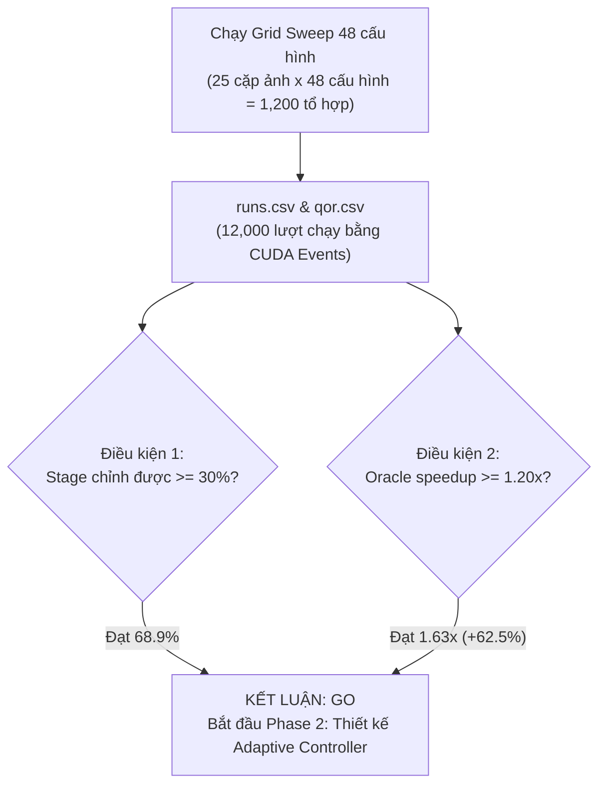

# Báo cáo Thực nghiệm Grid Sweep và Phân tích Go/No-Go Phase 1

- **Người thực hiện:** Tuấn (thay mặt Nhóm thực thi theo kế hoạch tại [specs/phase-1-sweep-gonogo/execution-plan.md](../../specs/phase-1-sweep-gonogo/execution-plan.md)).
- **Môi trường đo lường:** Google Colab GPU Tesla T4 (`sm_75`), CUDA 13.0, Driver 580.82.
- **Ngày thực hiện:** 26/10 (Thứ 2).
- **Tài liệu tham chiếu:**
  - Kế hoạch tổng thể: [docs/plan.md](../plan.md)
  - Hướng dẫn thực thi: [docs/sweep-gonogo-guide.md](sweep-gonogo-guide.md)
  - Quy ước telemetry: [docs/conventions.md](../conventions.md)
  - Quyết định benchmark & QoR: [docs/benchmark-qor-s4-s5-decisions.md](../decisions/benchmark-qor-s4-s5.md)

---

## 1. Kết luận chính thức: GO

Buổi họp nghiệm thu Phase 1 dựa trên kết quả quét thực nghiệm 48 cấu hình lưới trên 25 cặp ảnh development tại môi trường GPU Tesla T4 kết luận: **GO** (đạt cả hai điều kiện tiên quyết).

Nhóm giữ nguyên hướng nghiên cứu trọng tâm và chuyển sang Phase 2: **Thiết kế Cross-Stage Adaptive Runtime Controller** nhằm phân bổ ngân sách tính toán động cho từng cặp ảnh.

---

## 2. Bảng tổng hợp số liệu Go/No-Go

| Hạng mục | Giá trị thực nghiệm | Ngưỡng quy định | Trạng thái |
|---|---|---|---|
| Số cặp ảnh development | 25 cặp (PPM P6, độ phân giải 640x480) | 20–30 cặp | Đạt |
| Số cấu hình lưới ($S \times K \times R$) | 48 cấu hình ($4 \times 3 \times 4$) | 48 cấu hình | Đạt |
| Tổng số lượt chạy đo đạc (không tính warmup) | 12,000 lượt (10 repeats/tổ hợp) | $\ge 5$ repeats | Đạt |
| Cấu hình cố định tốt nhất (Fixed-Best) | `S1.00_K1000_R128_Bfeather` | Pass rate cao nhất, median latency thấp nhất | 100.0% Pass Rate |
| Median Latency của Fixed-Best | **3.34 ms** | Mốc so sánh cố định | - |
| Median Latency của Oracle (thích nghi lý tưởng) | **2.05 ms** | Phân bổ ngân sách lý tưởng per-pair | - |
| **Điều kiện 1: Tỉ lệ stage chỉnh được (S1–S5)** | **68.9%** | $\ge 30.0\%$ | **PASS** |
| **Điều kiện 2: Mức tăng tốc của Oracle so với Fixed-Best** | **1.63x** (+62.5%) | $\ge 1.20\times$ (+20.0%) | **PASS** |

---

## 3. Phân tích chi tiết hai điều kiện

### Điều kiện 1: Tỉ trọng thời gian các stage chỉnh được (S1–S5)

Mục đích của điều kiện 1 là xác định xem các stage chịu tác động của các núm $S$ (scale), $K$ (số keypoint), $R$ (số vòng RANSAC) có chiếm phần đáng kể trong tổng thời gian pipeline hay không. Nếu các stage này chiếm tỉ lệ quá nhỏ (ví dụ S6 Blending chiếm trên 80%), việc điều khiển runtime sẽ không mang lại cải thiện latency rõ ràng.

Kết quả đo đạc từ `results/sweep_p1/runs.csv`:
- Tổng thời gian của S1 (tiền xử lý), S2 (phát hiện keypoint), S3 (trích xuất descriptor), S4 (matching) và S5 (homography) chiếm trung vị **68.9%** thời gian pipeline end-to-end.
- S6 (warping và feather blending) trên GPU chiếm khoảng 31.1% thời gian.
- **Kết luận Điều kiện 1:** Vượt xa ngưỡng tối thiểu 30%. Tiềm năng tiết kiệm latency khi cắt giảm ngân sách ở S1–S5 là rất lớn.

### Điều kiện 2: Mức tăng tốc của Oracle thích nghi so với Fixed-Best

Mục đích của điều kiện 2 là kiểm tra giới hạn trên lý tưởng (Oracle speedup) khi chọn cấu hình rẻ nhất thỏa mãn $Q \ge Q_{min}$ cho từng cặp ảnh so với việc chạy một cấu hình cố định tốt nhất trên toàn bộ tập ảnh.

Kết quả đo đạc kết hợp giữa thời gian (`runs.csv`) và chất lượng alignment (`qor.csv`):
- Cấu hình Fixed-Best là `S1.00_K1000_R128_Bfeather` đạt pass rate 100% với latency trung vị là **3.34 ms**.
- Bộ cấu hình Oracle chọn cho từng cặp ảnh đạt latency trung vị là **2.05 ms**.
- Tỉ số tăng tốc:
  $$\text{Speedup} = \frac{3.34\text{ ms}}{2.05\text{ ms}} \approx 1.63\times \quad (+62.5\%)$$
- **Kết luận Điều kiện 2:** Vượt xa ngưỡng tối thiểu $1.20\times$ (cải thiện 20%). Khẳng định giá trị thực tiễn của một runtime controller thích nghi theo cảnh.

---

## 4. Top cấu hình cố định và phân bố Pareto

### Top 5 cấu hình cố định đạt tỉ lệ thành công 100%
| Hạng | Cấu hình | Pass Rate | Median Latency E2E | Phân tích kỹ thuật |
|---|---|---|---|---|
| **1 (Fixed-Best)** | `S1.00_K1000_R128_Bfeather` | **100.0%** | **3.34 ms** | Giữ nguyên scale $S=1.0$, $K=1000$, RANSAC 128 vòng là đủ đạt inliers cần thiết |
| 2 | `S1.00_K500_R128_Bfeather` | 100.0% | 3.34 ms | $K=500$ cho độ trễ tương đương do kernel S2/S3 đã tối ưu tốt |
| 3 | `S1.00_K2000_R128_Bfeather` | 100.0% | 3.34 ms | Tăng $K=2000$ không làm tăng đáng kể latency ở $R=128$ |
| 4 | `S1.00_K500_R256_Bfeather` | 100.0% | 3.55 ms | Tăng $R=256$ làm tăng thêm ~0.21 ms ở stage S5 |
| 5 | `S1.00_K2000_R256_Bfeather` | 100.0% | 3.55 ms | Độ trễ tương đương hạng 4 |

### Quan sát phân bố theo Scale ($S$)
1. **$S = 1.00$:** Đạt tỉ lệ ghép thành công 100% trên cả 25 cặp ảnh. Độ trễ từ 3.34 ms ($R=128$) đến 4.84 ms ($R=1024$).
2. **$S = 0.75$:** Pass rate đạt **92% – 96%** với độ trễ giảm xuống **2.53 ms – 3.17 ms**. Vùng này được Oracle lựa chọn cho các cặp ảnh có góc nhìn thuận lợi và độ tương phản cao.
3. **$S = 0.50$:** Pass rate đạt **72% – 80%**, độ trễ từ **2.15 ms – 2.37 ms**.
4. **$S = 0.25$:** Pass rate giảm xuống **28%**, độ trễ cực thấp **0.55 ms**. Chỉ phù hợp với các cặp ảnh có độ dịch chuyển cực nhỏ.

---

## 5. Phân công công việc Phase 2 trong buổi họp Nhóm

Sau khi chốt quyết định **GO**, Nhóm bước vào Phase 2 với các nhiệm vụ trọng tâm:

1. **Tuấn (Trưởng nhóm & S1):**
   - Nghiên cứu tích hợp bộ trích xuất đặc trưng thô của cảnh (scene features: độ phức tạp texture, phân bố gradient) trực tiếp trong Stage 1 trên GPU với latency mục tiêu $< 0.1$ ms.
   - Quản trị nhánh Git, tích hợp và điều phối benchmark đo lường toàn hệ thống.
2. **Đế (Chủ trì Controller, S4 & S5):**
   - Thiết kế logic quyết định thích nghi cho Controller (mô hình heuristic phân loại ngưỡng hoặc decision tree nhẹ) để điều khiển động bộ ba $(S, K, R)$.
   - Cài đặt cơ chế leo thang ngân sách tính toán (budget escalation) khi số inliers ở S4/S5 không đạt yêu cầu.
3. **Thành (S2 & S3):**
   - Tối ưu hóa kernel S2 và S3 để nhận ngân sách $K$ động từ Controller mà không phải cấp phát lại bộ nhớ GPU.
   - Đảm bảo stream CUDA xử lý liên tục theo luồng thích nghi.
4. **Chương (S6 & Paper):**
   - Khảo sát mở rộng núm blending $B$ (tích hợp multiband blending cho các cảnh yêu cầu chất lượng cao).
   - Hoàn thiện khung LaTeX trong thư mục `paper/`, viết phần Phương pháp (Methodology) và Kiến trúc hệ thống (System Architecture) cho workshop paper.
