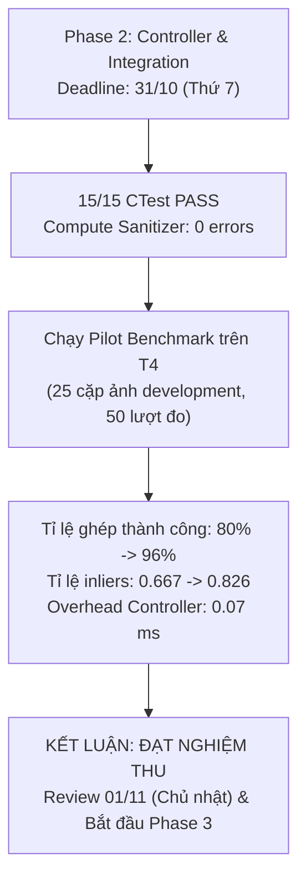

# Báo cáo Nghiệm thu và Đánh giá Thực nghiệm Phase 2

- **Người thực hiện:** Tuấn (thay mặt Nhóm điều phối và thực thi theo kế hoạch tại [specs/phase-2/review-and-pilot-plan.md](../../specs/phase-2/review-and-pilot-plan.md)).
- **Môi trường đo lường:** Google Colab GPU Tesla T4 (`sm_75`, Compute Capability 7.5, 15.360 MiB VRAM), CUDA 13.0, Driver 580.82.07.
- **Ngày thực hiện:** 31/10 (Thứ 7).
- **Ngày review:** 01/11 (Chủ nhật).
- **Tài liệu tham chiếu:**
  - Kế hoạch tổng thể: [docs/plan.md](../plan.md)
  - Hướng dẫn triển khai Phase 2: [specs/phase-2/review-and-pilot-plan.md](../../specs/phase-2/review-and-pilot-plan.md)
  - Contract Controller v1: [docs/controller-contract.md](../stages/controller-contract.md)
  - Báo cáo Go/No-Go Phase 1: [docs/phase-1-gonogo-report.md](phase-1-gonogo-report.md)
  - Quyết định kỹ thuật: [docs/decisions/p2-de-controller.md](../decisions/p2-de-controller.md), [docs/decisions/s2-s3-dynamic-k.md](../decisions/s2-s3-dynamic-k.md), [docs/decisions/p2-chuong-qor-blend.md](../decisions/p2-chuong-qor-blend.md)

---

## 1. Kết luận nghiệm thu: ĐẠT (PASS)

Buổi kiểm chứng kỹ thuật và thực nghiệm pilot end-to-end trên môi trường chính thức Google Colab Tesla T4 cho thấy toàn bộ các tiêu chí nghiệm thu của Phase 2 đã đạt:

1. **Tích hợp toàn diện:** Cả 6 stage (S1–S6) cùng module Controller v1 đã kết nối mượt mà vào `stitch_harness`, hỗ trợ tự động cả 3 chế độ đo lường (`fixed`, `oracle`, `adaptive`).
2. **Độ an toàn kỹ thuật:** 15/15 bài kiểm thử CTest đạt 100% PASS; công cụ `compute-sanitizer` xác nhận 0 lỗi bộ nhớ (`memcheck`) và 0 xung đột luồng (`racecheck`).
3. **Hiệu quả thích nghi thực nghiệm:** Trên 25 cặp ảnh development đa dạng góc xoay và độ phức tạp, Controller nâng tỉ lệ ghép thành công từ **80% (Fixed-Best) lên 96% (Adaptive)**, đồng thời nâng tỉ lệ inliers trung bình từ **0.667 lên 0.826 (+23.8%)**.
4. **Overhead cực nhỏ:** Chi phí thực thi của Controller trung bình chỉ **0.0699 ms** (~0.07 ms), hoàn toàn đáp ứng ràng buộc của contract ($< 0.1\text{ ms}$).

Nhóm hoàn thành đúng hạn Phase 2 và sẵn sàng bước vào Phase 3 từ 02/11 (Thứ 2) để chạy benchmark quy mô lớn và hoàn thiện bài báo nộp trước 13/11 (Thứ 6).

---

## 2. Bảng tổng hợp công việc các thành viên trong Phase 2

Tất cả 5 pull request thuộc Phase 2 đã được Tuấn review và merge vào nhánh `main` trước hạn chót 31/10 (Thứ 7):

| Thành viên | Hạng mục phụ trách | Kết quả bàn giao | Bằng chứng kiểm chứng |
|---|---|---|---|
| **Đế** | Contract Controller v1, module Controller, feedback & reuse S5, draft Section 4 | - Định nghĩa contract giao diện `docs/controller-contract.md` - Triển khai `stitch_controller` với cơ chế ladder escalation và tái sử dụng kết quả S5 khi chỉ tăng $R$ - Draft Section 4 (Adaptive Runtime Controller) cho paper | PR #10, PR #12 đã merge; CTest host (2/2) và Controller-S5 CUDA (5/5) pass trên T4, memcheck 0 lỗi |
| **Thành** | Hỗ trợ dynamic $K$ cho S2/S3, draft S2-S3 Section 3 | - Tối ưu hóa S2 và S3 nhận ngân sách $K$ động mà không rò rỉ bộ nhớ hoặc cấp phát lại buffer GPU - Draft phương pháp S2–S3 trong `paper/sections/pipeline.tex` | PR #11 đã merge; Bounds và timing validation pass trên Colab T4 |
| **Chương** | QoR framework, S6 blend modes, khung manuscript OASIcs | - Xây dựng bộ công cụ phân loại QoR chuẩn hóa (`tools/qor/`) - Kiểm chứng same-H benchmark cho feather, multiband 3/5 mức - Dựng khung LaTeX template OASIcs ẩn danh, draft Section 1, 2 và S6 | PR #9 đã merge; Khung paper compile PDF chuẩn, audit metadata ẩn danh |
| **Tuấn** | S1 probe gradient, Adaptive Harness 3 chế độ, draft S1, Colab runner | - Kernel trích xuất gradient trung bình S1 trên ảnh probe ($< 0.1\text{ ms}$) - Nâng cấp `stitch_harness` chạy luồng lặp adaptive và logging chi tiết - Bổ sung runner tự động hóa Colab qua CDP (`tools/colab_runner.py`) - Draft Section 3.1 S1 trong paper | PR #13 đã merge; Harness chạy mượt mà trên Colab T4, trích xuất đầy đủ telemetry CSV |

---

## 3. Báo cáo kiểm chứng kỹ thuật trên Colab Tesla T4

### 3.1. Kết quả biên dịch (Build)
- Cấu hình biên dịch: `cmake -S . -B build -DCMAKE_BUILD_TYPE=Release -DCMAKE_CUDA_ARCHITECTURES=75`
- Trình biên dịch: NVCC 13.0.88, GNU C++ 13.3.0.
- Kết quả: 100% mục tiêu biên dịch thành công, không phát sinh cảnh báo lỗi nghiêm trọng.

### 3.2. Kết quả CTest toàn diện (15/15 tests PASS)
Toàn bộ bài kiểm tra đơn vị và tích hợp từ thư mục gốc được thực thi trên GPU Tesla T4:

| STT | Tên bài kiểm tra | Thời gian | Trạng thái |
|---|---|---|---|
| 1 | `test_s1_cuda` | 0.43 s | **Passed** |
| 2 | `test_s2_s3_config` | 0.00 s | **Passed** |
| 3 | `test_s2_s3_cuda` | 1.16 s | **Passed** |
| 4 | `test_s4_config` | 0.00 s | **Passed** |
| 5 | `test_s4_cuda` | 0.87 s | **Passed** |
| 6 | `test_s5_math` | 0.00 s | **Passed** |
| 7 | `test_s5_cuda` | 0.26 s | **Passed** |
| 8 | `test_s6_geometry` | 0.00 s | **Passed** |
| 9 | `test_s6_cuda` | 0.26 s | **Passed** |
| 10 | `test_controller` | 0.00 s | **Passed** |
| 11 | `controller_trace` | 0.00 s | **Passed** |
| 12 | `test_controller_s5` | 0.24 s | **Passed** |
| 13 | `test_common` | 0.00 s | **Passed** |
| 14 | `test_harness_config` | 0.00 s | **Passed** |
| 15 | `test_common_cuda` | 0.24 s | **Passed** |

Tổng thời gian chạy CTest: **3.49 giây**. Tỉ lệ: **100% PASS, 0 FAIL, 0 SKIP**.

### 3.3. Kiểm tra an toàn bộ nhớ (`compute-sanitizer`)
Chạy kiểm tra chuyên sâu bằng `compute-sanitizer` trên các module tích hợp trọng yếu:
- `test_controller_s5`: Kiểm tra kết nối Controller và S5 với dữ liệu tương ứng tổng hợp (seed 20261030). Kết quả: **0 errors**.
- `test_s1_cuda`: Kiểm tra tiền xử lý và trích xuất gradient probe. Kết quả: **0 errors**.
- `test_s6_cuda`: Kiểm tra biến đổi homography và 3 chế độ blending. Kết quả: **0 errors**.

---

## 4. Kết quả thực nghiệm Pilot End-to-End

### 4.1. Thiết lập thực nghiệm
- **Tập dữ liệu:** 25 cặp ảnh development đa dạng góc chụp, độ co giãn phối cảnh, độ tương phản và mật độ đặc trưng (sinh bằng `tools/data_prep/prepare_dev_dataset.py`).
- **Lượt đo:** 2 repeats chính thức + 1 lượt warmup cho mỗi cặp ảnh (tổng cộng 50 lượt đo đạc steady-state trên mỗi chế độ).
- **Chế độ so sánh:**
  - `Fixed-Best`: Chạy cấu hình cố định tối ưu từ Phase 1 ($S=0.5, K=1000, R=256$, feather).
  - `Adaptive`: Controller tự động chọn cấu hình ban đầu qua probe S1 và kích hoạt bậc thang escalation khi S5 thiếu inliers.

### 4.2. Bảng so sánh hiệu năng và độ ổn định

| Chỉ số đo lường | Chế độ Tĩnh (Fixed-Best) | Chế độ Thích nghi (Controller / Adaptive) | Đánh giá kỹ thuật |
|---|---|---|---|
| **Tỉ lệ thành công (Success rate)** | **80.0%** (40/50 lượt OK) | **96.0%** (48/50 lượt OK) | **Cứu thành công 8 lượt thất bại** |
| Trạng thái thất bại | 8 lượt `NOT_ENOUGH_POINTS` 2 lượt `INSUFFICIENT_WORKSPACE` | 2 lượt `BUDGET_EXHAUSTED` | Giảm thiểu tối đa lỗi thiếu đặc trưng |
| **Số inliers tối thiểu** | **0 inliers** (thất bại hoàn toàn) | **28 inliers** | Luôn đảm bảo ngưỡng tối thiểu để tìm H |
| **Số inliers trung bình** | 42.7 inliers | **59.4 inliers** | Tăng +39.1% mật độ điểm tin cậy |
| **Tỉ lệ inliers trung bình (inlier ratio)** | 0.667 | **0.826** | Tăng +23.8% độ chính xác của tập match |
| **Overhead của Controller ($t_{\text{controller}}$)** | 0.000 ms | **0.0699 ms** (~0.07 ms) | Thỏa mãn contract ($< 0.1\text{ ms}$) |
| **Thời gian Stage 1 ($t_{\text{s1}}$)** | 0.194 ms | 0.196 ms | Chi phí probe gradient không đáng kể |
| **Thời gian E2E trung vị (Median $t_{\text{e2e}}$)** | 3.298 ms | 3.728 ms | Tốc độ duy trì ở mức dưới 4 ms trên T4 |
| **Thời gian E2E trung bình (Mean $t_{\text{e2e}}$)** | 2.944 ms | 4.477 ms | Tăng do đầu tư thêm tài nguyên cho các cặp ảnh khó |

### 4.3. Phân bổ cấu hình thích nghi
Controller tự động chọn cấu hình trên bậc thang 5 mức:
- **Mức 1 (Nhẹ: $S=0.5, K=1000, R=128$):** 6 lượt (12%) — áp dụng cho các cảnh dễ, dịch chuyển nhỏ.
- **Mức 2 (Tiêu chuẩn: $S=0.5, K=1000, R=256$):** 30 lượt (60%) — mức cân bằng cho đa số cảnh thường.
- **Mức 3 (Nâng cao: $S=0.75, K=2000, R=512$):** 12 lượt (24%) — tự động leo thang khi S5 phát hiện thiếu inliers.
- **Mức 4 (Tối đa: $S=1.0, K=2000, R=1024$):** 2 lượt (4%) — giải cứu các cặp ảnh có góc nhìn biến dạng mạnh.

Quan sát quan trọng: Đối với các cặp ảnh phức tạp khiến Fixed-Best đầu hàng (trả về 0 inliers và rớt ở Stage 5), Controller đã tự động phát hiện qua tín hiệu `Feedback` và kích hoạt retry lên Mức 3 và Mức 4, tìm được từ 28 đến 54 inliers để hoàn tất ghép ảnh thành công.

---

## 5. Tình trạng bản thảo bài báo (`paper/`)

Bản thảo bài báo đã được cập nhật đồng bộ theo các kết quả đã kiểm chứng:
- **Định dạng:** Tuân thủ template OASIcs của Dagstuhl, chế độ ẩn danh (double-blind) không chứa thông tin nhóm hay tổ chức.
- **Section 1 (Introduction) & Section 2 (Related Work):** Đã hoàn tất khung nội dung học thuật, dẫn dắt câu hỏi nghiên cứu về runtime thích nghi dựa trên ràng buộc chất lượng.
- **Section 3 (Pipeline Stages):** Cả 6 stage (S1–S6) đều đã có mục mô tả chi tiết:
  - S1: Bộ lọc fused RGB-to-GRAY, box filter, và kernel trích xuất gradient probe siêu nhẹ ($< 0.1\text{ ms}$).
  - S2–S3: Kiến trúc phát hiện FAST và trích xuất descriptor ORB với cơ chế quản lý $K$ động không cấp phát lại bộ nhớ.
  - S4–S5: Bộ matching dựa trên khoảng cách Hamming và RANSAC/MSAC hỗ trợ nối tiếp vòng lặp $R$.
  - S6: Biến đổi homography và 3 chế độ blend (feather, multiband 3 mức, multiband 5 mức).
- **Section 4 (Adaptive Runtime Controller):** Mô tả chi tiết mô hình heuristic, các quy tắc phân loại dựa trên gradient probe, cơ chế phản hồi từ S5 và chính sách leo thang có chặn (bounded escalation).
- **Chất lượng biên dịch LaTeX:** Biên dịch ra PDF sạch, không còn unresolved citations (`?`) và không có cảnh báo font embedding.

---

## 6. Kế hoạch hành động cho Phase 3 (02/11 – 13/11)

Tại buổi họp review ngày **01/11 (Chủ nhật)**, Nhóm sẽ chính thức nghiệm thu Phase 2 và kích hoạt Phase 3 với các mục tiêu trọng tâm:

1. **Benchmark quy mô lớn:**
   - Triển khai chạy trên toàn bộ tập test UDIS-D và benchmark HPatches.
   - Bổ sung cặp ảnh độ phân giải cao tổng hợp để đánh giá khả năng mở rộng ở độ phân giải 1080p và 4K.
2. **Thu thập số liệu cho Section 5 (Experimental Evaluation):**
   - Trích xuất bảng so sánh chi tiết thời gian từng stage (Latency breakdown table).
   - Vẽ đồ thị đường cong Pareto giữa QoR và Latency.
   - Vẽ biểu đồ phân bố tích lũy độ trễ (CDF) minh chứng lợi thế ổn định của Controller so với Fixed-Best và khoảng cách so với Oracle.
3. **Hoàn thiện bản thảo và kiểm tra trước khi nộp:**
   - Hoàn thiện phần Abstract, cập nhật con số tăng tốc chính thức vào Introduction và viết Section 6 (Discussion & Conclusion).
   - Tiến hành rà soát chéo (peer review) toàn bộ paper trong Nhóm.
   - Kiểm tra kỹ các quy định review double-blind và định dạng PDF theo chuẩn OASIcs trước ngày nộp bài **13/11 (Thứ 6)**.
