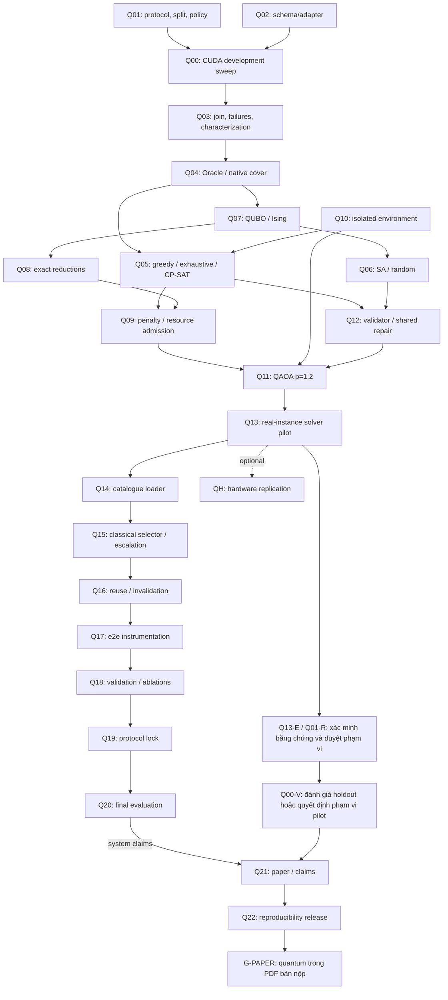

# Kế hoạch triển khai quantum catalogue selection

## Material Passport

- Origin Skill: academic-research-suite / deep-research.
- Origin Mode: backlog triển khai từ nghiên cứu có RQ xác định.
- Origin Date: 02/11 (Thứ 2), năm 2026; thay phân công đề xuất ngày 24/10 (Thứ 7).
- Handoff lập kế hoạch paper: academic-research-suite, cập nhật 07/11 (Thứ 7), năm 2026.
- Verification Status: `PILOT_REPORTED`, `G-PAPER` còn mở. Tooling đã vào `main`. Báo cáo ghi `PASS_OFFLINE` cho pilot chính trên calibration. Cần xác minh raw artifact độc lập và duyệt phạm vi claim trước khi dùng trong bản nộp. [Báo cáo pilot](quantum-pilot-report.md)
- Version Label: quantum_catalogue_tasks_v3_thanh.
- Tài liệu phương pháp: [quantum-integration-proposal.md](quantum-integration-proposal.md).

## 1. Phạm vi, owner và Definition of Done

**Bài toán con bắt buộc trong bản nộp** là chọn catalogue cấu hình `(S,K,R,B_fixed)` từ sweep CUDA bằng QUBO/QAOA offline. Câu hỏi phụ là QAOA tìm catalogue khả thi ở mức nào và chi phí ra sao khi so cùng instance với solver cổ điển. Câu hỏi chính về latency và QoR của adaptive runtime vẫn dùng benchmark GPU riêng. Consumer catalogue thuộc nhánh mở rộng để đánh giá tác động lên runtime.

Phân công được người dùng chốt ngày 02/11 (Thứ 2): **Thành là single owner Q00–Q13 và quantum tooling/solver report**. Thành tiếp tục S2–S3/A3; các việc quantum được làm song song với baseline không quantum. Tuấn cung cấp raw sweep và giữ harness/S1/common/merge; Đế duyệt policy/reference và giữ controller/S4–S5; Chương giữ S6/A4/A5, review QoR và tổng hợp paper. Review hoặc cung cấp input không chuyển trách nhiệm implementation của stage sang Thành. Quyết định ở [p3-offline-quantum-catalogue.md](../decisions/p3-offline-quantum-catalogue.md).

Q00–Q13 là backlog Phase 3, giữ để truy vết pilot và trạng thái ở mục 11. Đầu việc bàn giao Full Draft Phase 4 nằm ở mục 8, dùng deadline chung **09/11 (Thứ 2)** theo kế hoạch nhóm. Q14–Q20 là backlog cho đánh giá hệ thống, QH là tùy chọn. P0/P1/P2 trong backlog chỉ biểu thị ưu tiên.

`G-PAPER` đạt khi có run QAOA `p=1,2` trên simulator cho ít nhất một instance từ sweep CUDA còn `q_after > 0`, raw counts và controls đã xác minh, phạm vi dữ liệu/policy được duyệt, và PDF có phương pháp, bảng kết quả, giới hạn cùng gói tái lập. Kết quả âm đủ bằng chứng là kết quả hợp lệ. QPU là tùy chọn. Claim hệ thống thuộc G4.

Tooling offline nằm trong `tools/quantum/`. Trạng thái và bằng chứng từng ticket ở mục 11. Artifacts data/results/build lưu ở nơi chia sẻ theo conventions. Repo giữ mã nguồn, manifest/hash phù hợp và hướng dẫn tái lập.

### 1.1. Hai nhánh song song và ba nhóm đối chứng

| Nhóm | Vai trò | Quantum khi chạy từng ảnh |
|---|---|---|
| W0 — Adaptive-original | Runtime/ladder gốc của nhóm, cùng Fixed-Best và Oracle; giữ campaign baseline riêng | Không |
| W1 — Adaptive-classical-catalogue | Catalogue do exact/CP-SAT/greedy hoặc classical solver đã khai báo chọn; dùng catalogue consumer cổ điển | Không |
| W2 — Adaptive-QAOA-catalogue | Catalogue từ QAOA simulator, validated và truy vết được sample; repair nếu có phải mang nhãn hybrid | Không |

W0 chạy được khi không cài quantum SDK và không cần đợi W1/W2. Quantum SDK không nằm trong root CMake, stage API hoặc `tools/requirements.txt`. W1/W2 chỉ được gọi là kết quả runtime sau khi Đế/Tuấn tích hợp consumer và đo thật; trước đó chỉ có so sánh solver offline. W1/W2 dùng cùng candidate set/reduction, split, quality policy, B, consumer, selector family và tuning budget, reuse/self-check/fallback. W0 so với W1 đo tác động thiết kế catalogue/consumer; W1 so với W2 mới kiểm tra đóng góp solver. Kích thước catalogue khác nhau vẫn được giữ trong bảng, kèm matched-size control khi có.

Thành đã đưa adapter, classical solvers, encoding, QAOA và validator vào `tools/quantum/` cùng tests riêng. Catalogue JSON lưu config IDs/S/K/R/B, hashes và provenance. Nếu mở nhánh runtime, Đế chuyển catalogue sang policy/ladder trên development và giữ fallback đã duyệt.

### 1.2. Mức nghiệm thu trong Phase 3

- **PASS_OFFLINE:** Trạng thái solver offline trên ít nhất một instance từ sweep CUDA còn `q_after > 0`, có QAOA p=1,2 và controls. Runner pilot dùng trạng thái này cho G0–G2 trong phạm vi run. `G-PAPER` kiểm riêng phê duyệt, tái lập và bản thảo.
- **NEGATIVE_RESULT:** Circuit/counts và đối chứng đầy đủ nhưng raw feasibility bằng 0, classical mạnh hơn hoặc repair quyết định kết quả; bàn giao nguyên dữ liệu và giới hạn, không xuất catalogue thành công giả.
- **BLOCKED/INCOMPLETE:** Thiếu sweep/policy approval, environment không chạy, encoding chưa đúng, mọi instance bị exact reduction giải hết hoặc vượt tài nguyên; toy-only không đóng ứng dụng quantum.

Không dùng một kết quả baseline để đóng task quantum. Negative result không chặn baseline, không tự cho phép bỏ workstream quantum, đổi stage hoặc mua quyền QPU. Nếu chưa có e2e consumer thì phần tích hợp runtime còn pending dù solver offline đã nghiệm thu.

### 1.3. Protocol và phân bổ công việc của Thành

Thành bắt đầu Q02/Q10 và tiny exact tests trong lúc chờ raw sweep Q00. Sau G0 mới tạo instance ứng dụng; sau G1 mới chạy QAOA; Q13 gom tất cả seeds/failures và công bố G2/G3. QAOA/classical controls có ngân sách solver riêng, CPU simulator tách khỏi phiên đo GPU T4 để tránh tranh tài nguyên. Không chạy thêm solver trên T4 trong lúc baseline đang đo nếu chưa có cô lập tài nguyên.

A3 và quantum là hai deliverable riêng của Thành; không chuyển A3 sang owner khác. Để giới hạn khối lượng trong Phase 3, bắt đầu một instance thật đã kiểm tra cùng các controls, rồi mới mở rộng cohort/seeds khi còn budget. Không đồng thời mở multiobjective, quantum selector, seam, QPU hoặc toàn bộ sensitivity grid. Mọi run config nhỏ hơn các budget pilot đề xuất phải được ghi trước khi chạy và báo số thực thi; không giảm sau khi nhìn kết quả để bỏ seed thất bại. Nếu tổng effort vượt sức chứa phase, Thành báo phần PASS/NEGATIVE/BLOCKED tại review; Nhóm quyết định phần tiếp theo, không ghi tất cả DONE.

Nhánh quantum đầu tiên chỉ dùng **một** policy QoR đã được Đế duyệt và B cố định được Chương xác nhận. A5 là workstream sensitivity riêng; không tự nhân quantum theo 20 tổ hợp hoặc dùng test UDIS-D để fit catalogue. Rho, seeds, sampling/budget và restriction manifest ở proposal là tham số pilot đề xuất; Thành lập run config, Tuấn/Đế review trước khi dùng validation/final. Quyết định offline/owner hiện tại không đồng thời duyệt mọi ngưỡng trong proposal.

## 2. Dependency graph và critical path

Q00 được đặt đầu vì chưa có bảng characterization đủ provenance được tooling quantum nghiệm thu; kernel/controller nền đã có và Phase 2 đã PASS theo báo cáo nhóm. Q01/Q02 là prerequisite chuẩn bị của Q00, có thể làm trước khi đủ kernel. Q04–Q12 có thể phát triển bằng toy fixtures khi chờ, nhưng không đóng task nghiệm thu dữ liệu thật bằng toy. Graph có cả chuỗi tooling song song và đường dữ liệu chính.

Đường găng của bản nộp là Q13 → Q13-E và Q01-R → Q00-V hoặc quyết định phạm vi pilot → Q21 → Q22 → `G-PAPER`. Đường qua Q14–Q20 chỉ dùng khi đánh giá hệ thống. Bằng chứng ứng dụng dùng sweep CUDA của pipeline và run simulator tương ứng.

## 3. Nhóm dữ liệu characterization

### Q00 — Complete the development CUDA sweep

- **Owner:** Thành (yêu cầu, tiếp nhận và kiểm tra campaign); Tuấn cung cấp sweep/harness, Đế review pipeline/QoR; **Priority:** P0.
- **Dependencies:** Q01, Q02; stage GPU và T4/harness đủ điều kiện theo plan. **Estimated effort:** 1–2 ngày chạy/kiểm tra sau tích hợp; không bao gồm viết stage còn thiếu.
- **Deliverable:** Thành yêu cầu và tiếp nhận sweep CUDA từ Tuấn cho các development-fit/validation pairs được phép, C=(S,K,R,B_fixed), Fixed-High và baseline cần thiết; có 2 warmup + 10 đo/pair/config.
- **Acceptance criteria:** cùng timing boundary t_e2e của conventions; algorithm seed cố định, H tất định; đủ stage thực chạy GPU; H trong hệ RGB gốc B→A; lưu mọi launch/runtime failure; config/repeats coverage được kiểm bằng manifest. Không thay measurements thiếu bằng CPU/mock hoặc latency S6-only.
- **Go/No-Go:** G0; thiếu stage/harness/T4 thì BLOCKED ứng dụng, không đánh sweep complete. Toy test của tooling vẫn có thể chạy độc lập.
- **Artifacts:** `runs.csv`, `meta.json`, config-grid/split manifests, logs, GPU/driver/CUDA/clock/git/source hashes; vị trí dự kiến `results/quantum-characterization/<run_id>/`.

### Q01 — Freeze the pilot protocol and scene-grouped splits

- **Owner:** Thành lập protocol quantum; Đế duyệt policy/reference/split, Tuấn review CSV/measurement, Chương review B; **Priority:** P0.
- **Dependencies:** quyết định hiện có trong docs; không phụ thuộc Q00. **Estimated effort:** 0,5 ngày review, chưa tính chuẩn bị dataset lớn.
- **Deliverable:** protocol pilot có C, B_fixed, Fixed-High, candidate/fallback spaces, split/grouping, seeds và policy version/hash.
- **Acceptance criteria:** validation tách từ development được phép; final không đổi; scene/sequence/ảnh dùng chung không leakage khi metadata cho phép. Policy pilot 0.95/0.02/0.5 được ghi là đề xuất cho tới Đế duyệt. Khóa quantile method và failure/repeat handling. Sensitivity grids/rho/budget có người duyệt, không tự thay Go/No-Go runtime.
- **Go/No-Go:** chưa có owner decision thì chỉ cho synthetic tooling/pilot có nhãn, chưa chạy final hoặc claim QoR chính thức.
- **Artifacts:** `protocol-pilot.json`, `splits.json`, `config-grid.json`, `policy.json`, decision record; metadata thiếu scene được ghi rõ.

### Q02 — Implement the characterization schema and adapters

- **Owner:** Thành (adapter riêng), Tuấn review schema/common boundary; **Priority:** P0.
- **Dependencies:** đọc conventions và evaluator hiện có; test schema không cần sweep. **Estimated effort:** 0,5–1 ngày.
- **Deliverable:** `tools/quantum/characterize.py`, schema bảng dẫn xuất và tiny CSV fixtures/tests.
- **Acceptance criteria:** join đúng pair_id/config_id/run_id/split, gọi evaluator/report để tính pass; không sửa runs.csv/qor.csv chung. Kiểm tra duplicate/missing rows, config mismatch, warmup, đủ 10 repeats, status/hashes. `latency_p95_repeat_ms` chỉ diagnostic; p95 main trên pair medians. Không drop silent failures.
- **Go/No-Go:** input chưa đầy đủ phải error/ledger, không tự tạo latency hoặc labels.
- **Artifacts:** schema version, tests cho malformed/missing/policy mismatch, `characterization.csv` dự kiến; implementation không có quantum dependency.

### Q03 — Validate failures and publish characterization

- **Owner:** Thành; Đế review reference status/QoR, Tuấn review timing; **Priority:** P0.
- **Dependencies:** Q00, Q02. **Estimated effort:** 0,5 ngày.
- **Deliverable:** bảng pair/config median latency, diagnostic repeat p95, QoR pass, coverage, status và completeness report.
- **Acceptance criteria:** reference_failure/reference_unreliable, unachievable_in_C và incomplete phân loại riêng; giữ denominator toàn split. QoR pass tái tạo từ evaluator, không nhập tay. Fixed-High hợp lệ tự pass nếu nằm trong C; explicit candidate exclusion được ghi. Mỗi dòng truy về run/meta/policy hashes.
- **Go/No-Go:** G0 chỉ qua khi đủ bảng và provenance; incomplete chặn instance chính, không coi là no-pass. S6/Oxford smoke hiện có không đủ đóng task.
- **Artifacts:** `characterization.csv`, `failure-ledger.csv`, `completeness.json`, input manifest/hash và review record.

## 4. Nhóm native cover và classical baselines

### Q04 — Build the Oracle and original cover instances

- **Owner:** Thành; Tuấn review Oracle consistency; **Priority:** P0.
- **Dependencies:** Q03 cho dữ liệu thật; phát triển trước bằng toy. **Estimated effort:** 0,5–1 ngày.
- **Deliverable:** `tools/quantum/build_instance.py`, C/I_f/t_i*/U_i(rho), original incidence matrix và original-problem validator API.
- **Split guard:** chỉ development-fit tạo incidence/objective cho solver; validation/final được xuất riêng cho đánh giá catalogue, không thêm vào cover constraints hoặc repair. Tests phải từ chối mixed-split instance và rò rỉ final vào fit.
- **Acceptance criteria:** Oracle từ median t_e2e và pass trong C, không từ S6 latency; rho/epsilon comparison versioned; no-pass/empty I_f là status rõ. Fixture giải tích xác nhận U_i, full-grid coverage và infinity regret. Có hashes/scope full hoặc restricted.
- **Go/No-Go:** thiếu measurements hoặc I_f rỗng thì không xuất instance hợp lệ giả.
- **Artifacts:** `instance.json`, `incidence.npz`, `oracle.csv`, tests và configuration mapping.

### Q05 — Implement greedy, exhaustive and native CP-SAT

- **Owner:** Thành; Tuấn review exact/bound reporting; **Priority:** P0.
- **Dependencies:** Q04; CP-SAT execution cần Q10, pure-Python tests làm trước. **Estimated effort:** 1 ngày.
- **Deliverable:** `tools/quantum/solve_classical.py` với maximum-gain greedy/reverse-delete, exhaustive-small và native integer CP-SAT.
- **Acceptance criteria:** cùng original instance/reduction và tie-break; greedy/exact feasibility được kiểm gốc; known-optimum tests. Native enumeration admission theo n_y=|C_remaining|, không theo số hàng. CP-SAT OPTIMAL/FEASIBLE/UNKNOWN và incumbent/bound tách rõ; exhaustive timeout chưa là certificate. Ghi actual wall time kể cả khi exact chạy gần như tức thì.
- **Go/No-Go:** optimum/bound sai hoặc thiếu certificate thì chặn objective-gap claims; classical mạnh không phải lý do bỏ baseline hoặc bỏ prototype quantum.
- **Artifacts:** native model export, solver logs, known-optimum fixtures, per-instance catalogue/coverage/regret report.

### Q06 — Implement QUBO SA and matched random controls

- **Owner:** Thành; **Priority:** P0.
- **Dependencies:** Q07; phát triển trên tiny QUBO trước. **Estimated effort:** 0,5–1 ngày.
- **Deliverable:** seeded Metropolis SA, uniform-QUBO random và random-y distribution có khai báo; same-time/matched-sample runs.
- **Acceptance criteria:** tính delta energy khớp full energy; schedule/proposals/restarts, draws/evaluations và threads lưu vào log. Cùng QUBO với QAOA, không coi shot bằng SA move. Ghi raw sample/energy/status; raw feasibility không thay bằng repaired feasibility.
- **Go/No-Go:** không tái lập seed hoặc không có comparable budgets thì chưa nghiệm thu solver comparison.
- **Artifacts:** solver configs/logs, raw sample files, tests, anytime traces.

## 5. Nhóm encoding và tài nguyên

### Q07 — Implement slack QUBO, Ising conversion and decode

- **Owner:** Thành; Tuấn review logic/formulation; **Priority:** P0.
- **Dependencies:** Q04. **Estimated effort:** 1 ngày.
- **Deliverable:** slack binary b_i=ceil(log2 d_i), upper-triangular QUBO, Ising h/J/offset, bit mapping/decode.
- **Acceptance criteria:** enumerate tiny (y,z), so residual/QUBO/Ising energies; cover-feasible y có ít nhất một zero-penalty slack, equality-feasible sample luôn cover gốc. Với alpha>lambda|C|, ground state cardinality bằng exact cover; test singleton, duplicate, non-power-of-two degree, empty/invalid row, endian/factor-2. QUBO-feasible phải định nghĩa là residual zero, không là mọi bitstring.
- **Go/No-Go:** bất kỳ mismatch nào chặn QAOA; không sửa tolerance/penalty để che lỗi conversion.
- **Artifacts:** `qubo.json`, `ising.json`, `variables.json`, proof note trong proposal và `test_quantum_encoding.py`.

### Q08 — Implement optimum-preserving reductions

- **Owner:** Thành; **Priority:** P0.
- **Dependencies:** Q07, Q04. **Estimated effort:** 0,5–1 ngày.
- **Deliverable:** duplicate/superset rows, forced singletons, zero columns, duplicate columns và full reconstruction ledger.
- **Acceptance criteria:** exhaustive nhỏ xác nhận optimum cardinality trước/sau và feasibility sau restore trên original matrix; fixed-point và idempotence tests. Giữ forced cost/representatives/hashes. Duplicate columns chỉ giữ cardinality optimum, không hứa validation-equivalence; có on/off ablation. Không sparsify mất constraints rồi nhận exact reduction.
- **Go/No-Go:** mismatch thì tắt reduction đó và sửa; q=0 xuất solved_by_reduction, không gọi quantum solution.
- **Artifacts:** `reduction.json`, before/after matrices, reconstruction tests và optimum certificates nhỏ.

### Q09 — Audit penalties, couplings and simulator admission

- **Owner:** Thành; **Priority:** P0.
- **Dependencies:** Q05, Q07, Q08. **Estimated effort:** 0,5 ngày.
- **Deliverable:** bound alpha>lambda k_ub từ feasible cover, sensitivity grid, q_before/q_after/couplings/dynamic-range/RAM report.
- **Acceptance criteria:** default alpha=k_ub+1 khi lambda=1; below-bound tests được nhãn stress-only. Đếm q_after theo row degrees đã cập nhật sau reduction. Positive global scaling giữ mapping/offset, không clip. q<=20 là proposed admission, đo thêm actual memory. Full instance quá lớn chỉ cho restricted cohort manifest khóa trước; đánh giá full-data coverage sau đó, không claim full optimum.
- **Go/No-Go:** G1; sai bound/precision hoặc vượt RAM/time thì reject run với status rõ. Mọi instance trivial/quá lớn phải báo feasibility limitation, không lựa dataset sau khi xem quantum score.
- **Artifacts:** `resource-audit.json`, penalty-sensitivity config, cohort selection manifest và admission logs.

## 6. Nhóm QAOA prototype bắt buộc

### Q10 — Pin and verify an isolated simulator environment

- **Owner:** Thành; Tuấn review dependency boundary; **Priority:** P0.
- **Dependencies:** không cần sweep; package/install plan trong proposal. **Estimated effort:** 0,5 ngày.
- **Deliverable:** Python 3.12 environment riêng, pinned/hashes Qiskit/Aer/OR-Tools, license inventory và install/run instructions.
- **Tách dependencies:** classical core dùng stdlib/NumPy, CP-SAT dùng extra OR-Tools; Qiskit/Aer chỉ import khi chọn backend QAOA. CLI/tests classical phải chạy khi thiếu quantum SDK; không import SDK trong package initializer hoặc runtime consumer.
- **Acceptance criteria:** compatibility import + tiny circuit smoke, CPU/RAM/threads/OS/version receipt, direct/transitive licenses/NOTICE. Không đổi pipeline requirements hoặc root build, không cần cloud credentials. Pin versions sau kiểm tra thực, không sao chép version chưa chạy.
- **Go/No-Go:** thiếu compatible environment thì chặn QAOA execution; dependency failure không được ghi thành quantum negative result về thuật toán.
- **Artifacts:** `tools/quantum/requirements-lock.txt`, environment receipt và license inventory; venv/build không commit.

### Q11 — Implement and run QAOA p=1,2 on a simulator

- **Owner:** Thành; **Priority:** P0.
- **Dependencies:** Q07, Q09, Q10, Q12. **Estimated effort:** 1–2 ngày prototype; pilot budget giới hạn theo config.
- **Deliverable:** `tools/quantum/solve_qaoa.py`, uniform initial state, X mixer, cost Hamiltonian, finite-shot expectation/SPSA và p=1,2.
- **Acceptance criteria:** circuit phase/basis test khớp Ising oracle; raw counts tổng đúng executed shots. Lưu angles, optimizer/sampler/transpiler seeds, requested/executed calls/shots, restarts/timeouts, backend/version/circuit depth/two-qubit gates. Pilot đề xuất 10 seeds, 4 starts, 100 calls/start, 1024 shots/call + 4096 confirmation; 60 s cap gồm mọi bước solver/repair, dừng sớm ghi rõ. Raw probabilities chính từ confirmation circuit cố định; samples gộp optimizer chỉ là adaptive mixture/best-found. Exact-expectation diagnostic tách khỏi finite shots.
- **Go/No-Go:** G2 cần ít nhất một nontrivial real-sweep instance, có counts ở cả p. Feasibility=0 vẫn giữ thí nghiệm; no circuit/crash không hoàn thành task. Không nhãn simulator là hardware.
- **Artifacts:** circuits QPY/QASM phù hợp version, raw counts, angles/traces, `solver_runs.jsonl`, simulator memory/time logs.

### Q12 — Implement shared validation, repair and catalogue provenance

- **Owner:** Thành; Đế review consumption contract; **Priority:** P0.
- **Dependencies:** Q05, Q06, Q07; có thể test không cần QAOA. **Estimated effort:** 0,5–1 ngày.
- **Deliverable:** shared original-matrix validator, canonical slack decode, deterministic add/reverse-delete repair và catalogue schema.
- **Acceptance criteria:** raw equality/cover feasibility tách; repaired y luôn được kiểm lại gốc. Cùng repair cho quantum/SA/random và empty-start control; đếm bit flips/added/deleted/time/rate. Không dùng validation/final labels. No-feasible trả status thật; catalogue success truy về sample/forced/repair, không mặc định greedy rồi gắn nhãn quantum.
- **Go/No-Go:** provenance đứt hoặc repair chiếm kết quả mà không báo thì fail nghiệm thu; hybrid repaired catalogue cần nhãn riêng.
- **Artifacts:** `catalogue.schema.json`, `catalogue.json`, raw/repaired audit, repair-only tests và logs.

### Q13 — Run the real-instance solver pilot and evaluate Go/No-Go

- **Owner:** Thành; Tuấn/Đế review kết luận; **Priority:** P0.
- **Dependencies:** Q03–Q12 có artifact áp dụng, CP-SAT environment sẵn. **Estimated effort:** 0,5–1 ngày, không gồm sweep.
- **Deliverable:** comparison exhaustive/CP-SAT/greedy/SA/random/QAOA trên cùng instance; raw/post-repair và resource/time breakdown.
- **Acceptance criteria:** cardinality/feasibility/success/optimality gap hoặc bounds, raw feasibility probability, validation coverage/regret, repair rate và actual time đủ. CP-SAT native được phép mạnh hơn QUBO baseline. Cùng wall cap và separate resource audit; seeds/restarts retained, không chọn best seed rồi bỏ failures. Catalogue lớn/nhỏ đều giữ, thêm matched-size nếu có.
- **Go/No-Go:** G3; nếu exact/greedy thắng hoặc repair-only tương đương, chốt feasibility/negative result và dừng mở rộng. Quantum execution evidence vẫn bắt buộc; chưa có real instance thì ghi chưa hoàn tất.
- **Artifacts:** `solver-comparison.csv`, pilot report, logs/hashes, catalogue-size/regret và solver-time/instance-size plots; không vẽ scaling claim từ một instance.

## 7. Handoff sau prototype offline — chỉ định hướng

Q14–Q17 chỉ mở khi nhóm chọn đánh giá catalogue trên runtime. Thành bàn giao catalogue có schema/hash và validator. Đế chủ trì consumer/ladder cùng reuse/invalidation. Tuấn phụ trách harness/telemetry. Giữ provenance và nhãn repair qua consumer để so W1/W2.

## 8. Phase 4 — Bàn giao quantum cho paper

**Trạng thái 07/11 (Thứ 7).** Báo cáo pilot chính ghi 13 logical qubit, 20 lượt QAOA có counts xác nhận và catalogue 17 cấu hình trùng exhaustive. Lượt phụ 21 qubit chạm giới hạn thời gian trước bước xác nhận. Checkout dùng để lập kế hoạch chưa có gói raw của hai lượt. Policy/protocol còn chờ review và 50 cặp holdout v4 chưa có sweep trong gói pilot. [Báo cáo và phạm vi bằng chứng](quantum-pilot-report.md)

| Task của Thành | Phụ thuộc và reviewer | Sản phẩm | Tiêu chí nghiệm thu |
|---|---|---|---|
| **Q13-E — Khóa và đối chiếu bằng chứng** | Pilot Q13. Tuấn kiểm nguồn sweep, Chương tái tạo bảng. | Gói nội bộ có `SHA256SUMS.json`, receipt nguồn và môi trường, split/policy/grid, run config, selection/reduction, `instance.json`, `qubo.json`, `ising.json`, `resource-audit.json`, circuit/counts, `solver_runs.jsonl`, `solver-comparison.csv`, `gates.json` và catalogue W1/W2 của lượt chính. | Kiểm hash, đối chiếu seed, shot, timeout và mapping bitstring. Sinh lại bảng từ raw bằng `tools.quantum.report`. Truy mẫu tạo W2 về run, phân biệt best-found trong optimizer với counts ở circuit xác nhận, raw với repair. Làm rõ phạm vi tái lập của từng lượt trong báo cáo. Thiếu hoặc lệch artifact giữ `BLOCKED` tới khi khôi phục hoặc chạy lại theo protocol đã duyệt. |
| **Q01-R — Duyệt phạm vi pilot và khóa đánh giá tiếp** | Làm song song Q13-E. Đế duyệt QoR/reference/split, Tuấn duyệt provenance và timing, Chương duyệt B và phạm vi claim. | Biên bản ghi hash của policy, split gốc, B, grid, regret bound, instance selection, seeds và budget thực chạy. Nếu cần run mới, lưu protocol riêng trước khi chạy. | Ghi rõ pilot đã chạy trước khi có phê duyệt. Quyết định về dùng pilot trong bài và protocol đánh giá tiếp có ngày, reviewer và phạm vi. Ngưỡng QoR, split và budget đã báo được giữ theo hồ sơ từng lượt. |
| **Q00-V — Đánh giá catalogue trên holdout đã khóa** | Q13-E và Q01-R. Tuấn cung cấp sweep 50 cặp holdout v4 của split gốc, Đế kiểm reference và cohort. | So W1/W2 offline bằng catalogue đã khóa. Xuất ledger đủ mẫu số, coverage đạt QoR, tỷ lệ đạt bound latency và regret theo pair trên cùng tập đủ reference, kèm thất bại. | Dùng đúng holdout và cùng evaluator. W1/W2 giữ nguyên trong lúc chấm. Ghi riêng cặp thiếu reference hoặc không có cấu hình feasible. Nếu thiếu sweep, ghi `BLOCKED`. Nhóm có thể duyệt riêng phạm vi *exploratory calibration pilot* cho bài và ghi holdout là `not_measured`. Ngoại lệ này giữ nguyên các yêu cầu về run thật, controls và tái lập. |
| **Q21 — Viết và tích hợp phần quantum** | Có thể viết khung song song. Chốt số sau Q13-E, Q01-R và quyết định về holdout. Chương tích hợp, Đế/Tuấn review. | Draft LaTeX tiếng Anh cho phần Method và một tiểu mục Experimental Evaluation, bảng đối chứng sinh từ raw, phần Limitations và các dòng bổ sung cho [claim–evidence map](../claim_evidence_map.md). | Giải thích mapping sweep → minimum set cover → QUBO/Ising → QAOA → decode/restore. Bảng ghi cohort, số biến trước/sau reduction, simulator, seeds/shots/cap, raw/repaired feasibility, cardinality/gap và thời gian solver theo ranh giới đo. Báo kết quả âm và lượt timeout đúng phạm vi. Mọi số truy được tới artifact, mọi kết luận về deployment cần G4. |
| **Q22 — Bàn giao gói tái lập và nghiệm thu PDF** | Q21. Tuấn hoặc thành viên khác kiểm gói ngoài máy đã chạy pilot, Chương kiểm bản OASIcs. | Manifest/hash, lệnh tái tạo bảng, receipt kiểm độc lập và PDF ẩn danh có nội dung quantum. | Người review tái tạo bảng từ log đã khóa và đối chiếu claim với nguồn. PDF có formulation, thí nghiệm và giới hạn quantum trong thân bài. Kiểm trích dẫn, ẩn danh và giới hạn trang trước khi đóng `G-PAPER`. |

Q14–Q20 thuộc đánh giá tác động lên pipeline, với matched W0/W1/W2 và phép đo runtime. QH dành cho tái lập trên phần cứng khi có phê duyệt riêng. Các phần này tách khỏi nghiệm thu thí nghiệm solver offline trong bản nộp hiện tại.

## 9. Gate và quyết định dừng

| Gate | Tickets / điều kiện | Nếu không đạt |
|---|---|---|
| G0 | Q00–Q03: CUDA characterization đầy đủ, policy/split có owner/hash | Chặn real-instance work; không giả dữ liệu; tooling test tiếp được |
| G1 | Q04–Q10/Q12: native/QUBO/Ising/reduction đúng, RAM/qubit phù hợp | Sửa lỗi; trivial/resource limitation báo rõ, không tạo circuit giả |
| G2 | Q11/Q13: p=1,2 real-instance circuit/counts và classical controls | Zero-feasible là negative experiment; crash/no circuit là chưa hoàn thành |
| G3 | Q13/Q18: trade-off theo criteria Nhóm khóa trước | Dừng mở rộng QPU/depth/B–F; giữ feasibility/negative report |
| G4 | Q17–Q20 có controller chạy thật, protocol đã khóa và kết quả tái lập được | Giới hạn claim ở solver và catalogue offline |
| G-PAPER | Q13-E, Q01-R, quyết định Q00-V, Q21 và Q22. Bằng chứng QAOA đã audit và quantum có mặt trong Method, Experiments và Limitations của PDF | Giữ bản nộp ở trạng thái `BLOCKED`, ghi rõ artifact hoặc phê duyệt đang thiếu |

**Go cho simulator MVP A; No-Go cho mở rộng khi không có giá trị.** Exact/greedy thắng không làm biến mất yêu cầu quantum: vẫn bàn giao circuit/logs, bảng đối chứng và negative/feasibility result. Nếu mọi real instance sau exact reduction là trivial hoặc vượt tài nguyên thì báo chưa thể hoàn thành real-application prototype trong budget, không claim toy thay ứng dụng. Không nới QoR/split/Go–No-Go sau xem kết quả. Quantum là mandatory experiment của backlog này; thắng classical là giả thuyết có thể bị bác bỏ.

## 10. Các commit dự kiến theo deliverable

| Nhóm commit tiếng Anh | Tickets liên quan |
|---|---|
| `feat(quantum): add characterization and native cover instances` | Q02–Q04 |
| `feat(quantum): add classical catalogue baselines` | Q05–Q06 |
| `feat(quantum): encode and validate catalogue QUBOs` | Q07–Q09/Q12 |
| `feat(quantum): add reproducible QAOA simulator experiments` | Q10–Q13 |
| `feat(controller): consume versioned configuration catalogues` | Q14–Q17, do Đế/Tuấn phụ trách |
| `docs(quantum): report catalogue experiments and limitations` | Q18–Q22 |

Danh sách này là cách tách commit implementation cho Thành và các owner integration khi task được kích hoạt; lượt hiện tại chỉ cập nhật tài liệu, không tạo solver hoặc catalogue consumer. Nguồn học thuật, license và giới hạn đọc nằm tại proposal §12; không sao chép citation metadata chưa kiểm chứng vào paper.

## 11. Trạng thái Q00–Q13 tại review 05/11 (Thứ 5)

Nhãn trạng thái: PASS (có artifact và test, chạy trên dữ liệu thật), PARTIAL (thiếu một phần dữ liệu hoặc kiểm chứng), PENDING_REVIEW (đã làm, chờ người duyệt). Mọi kết quả trên dữ liệu thật vẫn mang nhãn pilot vì policy và protocol chưa được duyệt. Output nằm trong `data/quantum/` (không commit), mỗi run có `SHA256SUMS.json`.

| Ticket | Trạng thái | Bằng chứng | Còn thiếu |
|---|---|---|---|
| Q00 | PARTIAL | Sweep calibration của Đế: 200 cặp × 48 cấu hình × 10 repeat trên T4, hash khớp audit; `split.json` gốc khớp receipt | Sweep validation trên 50 cặp holdout v4 của split gốc |
| Q01 | PENDING_REVIEW | `tools/quantum/protocol-pilot.json` với amendment A1–A5 ngày 05/11 (Thứ 5) | Đế duyệt policy và split, Tuấn duyệt đo, Chương duyệt B |
| Q02 | PASS | `tools/quantum/characterize.py`, `tests/python/test_quantum_characterize.py` | |
| Q03 | PASS | `data/quantum/v4-char-orig/` trên split gốc: 9600 dòng, complete, có failure ledger; giống từng byte bản trên split dựng lại | |
| Q04 | PASS | `tools/quantum/instance.py`, split guard có test; `instance.json` của hai run | |
| Q05 | PASS | Exhaustive, CP-SAT và greedy cho optimum 17 trên instance chính | |
| Q06 | PASS | SA, random_qubo, random_y, 10 seed, sample lưu trong `samples/` | |
| Q07 | PASS | `tests/python/test_quantum_encoding.py`; ground-state check trên instance thật ở 5 giá trị alpha | |
| Q08 | PASS | `tools/quantum/reduce.py`, `reduction.json` có ledger; ablation tắt gộp cột trùng cho q = 26 | |
| Q09 | PASS | `resource-audit.json`: q = 13, statevector 131072 byte, admitted | |
| Q10 | PASS | Venv Python 3.13, `tools/quantum/requirements-lock.txt`, env receipt | Chưa cài thử trên máy khác |
| Q11 | PASS | 20 run QAOA p = 1, 2 trên instance chính, đủ call và shot, counts xác nhận; chạy lại trên split gốc cho cùng góc và counts | Lượt phụ q = 21: cả 20 run chạm cap 60 s trước lượt xác nhận |
| Q12 | PASS | `tools/quantum/validate.py`, `catalogue.schema.json`; W1 và W2 qua `check_catalogue` | |
| Q13 | Runner ghi `PASS_OFFLINE` cho pilot, G3 không đạt theo luật dừng Q13 | [quantum-pilot-report.md](quantum-pilot-report.md): mọi solver, kể cả repair-only, đạt optimum 17 | Xác minh raw, duyệt phạm vi paper và xử lý holdout theo mục 8 |

Kiểm chứng local ngày 05/11 (Thứ 5): venv quantum `python -m pytest tests/python/test_quantum_*.py -q` cho 48 pass, 1 skip (test characterize cần `cv2`); Python 3.11 của pipeline `python -m pytest tests/python -q` cho 385 pass, 3 skip (các test cần OR-Tools).
