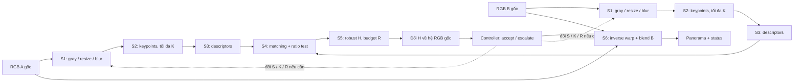

# Nội dung nghiên cứu, cơ sở lý thuyết và hướng triển khai workshop

Cập nhật: **22/10 (Thứ 5), năm 2026**. Phạm vi: bài của Nhóm tại **PARMA-DITAM 2027**, theo checkout dựa trên `e2c00e8` và các tài liệu hiện có. Đây là tài liệu giải thích và hệ thống hóa phương pháp; không thay thế quyết định của người phụ trách từng stage, không xác nhận đã hoàn thành triển khai.

## 1. Bài workshop của chúng ta nghiên cứu điều gì?

**Nhóm nghiên cứu một runtime điều chỉnh budget tính toán giữa các stage của pipeline ghép hai ảnh panorama trên GPU, theo độ khó của từng cảnh, nhằm giảm latency trong khi đáp ứng một quality policy đã định trước.**

Câu hỏi trong [plan.md](../plan.md#2-câu-hỏi-nghiên-cứu-và-hướng-tiếp-cận):

*Can a scene-aware cross-stage runtime reduce GPU panorama-stitching latency by dynamically allocating computational budgets while maintaining a predefined Quality-of-Result constraint?*

Nói cụ thể: cặp ảnh dễ có thể không cần nhiều keypoint hoặc nhiều giả thuyết RANSAC; cặp khó có thể cần budget lớn hơn. Dùng cùng cấu hình cao cho mọi ảnh có thể lãng phí; dùng cùng cấu hình thấp có thể thất bại. Nhóm muốn đo xem quyết định theo cảnh và tái sử dụng kết quả có tiết kiệm được thời gian sau khi tính đủ overhead hay không.

| Thành phần | Vai trò trong bài |
|---|---|
| Pipeline feature-based S1–S6 | Workload ứng dụng và nền để kiểm tra giả thuyết runtime |
| CUDA kernels | Bản thực thi do Nhóm xây để kiểm soát budget, stream, buffer và reuse |
| Quality-of-Result, viết tắt QoR | Điều kiện xác định kết quả chấp nhận được |
| Sweep cấu hình và Pareto | Đặc trưng hóa trade-off latency–QoR |
| Controller | Chọn cấu hình khởi đầu, kiểm tra tín hiệu và tăng budget khi cần |
| Cross-stage reuse | Tránh chạy lại các phép tính còn hợp lệ sau khi đổi budget |
| Benchmark và ablation | Kiểm chứng lợi ích thực, failure và nguồn gốc speedup |

Đóng góp **dự kiến** là thiết kế và đánh giá runtime dưới ràng buộc chất lượng. Pipeline stitching cổ điển, ratio test, RANSAC và multi-band không được coi là thuật toán mới của Nhóm. Cũng chưa có bằng chứng để ghi đã đạt realtime, tiết kiệm năng lượng, SOTA image quality hoặc quantum advantage.

Phạm vi ứng dụng hiện là **hai ảnh, một global homography, một GPU T4**. Multi-view/360°, video temporal consistency, optical flow, local mesh và neural stitching chưa thuộc đường triển khai chính. Quantum là đề xuất mở rộng riêng trong [quantum-integration-proposal.md](quantum-integration-proposal.md), chưa thay research question hoặc pipeline đã chọn.

PARMA-DITAM có các topic heterogeneous/parallel computing, công cụ phân tích hiệu năng và case studies [W1]. Bài của Nhóm gắn với các topic này qua runtime và đánh giá hệ thống. Đây là cách định vị đề tài, không phải bảo đảm được nhận bài.

## 2. Nguồn nội bộ và cách hiểu trạng thái

| Nguồn | Vai trò |
|---|---|
| [plan.md](../plan.md) | Research question, phân công, phase và Go/No-Go |
| [stages.md](../stages.md) | Pipeline, input/output và người phụ trách |
| [conventions.md](../conventions.md) | Contract dữ liệu, hình học, workspace, timing và CSV |
| [s1-preprocessing.md](../stages/s1-preprocessing.md) | Phương pháp S1 do Tuấn chọn |
| [benchmark-qor-s4-s5-decisions.md](../decisions/benchmark-qor-s4-s5.md) | Benchmark, quality policy, S4/S5 do Đế phụ trách |
| [s6-warp-blend.md](../stages/s6-warp-blend.md) | Quyết định và reference algorithm S6 của Chương |
| [khung LaTeX](../../PARMA-DITAM_2027_Workshop/README.md) | Story và outline manuscript |

Tài liệu dùng các trạng thái sau:

- **Đã chọn:** có quyết định phương pháp trong tài liệu; chưa đồng nghĩa có kernel hoặc kết quả đo.
- **Quy ước chung:** contract đã được ghi; các điểm còn mở vẫn cần người phụ trách xác nhận.
- **Mock/reference:** bản giả phục vụ phát triển và kiểm tra, không tự trở thành phương pháp CUDA chính thức.
- **Đề xuất triển khai:** cách cụ thể hóa để hiểu thiết kế, chưa phải API/file hoặc hyperparameter đã được Nhóm duyệt.

Checkout hiện có common headers, CMake, host/CUDA smoke tests, mock OpenCV và khung paper. Chưa thấy stage kernels, harness, controller hoặc bảng latency/QoR ở đây. Không suy ra trạng thái code trên nhánh khác hay kết quả lưu ngoài repo từ quan sát này.

## 3. Toàn bộ luồng xử lý



S1–S3 xử lý từng ảnh; S4–S6 cần thông tin của cả hai. Controller là module điều phối, không phải stage thứ bảy. H được tìm trên ảnh làm việc đã thu nhỏ, nhưng S6 render từ RGB gốc.

Nguồn nền tảng cho pipeline feature-based là Brown–Lowe [F1]. Bài đó trình bày hệ thống panoramic stitching rộng hơn; repo không mặc nhiên triển khai toàn bộ các thành phần như bundle adjustment, gain compensation hoặc automatic straightening của hệ thống ấy.

## 4. Mô hình toán của cấu hình và chất lượng

### 4.1. Bốn núm chỉnh

$$
c=(s,k,r,b)\in\mathcal C.
$$

| Núm | Ý nghĩa | Tác động chính và đánh đổi |
|---|---|---|
| `S = s` | Tỉ lệ ảnh làm việc ở S1 | Ít pixel hơn, nhưng có thể mất chi tiết giúp tìm H |
| `K = k` | Số keypoint tối đa giữ lại | Ít descriptor và matching hơn, nhưng có thể giảm số/độ phủ correspondence |
| `R = r` | Budget giả thuyết RANSAC tối đa | Ít hypothesis scoring hơn, nhưng giảm cơ hội tìm model tốt |
| `B = b` | Feather hoặc multi-band | Đổi chi phí composition và kiểu chuyển tiếp; không sửa được H sai nói chung |

Không giả định tăng mọi núm đều tăng chất lượng, hoặc cấu hình có budget cao hơn luôn tốt hơn trên mọi cảnh. Đây là quan hệ cần đo. Grid cụ thể chỉ khóa sau pilot.

### 4.2. Bài toán lựa chọn lý tưởng

Với cặp ảnh `i`, gọi `T_i(c)` là latency và `Pass_i(c)` là điều kiện đạt quality policy:

$$
c_i^*=\arg\min_{c\in\mathcal C:\operatorname{Pass}_i(c)=1}T_i(c).
$$

Đây là lựa chọn Oracle offline trên một lưới hữu hạn. Nếu không có cấu hình đạt, pair là `unachievable`; nếu quality reference lỗi thì báo riêng. Oracle không có quyền biết trước chất lượng trong hệ thống online thực.

Controller chỉ dùng feature đã tính được tại thời điểm quyết định. Tín hiệu S5 không thể dùng để chọn budget ban đầu trước S5 nếu chưa chạy một probe; mọi probe có chi phí phải được đo.

## 5. Cơ sở hình học: homography và hệ tọa độ

### 5.1. Homography B → A

Với tọa độ pixel `(x_B,y_B)` và điểm đồng nhất `p̄_B=(x_B,y_B,1)^T`:

$$
\widetilde p_A=H\bar p_B,\qquad
(x_A,y_A)=\pi(\widetilde p_A),\qquad
\pi(a,b,w)=(a/w,b/w).
$$

H có 9 phần tử nhưng chỉ 8 bậc tự do vì nhân toàn ma trận với một hằng số khác 0 biểu diễn cùng phép chiếu. Contract dùng `double`, row-major, vector cột, chiều B→A và cho phép `h33=0`; không dùng chia cho `h33` như một quy tắc chuẩn hóa phổ quát.

Một global H phù hợp khi cảnh gần phẳng hoặc camera quay quanh tâm chiếu; với parallax do các độ sâu khác nhau, một H thường không thể căn chỉnh mọi vùng. Blending có thể làm chuyển tiếp dịu hơn, nhưng không thay thế mô hình hình học phù hợp.

Để tìm H từ matches, cơ sở là linear homography estimation/DLT [B1]. Mỗi correspondence tạo hai phương trình tuyến tính theo 9 phần tử H; ít nhất bốn cặp ở cấu hình không suy biến mới xác định được model. Từ B `(x,y)` sang A `(u,v)`, hai hàng có thể viết:

$$
\begin{bmatrix}
x&y&1&0&0&0&-ux&-uy&-u\\
0&0&0&x&y&1&-vx&-vy&-v
\end{bmatrix}h=0.
$$

Chuẩn hóa tọa độ hai tập điểm để cải thiện conditioning, giải nullspace, rồi denormalize. DLT giảm vấn đề đại số; tự nó chưa xử lý outlier và chưa tối thiểu hóa geometric reprojection error. Chi tiết solver CUDA và refinement vẫn thuộc S5 của Đế.

### 5.2. Tại sao S1 phải trả ma trận D?

Kích thước làm việc được làm tròn:

$$
W_{\mathrm{work}}=\max(1,\operatorname{lround}(Ws)),\quad
H_{\mathrm{work}}=\max(1,\operatorname{lround}(Hs)),\quad
s_x=W_{\mathrm{work}}/W,\quad s_y=H_{\mathrm{work}}/H.
$$

`W, H` ở đây là width/height của ảnh gốc; ma trận homography được phân biệt qua ngữ cảnh và ký hiệu `H_s` cho hệ làm việc.

Với tâm pixel ở tọa độ nguyên, quy ước half-pixel:

$$
x_s=s_x(x+0.5)-0.5,\qquad
D=\begin{bmatrix}
s_x&0&(s_x-1)/2\\
0&s_y&(s_y-1)/2\\
0&0&1
\end{bmatrix}.
$$

Ví dụ ảnh rộng 5, `s=0.5` cho width làm việc 3, nên scale thực là `3/5`, không phải đúng `0.5`. Dùng S danh nghĩa thay D thực có thể làm sai H khi đổi về ảnh gốc.

Nếu S5 tìm ma trận `H_s` trong hệ làm việc:

$$
D_A\bar p_A\sim H_sD_B\bar p_B
\quad\Rightarrow\quad
H=D_A^{-1}H_sD_B.
$$

S5 trả cả hai ma trận; **S6 chỉ dùng H trong hệ RGB gốc**. Quy tắc này nằm trong [conventions.md](../conventions.md#5-quy-ước-hình-học) và helper [geometry.hpp](../../src/common/geometry.hpp). Không chuyển đổi thêm lần nữa trong S6.

## 6. S1 — Tiền xử lý ảnh

**Phụ trách: Tuấn. Trạng thái: đã chọn phương pháp; kernel CUDA chưa có trong checkout.** Nguồn quyết định chi tiết là [s1-preprocessing.md](../stages/s1-preprocessing.md).

Luồng đã chọn: RGB → gray → area resize → Gaussian blur. Resize làm giảm aliasing khi thu nhỏ; blur ở ảnh nhỏ giúp chi phí smoothing giảm theo diện tích ảnh làm việc. Gaussian có tính separable:

$$
G_\sigma(x,y)=g_\sigma(x)g_\sigma(y),\qquad
I_{\mathrm{blur}}=g_y*(g_x*I).
$$

Một filter hai chiều có kernel rộng m cần khoảng `m²` phép tính/pixel; hai filter một chiều cần khoảng `2m`, chưa tính memory và launch overhead. Đây là phân tích chi phí thuật toán, không phải speedup T4 đã đo.

Quyết định hiện tại:

- Gray dùng hệ số nguyên 15 bit gắn với reference OpenCV đã pin trong repo. Đây là quyết định implementation/version, không phải công thức riêng được kế thừa từ một paper stitching.
- Resize tính trung bình theo diện tích đóng góp của pixel nguồn; biên và rounding phải khớp reference trong tolerance.
- Gaussian dùng `ksize=2ceil(3σ)+1`, reflect-101; `σ` cần Thành xác nhận, giá trị tạm trong mock không tự thành giá trị cuối.
- Output ảnh gray có pitch và `ScaleInfo` trên host.

Mapping CUDA được đề xuất trong quyết định S1: một kernel chuyển xám + resize, một kernel blur theo tile/shared memory; xử lý hai ảnh trong batch. Nếu fusion khó kiểm chứng thì tách pass trước. Không suy ra hai ảnh bắt buộc dùng hai stream: quy ước bản đầu hiện là một stream.

Kiểm chứng: màu chuẩn/RGB ramp, ảnh kích thước lẻ, S=1, S phân số, border và D. Chỉ dùng kết quả test được lưu và tái lập để xác nhận correctness; chưa có benchmark mới từ tài liệu này.

## 7. S2–S3 — Keypoint và descriptor

**Phụ trách: Thành. Trạng thái: chưa thấy tài liệu chốt detector/descriptor riêng trong checkout.** Mock hỗ trợ ORB và SIFT; chúng là reference/candidate, không đủ để kết luận Nhóm đã chọn ORB hoặc SIFT cho CUDA.

### 7.1. Các khái niệm cần hiểu

Keypoint là vị trí có cấu trúc cục bộ giúp nhận ra lại ở ảnh khác. S2 cần detection, response/ranking, loại điểm quá gần khi phương pháp yêu cầu và chọn tối đa K điểm. Chỉ lấy K response cao nhất mà bỏ phân bố không gian có thể làm matches tập trung một góc ảnh, khiến H thiếu ổn định.

Descriptor biểu diễn vùng quanh keypoint thành vector để so sánh. Hai họ liên quan:

| Candidate | Cơ sở | Biểu diễn và metric | Điều chưa được quyết định |
|---|---|---|---|
| SIFT [F2] | Scale-space/gradient, orientation và histogram cục bộ | Reference thường 128 thành phần; float descriptor so L2 | Có triển khai đầy đủ scale-space/SIFT hay chọn phương án khác |
| ORB [F3] | Oriented FAST và binary descriptor phát triển từ BRIEF | Reference thông thường 256 bits; Hamming với encoding phù hợp | Detector, pyramid, pattern, orientation và `WTA_K` thực tế |

SIFT và ORB cung cấp những mức ổn định đối với scale/rotation khác nhau; không phải bảo đảm bất biến dưới mọi phép projective. Tài liệu này không áp đặt một trong hai lên Thành.

### 7.2. Hướng mapping CUDA cần giữ

Detection/filtering theo pixel/tile, compact điểm hợp lệ, ranking/top-K và description theo keypoint là các đơn vị có thể tách để kiểm thử. Shape/descriptor type phải chốt trước khi S4 tối ưu metric. Buffer output và số phần tử nằm trên device theo [types.hpp](../../src/common/types.hpp).

Tăng K có thể tăng S2 selection, S3 description và đặc biệt S4 matching. Vì thế K là núm **cross-stage**, không chỉ là tham số cục bộ của detector. Nếu K_A và K_B cùng tăng gấp đôi, số cặp matching có thể tăng khoảng bốn lần; thời gian thực còn phụ thuộc occupancy, bandwidth và overhead.

## 8. S4 — Exact matching và ratio test

**Phụ trách: Đế. Trạng thái: đã chọn tiled exact BF top-2 + ratio test.** Cross-check là ablation, chưa mặc định luôn bật.

Với descriptor query `d_a`, tìm hai descriptor gần nhất trong B, với khoảng cách `d_1 ≤ d_2`. Chấp nhận khi:

$$
d_1<\tau d_2.
$$

Ratio test theo Lowe [F2] loại các trường hợp nearest và second-nearest quá giống nhau, tức match còn mơ hồ. Nó không chứng nhận correspondence đúng về hình học; S5 vẫn phải robust fitting. `τ=0.8` đang có trong mock, chưa là threshold đã khóa cho descriptor thật của Nhóm.

Metric:

$$
d_{\mathrm{L2}}(a,b)=\sqrt{\sum_j(a_j-b_j)^2},\qquad
d_{\mathrm{Ham}}(a,b)=\operatorname{popcount}(a\oplus b).
$$

Nếu kernel dùng squared L2, điều kiện tương đương là `d1_squared < τ²·d2_squared`; không giữ nguyên τ. Descriptor kiểu ORB có `WTA_K=3/4` cần metric tương ứng, không mặc định popcount bit thông thường.

Mapping đã chọn: chia descriptors B thành tile, tái sử dụng dữ liệu đọc khi phù hợp, mỗi query giữ top-2 và chỉ xuất match vượt filter; tránh lưu toàn bộ ma trận khoảng cách. Complexity khoảng `O(K_A K_B D)`. Ties, fewer-than-two-neighbors và empty descriptor phải có quy tắc deterministic.

LightGlue [F15] là related work về learned/adaptive matching, chưa phải S4 của repo. Vì đã có nghiên cứu adaptive matching, bài của Nhóm cần chứng minh giá trị điều phối **giữa các stage** và chi phí hệ thống; không chỉ nói “matching có thể thích nghi”.

## 9. S5 — RANSAC, MSAC-style score và refinement

**Phụ trách: Đế. Trạng thái: đã chọn batched GPU RANSAC, truncated-residual scoring và inlier refinement.** Chưa phải full MAGSAC++, MLESAC hoặc LO-RANSAC implementation.

### 9.1. Tại sao cần RANSAC?

Matches có outlier. Fit H bằng least squares trên tất cả matches có thể bị vài match sai kéo lệch mạnh. RANSAC [F4] lặp các bước: lấy minimal sample → tạo H → chấm mức đồng thuận trên mọi match → giữ model tốt.

Với homography, minimal sample có bốn cặp không suy biến. Dưới giả định đơn giản mỗi sample có xác suất `w^4` là toàn inlier và các lần lấy độc lập, với `0<w<1` và `0<p<1`, số vòng để xác suất gặp ít nhất một sample toàn inlier đạt p:

$$
R_{\mathrm{req}}=\left\lceil\frac{\log(1-p)}{\log(1-w^4)}\right\rceil.
$$

Đây là mô hình giải thích vì sao cảnh nhiều outlier cần nhiều vòng. Inlier ratio chưa biết, sample có thể suy biến và giả định độc lập chỉ xấp xỉ khi lấy mẫu thực; công thức không phải quality guarantee. Repo dùng R như maximum hypothesis budget, các giá trị cụ thể còn cần pilot.

### 9.2. Score và refinement

Ví dụ residual một chiều trong hệ ảnh đã quy định:

$$
e_j(H)=\|p_{A,j}-\pi(H\bar p_{B,j})\|_2.
$$

Ở đây `p_A,j` là tọa độ hai chiều và `p̄_B,j` là tọa độ đồng nhất tương ứng. Residual đối xứng là lựa chọn khác có thêm chi phí; không tự coi là đã chốt. Threshold cần cùng hệ pixel với residual, nhất là khi S thay đổi. Cùng một threshold theo pixel ảnh làm việc ở mọi S không tương đương cùng tolerance trên RGB gốc. Phải chọn rõ cách chấm residual ở hệ gốc hoặc cách đổi tolerance theo scale thực; không tự khóa lựa chọn này thay Đế.

RANSAC gốc ưu tiên consensus count. MSAC-style score giữ thông tin residual trong vùng inlier:

$$
J(H)=\sum_j\min(e_j(H)^2,\epsilon^2).
$$

Cần **tối thiểu hóa J(H)** khi chọn hypothesis. Cơ sở phân biệt RANSAC/MSAC/MLESAC được trình bày trong [F5]. Repo chọn **MSAC-style**, không tối ưu mixture likelihood như MLESAC. Sau chọn hypothesis, fit lại trên inliers rồi kiểm tra validity; [F6] là nền tảng local optimization, chưa đồng nghĩa đã tái lập toàn bộ thuật toán LO-RANSAC.

Mapping GPU: tạo samples/hypotheses theo batch, đánh giá residual song song trên matches, reduce score/count và chọn best bằng tie-break cố định. Cần kiểm tra trùng điểm, gần thẳng hàng, non-finite, conditioning và projection denominator. Trả H cùng count/ratio, residual và spatial coverage để controller dùng.

### 9.3. Reuse khi tăng R

Nếu matches và chính sách scoring không đổi, giữ best hypothesis, sampler state và số samples đã xử lý; chạy thêm budget còn thiếu thay vì chạy lại từ đầu. Muốn so với một lượt R lớn phải dùng cùng sample sequence và quy tắc refinement/tie-break được xác định rõ.

Nếu đổi S hoặc K làm matches thay đổi, RANSAC state cũ không mặc nhiên hợp lệ. Tăng số inlier cũng chưa chứng minh H đúng trên toàn ảnh; cần spatial coverage và evaluator offline.

## 10. S6 — Warp và blending

**Phụ trách: Chương. Trạng thái: đã chọn phương pháp ở mức tài liệu.** Chi tiết policy/reference nằm trong [s6-warp-blend.md](../stages/s6-warp-blend.md); các công thức bên dưới giải thích lựa chọn đó, không định nghĩa lại một blender khác.

### 10.1. Canvas và inverse warping

Chiếu footprint của B bằng H sang hệ A, kết hợp footprint A để tính bounding box/canvas và phép tịnh tiến T từ A sang canvas. Trước khi dùng bbox từ các góc phải loại H có horizon đi qua footprint, project không hữu hạn hoặc tài nguyên vượt budget. Tolerance/snapping theo policy chung.

Với pixel canvas có tọa độ đồng nhất `q_h=(x_c,y_c,1)^T`, tọa độ hai chiều để sampling là:

$$
p_A=\pi(T^{-1}q_h),\qquad p_B=\pi(H^{-1}T^{-1}q_h).
$$

Phải kiểm tra tính hữu hạn và mẫu số trước khi chia tọa độ đồng nhất. Inverse mapping cho mỗi thread biết vị trí cần đọc ở nguồn, tránh việc forward splatting tự tạo lỗ hoặc nhiều thread tranh ghi cùng output. Nó không tự giải quyết aliasing khi thu nhỏ mạnh.

Với `(x,y)=(x_0+α,y_0+β)`, bilinear:

$$
C(x,y)=(1-α)(1-β)C_{00}+α(1-β)C_{10}
+(1-α)βC_{01}+αβC_{11}.
$$

Validity mask phải dựa vào tọa độ/footprint và border policy. Pixel RGB bằng 0 vẫn có thể là pixel hợp lệ; không dùng “màu đen” làm dấu invalid. GPU dự kiến một thread/pixel output, gather các pixel nguồn và ghi độc lập.

### 10.2. Feather

Với tọa độ hợp lệ trong nguồn i, policy hiện tại dùng khoảng cách tương đối đến biên:

$$
d_i=\min\left(\frac{x_i+0.5}{W_i},\frac{W_i-0.5-x_i}{W_i},
\frac{y_i+0.5}{H_i},\frac{H_i-0.5-y_i}{H_i}\right),\quad w_i=M_i d_i,
$$

$$
C_F=\frac{w_AC_A+w_BC_B}{w_A+w_B}.
$$

Chỉ một nguồn hợp lệ thì giữ nguồn đó; cả hai invalid thì output ngoài union. Công thức weight cụ thể là **thiết kế của dự án**, không khẳng định giống `OpenCV FeatherBlender` hoặc sao nguyên công thức từ [F1]. Feather nhẹ nhưng có thể tạo ảnh đôi nếu hai nguồn chưa căn chỉnh.

### 10.3. Gaussian/Laplacian multi-band

Ý tưởng nền tảng [F7]: phân ảnh thành các dải tần và trộn với mức chuyển tiếp phù hợp từng scale. Nó giúp xử lý chuyển tiếp tần số thấp/cao khác nhau; không phải estimator sửa parallax.

Ký hiệu R là REDUCE, E là EXPAND; R ở mục này là toán tử pyramid, không phải budget RANSAC. Gaussian pyramid và Laplacian:

$$
G_i^0=F_i,\quad G_i^{\ell+1}=R(G_i^\ell),\qquad
L_i^\ell=G_i^\ell-E(G_i^{\ell+1}),\quad L_i^L=G_i^L.
$$

`F_i` là ảnh đã extension chỉ để filtering, không phải lấp vùng output bằng một nội dung mới. Ownership hình học `O_i` chọn nguồn dựa vào validity và khoảng cách đến biên, tie chọn A; đây không phải content-aware seam finder.

Weight pyramid `U_i^0=O_i`, `U_i^{ℓ+1}=R(U_i^ℓ)`; trộn và tái tạo:

$$
Z^\ell=\frac{U_A^\ell L_A^\ell+U_B^\ell L_B^\ell}{U_A^\ell+U_B^\ell},\qquad
C^L=Z^L,\quad C^\ell=Z^\ell+E(C^{\ell+1}).
$$

Weight tổng bằng 0 được xử lý riêng. Theo policy hiện tại, overlap dùng reconstruction; vùng một nguồn giữ warped color, ngoài union bằng 0. Cần kiểm tra seam ở rìa overlap, không mặc định công thức này đạt QoR.

Chi tiết tái lập của dự án:

- REDUCE dùng filter `[1,4,6,4,1]/16` tách chiều, lấy mẫu chẵn, shape `ceil(size/2)`.
- EXPAND chèn zero, filter với scale tương ứng và crop đúng shape cha; cùng phase/border reflect-101 ở CPU/GPU.
- Extension kiểu pull–push dùng color numerator và validity pyramid; giữ pixel nguồn hợp lệ, không đổi coverage. Không để vùng invalid bị coi là RGB đen thật rồi gây halo.
- `multiband_3/5` là 3/5 lần REDUCE, tương ứng 4/6 mức lưu trữ trước khi giới hạn bởi canvas nhỏ.
- Laplacian có thể âm: không clamp từng band. Chỉ clamp/round output cuối theo policy.
- Hiện blend trên RGB đã decode/chuẩn hóa, chưa có gamma/gain correction; không gọi đó là compositing trong linear light.

Những quy tắc ownership/extension/border trên là quyết định dự án cần test, không gán toàn bộ cho Burt–Adelson hoặc Brown–Lowe. [F8] hỗ trợ việc xem xét đồng thời chất lượng, thời gian và memory của blender; số đo paper ngoài không đại diện kernel của Nhóm.

### 10.4. Chi phí và mapping

Warp/feather theo pixel; pyramid filter và reconstruction theo level. Với số pixel P, tổng kích thước Gaussian lý tưởng `P(1+1/4+1/16+…) < 4P/3`, nhưng chi phí còn có filter passes, extension, reconstruction, padding và kernel launches. Không suy ra multiband 5 đắt gấp `5/3` lần multiband 3.

Hai nhánh ảnh có thể có phép tính độc lập, còn các level liên tiếp có phụ thuộc dữ liệu. Bản đầu tuân thủ một stream; chỉ thêm overlap/fusion sau khi có profiling và correctness. GPU dự kiến FP32 per-pixel, setup hình học cần precision phù hợp; không hứa bit-identical OpenCV khi arithmetic/border khác.

## 11. QoR — Đo cái gì và không đo được cái gì?

### 11.1. PSNR và SSIM

Với tập pixel hợp lệ V và C kênh, MSE và PSNR:

$$
\operatorname{MSE}=\frac{1}{C|V|}\sum_{p\in V}\sum_{c=1}^{C}(A_c(p)-B_{H,c}(p))^2,
\quad \operatorname{PSNR}=10\log_{10}\frac{L_{\max}^2}{\operatorname{MSE}}.
$$

`L_max=255` cho uint8 hoặc 1 cho ảnh chuẩn hóa; không trộn hai dynamic ranges. MSE bằng 0 cho PSNR vô hạn, phải có cách serialize/phân tích rõ; V rỗng là trường hợp không hợp lệ, không phải điểm số tốt.

SSIM so các thống kê cục bộ [F9]:

$$
\operatorname{SSIM}(x,y)=
\frac{(2\mu_x\mu_y+C_1)(2\sigma_{xy}+C_2)}
{(\mu_x^2+\mu_y^2+C_1)(\sigma_x^2+\sigma_y^2+C_2)}.
$$

Window, sigma, color space, dynamic range, covariance convention và cách tổng hợp masked SSIM cần chốt trong evaluator. Không thay mask bất quy tắc bằng bounding rectangle có pixel invalid mà không giải thích. Công thức SSIM không tự cung cấp protocol overlap cho stitching.

### 11.2. Evaluation domain và coverage

Đề xuất chung lấy miền tham chiếu cố định theo pair:

$$
\Omega_i=\{p\in A:\pi(H_{\mathrm{ref}}^{-1}\bar p)\text{ chiếu hợp lệ vào B}\},\qquad
V_{ic}=\Omega_i\cap\operatorname{valid}(H_c).
$$

Tính alignment metrics trên V và coverage `|V|/|Ω_i|`. Giữ Ω cố định ngăn candidate tự thu nhỏ overlap để bỏ những pixel khó. `Ω_i` rỗng hoặc reference lỗi cần trạng thái riêng.

Quality policy pilot hiện được đề xuất:

$$
\operatorname{Pass}_i(c)=\operatorname{ValidStitch}_i(c)
\land [\operatorname{SSIM}_i(c)\ge\operatorname{SSIM}_{i,ref}-0.02]
\land [\operatorname{PSNR}_i(c)\ge\operatorname{PSNR}_{i,ref}-0.5\,\mathrm{dB}]
\land [\operatorname{coverage}_i(c)\ge0.95].
$$

Ba con số là **tolerance do dự án đề xuất**, chưa phải ngưỡng chuẩn của dataset hoặc paper; Đế/Chương và Nhóm cần xác nhận bằng development. Không cộng SSIM với PSNR để tạo quality score vô hướng tùy ý. Fixed-High là reference thực nghiệm, không phải ground truth.

### 11.3. Alignment khác composition

UDIS/UDIS++ [F10, F11] là nguồn benchmark và tham khảo đánh giá. Hệ thống của các paper đó có learned warping/composition; Nhóm không mặc nhiên triển khai hoặc đạt chất lượng tương đương.

Evaluator hiện tại, khi **B cố định**, warp lại ảnh từ H để đo alignment; không dùng output S6. Vì vậy PSNR/SSIM này không chọn được feather hay multiband tốt hơn. Muốn B tham gia adaptive policy cần đánh giá composition nhạy với seam/ghosting và kiểm tra thị giác bổ sung. Chưa có metric đó thì giữ B cố định trong thí nghiệm S/K/R chính theo đề xuất phối hợp hiện tại.

## 12. Pareto, Fixed-Best và Oracle

### 12.1. Pareto là gì?

Trên cùng một pair, một cấu hình bị dominated nếu có cấu hình khác nhanh hơn hoặc bằng, mọi quality metric tốt hơn hoặc bằng, và ít nhất một chiều tốt hơn nghiêm ngặt. Pareto front gồm các điểm chưa bị dominated. Cần xử lý validity/coverage và noise của phép đo trước khi loại cấu hình.

Không dùng mean quality toàn dataset để kết luận một cấu hình vô dụng cho mọi pair: nó có thể quan trọng với một nhóm cảnh khó. Ladder cần được chọn trên development và kiểm lại trên final; không có định lý chất lượng tăng đơn điệu theo thứ tự ladder.

### 12.2. Baseline phải phân biệt

| Baseline | Ý nghĩa |
|---|---|
| Fixed-Low | Một cấu hình budget thấp dùng cho mọi pair |
| Fixed-High | Một cấu hình budget cao, dùng làm quality reference sau kiểm tra |
| Fixed-Best | Một cấu hình cố định được chọn trên development theo tiêu chí latency/QoR đã khóa |
| Oracle | Chọn riêng cho từng pair cấu hình rẻ nhất đạt policy sau sweep offline |
| Adaptive | Controller thực, có chi phí feature/check/retry/reuse |

Fixed-Best không phải chọn lại một cấu hình khác cho mỗi ảnh. Quy tắc chọn Fixed-Best phải làm rõ mức coverage/failure chấp nhận trên development; chưa tự áp đặt một ngưỡng mới trong tài liệu này.

Ví dụ **giả định để giải thích, không phải số đo của Nhóm**: Low mất 3 ms, chỉ đạt trên 8/10 pair; High mất 8 ms, đạt trên cả 10. Nếu 2 pair khó buộc dùng High, Oracle có mean `(8·3+2·8)/10=4 ms`, còn High là 8 ms. Đây là khoảng trống lý tưởng cho adaptation. Controller thật có thể mất thêm thời gian probe hoặc retry nên không được ghi trước rằng sẽ đạt 2× speedup.

## 13. Cơ sở runtime: điều chỉnh budget, kiểm tra và reuse

### 13.1. Dựa vào hướng nghiên cứu nào?

PowerDial [F13] nghiên cứu biến tham số cấu hình thành dynamic knobs và calibration trade-off. Green [F14] nghiên cứu controlled approximation với calibration và quyết định vận hành theo QoS. Đây là cơ sở liên quan cho việc xem chất lượng như một ràng buộc khi phân bổ computation.

Khác biệt cần kiểm chứng của đề tài Nhóm nằm ở workload stitching, lựa chọn theo cảnh, kiểm tra trung gian và dependency-aware reuse giữa các stage GPU. Không được kế thừa statistical QoS guarantee của Green hoặc power savings của PowerDial chỉ bằng cách trích dẫn hai paper. Tài liệu này bổ sung nguồn liên quan; chưa thay nội dung Related Work trong LaTeX hoặc xác nhận novelty đã đủ.

### 13.2. Vòng điều khiển dự kiến

```text
features_initial = compute_available_features(pair)
c = choose_initial_configuration(features_initial)
state = empty_cache()
repeat:
    run_required_S1_to_S5(c, state)
    inspect_available_S5_signals()
    if self_check_accepts():
        run_S6(c, state)
        return panorama, status
    if no_more_budget_or_fallback():
        return controlled_failure_or_defined_fallback()
    c = next_configuration(c)
    invalidate_only_dependencies_that_changed(state, c)
```

Đây là pseudocode giải thích [stages.md](../stages.md#3-controller), chưa phải controller đã cài. Feature set, classifier/rule, acceptance thresholds và ladder còn cần Đế chọn và kiểm chứng. Không mặc định dùng neural network, reinforcement learning hoặc quantum model.

Self-check có thể dùng số matches/inliers, inlier ratio, reprojection residual, spatial coverage và H validity. Chúng là proxy, không phải PSNR/SSIM thật trên final. Phải đo false acceptance: controller chấp nhận nhưng evaluator offline đánh fail; cùng false rejection và retry cost khi phân tích policy.

### 13.3. Dependency và cache invalidation

| Thay đổi | Có thể giữ | Phần phải tính lại hoặc xác minh |
|---|---|---|
| Chỉ tăng R | S1–S4, matches và trạng thái hypothesis tương thích | Samples mới, scoring/refinement cần thiết và H cuối; output warp cũ không hợp lệ nếu H đổi |
| Đổi K | S1 nếu input/S/blur không đổi | Selection/descriptor/matches/S5 phụ thuộc tập keypoint mới; không mặc định descriptor cũ dùng được |
| Đổi S | RGB gốc | S1–S5 và H; S6 nếu geometry thay đổi |
| Chỉ đổi B | H và warped colors/masks nếu đã materialize với cùng input/geometry/policy | Blender/pyramid tương ứng; cost dựng cache phải được tính |

Reuse chỉ đúng khi cache key bao gồm dependencies thực: ảnh, pitch, geometry, policy và cấu hình liên quan. Không mặc định reuse giữa hai cặp ảnh khác nhau. Cũng không dựng pyramid 5 trước cho mọi pair rồi bỏ chi phí đó khi báo feather nhanh.

### 13.4. Vì sao phải đo bottleneck trước?

Theo lập luận phân rã thời gian kiểu Amdahl [F16], nếu phần có thể cải thiện chiếm tỷ lệ f, được tăng tốc r lần, còn overhead mới là o lần baseline time:

$$
\operatorname{Speedup}=\frac{1}{(1-f)+f/r+o}.
$$

Đây là mô hình kế toán thời gian đơn giản, không dự đoán đầy đủ workload thay đổi theo S/K/R. Khi f nhỏ, tối ưu phần đó có trần lợi ích thấp; khi controller/retry làm o lớn, adaptation có thể chậm hơn fixed. Vì vậy Go/No-Go cần cả stage fraction và Oracle–Fixed-Best gap, không chỉ một kernel chạy nhanh.

## 14. Triển khai CUDA và đo đạc hệ thống

### 14.1. Contract thực thi

Theo [conventions.md](../conventions.md), dùng C++17/CUDA, T4 `sm_75`. Input RGB và buffers trung gian ở device; keypoints/matches dùng SoA và device count. Caller cấp output/workspace, mỗi stage cung cấp workspace query theo convention; đây không phải xác nhận đã thêm dependency CUB.

Bản đầu một stream, hai điểm đồng bộ chính:

1. Sau S5 để đọc H và tín hiệu cho controller.
2. Sau S6 khi panorama đã sẵn sàng.

Launch error và execution error được kiểm tra khác thời điểm. Stage không được trả thành công giả khi kernel lỗi. NVIDIA [D1] là nguồn execution/memory model; block size, shared-memory layout và fusion cụ thể phải do profiling/test của Nhóm xác nhận.

### 14.2. Hai ranh giới thời gian

- **Device stage time:** CUDA events trên đúng stream và đủ dependencies.
- **End-to-end:** host steady clock từ khi RGB đã nằm trên GPU đến sau synchronize khi panorama ở GPU sẵn sàng. Gồm controller, host setup, sync, retry và cache overhead trong đường chạy; không gồm decode/H2D đầu vào/D2H đầu ra theo ranh giới đã chọn.

Không so kernel-only của Adaptive với end-to-end của Fixed-Best. Mọi allocation/copy phát sinh trong vùng đo đều phải tính, không loại bằng cách đổi nhãn stage. Mock Python/CPU có thể giúp debug nhưng mixed pipeline không phải GPU performance baseline chính thức.

Protocol ghi trong repo: 2 warm-up, 10 lần đo, median cho từng pair/config; median/p95 tiếp theo trên phân phối các pair. Lưu GPU, xung, driver/CUDA/library versions, seed, config và git revision. Không lấy 10 lần chạy một ảnh thành 10 mẫu ảnh độc lập.

### 14.3. Kết quả lưu ở đâu?

`runs.csv`: config, stage/e2e time, self-checks, H và status. `qor.csv`: overlap SSIM/PSNR, coverage và reference status. Nối bằng `pair_id/config_id`; metadata lưu riêng. Số trong paper phải sinh từ các artifact này, không điền tay từ dự đoán lý thuyết.

## 15. Dataset, thí nghiệm và Go/No-Go

| Dữ liệu | Vai trò hiện tại | Nguồn |
|---|---|---|
| UDIS-D | Benchmark chính; repo nguồn ghi 10.440 train/1.106 test pairs (thực tế 1.105 test pairs hợp lệ do thiếu 000001.jpg trong input1) | [F10, F11] |
| HPatches | Mock, correspondence/geometry correctness, known homography | [F12] |
| Synthetic high-resolution | Stress test resolution/latency, có H biết trước; báo riêng ảnh thật | Thiết kế của Nhóm |

Development dự kiến 200–300 cặp từ train; 20–30 cặp là subset cho Go/No-Go. Final là test tách biệt theo convention. Nếu dùng fallback hash-split từ test, phải loại development khỏi final. Không tune thresholds/ladder bằng final hoặc im lặng bỏ reference failure.

Thí nghiệm cần trả lời bốn tầng:

1. **Correctness:** tọa độ, top-2, H, masks và màu đúng trong tolerance đã khóa; kiểm tra synthetic và memory errors.
2. **Characterization:** stage time, canvas/memory và latency–QoR trên grid.
3. **Lợi ích runtime:** Fixed-Low/High/Best, Oracle, Adaptive trên cùng pairs và timing boundary.
4. **Nguồn gốc lợi ích:** scene-aware initial choice, checks/escalation, reuse và B sweep cùng H. Báo violation/failure và overhead, không chỉ average speedup.

Phase 1 tạo kernels, harness, evaluator và sweep; Phase 2 mới triển khai/đánh giá controller và viết phương pháp đã kiểm chứng; Phase 3 tổng hợp kết quả và hoàn thiện paper. Theo plan, ngưỡng gợi ý cho Go/No-Go là khoảng 30% thời gian ở phần chịu tác động S/K/R và Oracle nhanh hơn Fixed-Best khoảng 20–25%; **cả Nhóm phải chốt ngưỡng chính thức**. Không đạt headroom thì fallback paper Pareto, không ép kết quả để giữ câu chuyện adaptive.

## 16. Bảng đối chiếu lý thuyết → phương pháp → bằng chứng cần có

| Phần | Cơ sở | Cách dùng trong dự án | Bằng chứng còn cần |
|---|---|---|---|
| Pipeline | Brown–Lowe [F1] | Hai ảnh feature-based, global H | Pipeline GPU end-to-end chạy thật |
| Homography | Hình học projective/DLT [B1] | B→A, normalized fitting và đổi scale | Known-H/degeneracy/round-trip tests |
| S1 | Sampling/filtering; quyết định Tuấn | Gray + area resize + separable blur | CUDA/reference và latency theo S |
| S2–S3 | SIFT/ORB [F2, F3] là candidates | Detector/descriptor do Thành chốt | Quyết định phương pháp và tests tương ứng |
| S4 | Nearest-neighbor ratio [F2] | Tiled BF top-2, metric theo descriptor | Top-2 correctness, ratio/cross-check ablation |
| S5 | RANSAC/MSAC/local optimization [F4–F6] | Batched hypotheses, truncated score, refinement | Robustness, deterministic R extension, cost/QoR |
| S6 | Multiresolution [F7]; stitching/blending [F1, F8] | Inverse bilinear, feather, multi-band 3/5 | Reference, masks/extension/halo, time/memory và composition |
| QoR | SSIM [F9], UDIS đánh giá alignment [F10, F11] | Fixed-domain overlap, coverage, relative tolerances | Evaluator tests, calibrated policy, failure analysis |
| Runtime | PowerDial/Green [F13, F14]; Amdahl [F16] | Budget theo cảnh, checks, reuse | Headroom, policy/overhead/reuse ablations |
| CUDA | Execution model [D1] và convention Nhóm | Device buffers, workspace, stream/events | T4 correctness/profiling, tái lập artifact |

Điểm chưa chốt quan trọng: S2–S3, các tham số S4/S5, SSIM masking/window, coverage/tolerances, B cố định trong main experiment, acceptance policy và Go/No-Go thresholds. Tài liệu này không tự quyết thay người phụ trách.

## 17. Paper nào cần đọc, dùng cho phần nào?

Các nguồn được đối chiếu qua trang tác giả/publisher, bản tác giả hoặc repo chính thức. Phạm vi truy cập ở mục 18; trích một paper không có nghĩa Nhóm triển khai toàn bộ paper hoặc đã tái lập số đo của nó.

### 17.1. Pipeline, features và robust geometry

**[F1]** Brown, M., & Lowe, D. G. (2007). *Automatic panoramic image stitching using invariant features*. IJCV, 74, 59–73. [Author manuscript](https://www.cs.ubc.ca/~lowe/papers/07brown.pdf); [DOI](https://doi.org/10.1007/s11263-006-0002-3). Đọc để hiểu pipeline stitching và ranh giới alignment/rendering; không sao toàn bộ hệ thống vào claim dự án.

**[F2]** Lowe, D. G. (2004). *Distinctive image features from scale-invariant keypoints*. IJCV, 60(2), 91–110. [Author manuscript](https://www.cs.ubc.ca/~lowe/papers/ijcv04.pdf); [DOI](https://doi.org/10.1023/B:VISI.0000029664.99615.94). Descriptor và nearest/second-nearest ratio; threshold trong paper không là guarantee cho mọi descriptor/dataset.

**[F3]** Rublee, E., Rabaud, V., Konolige, K., & Bradski, G. (2011). *ORB: An efficient alternative to SIFT or SURF*. ICCV, 2564–2571. [Publisher](https://ieeexplore.ieee.org/document/6126544/); [DOI](https://doi.org/10.1109/ICCV.2011.6126544). Nguồn candidate binary feature, không phải quyết định S2–S3 đã được xác nhận.

**[F4]** Fischler, M. A., & Bolles, R. C. (1981). *Random sample consensus: A paradigm for model fitting with applications to image analysis and automated cartography*. Communications of the ACM, 24(6), 381–395. [Cơ quan tác giả SRI](https://www.sri.com/publication/artificial-intelligence-pubs/random-sample-consensus-a-paradigm-for-model-fitting-with-applications-to-image-analysis-and-automated-cartography-2/); [DOI](https://doi.org/10.1145/358669.358692). Nền tảng sampling/consensus của S5.

**[F5]** Torr, P. H. S., & Zisserman, A. (2000). *MLESAC: A new robust estimator with application to estimating image geometry*. CVIU, 78(1), 138–156. [Author record](https://www.robots.ox.ac.uk/~vgg/publications/2000/Torr00/); [paper](https://www.robots.ox.ac.uk/~vgg/publications/2000/Torr00/torr00.pdf). §5 phân biệt scoring RANSAC, MSAC và MLESAC.

**[F6]** Chum, O., Matas, J., & Kittler, J. (2003). *Locally optimized RANSAC*. DAGM. [DOI](https://doi.org/10.1007/978-3-540-45243-0_31). Nguồn local optimization; “inlier refinement” của repo chưa là bằng chứng tái lập đầy đủ LO-RANSAC.

**[B1]** Hartley, R., & Zisserman, A. (2004). *Multiple view geometry in computer vision* (2nd ed.). Cambridge University Press. [Official book page](https://www.robots.ox.ac.uk/~vgg/hzbook/); [author-associated linear H code](https://www.robots.ox.ac.uk/~vgg/hzbook/code/vgg_multiview/vgg_H_from_x_lin.m). Đây là sách, không phải paper. Mã minh họa conditioning/nullspace/denormalization; không chép quy tắc chia `h33` của mã đó vào contract dự án.

### 17.2. Blending, metric và dataset

**[F7]** Burt, P. J., & Adelson, E. H. (1983). *A multiresolution spline with application to image mosaics*. ACM TOG, 2(4), 217–236. [Author paper](https://persci.mit.edu/pub_pdfs/spline83.pdf); [DOI](https://doi.org/10.1145/245.247). Nền tảng multiresolution blending; extension/ownership cụ thể của repo là thiết kế riêng.

**[F8]** Zhu, Z., Lu, J., Wang, M., Zhang, S., Martin, R. R., Liu, H., & Hu, S.-M. (2018). *A comparative study of algorithms for realtime panoramic video blending*. IEEE TIP, 27(6), 2952–2965. [Author project](https://cg.cs.tsinghua.edu.cn/blending/); [preprint v2](https://arxiv.org/html/1606.00103v2); [DOI](https://doi.org/10.1109/TIP.2018.2808766). Tham khảo trade-off blending; preprint v2 năm 2016 không mặc định giống hệt bản journal 2018.

**[F9]** Wang, Z., Bovik, A. C., Sheikh, H. R., & Simoncelli, E. P. (2004). *Image quality assessment: From error visibility to structural similarity*. IEEE TIP, 13(4), 600–612. [Author paper](https://ece.uwaterloo.ca/~z70wang/publications/ssim.pdf); [DOI](https://doi.org/10.1109/TIP.2003.819861). Cơ sở SSIM; không chứng minh overlap SSIM đủ đo mọi panorama artifact.

**[F10]** Nie, L., Lin, C., Liao, K., Liu, S., & Zhao, Y. (2021). *Unsupervised deep image stitching: Reconstructing stitched features to images*. IEEE TIP, 30, 6184–6197. [Official repository/dataset](https://github.com/nie-lang/UnsupervisedDeepImageStitching); [DOI](https://doi.org/10.1109/TIP.2021.3092828). Nguồn UDIS-D và bối cảnh learned stitching.

**[F11]** Nie, L., Lin, C., Liao, K., Liu, S., & Zhao, Y. (2023). *Parallax-tolerant unsupervised deep image stitching*. ICCV, 7399–7408. [Paper](https://arxiv.org/abs/2302.08207); [official UDIS++ repository](https://github.com/nie-lang/UDIS2). Tham khảo benchmark/evaluation và giới hạn global H; không coi quality của toàn mạng là quality của blender riêng.

**[F12]** Balntas, V., Lenc, K., Vedaldi, A., & Mikolajczyk, K. (2017). *HPatches: A benchmark and evaluation of handcrafted and learned local descriptors*. CVPR. [Author project](https://hpatches.github.io/); [author paper](https://www.robots.ox.ac.uk/~vgg/publications/2017/Balntas17/balntas17.pdf). Nguồn kiểm tra local features/matching và homography cho development.

### 17.3. Runtime, performance và execution model

**[F13]** Hoffmann, H., Sidiroglou, S., Carbin, M., Misailovic, S., Agarwal, A., & Rinard, M. (2011). *Dynamic knobs for responsive power-aware computing*. ASPLOS. [Author paper](https://people.csail.mit.edu/stelios/papers/asplos11.pdf). Nền tảng dynamic knobs/calibration/control; khác scene-aware stitching và chưa chứng minh cross-stage reuse của dự án.

**[F14]** Baek, W., & Chilimbi, T. M. (2010). *Green: A framework for supporting energy-conscious programming using controlled approximation*. PLDI. [Author/institution page](https://www.microsoft.com/en-us/research/publication/green-framework-supporting-energy-conscious-programming-using-controlled-approximation/). Cơ sở liên quan cho calibration và lựa chọn approximation dưới QoS.

**[F15]** Lindenberger, P., Sarlin, P.-E., & Pollefeys, M. (2023). *LightGlue: Local feature matching at light speed*. ICCV. [CVF](https://openaccess.thecvf.com/content/ICCV2023/html/Lindenberger_LightGlue_Local_Feature_Matching_at_Light_Speed_ICCV_2023_paper.html); [author project](https://github.com/cvg/LightGlue). Related work adaptive learned matching, chưa triển khai trong S4.

**[F16]** Amdahl, G. M. (1967). *Validity of the single processor approach to achieving large scale computing capabilities*. AFIPS Spring Joint Computer Conference. [Paper scan](https://www.cs.cmu.edu/~18742/papers/Amdahl1967.pdf); [DOI](https://doi.org/10.1145/1465482.1465560). Cơ sở phân tích trần lợi ích theo tỷ trọng thời gian; công thức có overhead ở mục 13 là mô hình diễn giải cho dự án.

**[D1]** NVIDIA. *CUDA C++ Programming Guide*, archive CUDA 12.5. [Official documentation](https://docs.nvidia.com/cuda/archive/12.5.0/cuda-c-programming-guide/index.html). Tài liệu kỹ thuật execution/memory model, không phải research paper. Toolkit thực tế trên Colab phải ghi riêng khi chạy.

**[W1]** PARMA-DITAM 2027. *Call for papers*. [Official CfP](https://parma-ditam-workshop.github.io/parma_ditam_2027_CfP.pdf). Dùng xác định scope workshop; không dùng làm chứng cứ thuật toán của Nhóm hiệu quả.

## 18. Phạm vi kiểm chứng và giới hạn của bản tổng hợp

- Nguồn nội bộ đã được đọc để giữ đúng RQ, ownership và trạng thái lựa chọn. Một số tài liệu stage còn ghi snapshot/deadline cũ; khi có mâu thuẫn tổ chức/contract, ưu tiên plan và conventions hiện hành, chưa tự sửa file nguồn trong task này.
- [F2] đã kiểm tra các phần descriptor/ratio; [F5] phần scoring; [F9] công thức SSIM; [F13] dynamic-knob calibration/control; [F14] abstract/mô tả phương pháp trên trang cơ quan tác giả. [F8] đọc bản preprint có ghi version; [F10–F12] đối chiếu metadata và nguồn dataset/implementation chính thức.
- [F1, F7] có provenance từ tài liệu S6 và primary search passages; lần mở lại author PDF gặp lỗi truy cập. Không ghi đã đọc toàn văn mới trong lượt này. [F3] xác minh metadata/abstract, chưa đọc trọn PDF. [F6] là nguồn đã có trong quyết định của Đế, dùng ở mức nền tảng, chưa rà toàn bộ quy trình LO-RANSAC.
- [B1] xác minh book metadata và mã linear homography của tác giả; official sample chapters không có Chapter 4. Không tuyên bố đã đọc Chapter 4 từ các sample đó. Các phương trình trong tài liệu là phần giải thích toán học tương thích contract, không trích nguyên văn sách.
- Bổ sung nguồn runtime không phải một systematic literature review hoặc xác nhận “first”. Chưa có đối chiếu đủ để chốt novelty so với mọi runtime/approximate-computing system.
- Tài liệu không thêm kernel, đổi common headers, chọn descriptor thay Thành hoặc đổi quality policy thay Đế. Không có số đo GPU/QPU mới. Ví dụ số ở mục 12 chỉ để giải thích.

Thứ tự đọc gợi ý: **mục 1–4** để nắm bài; **mục 5** để hiểu tọa độ; **mục 6–10** để triển khai stage; **mục 11–15** để hiểu evaluator/runtime/thực nghiệm; **mục 16–18** để kiểm tra nguồn và giới hạn claim.
