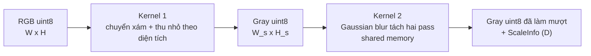

# Quyết định Phase 0: S1 Preprocessing

- **Task:** Khảo sát và chốt phương pháp chủ chốt cho S1 (task 3 của Tuấn, mục 6 của [kế hoạch](plan.md)).
- **Người quyết định:** Tuấn.
- **Ngày ghi nhận:** 18/10 (Chủ nhật), năm 2026.
- **Phase:** Phase 0.
- **Trạng thái:** Đã chọn phương pháp. Chưa có kernel CUDA và chưa đo trên GPU Tesla T4. Các điểm chờ Thành xác nhận ở mục 6.

Tham chiếu [các stage của pipeline](stages.md) và [quy ước chung](conventions.md). Ma trận `D` và các struct dữ liệu của S1 là một phần của interface dùng chung.

## 1. Bối cảnh

S1 nhận ảnh màu và trả ảnh xám một kênh đã thu nhỏ theo tỉ lệ S, đã làm mượt. S là núm chỉnh của controller, nên chi phí của S1 phải giảm khi S giảm. S1 cũng phải xuất ma trận `D` để S5 và S6 đưa homography từ hệ S1 về hệ ảnh gốc.

## 2. Phương án chọn

Cả hai kernel xử lý ảnh A và B trong cùng một lần launch (`blockIdx.z` chọn ảnh), nên S1 tốn 2 lần launch cho một cặp ảnh.

| Nội dung | Quyết định | Lý do | Fallback |
|---|---|---|---|
| Chuyển ảnh xám | Số nguyên 15 bit: `Y = (9798·R + 19235·G + 3735·B + 16384) >> 15` | Khớp bit với `cv2.cvtColor(..., COLOR_RGB2GRAY)` của `opencv-python` 5.0.0.93. Đã kiểm tra trên toàn bộ 2^24 giá trị RGB (xem mục 5) | Float BT.601 (0.299, 0.587, 0.114), cho phép sai số ±1 |
| Thứ tự bước | Chuyển xám, thu nhỏ theo diện tích, rồi Gaussian blur | Thu nhỏ theo diện tích đã chống aliasing. Chi phí blur tỉ lệ với S² | Blur ở độ phân giải gốc rồi mới thu nhỏ (chi phí không giảm theo S) |
| Kích thước sau thu nhỏ | `W_s = max(1, lround(W·S))`, `H_s = max(1, lround(H·S))`, tính `W·S` bằng `double` | Quy tắc làm tròn rõ ràng, giống nhau ở CUDA, bản giả và header | |
| Scale thực tế | `s_x = W_s / W`, `s_y = H_s / H` | Khớp với kích thước ảnh thực tế sau làm tròn | |
| Bản giả | `cv2.resize(gray, (W_s, H_s), interpolation=cv2.INTER_AREA)`, luôn truyền `dsize`, không truyền `fx`, `fy` | Khi truyền `fx`, OpenCV dùng đúng `fx` làm scale chứ không dùng `W_s / W` | |
| Quy ước tọa độ | Tâm pixel ở tọa độ nguyên. `x_s = s_x (x + 0.5) − 0.5` | Trùng quy ước half-pixel của `INTER_AREA` và đề xuất của Chương | |
| Ma trận D | `D = [[s_x, 0, 0.5(s_x − 1)], [0, s_y, 0.5(s_y − 1)], [0, 0, 1]]`, `double`, row-major | Đưa tọa độ ảnh gốc sang tọa độ ảnh S1 | |
| Làm mượt | Gaussian tách hai pass, `σ` tính theo pixel của ảnh đã thu nhỏ, `ksize = 2⌈3σ⌉ + 1`, biên `BORDER_REFLECT_101`; `σ = 0` bỏ qua blur | `σ` phụ thuộc detector của Thành | `σ = 1.0` (`ksize = 7`) tạm thời, tới khi Thành xác nhận |
| Kiểu output | `uint8`, một kênh, có pitch | Ít băng thông nhất; ORB, FAST dùng trực tiếp | Thêm tùy chọn `float32` nếu S2 cần |
| Phạm vi S | `0 < S ≤ 1`. Khi `S = 1` bỏ bước thu nhỏ và `D = I` | Không hỗ trợ phóng to | |
| S cho pilot | {1.0, 0.75, 0.5, 0.25}; khóa sau pilot | | |

## 3. Ánh xạ lên CUDA

| Kernel | Cách làm |
|---|---|
| Kernel 1 | Mỗi thread một pixel output. Thread đọc vùng nguồn `[x_d/s_x, (x_d+1)/s_x)` theo mỗi chiều, chuyển từng pixel nguồn sang xám bằng công thức số nguyên, cộng có trọng số theo phần diện tích phủ (pixel ở rìa vùng có trọng số lẻ), làm tròn về `uint8` |
| Kernel 2 | Mỗi block xử lý một tile output. Nạp tile và halo bán kính `ksize/2` vào shared memory, làm pass ngang (kết quả trung gian dạng `float` trong shared memory), làm pass dọc, ghi `uint8` |

Phiên bản:

- Bản 1 (Phase 1): hai kernel như trên.
- Bản 2, chỉ làm khi profiling cho thấy overhead launch đáng kể: gộp ba bước vào một kernel, tính lại phần halo trong mỗi block.
- Fallback nếu bản 1 gặp lỗi khó sửa: mỗi bước một kernel riêng (chuyển xám, thu nhỏ, blur ngang, blur dọc).

Lý do ưu tiên giảm số lần launch: ảnh UDIS-D khoảng 512×512, đọc toàn bộ RGB chỉ mất khoảng 2–3 µs với băng thông của T4, nhỏ hơn overhead của một lần launch kernel. Đây là ước lượng lý thuyết, chưa đo.

## 4. Sai số so với bản giả

| Trường hợp | Tiêu chí |
|---|---|
| Chuyển xám | Khớp bit |
| Thu nhỏ với 1/S nguyên (S = 0.5, 0.25) | Mục tiêu khớp bit; chấp nhận ±1 nếu cách làm tròn khác OpenCV |
| Thu nhỏ với 1/S không nguyên (S = 0.75) | Sai số tối đa ±1 |
| Sau blur | Sai số tối đa ±1; ngưỡng cuối cùng chốt bằng test |
| Metadata | `W_s`, `H_s` khớp chính xác; `D` khớp tới sai số làm tròn `double` |

## 5. Đã kiểm chứng và chưa kiểm chứng

Đã kiểm chứng ở máy local, `opencv-python` 5.0.0.93:

- Công thức chuyển xám 15 bit khớp `cv2.cvtColor(COLOR_RGB2GRAY)` trên toàn bộ 2^24 giá trị RGB ([tests/python/test_mock_stages.py](../tests/python/test_mock_stages.py)).
- Bộ hệ số 14 bit (4899, 9617, 1868) thường được nhắc cho OpenCV 4.x không khớp với `opencv-python` 5.0.0.93: có 162 sai khác trên 65.536 pixel ngẫu nhiên. Vì vậy công thức của S1 gắn với bản golden, không gắn với tên hàm OpenCV. Bản giả C++ dựa trên `libopencv-dev` của Colab (có thể là 4.x) có thể lệch ±1 so với golden ở bước này.
- `make_scale_info` trong [src/common/geometry.hpp](../src/common/geometry.hpp) cho cùng kết quả với bản Python trên các ca kiểm tra đã viết.

Chưa kiểm chứng: kernel CUDA, thời gian chạy, độ lệch của `INTER_AREA` so với kernel diện tích tự viết, các ước lượng thời gian ở mục 3.

## 6. Điểm cần xác nhận và rủi ro

| Điểm | Người xác nhận |
|---|---|
| Kiểu ảnh S2 cần (`uint8` hay `float32`) và giá trị `σ` | Thành |
| Làm sớm bộ cặp ảnh tổng hợp độ phân giải cao | Đế |

Rủi ro: ở 512×512 cả pipeline có thể bị giới hạn bởi overhead launch, làm điều kiện Go/No-Go số 1 (khoảng 30% thời gian nằm ở các stage có núm) khó đạt. Cần cặp ảnh tổng hợp độ phân giải cao (mục 9 của [kế hoạch](plan.md)) để núm S có tác động đo được.
