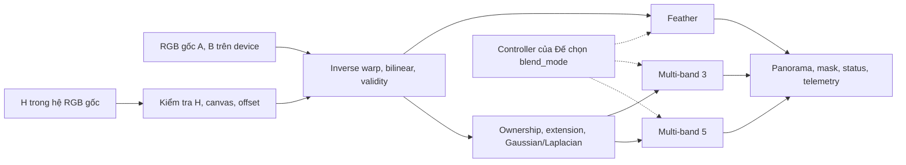

# S6 — Warping and blending cho workshop PARMA-DITAM 2027

Người phụ trách: Chương. Ngày cập nhật triển khai: 22/10 (Thứ 5), năm 2026; khảo sát nguồn gốc: 15/10 (Thứ 5).

Task hiện tại: **Phase 1 — triển khai S6 và evaluator QoR của Chương**, theo [kế hoạch](plan.md). Quyết định phương pháp Phase 0 được giữ bên dưới; API, mã nguồn, bằng chứng kiểm tra và lệnh chạy T4 ở [bàn giao P1](s6-p1-implementation.md). Dựng khung LaTeX là task riêng.

**Quyết định thiết kế:** global homography B → A, inverse warping và bilinear; tự viết CUDA cho hai họ blend là feather và Laplacian multi-band. Núm `B` ban đầu gồm `feather`, `multiband_3`, `multiband_5`. Average 50/50 chỉ làm đối chứng. Controller của Đế chọn `B` cùng `S, K, R`; S6 không dựng một controller khác.

Đây chưa phải kết luận tối ưu hay nghiệm thu P1. Repo hiện có mã S6, reference FP64, test geometry/CUDA và evaluator QoR; đã kiểm tra Python và host C++, **chưa biên dịch/chạy CUDA hoặc đo Colab T4**. Thông tin V0, 194 assertions và dataset tự chụp của đồ án không được dùng làm bằng chứng cho triển khai workshop.

## 1. Bối cảnh và tiêu chí quyết định

Research question của Nhóm là giảm latency của pipeline GPU bằng phân bổ lượng tính toán theo cảnh, dưới ràng buộc QoR. [Pipeline](stages.md) giao Chương S6; Tuấn S1 và quy ước chung; Thành S2–S3; Đế S4–S5, controller, benchmark và định nghĩa `Qmin`.

Workshop nêu parallel/heterogeneous computing, công cụ phân tích hiệu năng và case studies trong phạm vi tiếp nhận [W1]. Từ đó, thiết kế S6 cần giúp kiểm tra giả thuyết runtime: lựa chọn có chi phí/chất lượng khác nhau, đo được overhead và tái sử dụng được kết quả. Đây là cách diễn giải cho dự án, không phải bảo đảm paper được chấp nhận.

| Tiêu chí | Yêu cầu đối với S6 |
|---|---|
| Đúng phạm vi | Nhận RGB gốc và H; không thay S2–S5 bằng neural alignment, flow hoặc local mesh |
| Có núm tính toán | Thay `B`; giữ warping, miền output và chuẩn đánh giá |
| Chất lượng đo được | Đánh giá panorama sau blend; tách lỗi H khỏi artifact do blend |
| Phù hợp T4 | Kernel theo pixel, filter separable; kiểm soát buffer, launch, dependency |
| So sánh công bằng | Fixed, Oracle, Adaptive có cùng tập cấu hình và ranh giới đo |
| Khả thi | Hai họ blend có định nghĩa rõ; chưa thêm mô hình huấn luyện hoặc solver |

Không áp dụng quy định V0–V3 phải cùng phương pháp của đồ án cho các giá trị `B`. Thay phương pháp blend chính là núm nghiên cứu của workshop. Khi so hai cách tối ưu CUDA cho **cùng một B**, vẫn phải giữ thuật toán, tham số và chuẩn correctness.

## 2. Khảo sát nghiên cứu và giới hạn bằng chứng

### 2.1. Cách khảo sát

Tra cứu có mục tiêu: `image stitching blending GPU adaptive multiband feather 2025 2026 latency`, image stitching tại ICCV 2025/CVPR 2026, rồi truy ngược paper nền tảng và kiểm tra tên paper. Ưu tiên CVF, proceedings NeurIPS, bản tác giả, arXiv, publisher và tài liệu chính thức. Đây là khảo sát để chọn S6 dưới contract hiện tại, không phải systematic review hay bảng xếp hạng SOTA toàn lĩnh vực.

Giữ nguồn về compositing, GPU cost và ranh giới alignment/blend; loại kết quả chỉ trùng từ “stitching” nhưng khác bài toán. Các phương pháp mới là đại diện nghiên cứu hiện đại trong bối cảnh riêng, chưa chứng minh đứng đầu trên benchmark của Nhóm.

### 2.2. Ma trận tài liệu

| Nguồn | Bằng chứng đã kiểm tra | Ý nghĩa và quyết định cho S6 |
|---|---|---|
| Burt & Adelson, TOG 1983 [R1] | Abstract, §2.2 qua nguồn MIT được lập chỉ mục: ghép theo dải tần, chuyển tiếp theo scale | Nền tảng Gaussian/Laplacian multi-band; không là thuật toán mới của Nhóm |
| Brown & Lowe, IJCV 2007 [R2] | §6–7 và thảo luận: gain, weighted blend, multi-band; weighted blend có thể mờ khi còn lệch | Giữ hai họ feather/multi-band và giới hạn; chưa thêm gain |
| Zhu et al., TIP 2018 [R3] | Metadata journal; abstract và §2–3 preprint: sáu blender, CPU/GPU, thời gian/bộ nhớ/chất lượng | Related work gần về trade-off; rig video có setup tái dùng khác cặp ảnh mới; không chép speedup |
| UDIS++, ICCV 2023 [R4] | Abstract CVF: global H + local TPS và learned seam-driven masks | Không quy chất lượng toàn hệ thống cho blender sau global H; không thay pipeline |
| NIS, WACV 2024 [R5] | Abstract/tổng quan: Fourier features, latent warp/blend, giải mã RGB | Đổi biểu diễn và cần mô hình học; ngoài kernel S6 chính |
| SC-AOF, Sensors 2024 [R6] | Metadata, §3.2.1/Eq.14 qua primary search text; compatibility ở preprint | Flow và sai khác điều khiển blend; có biến thể flow=0. Không gọi heuristic màu là cài đầy đủ SC-AOF |
| Jia et al., Sensors 2024 [R7] | Abstract, §2 qua primary search text: superpixel mapping, semantic seam, Poisson | Framework rộng hơn cost màu/gradient; không đưa graph/Poisson vào đường chính |
| LPAM, ICCV 2025 [R8] | Abstract CVF: đánh giá seam, local SIFT-flow trên patch xấu, recomposite | Seam cần vùng căn chỉnh phù hợp; không hứa multi-band sửa được parallax |
| PixelStitch, ICCV 2025 [R9] | Abstract/trang đầu PDF qua CVF search: bidirectional global warp, residual flow, giữ cấu trúc | Thay mô hình warp; không chuyển thành giá trị B |
| DSFN, NeurIPS 2025 [R10] | Proceedings; §3.1–3.3, §5 bản tác giả HTML: depth-aware alignment, learned soft-seam fusion | Không coi như graph-cut rẻ lấy riêng mà giữ chất lượng; không thêm depth/UNet |
| UniStitch, arXiv 2026 [R11] | Abstract, overview, §3.4: geometric/semantic features và global-to-local warp | Adaptive feature fusion khác runtime phân bổ ngân sách; related work, ghi rõ preprint |
| Generative Panoramic Image Stitching, CVPR Workshops 2026 [R12] | Abstract CVF: fine-tune diffusion inpainting tạo panorama từ ảnh tham chiếu | Mục tiêu tạo nội dung khác lấy mẫu nguồn cố định; ngoài đường chính, không dùng làm GT |

Mức đọc khác nhau được giữ rõ: abstract đủ phân loại scope, không đủ tái lập thuật toán hoặc xếp hạng. Một số PDF CVF/MIT, trang MDPI/PMC mở thất bại, 403 hoặc CAPTCHA; chỉ dùng đoạn thực sự truy xuất được. Không kế thừa nhãn “đã đọc toàn bài” của bản cũ.

### 2.3. Tổng hợp và khoảng trống

R1–R3 hỗ trợ khảo sát frequency blending, chưa chứng minh lợi ích runtime trên T4. R4, R6–R10 kết hợp sửa geometry hoặc học mask: không thể lấy chất lượng toàn hệ thống làm bằng chứng cho multi-band dưới global H cố định. R11–R12 mở rộng biểu diễn/mô hình sinh, giúp xác định ranh giới đóng góp của Nhóm.

| Cặp bằng chứng có vẻ căng thẳng | Phân tích và cách dùng |
|---|---|
| R2 dùng multi-band giảm mờ; R6 vẫn thấy artifact khi parallax | Khác loại/mức sai lệch hình học. Giữ multi-band là ứng viên, kèm failure cases |
| R3 nghiên cứu realtime blending; R8 cần thêm local alignment | Khác contract camera/geometry. Đo lại setup từng cặp, không dùng “realtime” làm bảo đảm |
| R10 có soft-seam fusion; R11 cải thiện cả feature/warp | Không cô lập cùng biến can thiệp. Không xếp hạng blender bằng bảng end-to-end của chúng |

Đây là đối chiếu có phạm vi của 12 công trình, xét ba cặp trên; chưa xét mọi cặp nguồn, chưa có xác nhận của tác giả. Hai khoảng trống của dự án: chưa biết B có điểm không bị dominated trên T4, và chưa có metric sau blend được xác nhận đủ dùng cho runtime.

## 3. Phản biện bản đồ án và cách sửa

Áp dụng lăng kính contribution, validity và reproducibility của `academic-paper-reviewer` cho thiết kế. Review inline trong cùng ngữ cảnh, `NOT_CALIBRATED`; không phải panel độc lập hoặc Accept/Reject manuscript. Chưa có criteria binding chính thức (`criteria_binding_unavailable`), nên không chứng nhận đáp ứng tiêu chí review của venue.

Giữ chiều H, inverse mapping có offset, mask tách khỏi màu, kiểm tra horizon và bảo vệ allocation. Các thay đổi cần thiết:

| Mức | Anchor trong bản trước | Vấn đề | Sửa trong bản này |
|---|---|---|---|
| Major | Mở đầu “P1-T17”, “Đã có `src/v0_warp_blend.cpp`”; §5/7 “194 assertions” | Sai Phase 0, không có artifact ở repo; dễ bị hiểu là đã nghiệm thu | Ghi đúng trạng thái; test là tiêu chí cần chạy |
| Major | §1.1/1.6 cố định phương pháp V0–V3, average theo coding đồ án | Xóa núm B của research question | Hai họ blend, ba B; average làm ablation |
| Major | §1.3 gộp “Seam finding + multi-band” | Không tách lợi ích seam/blend; phát sinh solver | Multi-band có ownership hình học; seam finder ngoài đường chính |
| Major | §2.1 nhận H nhưng thiếu đổi scale S1 | H ảnh thu nhỏ không áp thẳng lên RGB gốc | Dùng ma trận resize thực tế ở §5.1 |
| Major | §5 xem panorama/crop, thiếu phép đo tác động B | QoR geometry hoặc pre-blend không chọn được B | Tách geometry, output blend, coverage và proxy |
| Major | §3 mọi tính toán double, giới hạn 100 triệu pixel | Mang lựa chọn CPU lên GPU; bỏ chi phí pyramid | FP64 reference/setup, FP32 render dự kiến; budget live buffers |
| Major | §6 tối ưu V1/V2/V3, thiếu cache contract | Warp lại hoặc bỏ sót chi phí khi đổi B | Tách prepare/warp/blend và invalidation |
| Minor | Link interface/task-board/specs/src/tests ngoài repo | Contract workshop chưa tồn tại | Chỉ link tài liệu có thật; đánh dấu interface đề xuất |

**Phản biện mạnh nhất:** nếu QoR không phân biệt blender, hoặc chỉ một B tốt nhất mọi cảnh, Adaptive-B không có giá trị. Nếu H sai do parallax, tăng pyramid không bảo đảm cứu được chất lượng. Chưa có thí nghiệm bác bỏ hai phản biện này. Cách kiểm tra là giữ H khi sweep B, đo output, loại dominated và giữ tỷ lệ infeasible; không kết luận thành công trước số liệu.

## 4. Phương pháp chủ chốt đã chọn

### 4.1. Tập cấu hình ban đầu

Dùng tên `blend_mode` trong giao diện để tránh nhầm núm B với ảnh B.

| `blend_mode` | Định nghĩa | Vai trò và trade-off |
|---|---|---|
| `feather` | Weighted average theo khoảng cách tương đối tới biên nguồn (§5.3) | Ít bước, không pyramid; có thể mờ/ghosting khi lệch |
| `multiband_3` | Ownership hình học, 3 lần REDUCE, 4 mức lưu trữ | Ứng viên trung gian; cần buffer và nhiều launch |
| `multiband_5` | Cùng thuật toán/mask, 5 lần REDUCE, 6 mức lưu trữ | Chuyển tiếp ở scale lớn hơn; có thể không cải thiện hoặc chậm không đáng kể |
| `average` | Overlap lấy `(CA+CB)/2` | Đối chứng/correctness; chưa thuộc thang controller ban đầu |

Số 3 và 5 là điểm khảo sát ban đầu, không phải tham số tối ưu đã chứng minh. Canvas nhỏ dùng `L_eff=min(L_requested,ceil(log2(max(Wc,Hc))))`; 1×1 cho `L_eff=0`. Lưu cả requested/effective và gộp cấu hình trùng thực tế.

Không giả định thang chất lượng đơn điệu. Tổng pixel pyramid lý tưởng là `P*sum(4^-l)`: 3 lần REDUCE khoảng `1.328125P`, 5 lần khoảng `1.333008P`, chưa tính ceil/padding, các pass và buffer. Vì vậy chi phí không là `L*P`; 5 mức không mặc nhiên chậm hơn nhiều. Launch/reconstruction vẫn khác. Nếu hai mức không tạo khác biệt hữu ích, chỉ giữ một mức multi-band sau profiling.

### 4.2. Ranh giới phương pháp

Không thêm content-aware seam finder, graph cut, Poisson, flow, semantic segmentation, neural blender hoặc inpainting vào đường chính. Không thêm exposure compensation riêng cho một B; giữ exposure mismatch như điều kiện đánh giá. Multi-band không được mô tả là hiệu chỉnh radiometry đầy đủ.

`S` chỉ phục vụ tìm H; S6 render RGB gốc. Thay render scale sẽ là núm mới cần quyết định riêng. Bilinear là resampling chung, không là bộ lọc chống aliasing đầy đủ khi minification mạnh.

Đây là các nhánh lựa chọn, không yêu cầu chạy cả ba cho mỗi cặp. Oracle mới sweep toàn bộ offline. Warp có thể fuse với feather khi không cần cache; nếu materialize cache phải tính chi phí.

## 5. Contract và thuật toán tham chiếu

### 5.1. Đầu vào, hệ tọa độ và đầu ra

Contract đã được hiện thực bằng API riêng ở [src/s6/s6.hpp](../src/s6/s6.hpp) và [geometry.hpp](../src/s6/geometry.hpp), dùng `ImageView`/`Status`/stream chung hiện có. Chưa sửa header chung hoặc root CMake; Tuấn cần review tích hợp. `Geometry.origin_x/y` là tọa độ trong A của góc canvas, **ngược dấu offset A → canvas** trong công thức dưới. Mask union có giá trị 0/1.

| Thành phần | Contract đề xuất |
|---|---|
| Ảnh | RGB gốc `uint8`, interleaved, kích thước riêng, stride byte rõ ràng; không dùng ảnh xám/blur S1 |
| Bộ nhớ | GPU mượn device views, nhận workspace/output do caller quản lý và stream; không sửa input |
| H | 3×3 row-major, vector cột, B → A trong hệ RGB gốc; precision lưu trữ thống nhất cùng Đế/Tuấn |
| Output | Panorama RGB, width/height/stride, offset A → canvas, mask union; chỉ hợp lệ khi hoàn tất thành công |
| Cấu hình | `blend_mode`, budget/tolerance có version; không tự đổi cấu hình khi lỗi |
| Thực thi | Async trên stream nếu khả thi; kiểm tra cả launch error và completion error; buffer sống tới completion |

Nếu S5 ước lượng `H_s` từ keypoint thu nhỏ, gọi `D_A,D_B` đưa tọa độ RGB gốc sang tọa độ S1 thực tế:

\[
H_{\mathrm{orig}}=D_A^{-1}H_sD_B.
\]

`D` chứa scale x/y thực tế sau làm tròn kích thước và dịch pixel-center của resize. Ví dụ half-pixel: `x_s=s_x(x+0.5)-0.5`; không thay bằng `diag(S,S,1)` khi dùng convention này. S5 nên trả H đã đổi hệ kèm metadata; nếu wrapper S6 nhận `H_s` thì đổi đúng một lần. Đây là điểm phối hợp bắt buộc, không giả định interface đã có.

Tâm pixel ở tọa độ nguyên. H hữu hạn, khả nghịch, ổn định theo tolerance; không bắt `h33!=0`. Normalize theo hệ số lớn nhất, kiểm tra pivot/conditioning trong hệ tọa độ quy định, không dùng riêng determinant tuyệt đối.

### 5.2. Canvas, inverse warping và validity

Dùng miền tâm pixel `[0,W-1]×[0,H-1]`. Trước khi chiếu bốn góc B, kiểm tra mẫu số projective tại góc cùng dấu, cách 0 theo tolerance tương đối. Mẫu số affine trên hình chữ nhật nên kiểm tra này loại horizon cắt miền B. H và −H phải tương đương; mẫu số âm toàn miền không phải lỗi.

Hợp góc B đã chiếu với góc A, rồi tính:

\[
x_0=\lfloor x_{\min}\rfloor,\quad x_1=\lceil x_{\max}\rceil,\quad
W_c=x_1-x_0+1,\quad o_x=-x_0,
\]

và tương tự theo y. Gọi T là tịnh tiến `(ox,oy)`. Với `pC=(xc,yc,1)`:

\[
p_A=T^{-1}p_C,\qquad p_B\sim H^{-1}T^{-1}p_C.
\]

Kiểm tra hữu hạn/mẫu số trước phép chia. Nguồn hợp lệ nếu tọa độ trong miền tâm pixel; mask riêng, RGB đen vẫn hợp lệ. Clamp neighbor bilinear tại pixel cuối sau kiểm tra miền; không clamp mọi truy vấn ngoài nguồn để mở rộng validity.

Bilinear dùng bốn neighbor với weights `(1-a)(1-b), a(1-b), (1-a)b, ab`, giữ số thực tới sau blend. A chỉ cần mapped load khi T là tịnh tiến nguyên. Một nguồn hợp lệ thì giữ nguồn đó; ngoài cả hai ghi RGB 0, mask 0. Không tự crop/resize output.

Kiểm tra tràn trước cast và nhân kích thước/byte, budget toàn workspace trước allocation. Một pixel không chiếu về B có thể nằm ngoài footprint, không mặc nhiên hủy S6. H lỗi hoặc canvas bất thường trả failure; không overlap được báo riêng để benchmark quyết định feasibility.

### 5.3. Feather và ownership hình học

Với tọa độ hợp lệ `(x_i,y_i)` ở nguồn i:

\[
s_i=\min\left(\frac{x_i+0.5}{W_i},\frac{W_i-0.5-x_i}{W_i},
                 \frac{y_i+0.5}{H_i},\frac{H_i-0.5-y_i}{H_i}\right),\quad w_i=M_i s_i.
\]

Feather trong overlap:

\[
C_F=\frac{w_A C_A+w_B C_B}{w_A+w_B}.
\]

Đây là khoảng cách tương đối **trong nguồn**, do dự án định nghĩa; không phải distance transform của mask đã warp hoặc bản cài tương đương `cv::detail::FeatherBlender`. `+0.5` giữ weight dương ở pixel biên/ảnh 1×1. Ngoài overlap dùng quy tắc một nguồn, không chia tổng 0.

Ownership multi-band: `O_A=1` khi chỉ A hợp lệ hoặc overlap có `s_A>=s_B`; `O_B` nhận phần còn lại trong union. Tie chọn A; ngoài union cả hai 0. Đây là đường phân chia hình học, **không phải content-aware seam optimization**. Hai mức multi-band dùng cùng ownership. Feather dùng soft weights khác ownership, nên so hai họ là so chính sách blend hoàn chỉnh; chỉ so hai mức multi-band mới cô lập pyramid depth.

### 5.4. Multi-band có định nghĩa tái lập

REDUCE R: filter separable `k=[1,4,6,4,1]/16`, lấy mẫu tại tọa độ chẵn, shape mới `ceil(W/2),ceil(H/2)`. EXPAND E: chèn 0 thành mảng gấp đôi mỗi chiều, filter với hệ số 4 trong 2D, rồi crop từ góc trên trái về đúng shape cha. Dùng reflect-101; chiều dài 1 lấy giá trị duy nhất. CPU/GPU phải cùng pha lấy mẫu và quy tắc shape lẻ.

**Vùng không có nguồn:** không dùng RGB đen ngoài footprint làm mẫu ảnh thật. Chọn extension tham chiếu kiểu pull–push chỉ để filtering:

1. `V_i^0=M_i`, `N_i^0=C_i` ở pixel hợp lệ và 0 ở pixel invalid (không đọc màu invalid). Dựng `V_i^(l+1)=R(V_i^l)`, `N_i^(l+1)=R(N_i^l)` tới 1×1; nơi `V>0` đặt `G=N/V`.
2. Từ trên cùng xuống: nơi `V_i^l>0` giữ `G_i^l`; nơi `V_i^l=0` dùng E của ảnh đã fill ở level kế tiếp. Level 0 sau fill là `F_i`; giữ nguyên màu tại pixel hợp lệ. Mask nguồn rỗng thì bỏ nhánh, không chia 0.
3. Không đổi mask/ownership/coverage. Cùng `F_i` cho hai mức B; tính cả cost extension. Đây là lựa chọn biên của dự án cần kiểm thử, không hứa bit-identical OpenCV hoặc nguyên bản R1.

Từ `F_i`, dựng image Gaussian `P_i^0=F_i`, `P_i^(l+1)=R(P_i^l)`. Với `L=L_eff`:

\[
\mathcal L_i^l=P_i^l-E(P_i^{l+1})\ (l<L),\qquad \mathcal L_i^L=P_i^L.
\]

Weight Gaussian: `U_i^0=O_i`, `U_i^(l+1)=R(U_i^l)`. Tại mỗi level:

\[
Z^l=\frac{U_A^l\mathcal L_A^l+U_B^l\mathcal L_B^l}{U_A^l+U_B^l}.
\]

Tổng weight bằng 0 thì đặt `Z^l=0`. Tái tạo `C^L=Z^L`, `C^l=Z^l+E(C^(l+1))`. Output cuối chỉ overlap dùng reconstruction; vùng một nguồn giữ đúng warped color, ngoài union là 0. Quy tắc giữ coverage nhưng có thể còn seam ở rìa overlap; phải kiểm tra halo/chuyển tiếp, không mặc định chất lượng đạt.

Dùng RGB đã decode chuẩn hóa `[0,1]`, chưa gamma/gain correction; không tương đương light-linear compositing. Ghi output bằng `floor(clamp(255*C,0,255)+0.5)`. Không clamp từng Laplacian band vì band có thể âm.

### 5.5. Precision và tham số

| Mục | Quyết định / điều kiện triển khai |
|---|---|
| Reference | FP64 kiểm tra H, canvas, sampling, blend; oracle correctness, không dùng latency CPU làm kết quả GPU |
| GPU | Bản P1 dùng FP64 tọa độ warp, FP32 màu/filter/pyramid. Tolerance RGB tối đa 2 mức uint8 được đặt trước trong harness, chưa xác nhận trên GPU; không hứa bit-identical |
| Hình học | Version hóa normalize H, mẫu số tương đối, snap số nguyên, conditioning cùng S5; không coi ngưỡng cũ là Nhóm đã chốt |
| Correctness | Canvas/offset/mask khớp reference trước màu; giới hạn màu định trước. Sát biên cần đường tính ổn định hơn nếu FP32 không đủ |
| Texture/fast math | Bilinear tự tính ở bản đầu. Chỉ khảo sát hardware filtering sau profiling/sai số; CUDA 12.5 nêu weights có 8 bit phần lẻ [I2] |
| Bộ nhớ | Budget theo live buffers/levels/padding/workspace khác, không riêng mốc 100 triệu pixel cũ |

Tolerance số và API riêng S6 đã ghi tại [bàn giao P1](s6-p1-implementation.md#3-quy-tắc-số-học-và-blender); còn phải kiểm chứng GPU và review tích hợp. Các guard số học khác với QoR `Qmin` do Đế phụ trách.

## 6. Mapping CUDA, bộ nhớ và tái sử dụng

Tách trách nhiệm geometry, warp/mask, feather, pyramid/reconstruction và telemetry. Bản P1 công khai `prepare_geometry`, `s6_workspace_bytes`, `render`; các kernel nội bộ nằm ở `src/s6/s6.cu`, timing runner nằm trong test riêng. Đây không phải thay đổi interface common.

- Warp/feather: một thread cho một pixel output, ghi độc lập. Không copy A rồi ghi lại toàn canvas nếu một pass đủ.
- Pyramid: kernel là separable về toán học; bản correctness P1 dùng vòng lọc 5×5 trực tiếp. Tách hai pass/fusion sau profiling. Shared memory không mặc nhiên có lợi cho gather projective.
- Các level cùng pyramid phụ thuộc nhau. Hai nhánh ảnh có thể chạy đồng thời bằng stream/events; không chạy các level phụ thuộc như thể độc lập.
- Ảnh/buffer trung gian ở device. Setup 3×3/bbox có thể dùng host metadata trong bản đầu; công bố host/sync/allocation, không gọi toàn S6 thuần GPU khi chưa đúng.
- Tính launch/copy/allocation trong ranh giới đo tương ứng. So fused feather và đường materialize cache bằng tổng cost của policy sử dụng chúng.

Với `P=Wc*Hc`, hai warped RGB FP32 cần `24P` byte, chưa có output/mask, extension, Gaussian/Laplacian/weights/scratch. Một RGB FP32 pyramid khoảng `16P` byte khi nhiều mức; các pyramid sống đồng thời cộng dồn. Đây là tính dung lượng lý thuyết, chưa phải peak VRAM đo được. Tính peak theo lifetime, cấp workspace có budget và ghi OOM thay vì tự hạ chất lượng.

| Thay đổi | Có thể tái dùng | Phải làm lại / điều kiện |
|---|---|---|
| Chỉ đổi B, giữ ảnh/H | Geometry, warped RGB, validity; extension/Gaussian nếu đã có | Weights/chính sách và blend/reconstruct; cache chưa có phải tính cost tạo |
| Multi-band 3 → 5 | `P_i^0..3`, weight Gaussian, các band dưới 3 | Level 4–5; band 3 cũ là residual nay thay bằng `P3-E(P4)`; reconstruct lại |
| Đổi R nhưng S5 trả đúng cùng H | Cache S6 nếu toàn bộ input key giống nhau | Không dùng “H gần giống” khi chưa kiểm chứng sai số |
| Đổi S/K/R làm H đổi | Chỉ input RGB | Invalidate canvas/warp/mask/ownership/pyramid phụ thuộc H |
| Đổi pixel input, giữ shape/H | Metadata geometry | Color, extension/pyramid của ảnh bị đổi |

Cache key có image identity/version, dimensions/stride/layout, H và hệ tọa độ, canvas/offset, sampling/precision/color policy, extension/filter/mask config. Cache theo từng cặp, không giả định dùng lại giữa các cặp ảnh. Không dựng sẵn pyramid 5 rồi báo feather rẻ mà bỏ cost dựng pyramid.

## 7. Phối hợp controller và đo latency

S6 cung cấp dữ liệu cho controller của Đế, không tự chọn B bằng một ngưỡng màu chưa hiệu chỉnh. Chọn trước render khi đủ tín hiệu; nếu cần proxy trên ảnh warp hoặc chạy thử feather rồi nâng mức, tính toàn bộ chi phí kiểm tra và lần chạy bị bỏ.

Telemetry đề xuất: canvas/union/overlap pixels, overlap ratio, `blend_mode_requested/effective`, số level thực tế, byte workspace/peak, `cache_hit`, status, thời gian setup/warp/extension/pyramid/blend/reconstruct. Đây là đầu vào phối hợp, không tự đổi schema CSV chung của Tuấn.

Proxy có thể khảo sát: phân bố residual màu/gradient trên lưới cố định trong overlap, diện tích canvas/overlap và tín hiệu S5. Residual cao có thể do exposure, chuyển động hoặc H sai; không dùng làm chứng chỉ QoR. Sampling/reduction/đưa scalar về host và chờ stream đều thuộc overhead.

| Phép đo | Ranh giới |
|---|---|
| S6 device time | CUDA events trên đúng stream/dependency, đủ mọi kernel của nhánh |
| S6 elapsed | Host setup, allocation, sync và transfer phát sinh do S6 |
| End-to-end | Cùng input/output boundary cho Fixed/Oracle/Adaptive do Nhóm chốt; gồm controller, proxy, retry, materialize cache và fallback |

Đo chính trên Colab T4, build `-arch=sm_75`, warm-up, đồng bộ đúng completion, kiểm soát thứ tự cấu hình, lưu seed. Báo median/p95/độ biến thiên; tổng hợp speedup theo cùng tập cặp có công bố failure. Không so kernel-only nhánh này với end-to-end nhánh khác.

Oracle biết QoR offline để chọn cấu hình rẻ nhất trong tập hữu hạn; ghi rõ chi phí chạy mới hay có reuse. Không lẫn incremental cost với single-shot. Adaptive không truy cập GT/nhãn QoR test. Sweep offline không phải inference latency, nhưng mọi bước policy thật sự sử dụng phải tính.

## 8. QoR, benchmark và điều kiện loại núm B

### 8.1. Ba phép kiểm tra khác nhau

1. **Implementation correctness:** cùng H/B, CPU/GPU khớp contract; chưa chứng minh panorama đẹp.
2. **Geometric quality:** correspondence/corner error so GT/annotation. Đổi B không đổi H, không thể dùng riêng metric này chọn blender.
3. **Rendered quality:** output sau blend trên miền cố định, gồm seam/ghosting/detail và coverage. SSIM giữa hai ảnh warp trước blend cũng bất biến theo B.

Đế sở hữu QoR và `Qmin`. S6 đề nghị feasibility có constraint geometry, render và coverage; chưa tự đặt trọng số tổng hợp/ngưỡng toàn pipeline. Tránh một chỉ số tăng nhờ làm mờ hoặc crop.

### 8.2. Dữ liệu và phép đánh giá đề nghị

| Nguồn theo kế hoạch Nhóm | Dùng cho S6 | Giới hạn |
|---|---|---|
| HPatches/mock H biết trước | Hệ tọa độ, scale, geometry; sweep B trên cùng H | GT homography không đồng nghĩa GT panorama màu |
| CA-UDHN/correspondence | Tách geometry failure theo cảnh | Không đánh giá đầy đủ blend |
| UDIS-D | Output/crop overlap và failure ảnh thật | Không gọi ảnh blend chất lượng cao là GT; chưa có GT panorama |
| Synthetic high-resolution từ ảnh nền có nguồn | Hai view H biết trước, giữ nền làm reference; perturb H/exposure/nhiễu có kiểm soát | Mô tả crop/warp/interpolation và masks; không ngoại suy thành parallax thật |

Synthetic không thay benchmark ảnh thật. Scoring domain/ROI và mẫu số coverage xác định bằng reference/annotation độc lập `H_est`, đưa output về cùng hệ bằng metadata. Không chấm chỉ trên overlap do chính cấu hình tạo ra: output sai hoặc mất nội dung không được tăng điểm nhờ thu nhỏ vùng chấm.

Chỉ số bàn với Đế: PSNR/SSIM so reference tổng hợp trên miền cố định, liên tục/sai lệch vùng chuyển tiếp, giữ gradient/detail và coverage. Seam metric đơn lẻ có thể bị blur đánh lừa, cần ảnh minh họa và kiểm tra chi tiết. Trên ảnh thật không GT, proxy chỉ là chẩn đoán tới khi được xác nhận; không gọi là QoR perceptual chuẩn hóa.

Tách development/calibration và held-out test theo scene/sequence trước khi chọn thresholds, đặc trưng controller hoặc mức pyramid. Các view cùng ảnh nền ở cùng split. QoR tham chiếu có thể tốn cost offline; controller chỉ dùng proxy rẻ đã kiểm tra trên split riêng.

### 8.3. Đối chứng và quyết định sau profiling

- **Sweep B, H cố định:** cùng ảnh/H/canvas/màu/scoring domain; average, feather, multi-band 3/5. Dùng để cô lập S6; không cấp oracle H cho Adaptive trong đánh giá pipeline thật.
- **Fixed-B và Adaptive-B:** cố định S/K/R để thấy lợi ích riêng B; chọn Fixed-B trên development theo cùng constraint.
- **Cross-stage:** Adaptive S/K/R với B cố định, chỉ Adaptive B, Adaptive đầy đủ; có fixed cấu hình rẻ và cấu hình chất lượng cao phù hợp.
- **Reuse:** bật/tắt cache, giữ outputs/điều kiện; tính materialization. Tách fusion/precision khỏi thay thuật toán.
- **Feasibility:** giữ cặp không có cấu hình nào đạt ngưỡng, báo coverage/tỷ lệ vi phạm; không loại im lặng để tăng speedup.

Ở review Phase 1, S6 cung cấp fraction latency, cost từng B, chất lượng output và dominated points trên dữ liệu thử Nhóm. Nếu B không tạo trade-off, giữ blender cố định tốt nhất rồi kiểm tra S/K/R. Nếu chỉ hai B hữu ích, rút thang. Geometry failure chiếm ưu thế thì báo infeasible/phối hợp S5, không tăng pyramid như cách sửa H.

Theo [Go/No-Go](plan.md#7-gonogo), ngưỡng quyết định do cả Nhóm thống nhất; tài liệu này không thay ngưỡng đó. Nếu QoR render chưa đáng tin, chưa tuyên bố Adaptive-B giữ được `Qmin`; dùng B cố định ở đánh giá chính, báo sweep B như khảo sát phụ tới khi giải quyết được.

## 9. Kiểm chứng cần thực hiện và bàn giao

Đã có code/harness và đã chạy kiểm tra Python/geometry host; **CUDA, sanitizer và profiling T4 chưa chạy**. Lệnh build/test và phạm vi bằng chứng cụ thể ở [bàn giao P1](s6-p1-implementation.md#4-bằng-chứng-đã-chạy-tại-máy-phát-triển). Bảng dưới giữ vai trò checklist nghiệm thu; không phải mọi hàng đều đã có test hoặc đã pass. Cache chưa được triển khai. Ghi GPU/toolkit/commit khi chạy và dùng pass/fail thực tế, không kế thừa “194 assertions”.

| Nhóm test | Trường hợp và kết quả bắt buộc |
|---|---|
| Geometry | Identity; tịnh tiến nguyên/âm; projective; hai kích thước khác nhau. Hai ảnh 4×3, B dịch x=−2: canvas 6×3, offset (2,0) theo đại số |
| Scale S1 | Resize làm tròn/half-pixel; `D_A^-1 H_s D_B` khớp H biết trước; không đổi hệ hai lần |
| Sampling/mask | Ramp phân số, pixel đen, pixel cuối, 1×1, đủ bốn validity cases, stride padding, không đọc ngoài buffer |
| H/tài nguyên | NaN/Inf, singular, H và −H, horizon, sát số nguyên, overflow/budget, OOM/async CUDA failure; không trả thành công giả |
| Feather | Cặp đồng nhất giữ màu; constant khác màu khớp công thức; weight hữu hạn; giữ single-source |
| Multi-band | Reconstruction một ảnh, constant không viền đen, tie ownership, mask rỗng/holes, shape lẻ, L=0, band âm/clamp đúng |
| Extension | Invalid không là RGB 0 thật; fill giữ pixel hợp lệ/coverage; hai mức B cùng extension |
| CPU/GPU | So canvas/offset/masks trước màu; tolerance định trước; dùng công cụ CUDA kiểm tra memory/race trên T4 |
| Cache | Đổi B/H/pixel/stride/policy; hit khớp chạy mới; thay residual level 3 đúng khi lên mức 5 |
| QoR/timing | H đúng/nhiễu, exposure, overlap hẹp, texture/đường thẳng, moving object/parallax; lưu output/crop/status/peak/time |

Synthetic expected output phải tính độc lập helper đang test. OpenCV chỉ làm reference/baseline/mock theo kế hoạch [I1], không thay CUDA chính. Khi đối chiếu OpenCV phải cùng miền tâm pixel/mask; giải thích sai khác border/precision/weights thay vì ép khớp baseline khác thuật toán.

Phase 0 chốt phương pháp là cơ sở cho bản triển khai P1 hiện có. Tiếp theo cần chạy CUDA/T4, Tuấn review tích hợp target/buffer/timing và Đế review evaluator/policy QoR. Chưa nghiệm thu correctness GPU, chất lượng hoặc performance S6; không ghi như đã quyết định thay thành viên khác.

## 10. Quyết định, fallback và nguồn

### 10.1. Bản ghi quyết định Phase 0

| Trường | Nội dung |
|---|---|
| Bối cảnh | Bản cũ phục vụ đồ án; workshop cần B cho runtime dưới constraint |
| Chọn | Global H, inverse warp/bilinear; feather và multi-band, ba B ban đầu |
| Trade-off | Feather ít bước nhưng dễ mờ/ghosting; multi-band cần extension/buffer/launch, không sửa parallax tổng quát |
| Phương án phụ | Average đối chứng; fusion/filter optimization sau profiling, giữ correctness |
| Fallback | Loại dominated; B cố định nếu QoR chưa nhạy blend hoặc không có lợi ích; báo geometry infeasible, không tự thêm flow/mesh |
| Người phụ trách | Chương; bản cập nhật do AI hỗ trợ theo yêu cầu người dùng khảo sát, phản biện và chốt phương pháp. Không ghi Nhóm đã duyệt interface/Qmin |
| Ngày | 15/10 (Thứ 5), năm 2026 |
| Thiếu bằng chứng | Implementation, CPU/GPU correctness, cost/QoR T4, Pareto benefit, proxy calibration |

### 10.2. Tài liệu tham khảo và mức đọc

Nguồn được tra cứu ngày 15/10 (Thứ 5), năm 2026. URL hỗ trợ nội dung mô tả, không chứng nhận hiệu quả bản cài dự án. Công thức weight, extension, tập B và cache là thiết kế của dự án, không gán như nguyên bản của paper ngoài.

| Mã | Nguồn | Locator / mức truy cập |
|---|---|---|
| W1 | [PARMA-DITAM 2027 — chính thức](https://parma-ditam-workshop.github.io/) | Scope of the Workshop, T3–T4/T6; mở được nội dung |
| R1 | Burt, P. J., & Adelson, E. H. (1983). *A multiresolution spline with application to image mosaics*. ACM TOG, 2(4), 217–236. [MIT abstract](https://persci.mit.edu/pub_abstracts/spline83_abs.html), [author PDF](https://persci.mit.edu/pub_pdfs/spline83.pdf), [DOI](https://doi.org/10.1145/245.247) | Abstract, §2.2 qua primary search text; mở PDF thất bại, chưa đọc toàn văn |
| R2 | Brown, M., & Lowe, D. G. (2007). *Automatic panoramic image stitching using invariant features*. IJCV, 74, 59–73. [Author PDF](https://www.cs.ubc.ca/~lowe/papers/07brown.pdf), [DOI](https://doi.org/10.1007/s11263-006-0002-3) | PDF truy xuất được; §6–7/Eq.30 và thảo luận moving objects; không tái lập experiments |
| R3 | Zhu, Z., Lu, J., Wang, M., Zhang, S., Martin, R. R., Liu, H., & Hu, S.-M. (2018). *A comparative study of algorithms for realtime panoramic video blending*. IEEE TIP, 27(6), 2952–2965. [Author project](https://cg.cs.tsinghua.edu.cn/blending/), [preprint HTML](https://arxiv.org/html/1606.00103v2), [DOI](https://doi.org/10.1109/TIP.2018.2808766) | Metadata journal; abstract/§2–3 preprint v2 (2016). Không mặc định preprint giống hệt journal |
| R4 | Nie, L., Lin, C., Liao, K., Liu, S., & Zhao, Y. (2023). *Parallax-tolerant unsupervised deep image stitching*. ICCV, 7399–7408. [CVF](https://openaccess.thecvf.com/content/ICCV2023/html/Nie_Parallax-Tolerant_Unsupervised_Deep_Image_Stitching_ICCV_2023_paper.html), [arXiv](https://arxiv.org/abs/2302.08207) | CVF metadata/abstract qua search; mở trực tiếp CVF 403 |
| R5 | Kim, M., Lee, J., Lee, B., Im, S., & Jin, K. H. (2024). *Implicit neural image stitching with enhanced and blended feature reconstruction*. WACV, 4087–4096. [CVF](https://openaccess.thecvf.com/content/WACV2024/html/Kim_Implicit_Neural_Image_Stitching_With_Enhanced_and_Blended_Feature_Reconstruction_WACV_2024_paper.html) | Metadata/abstract, Fig.1/intro qua CVF search text; chưa đọc toàn paper |
| R6 | Chang, J., Li, Q., Liang, Y., & Zhou, L. (2024). *SC-AOF: A sliding camera and asymmetric optical-flow-based blending method for image stitching*. Sensors, 24(13), 4035. [Publisher](https://www.mdpi.com/1424-8220/24/13/4035), [preprint](https://www.preprints.org/manuscript/202404.1791), [DOI](https://doi.org/10.3390/s24134035) | Publisher §3.2.1/Eq.14 qua search; preprint §4.2.2 gợi ý flow=0. PMC CAPTCHA; chưa đọc trọn journal |
| R7 | Jia, Y., Li, Z., Zhang, L., Song, B., & Song, R. (2024). *Semantic aware stitching for panorama*. Sensors, 24(11), 3512. [Publisher](https://www.mdpi.com/1424-8220/24/11/3512), [PMC](https://pmc.ncbi.nlm.nih.gov/articles/PMC11174851/), [DOI](https://doi.org/10.3390/s24113512) | Abstract, §2/2.1 qua primary search text; mở PMC CAPTCHA |
| R8 | Liao, T., Zhao, C., Li, L., & Cao, H. (2025). *Leveraging local patch alignment to seam-cutting for large parallax image stitching*. ICCV, 27262–27271. [CVF](https://openaccess.thecvf.com/content/ICCV2025/html/Liao_Leveraging_Local_Patch_Alignment_to_Seam-cutting_for_Large_Parallax_Image_ICCV_2025_paper.html), [arXiv](https://arxiv.org/abs/2311.18564) | CVF metadata/abstract, abstract tác giả; arXiv đầu từ 2023, không gọi mới phát sinh 2025 |
| R9 | Jin, H., Nie, L., Lin, C., Feng, X., & Zhao, Y. (2025). *PixelStitch: Structure-preserving pixel-wise bidirectional warps for unsupervised image stitching*. ICCV. [CVF PDF](https://openaccess.thecvf.com/content/ICCV2025/papers/Jin_PixelStitch_Structure-Preserving_Pixel-Wise_Bidirectional_Warps_for_Unsupervised_Image_Stitching_ICCV_2025_paper.pdf) | Abstract/intro trang đầu qua CVF search text; mở PDF trực tiếp thất bại, không dùng số liệu bảng |
| R10 | Jiang, Z., Yan, R., Zhang, Z., Zhang, B., & Liu, J. (2025). *Depth-supervised fusion network for seamless-free image stitching*. NeurIPS 38. [Proceedings](https://proceedings.neurips.cc/paper_files/paper/2025/hash/bcf5b917751e92c941d03512ae75dd03-Abstract-Conference.html), [author HTML](https://arxiv.org/html/2510.21396v1) | Proceedings xác minh venue; §3.1–3.3, §5 bản tác giả; không dự báo performance T4 từ số đo paper |
| R11 | Mei, Y., Nie, L., Liao, K., Xu, Y., Lin, C., & Xiao, B. (2026). *UniStitch: Unifying semantic and geometric features for image stitching*. arXiv:2603.10568. [Metadata](https://arxiv.org/abs/2603.10568), [HTML v1](https://arxiv.org/html/2603.10568v1) | Abstract, §3.1/3.4; preprint, chưa xác minh venue xuất bản khác |
| R12 | Tuli, M., Kamali, K., & Lindell, D. B. (2026). *Generative panoramic image stitching*. CVPR Workshops, 5084–5094. [CVF](https://openaccess.thecvf.com/content/CVPR2026W/LoViF/html/Tuli_Generative_Panoramic_Image_Stitching_CVPRW_2026_paper.html) | Metadata/abstract; phân biệt workshop và main conference |
| I1 | OpenCV, [blenders.cpp](https://github.com/opencv/opencv/blob/4.x/modules/stitching/src/blenders.cpp), [Image Blenders API](https://docs.opencv.org/4.13.0/d9/d46/group__stitching__blend.html) | Đọc FeatherBlender/MultiBandBlender/createWeightMap/Laplacian helpers; tham khảo cách cài, không là CUDA dependency chính. Nhánh 4.x có thể đổi, pin commit khi đối chiếu code |
| I2 | NVIDIA, [CUDA C Programming Guide 12.5 — Linear Filtering](https://docs.nvidia.com/cuda/archive/12.5.0/cuda-c-programming-guide/index.html#linear-filtering) | §15.2: half-texel, fractional weights; toolkit Colab thực tế phải ghi khi chạy |

### 10.3. Lịch sử chuyển phạm vi

| Ngày | Nội dung |
|---|---|
| 13/10 (Thứ 3) | Bản cũ ghi average cho đồ án và kết quả local ngoài repo; giữ như thông tin lịch sử, không xác nhận triển khai tại đây |
| 15/10 (Thứ 5) | Viết lại Phase 0 workshop: hai họ blend/ba B, H scale, ownership/pyramid, cache, QoR sau blend, đo và fallback. Chưa có thực nghiệm |
| 22/10 (Thứ 5) | Bắt đầu P1: thêm S6 CUDA/API riêng, geometry host, reference/test/fixture và evaluator QoR pilot; kiểm tra Python/host, còn chờ CUDA/T4 và review tích hợp |
