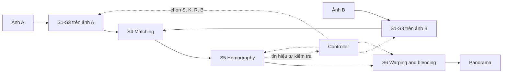

# Các stage của pipeline

Pipeline ghép hai ảnh chồng lấn thành một ảnh panorama theo hướng feature-based kinh điển (Brown & Lowe, IJCV 2007; Szeliski, *Computer Vision: Algorithms and Applications*). Nội dung 6 stage trùng với mục 2.1 của đề đồ án môn học CSC14120; file này chỉ tóm tắt ý chính và bổ sung phần riêng của paper.

Định dạng dữ liệu cụ thể truyền giữa các stage được chốt trong quy ước chung ở Phase 0 (xem [plan.md](plan.md)). Phương pháp và tham số của mỗi stage do người phụ trách quyết định.

## 1. Tổng quan

S1-S3 chạy độc lập trên từng ảnh, nên hai ảnh có thể xử lý song song. S4-S6 cần dữ liệu của cả hai ảnh.

## 2. Mục tiêu, đầu vào và đầu ra

| Stage | Mục tiêu | Đầu vào | Đầu ra | Núm chỉnh | Người phụ trách |
|---|---|---|---|---|---|
| S1 Preprocessing | Chuyển ảnh xám, làm mượt để giảm nhiễu, thu nhỏ ảnh theo tỉ lệ S | Ảnh màu A hoặc B | Ảnh xám đã làm mượt (đã thu nhỏ theo S) | S | Tuấn |
| S2 Keypoint detection | Tìm các điểm đặc trưng, ví dụ góc | Ảnh từ S1 | Danh sách keypoint (tọa độ, độ mạnh), giữ tối đa K điểm | K | Thành |
| S3 Description | Mô tả vùng lân cận của mỗi keypoint bằng một vector ngắn gọn | Ảnh từ S1, keypoint từ S2 | Descriptor của từng keypoint | | Thành |
| S4 Matching | Với mỗi keypoint của A, tìm keypoint giống nhất của B; loại các match mơ hồ | Keypoint và descriptor của A và B | Danh sách match (chỉ số bên A, chỉ số bên B, khoảng cách) | | Đế |
| S5 Homography | Ước lượng ma trận 3×3 biến ảnh B sang khung của ảnh A, chịu được match sai (ví dụ RANSAC) | Danh sách match và tọa độ keypoint | Homography, tập inlier và các tín hiệu tự kiểm tra (số inlier, tỉ lệ inlier, độ phủ của inlier) | R | Đế |
| S6 Warping and blending | Biến đổi ảnh B sang khung của ảnh A và trộn vùng chồng lấn thành một ảnh | Ảnh màu gốc A, B và homography | Ảnh panorama | B | Chương |

Các núm chỉnh lượng tính toán:

| Núm | Ý nghĩa |
|---|---|
| S | Tỉ lệ thu nhỏ ảnh khi tìm homography |
| K | Số keypoint giữ lại |
| R | Số vòng RANSAC tối đa |
| B | Kiểu blend |

## 3. Controller

Controller không phải một stage của pipeline mà là module điều khiển các núm chỉnh. Người phụ trách: Đế.

- Đánh giá độ khó của cảnh trước khi chạy để chọn mức tính toán khởi đầu.
- Sau khi chạy, dùng các tín hiệu tự kiểm tra (chủ yếu từ S5) để quyết định có cần leo lên mức tính toán cao hơn không, sao cho chất lượng đạt ngưỡng `Qmin`.
- Mức tính toán được chọn từ một thang cấu hình dựng sẵn từ Pareto front.
- Khi leo thang, tái sử dụng kết quả của các stage không bị ảnh hưởng.

## 4. Lý do chia stage

Cách chia giữ giống đồ án môn học để mỗi người làm tiếp stage mình đã quen.

| Thành viên | Stage | Lý do |
|---|---|---|
| Tuấn | S1 | Núm S nằm ở S1, gắn trực tiếp với việc dựng Pareto. Stage nhẹ, phù hợp với khối lượng review pull request và merge |
| Thành | S2, S3 | Núm K nằm ở S2. Detector và descriptor do cùng một người làm nên không phải phối hợp ở ranh giới giữa hai stage này |
| Đế | S4, S5 | Tín hiệu tự kiểm tra của controller là output của S5. Việc tái sử dụng kết quả khi chỉ tăng R (giữ nguyên match) nằm gọn trong S4-S5, nên controller dùng dữ liệu từ chính stage của Đế |
| Chương | S6 | Núm B nằm ở S6. Multi-band blending là phần nặng, tương xứng với khối lượng hai stage của người khác |
