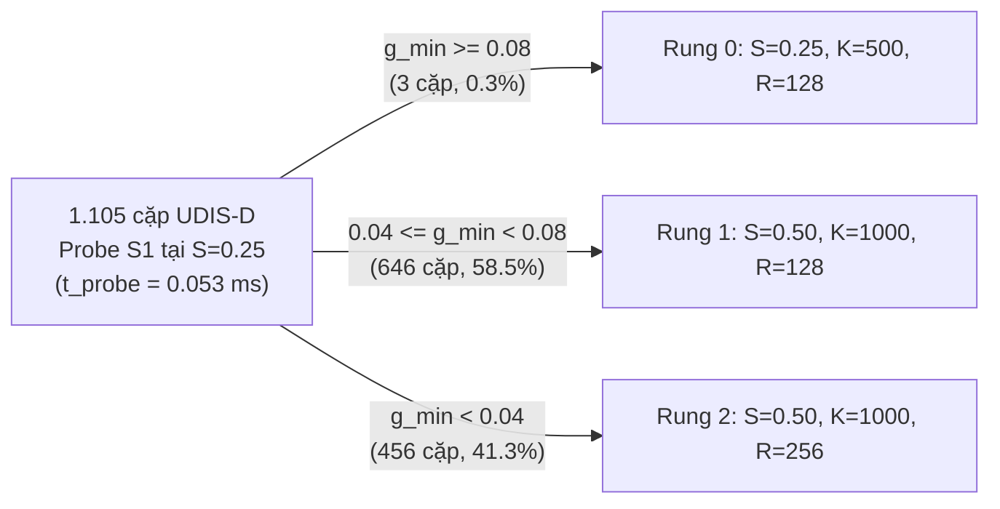

# S1: kết quả thực nghiệm Ablation A1 (S1 Probe Signal) trên Colab Tesla T4

- **Task:** Phase 3, task của Tuấn trong [kế hoạch](../plan.md), mục 8: Ablation A1 theo [đặc tả ablation](../experiments/ablation-studies.md), mục 2.1. Cách đo theo [quyết định đo A1](../decisions/p3-tuan-s1-a1-probe.md).
- **Người thực hiện:** Tuấn.
- **Ngày đo:** 06/11 (Thứ 6), năm 2026.
- **Nhánh:** `tuan/p3-s1-ablation-a1` (tách từ `main` `c876b12`).

## 1. Môi trường thực thi và thiết lập đo lường

| Mục | Giá trị quan sát trên Colab |
|---|---|
| GPU | NVIDIA Tesla T4 (`sm_75`), 15.360 MiB VRAM |
| Driver / CUDA / `nvcc` | Driver `580.82.07`, CUDA `13.0`, `nvcc 13.0.88` |
| Trình biên dịch C++ host | GNU `13.3.0`, cờ build `-O3 -DNDEBUG -arch=sm_75` |
| Xung nhịp khi đo | Graphics `1590 MHz`, Memory `5000 MHz`, công suất ~`42.2–42.5 W` |
| Seed RANSAC (S5) | `20261101` (cố định cho mọi biến thể và mọi repeat) |
| Giao thức lặp | 2 lượt warmup (`is_warmup = 1`, loại bỏ khi thống kê) + 10 lượt đo (`is_warmup = 0`) cho mỗi cặp ảnh |
| Quy tắc tổng hợp | Lấy median qua 10 repeat đo cho từng cặp ảnh trước, sau đó tính mean, median và p95 (nội suy tuyến tính) trên phân phối 1.105 cặp ảnh |

Tập dữ liệu đo là toàn bộ 1.105 cặp ảnh hợp lệ (`000002` đến `001106`, kích thước chuẩn `512 × 512` RGB) giải nén trực tiếp từ kho lưu trữ `testing.zip` chính thức của UDIS-D (SHA-256: `7e7b6c0b930a18e177b83409680f57077f7d92a84d3f66a26c81a03d4eea3478`; cặp `000001` bị khuyết `input1/000001.jpg` trong file nén gốc của tác giả nên `prepare_dev_dataset.py` tự động bỏ qua và lập chỉ mục đúng 1.105 cặp hợp lệ).

Lệnh chạy thực nghiệm và tổng hợp báo cáo:

```bash
python3 -m tools.colab_runner \
    --subset test1105 \
    --ablation-a1 \
    --seed 20261101 \
    --warmup 2 \
    --repeats 10 \
    --out-dir results/p3_a1_test1105

python3 -m tools.s1.a1_report \
    --in-dir results/p3_a1_test1105 \
    --json results/p3_a1_test1105/a1_summary.json \
    --markdown results/p3_a1_test1105/a1_report.md \
    --latex paper/tables/s1-a1.tex
```

## 2. Kết quả đo 4 biến thể Ablation A1 trên 1.105 cặp ảnh UDIS-D

Bảng dưới đây trích xuất trực tiếp từ `results/p3_a1_test1105/a1_summary.json` và `paper/tables/s1-a1.tex` (tổng cộng 53.040 dòng telemetry):

| Biến thể | Số cặp | Hoàn tất (%) | Retry (%) | Số attempt TB | $t_{\text{probe}}$ median (ms) | $t_{\text{ctrl}}$ median (ms) | $t_{\text{s1}}$ median (ms) | $t_{\text{e2e}}$ mean (ms) | $t_{\text{e2e}}$ median (p95) (ms) |
|---|---:|---:|---:|---:|---:|---:|---:|---:|---:|
| Adaptive with Probe (`legacy-v1`) | 1105 | 944 (85.4%) | 204 (18.5%) | 1.363 | 0.0531 | 0.0620 | 0.1615 | 4.931 | 4.716 (8.512) |
| Blind Escalation ($S_0=0.25$) | 1105 | 947 (85.7%) | 416 (37.6%) | 1.738 | 0.0000 | 0.0010 | 0.0390 | 3.031 | 2.286 (6.503) |
| Blind Escalation ($S_0=0.50$) | 1105 | 949 (85.9%) | 186 (16.8%) | 1.362 | 0.0000 | 0.0010 | 0.1110 | 4.789 | 4.530 (8.551) |
| Conservative High ($S=1.0, K=2000, R=1024$) | 1105 | 1072 (97.0%) | 0 (0.0%) | 1.000 | 0.0000 | 0.0000 | 0.3705 | 9.366 | 8.931 (17.497) |

Để đối chiếu bổ sung trên cùng phiên chạy Colab T4, cấu hình tĩnh `Fixed-Best` (`S = 0.75, K = 2000, R = 512`) trên 1.105 cặp UDIS-D hoàn tất `1.072/1.105` cặp (`97.0%`), thời gian `t_s1` median là `0.2320 ms`, và `t_e2e` mean / median / p95 lần lượt là `7.421 ms` / `6.669 ms` / `15.466 ms`. Trên tập pilot `dev25` (25 cặp), `Adaptive with Probe` đạt `t_e2e` median `5.080 ms` (p95 `7.525 ms`, `t_probe` median `0.0525 ms`), trong khi `Fixed-Best` có `t_e2e` median `7.476 ms` (p95 `15.766 ms`).

### 2.1. Bóc tách chi phí nội tại của Probe S1 trên GPU

Trong biến thể `Adaptive with Probe`, bước probe chạy trên cả hai ảnh đầu vào (ảnh A và ảnh B) ở tỷ lệ `probe_s = 0.25` (tức giảm từ `512 × 512` xuống `128 × 128` pixel cho mỗi ảnh):

| Thành phần thời gian | Mean (ms) | Median (ms) | p95 (ms) | Tỷ trọng trên $t_{\text{e2e}}$ median (`4.716 ms`) |
|---|---:|---:|---:|---:|
| S1 Probe Preprocess (`s1_preprocess` ở `S=0.25`, 2 ảnh) | 0.0389 | 0.0382 | 0.0436 | 0.81% |
| S1 Probe Gradient (`s1_compute_gradient`, Sobel + atomic reduction, 2 ảnh) | 0.0145 | 0.0145 | 0.0164 | 0.31% |
| Tổng GPU Probe (`t_probe` = Preprocess + Gradient) | 0.0537 | 0.0531 | 0.0580 | 1.13% |
| Host Controller + đồng bộ D2H (`t_controller`) | 0.0630 | 0.0620 | 0.0700 | 1.31% |

Nhận xét về chi phí GPU của S1 Probe:

- Riêng kernel tính độ dốc Sobel kèm rút gọn song song trong bộ nhớ chia sẻ (`s1_compute_gradient` cho hai ảnh `128 × 128`) chỉ tốn median `0.0145 ms` (`14.5 µs`, p95 `16.4 µs`), tức khoảng `0.31%` tổng thời gian toàn trình `t_e2e`.
- Cộng cả bước chuyển hệ màu và lấy mẫu song tuyến tính xuống tỷ lệ `0.25` (`t_probe_s1` median `0.0382 ms`), toàn bộ pha probe trên GPU chỉ hết `0.0531 ms` (`1.13%` của `t_e2e` median). Chi phí này nhỏ hơn một bậc độ lớn so với ngưỡng chấp nhận `< 15%` đặt ra trong đặc tả.
- Hơn nữa, nếu Controller quyết định bắt đầu attempt đầu tiên ở Rung 0 (`S_0 = 0.25`), cờ `prev_s == cur_knobs.S` trong `harness/pipeline_runner.cu` sẽ tái sử dụng trực tiếp hai ảnh xám `d_gray_a_`, `d_gray_b_` vừa tạo trong bước probe mà không cần gọi lại `s1_preprocess`.

### 2.2. Phân bố bậc thang khởi điểm và kết thúc



Phân bố cấu hình khởi điểm (`initial_rungs`) và cấu hình kết thúc (`final_rungs`) trên 1.105 cặp ảnh:

| Cấu hình (Rung) | `Adaptive with Probe` (Khởi điểm → Kết thúc) | `Blind Escalation (S0=0.25)` (Khởi điểm → Kết thúc) | `Blind Escalation (S0=0.50)` (Khởi điểm → Kết thúc) | `Conservative High (S=1.0)` (Khởi điểm → Kết thúc) |
|---|---:|---:|---:|---:|
| Rung 0: `S=0.25, K=500, R=128` | 3 → 2 | 1105 → 689 | 0 → 0 | 0 → 0 |
| Rung 1: `S=0.50, K=1000, R=128` | 646 → 612 | 0 → 230 | 1105 → 919 | 0 → 0 |
| Rung 2: `S=0.50, K=1000, R=256` | 456 → 287 | 0 → 0 | 0 → 0 | 0 → 0 |
| Rung 3: `S=0.75, K=2000, R=512` | 0 → 30 | 0 → 20 | 0 → 20 | 0 → 0 |
| Rung 4: `S=1.00, K=2000, R=1024` | 0 → 174 | 0 → 166 | 0 → 166 | 1105 → 1105 |

### 2.3. So sánh ghép cặp theo từng cặp ảnh (Paired Comparison)

Khi tính hiệu ghép cặp $\Delta t_{\text{e2e}} = t_{\text{e2e}}(\text{variant}) - t_{\text{e2e}}(\text{adaptive})$ trên từng cặp trong 1.105 cặp ảnh:

| Biến thể đối chiếu | $\Delta t_{\text{e2e}}$ mean (ms) | $\Delta t_{\text{e2e}}$ median (ms) | $\Delta t_{\text{e2e}}$ p95 (ms) | Tỉ số $t_{\text{e2e}}$ median (Variant / Adaptive) |
|---|---:|---:|---:|---:|
| `Blind Escalation (S0=0.25)` | -1.900 | -1.965 | +0.592 | 0.492× |
| `Blind Escalation (S0=0.50)` | -0.142 | -0.054 | +0.076 | 0.988× |
| `Conservative High (S=1.0)` | +4.435 | +4.830 | +9.954 | 2.115× |

## 3. Phân tích chuyên sâu: hiệu quả giảm retry và điểm nghẽn của bộ ngưỡng `legacy-v1`

Số liệu thực nghiệm trên tập UDIS-D (`test1105`) làm sáng tỏ ba kết luận quan trọng cho bài báo:

1. **So với Conservative High (`S = 1.0, K = 2000, R = 1024`):**
   - Việc dùng tín hiệu probe để khởi điểm ở `S = 0.50` giúp giảm một nửa thời gian toàn trình: `t_e2e` median giảm từ `8.931 ms` xuống `4.716 ms` (tiết kiệm ghép cặp median `4.830 ms`, tương đương hệ số `2.12×` ở median và giảm p95 từ `17.497 ms` xuống `8.512 ms`).
   - Đánh đổi của bộ quy tắc tự kiểm tra (`self_checks`) trong `legacy-v1` là có `161/1.105` cặp bị từ chối do `BUDGET_EXHAUSTED` (tỷ lệ hoàn tất `85.4%` so với `97.0%` của `Conservative High`, nơi pipeline không áp ngưỡng `self_checks` mà chấp nhận mọi homography không suy biến từ S5).

2. **So với Blind Escalation khởi điểm tại Rung 0 (`S_0 = 0.25`):**
   - Tín hiệu probe giảm một nửa tỷ lệ phải chạy lại (retry rate): từ `37.6%` (`416/1.105` cặp ở `blind_s025`) xuống còn `18.5%` (`204/1.105` cặp ở `adaptive`), đồng thời kéo số lần thử trung bình mỗi cặp từ `1.738` xuống `1.363`.
   - Nếu xét theo từng phân tầng độ dốc `g_min = min(probe_gradient_a, probe_gradient_b)`:
     - Ở nhóm ảnh ít chi tiết (`g_min < 0.04`, `N = 456` cặp): `blind_s025` có tỷ lệ retry lên tới `63.6%` (`290/456` cặp, số attempt trung bình `2.333`), trong khi `adaptive` nhờ nhảy thẳng lên Rung 2 (`S = 0.50, K = 1000, R = 256`) chỉ phải retry `37.1%` (`169/456` cặp, số attempt trung bình `1.697`).
     - Ở nhóm ảnh trung bình (`0.04 <= g_min < 0.08`, `N = 646` cặp): `blind_s025` phải retry `19.3%` (`125/646` cặp), còn `adaptive` khởi điểm ở Rung 1 chỉ phải retry `5.3%` (`34/646` cặp).
   - Tuy nhiên, một phát hiện thực nghiệm đáng chú ý là `blind_s025` lại có `t_e2e` median thấp hơn (`2.286 ms` so với `4.716 ms` của `adaptive`). Nguyên nhân là trên tập UDIS-D (`512 × 512`), độ dốc chuẩn hóa `g_min` ở tỷ lệ `0.25` nằm trong khoảng `[0.004, 0.087]` với median `0.044` và p90 `0.062`. Do ngưỡng chọn Rung 0 của `legacy-v1` đặt ở `g_min >= 0.08`, `adaptive` chỉ đưa `3/1.105` cặp (`0.27%`) vào Rung 0 và đẩy `99.73%` số cặp lên `S = 0.50` (nơi ảnh xám `0.25` của probe bị bỏ đi và phải chạy lại `s1_preprocess` ở `S = 0.50`, đồng thời S2–S6 xử lý diện tích pixel gấp 4 lần). Ngược lại, khi `blind_s025` thử đại ở Rung 0 (`S = 0.25`), có tới `689/1.105` cặp (`62.4%`) vượt qua được ngưỡng tự kiểm tra lỏng của Rung 0 (`min_inliers = 15, min_inlier_ratio = 0.15, max_residual_s1 = 4.0 px`) ngay ở lần thử đầu tiên với chi phí cực rẻ (~`2.18 ms`).

3. **So với Blind Escalation khởi điểm tại Rung 1 (`S_0 = 0.50`):**
   - Vì `adaptive` xếp `646` cặp vào Rung 1 (`S = 0.50, K = 1000, R = 128`) và `456` cặp vào Rung 2 (`S = 0.50, K = 1000, R = 256`), cả hai đều có cùng tỷ lệ `S = 0.50` và `K = 1000` như `blind_s050`.
   - Khác biệt duy nhất ở `456` cặp `g_min < 0.04` là `adaptive` khởi điểm ở Rung 2 (`R = 256`), mà Rung 2 trong `legacy-v1` lại áp ngưỡng tự kiểm tra khắt khe hơn Rung 1 (`min_inliers = 25, min_inlier_ratio = 0.20, max_residual_s1 = 3.0 px` so với `20, 0.15, 3.5 px` của Rung 1). Hệ quả là `18` cặp lẽ ra đạt yêu cầu ở Rung 1 bị Rung 2 đánh trượt và ép leo thang lên Rung 3/4, làm tỷ lệ retry của `adaptive` (`18.5%`) cao hơn nhẹ so với `blind_s050` (`16.8%`) và `t_e2e` median chênh `0.186 ms` (`4.716 ms` so với `4.530 ms`).

## 4. Ý nghĩa đối với thiết kế Cross-Stage Controller

Kết quả Ablation A1 cung cấp hai bài học thiết kế có giá trị trực tiếp cho workshop paper:

- **Về mặt kiến trúc GPU (S1 Kernel Design):** Kernel probe độ dốc Sobel ở độ phân giải giảm tải (`S = 0.25`) kết hợp rút gọn trong shared memory đạt chi phí cực thấp (`0.0145 ms` cho kernel gradient, `0.0531 ms` cho toàn bộ pha probe, bằng `1.13%` thời gian toàn trình). Do đó, việc trích xuất tín hiệu nội dung ảnh ngay trên GPU hoàn toàn khả thi và không tạo nút thắt cổ chai.
- **Về mặt chính sách điều khiển (Controller Calibration):** Một tín hiệu probe rẻ trên GPU chỉ chuyển hóa thành lợi thế latency toàn trình khi:
  1. Ngưỡng phân loại độ dốc (`scene_rules`) được hiệu chuẩn khớp với phân phối thực nghiệm của tập dữ liệu để tận dụng tối đa bậc thang `S = 0.25` (nơi kết quả tiền xử lý của probe được tái sử dụng 100% mà không tốn thêm `s1_preprocess`), và
  2. Các ngưỡng tự kiểm tra (`self_checks`) được giữ đơn điệu hoặc đồng nhất theo mục tiêu chất lượng cuối cùng, tránh việc chọn bậc thang khởi điểm cao hơn (như Rung 2 so với Rung 1) lại kích hoạt điều kiện từ chối khắt khe hơn làm tăng số lần retry.
